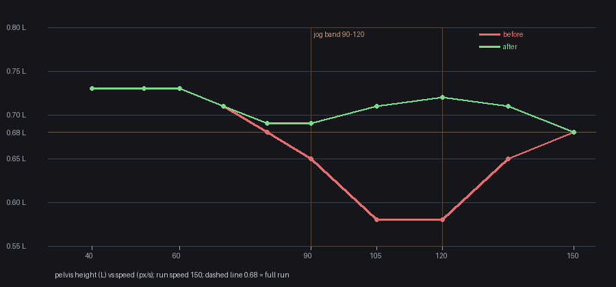
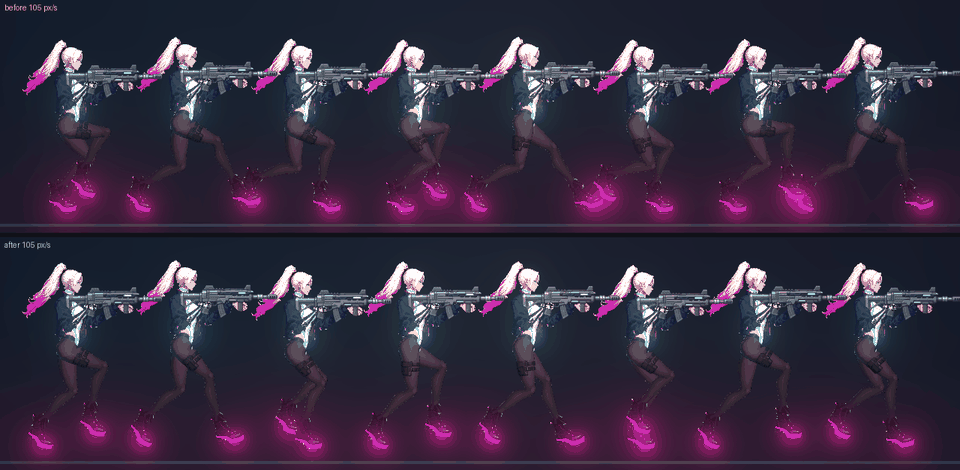
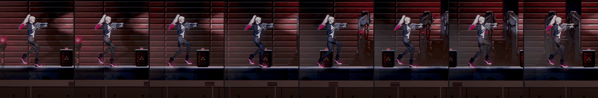
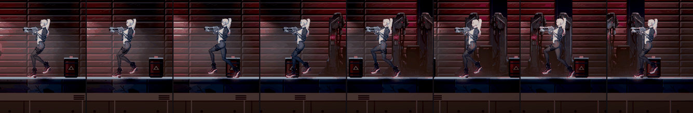
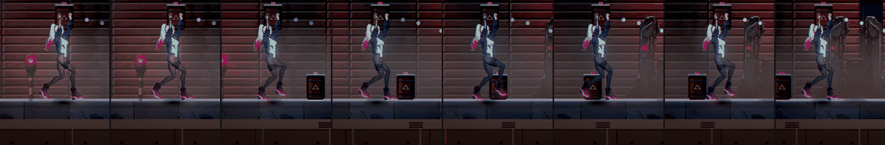

# [NE-481] 修好凜小跑時蹲過頭

> 狀態：完成

## 內文

### 需求
NE-480 量到主角凜慢走時偏蹲。先查清楚玩家實際在什麼速度看到她慢走，再修：
- 她的站姿是定案的持槍半蹲，不動
- 只修 90～120 px/s 的小跑段（手把半推、拿東西、倒退都會落在這裡）：骨盆不低於她滿速跑的高度（0.68 L），膝角跟著下來；從慢走到小跑到滿速跑的過渡連續，沒有哪一段突然下沉
- 步頻不能變成碎步，腳不滑
- 既有主角的測試全部不動、全過；新的走路量測對主角改成「不低於她自己的站姿」，另加小跑段的回歸檢查
- 倒退與拿東西各看一次

### 來源
2026-11-28，主 session 依 NE-480 的回報決定（選項 A）：「站姿不動……只修 90～120 px/s 的小跑段。」

### 驗收條件
- [x] 寫出玩家實際看到凜慢走與小跑的情況與速度
- [x] 小跑段（90、105、120 px/s）骨盆 ≥ 0.68 L；慢走與滿速跑不變
- [x] 過渡連續，沒有突然下沉；步頻沒有變快；腳不滑
- [x] 既有主角測試（平滑度、骨盆起伏、腳滑、NE-394／395／396、主角動作、骨架動作、動作稽核）全過，數值與測試沒有改
- [x] 走路量測對主角改成「不低於她自己的站姿」，跳過拿掉；小跑段的回歸檢查用修正前的資料當負控制會失敗
- [x] 倒退時膝與骨盆不比前進怪；拿東西時物件不穿進腿
- [x] 接點稽核（含外套）與動作稽核，新姿勢沒有比原本差
- [x] 關卡裡的實機連續圖（手把半推的小跑、倒退、拿東西各一條，遊戲倍率）、骨盆高度對速度的曲線修前修後、骨架預覽修前修後

### 測試流程
1. `godot --headless --path . res://tools/rig_locomotion_report.tscn -- --skin=rin --speeds=40,60,90,105,120,150`：看骨盆（hip）一欄
2. 截圖情境 `rin_gaits`：第一章倉庫，三條連續圖

---

# 跟其他票的關係

- Blocks：無
- Blocked by：無
- Related：NE-480、NE-208、NE-394、NE-395、NE-396

---

# Commit-1

## 內文

玩家實際看到凜不全速移動的情況（跑速 150 px/s）：手把半推（任何速度）、拿著東西 90～135（依物件重量，油桶 90、水泥塊 120、小貨箱 135）、倒退約 127、格擋中移動約 52、過場走位約 40～80。
量到的事實：她站著時骨盆 0.77 L、膝 49°（持槍半蹲的站姿），慢走（40～60）骨盆 0.73、膝 61°，只比站著低 1.5～1.8 像素，看起來蹲大部分是站姿本身；真正蹲過頭的是 90～120 的小跑段，骨盆掉到 0.58、膝 94°。原因：速度到跑速的七成以前，步態都還用走路的踩地比例（踩地時間長），步幅卻已經接近跑步，腿要搆到很遠，等高步態就把骨盆壓到很低。
改法：動作資料新增兩個選項，讓「騰空」（跑步的短踩地）可以提早開始、提早到位；預設值等於原本寫死的數字，其他角色完全不變。凜改成從跑速的 45% 開始、85% 到位。她的站姿、慢走（40～70）與滿速跑（150）的數字和修正前完全一樣。
結果（骨盆 L／膝角）：90 由 0.65／82° 變 0.69／72°，105 由 0.58／94° 變 0.71／70°，120 由 0.58／95° 變 0.72／67°，135 由 0.65／82° 變 0.71／71°；整條曲線落在 0.68～0.73 之間，相鄰兩個量測速度最多差 0.03 L，沒有下沉。這段不是嚴格單調（90 之後略升、到 150 回到 0.68），但都高於滿速跑。步頻維持原本的每秒 3.75 步（沒有變快）；腳滑 0；骨盆起伏 ≤ 0.054 L；平滑度（加速度峰值相對純正弦）最大 3.26，原門檻 3.5。
步頻沒有做到 2.4～2.8 Hz：要在 105 px/s 降到每秒 2.6 步，步幅得拉到和滿速跑一樣長，只要還有走路的踩地時間，骨盆就會再掉到 0.60～0.62（試過，數字在下面），和「骨盆 ≥ 0.68」互相衝突；所以保留原本的步頻，只確保不變快。
測試：走路量測對主角改成「不低於她自己的站姿」（骨盆最多比站姿低 0.06 L、膝最多多彎 15°），小跑段另加「90、105、120 的骨盆 ≥ 0.68 L」，並把凜改回修正前的騰空時機當負控制，會被擋下。原本的主角測試沒有改任何數值。
倒退（128 px/s，瞄左走右）：膝與骨盆和前進同一套，畫面上沒有怪動作。拿東西（油桶，90 px/s）：物件舉在頭上，不碰到腿。

### 測試結果

| 項目 | 結果 |
|---|---|
| 受影響範圍的測試 | 通過 69521 / 69521，0 個新失敗 |
| 流程探針 | 9 個：7 個通過；序章探針第一次有一個案例在結束時回報 1 筆渲染資源洩漏，重跑 27 個案例全過；手把存檔探針是已知的 Windows 路徑問題（玩法線處理中） |
| 主角動作、骨架動作、動作稽核 | 通過 10956 / 10956 |
| 移動動作測試 | 通過 188 / 188（含主角原本的平滑度、骨盆起伏、腳滑、步頻，與新的負控制） |
| 接點稽核（20 個接點含外套，30 格 × 兩面向 × 兩倍率，跑步姿勢改成 105 px/s） | 實際缺口 58（修前 62）；跑步姿勢的後膝缺口 4 → 0，頸部 10 筆修前修後相同 |
| 試過但沒採用（步幅指數 0.6，降步頻） | 105 的步頻每秒 3.25 步，但骨盆 0.60～0.62、腳滑 0.015 L |

| 速度（px/s） | 修前 骨盆 L／膝° | 修後 骨盆 L／膝° |
|---|---|---|
| 40～60 | 0.73／61 | 0.73／61 |
| 80 | 0.68／74 | 0.69／72 |
| 90 | 0.65／82 | 0.69／72 |
| 105 | 0.58／94 | 0.71／70 |
| 120 | 0.58／95 | 0.72／67 |
| 135 | 0.65／82 | 0.71／71 |
| 150 | 0.68／76 | 0.68／76 |

### 截圖

骨盆高度對速度（紅：修前，綠：修後；褐色橫線是滿速跑的 0.68 L，框起來的是小跑段）。

骨架預覽，105 px/s 一個步伐週期，上：修前，下：修後。

第一章倉庫，遊戲倍率，每 0.08 秒一張：手把半推的小跑（105 px/s）。

倒退（瞄左走右，128 px/s）。

拿著油桶走（90 px/s）。

