# [NE-48] 新增突襲型敵人

> 狀態：完成

## 內文

### 需求
電擊犬與偽裝箱。電擊犬成群出現、低吼蓄力後撲咬；偽裝箱平常是一個箱子，被打或靠近時彈起來咬人。新增後第一、二章的戰鬥種類更豐富。

### 來源
2026-10-03，使用者於開發對話中提出：「多設計幾種不同的敵人」；「這些都可以去看看目前業界有哪一些最佳實例可以參考，我們盡可能設計的貼近完整實際的 Demo」。設計見 `design/10-presentation/DESIGN.md`、`design/04-story/`。

### 驗收條件
- [x] 電擊犬：低吼與刨地蓄力後撲咬，成群出現；站上平台就安全，範圍武器有效
- [x] 偽裝箱：看起來是貨箱，被打時震動、靠近時彈起；用子彈試探或爆炸
- [x] 每種敵人的攻擊都有明確預兆，預兆在暗處自帶光、看得清楚
- [x] 每種敵人有敗北圖鑑卡片與攻略，數值在資料檔
- [x] 三種難度下都能擊敗，任何難度的預兆都不少於 0.3 秒
- [x] 已配置到關卡（第一章貨運站與第二章升降井、轉運站），並有第一次遭遇時的安全空間

### 測試流程
1. 在測試場地逐一遭遇，確認預兆與應對方式成立
2. 被每種敵人擊敗一次，確認圖鑑解鎖並顯示攻略
3. 在關卡裡確認配置
4. 執行完整測試套件，全部通過

---

# 跟其他票的關係

- Blocks：NE-54
- Blocked by：無
- Related：NE-28

---

# Commit-1

## 內文

第一、二章缺少「成群突襲」與「懷疑每一個箱子」的敵人。
現在新增電擊犬與偽裝箱。電擊犬三隻一群：第一隻發現玩家就低吼、前爪刨地（身體壓低、電弧在身上亂竄），並呼喚同伴，同伴的蓄力依序錯開，不會同時撲上來；蓄力後朝玩家所在的位置撲咬、電擊，落地後有硬直。牠們跳不高，玩家站上平台就撲不到，只能在底下打轉；一發範圍武器可以清掉一整群；撲出的瞬間完美格擋會讓牠暈眩。偽裝箱的外觀、大小與光影和貨箱一模一樣，不會比旁邊的真貨箱亮；外殼緊閉時子彈與近戰傷不了牠，只會讓牠震動、牙齒亮起而現形，爆炸則無視外殼；玩家走近時箱子先劇烈震動、縫裡透出燈光（預兆），再彈起來咬人；現形後守在原地，玩家保持距離就不會動。
兩種敵人都有敗北圖鑑卡片與攻略，數值在資料檔；任何難度的預兆都不少於 0.3 秒。已配置到第一章貨運站（一群電擊犬、醫療針旁的偽裝箱）與第二章升降井（一群電擊犬、一個偽裝箱）、轉運站（一群電擊犬、守著雷射槍的偽裝箱），第一次遭遇的左邊都留有空間，也避開了機關示範區與頭目戰場地。
驗收了什麼：在測試場地逐一遭遇，確認預兆與應對方式成立（成群呼喚與錯開蓄力、撲咬傷害、站上平台不受攻擊、下來後又會攻擊、範圍爆炸清群、暈眩中斷；偽裝箱不動不傷人、子彈試探現形但不受傷、現形後保持距離不會撲、靠近震動預兆與咬人、爆炸無視外殼、暈眩中斷）；被每種敵人擊敗一次會解鎖對應的圖鑑卡片；三種難度都能擊敗；關卡配置與安全空間。結果全數通過。

### 測試結果

| 項目 | 結果 |
|---|---|
| 完整測試套件 | 通過 3457 / 3457 |
| 資料驗證 | 0 錯誤 |
| 執行 log | 無 ERROR |

### 截圖

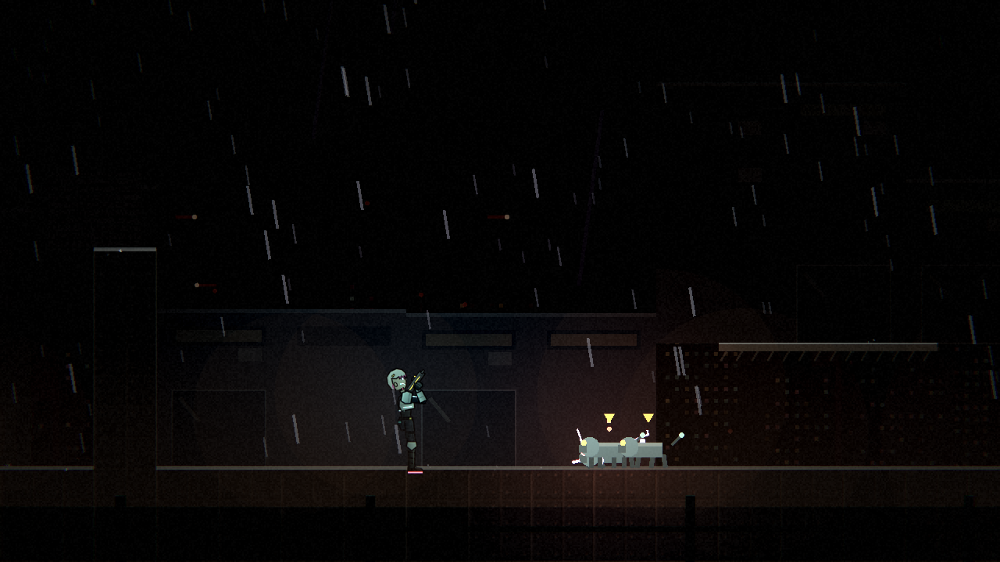

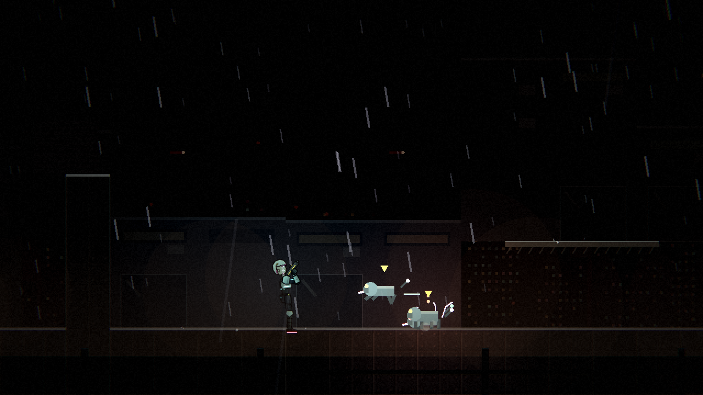

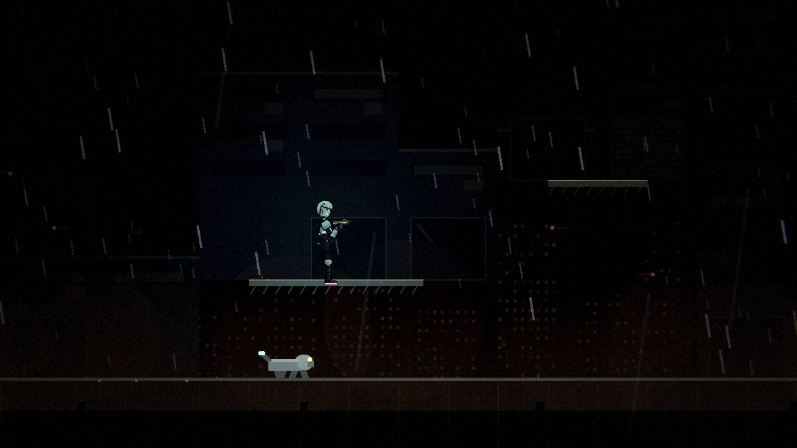

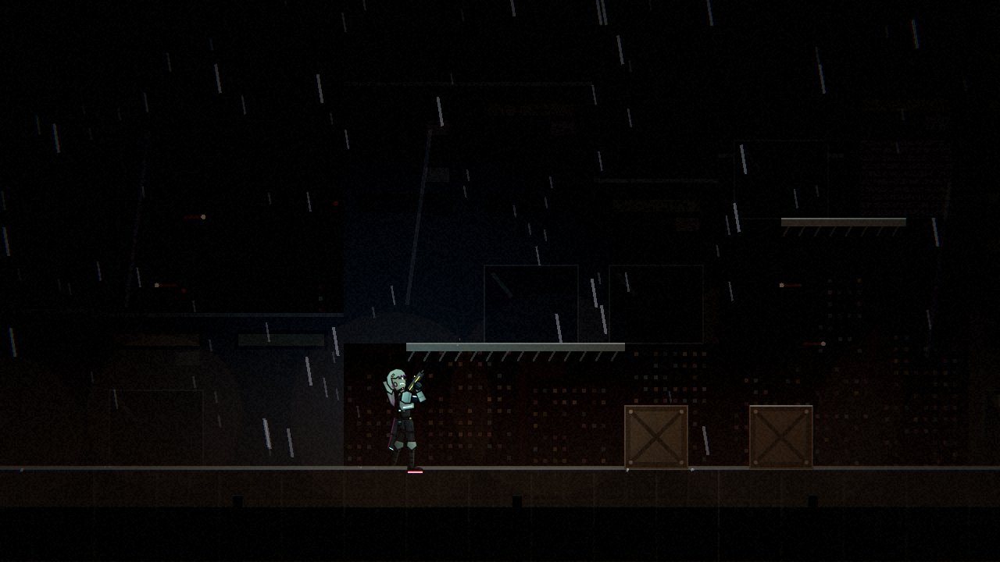

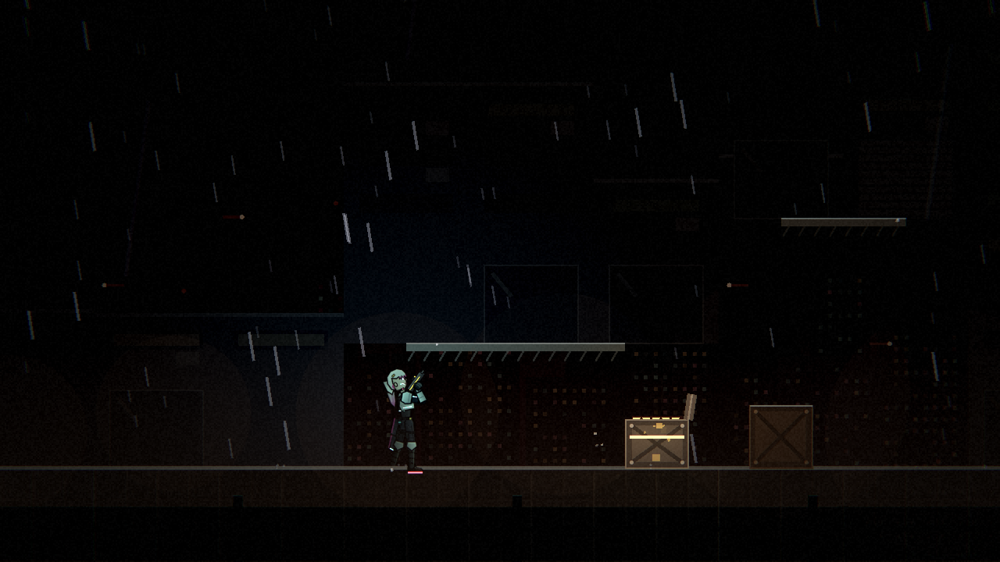

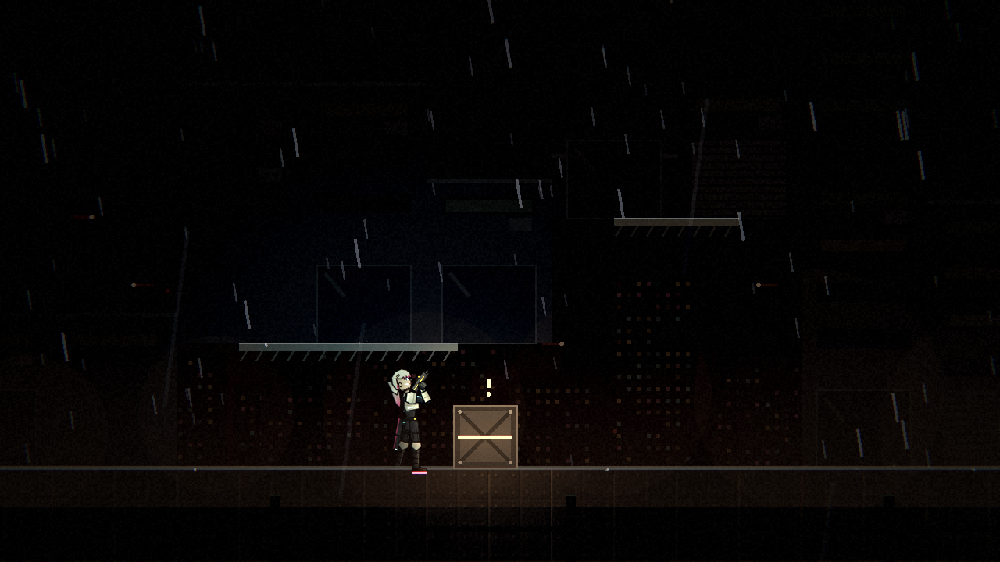

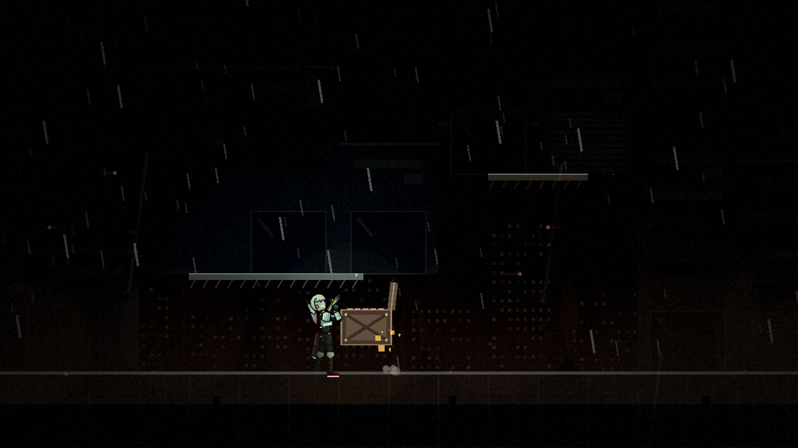

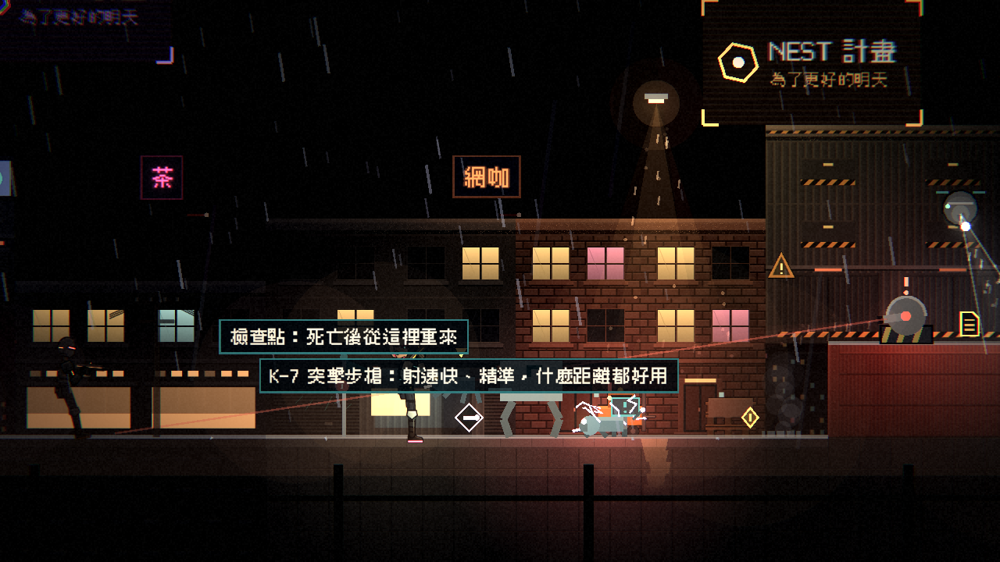

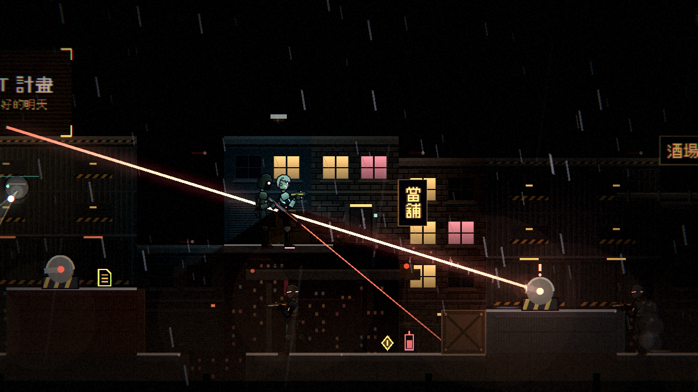

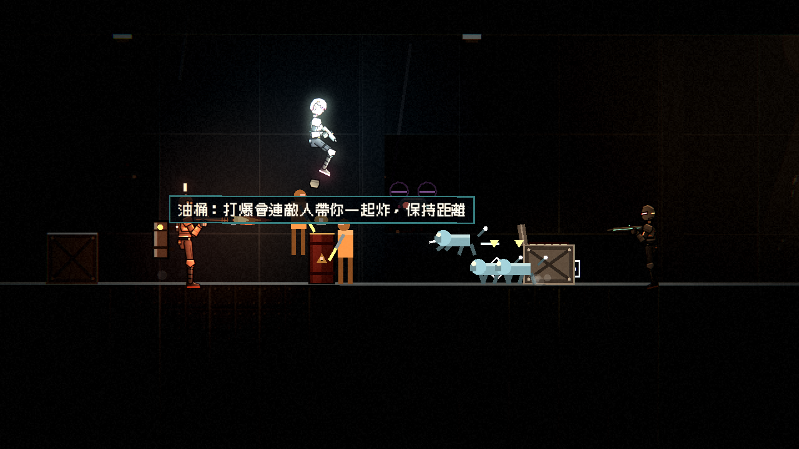

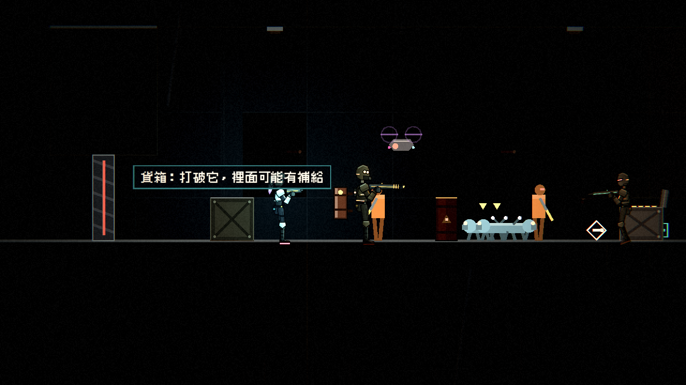
