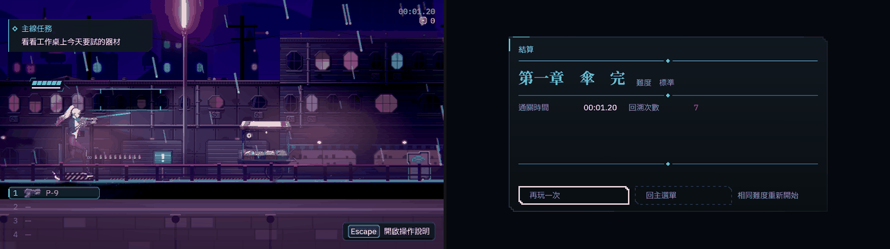

# [NE-490] 地點標示不壓在蓋住遊戲的畫面上

> 狀態：完成

## 內文

### 需求

NE-422 驗收時退回的缺陷：

1. 死亡畫面的截圖右下角有地點標示疊在面板上、壓到「回主選單」按鈕旁邊。地點標示在死亡畫面、結算、存檔提示、手把斷線這類蓋住遊戲的畫面出現時要隱藏（和暫停、背包、通訊同一套規則），圖層也要在這些畫面之下。要做成一份共用的判斷，不逐個畫面補。
2. 那一區的地名顯示成「第一章　雨夜」——地點標示應該是地點名稱。要找出把章名寫在地點名欄位的區域並修掉，加上檢查。

另外，畫面線回報第一章「當舖清晨」的可讀性取樣整張全黑，懷疑和章末畫面或轉場有關：要確認實際遊玩不會停在黑畫面；若只是工具太早取樣，要提供工具可以等的訊號。

### 來源

- 2026-11-28 主 session 驗收 NE-422 的退回意見。
- 2026-11-28 畫面線回報（經主 session 轉達）：當舖清晨的取樣全黑。

### 驗收條件

- [x] 蓋住遊戲的畫面（死亡畫面、結算、存檔被拒絕的提示、手把斷線、存檔的重試提示）都登記到同一個群組；地點標示用同一個判斷，任一個開著時藏起來並凍結
- [x] 地點標示的圖層在 HUD 之上、死亡畫面與所有選單之下
- [x] 自動檢查：死亡畫面、手把斷線提示開著時標示不可見，關掉後恢復；每一個蓋住遊戲的畫面都有登記
- [x] 區域的名稱欄位沒有章節標題；有自動檢查（中文、英文、日文名稱）
- [x] 實際遊玩從章末畫面接到結算不會停在黑畫面；章末畫面的黑底在沒有人接手時會自己淡掉並釋放
- [x] 截圖與量測工具有一個「目前有轉場或章末黑幕」的查詢可以等
- [x] 受影響的測試 0 個新失敗

### 測試流程

1. 在當舖附近死亡：死亡畫面出現時右下角沒有地點標示
2. 跑實際流程探針 `tests/probes/retry_flow.tscn`：章末畫面之後進到結算畫面，最後沒有殘留黑幕

---

# 跟其他票的關係

- Blocks：無
- Blocked by：無
- Related：NE-421、NE-422、NE-472

---

# Commit-1

## 內文

地點標示原本只在暫停、通訊時藏起來，死亡畫面、結算與各種提示出現時仍疊在上面（圖層也比死亡畫面高）。舊的開發用區域（第一章「雨夜」、第二章「天空的代價」）把章節標題寫在地名欄位，地點標示就顯示成「第一章　雨夜」。章末畫面收尾後黑底會一直留到關卡被換掉，單獨載入結尾區域的工具因此取樣到全黑。

現在：

- 所有蓋住遊戲的畫面登記到同一個群組，地點標示只問一個問題「遊戲現在有沒有被蓋住」（暫停、通訊、或任一個這類畫面顯示中），有就藏起來並凍結；圖層移到 HUD 之上、死亡畫面與所有選單之下。
- 兩個舊區域改成地點名稱（「下層港區」「升降井與夾層區」），並加上檢查：任何區域的中文、英文、日文名稱都不能是章節標題。
- 章末畫面的黑底仍然留給下一個畫面接手；如果 1.5 秒內沒有人接手（工具單獨載入、流程被拒絕），黑底淡掉並釋放，不會停在黑畫面。
- 實際遊玩已確認：從章末畫面接到結算畫面，最後沒有殘留的轉場或黑幕（流程探針，見 NE-472 Commit-2）。畫面線的全黑是工具在章末黑底還在時取樣；工具可以等 `UiLayers.presentation_busy(get_tree())` 變成 false 再取樣。

### 測試結果

| 項目 | 結果 |
|---|---|
| 呈現、介面元件、介面畫面、轉場、死亡流程、過場、存檔 | 4840 項檢查，0 個新失敗 |
| 實際流程探針（含章末到結算） | 25 項檢查全部通過 |

### 截圖

實際流程：章末畫面 → 結算畫面（沒有殘留黑幕）。

