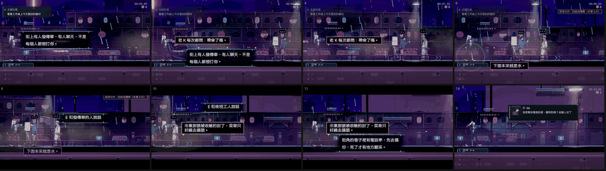
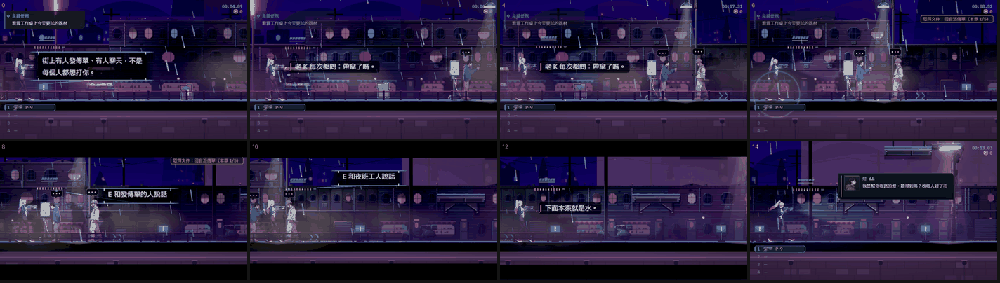
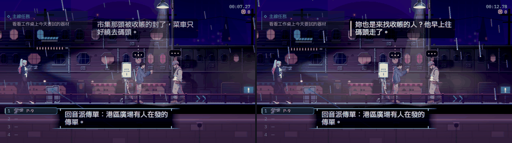

# [NE-491] 畫面上的文字輪流講不互相擠

> 狀態：完成

## 內文

### 需求

第一章港區街道（pm/ST/images/ST-59-street-chatter.png）同一個畫面上同時有三塊文字：街坊聊天的氣泡、互動提示「E 電話亭巷」、展開的教學看板，另外還有兩個「…」；教學看板的板子壓到互動提示。聊天氣泡是一大塊黑底細邊的矩形、字很大，被推開後尾巴對不到說話的人；凜自己的話甚至會被推到地面以下。

要訂出文字的交通管制，做成共用的管理：

1. 靠近主角的文字一次只有一個主要的在講話；優先順序是互動提示 > 正在進行的對話或通訊 > 街坊聊天氣泡 > 教學看板，低優先的延後，等高優先的結束再出現；任何兩塊文字不重疊。
2. 聊天氣泡縮小、不是黑色矩形，用字體系統的角色，尾巴對準說話的人；路過的閒聊和「對你說的話」在大小與存在感上要有差別（閒聊更小、更淡，可以不讀）。
3. 教學看板的版面歸畫面線，但什麼時候展開、會不會擋到別的文字歸這張；把對看板版面的需求寫出來轉交。

### 來源

- 2026-11-28 主 session 轉達（故事線 ST-59 的圖）。
- `design/22-living-scenes/PRESENTATION_AUDIT.md` 第 19 項。

### 驗收條件

- [x] 有一份共用的發言管理：想講話的文字（對凜說的話、路人閒聊、教學看板）每一格提出要求，只有優先順序最高的展開；互動提示不受限
- [x] 同一格畫面上展開的文字塊不超過兩塊（互動提示＋一個講話的）且互不重疊；有自動檢查
- [x] 教學看板在有人講話時不展開，講完才展開；有自動檢查
- [x] 氣泡同屏一個，下一句等前一句淡完
- [x] 氣泡不是黑色方框：圓角淡色底、尾巴指向講者頭頂；被擠高時有一條點線連到講者
- [x] 路人閒聊更窄、更淡；對凜說的話有講者顏色的細軌
- [x] 擠不下的氣泡在講者頭頂往上、頭的兩側找位置，不飛到地面以下或遠處；都沒有就等（不消耗閱讀時間），閒聊等太久安靜結束，對凜說的話等太久退回避讓後的位置
- [x] 對看板版面的需求寫進總檢文件
- [x] 受影響的測試 0 個新失敗；附港區街道同一段路的修前修後連續格，以及兩種氣泡的樣子

### 測試流程

1. 從港區街道入口往右走過 x27 一帶：同一時間只看得到一段話（加上可能的互動提示），一句講完才出下一句
2. 站在看板旁邊時有人講話：看板只亮著螢幕，話講完才展開說明
3. 看路人聊天的氣泡：比對凜說的話更小更淡，尾巴或點線指向講話的人

---

# 跟其他票的關係

- Blocks：無
- Blocked by：無
- Related：NE-425、NE-422

---

# Commit-1

## 內文

參考：Hollow Knight 的路人只在玩家靠近時冒一句、一次一個；Celeste 一次一個對話框、貼著講話的人；Hades 的路人閒聊是小字、不搶畫面，按鍵提示永遠在前面。取「一次只有一個在講話，按鍵邀請永遠優先，閒聊可以不讀」。

現在想講話的文字由同一份發言管理排隊：對凜說的話 > 路人閒聊 > 教學看板，互動提示不算講話、永遠可以顯示，位置照舊由提示的錯開規則避開彼此。教學看板在有人講話時只亮著螢幕，講完才展開。氣泡同屏一個，下一句等前一句淡完。

氣泡改成圓角的淡色底（沒有邊框）、尾巴指向講者頭頂；路人閒聊寬度較窄、整體較淡，對凜說的話左邊有一小段講者顏色的細軌。擠不下時在頭頂往上、頭的兩側找位置；被擠高時尾巴到講者頭頂之間有講者顏色的點線。都找不到位置就等，不消耗閱讀時間；路人閒聊等超過 6 秒安靜結束，對凜說的話等 12 秒後退回避讓後的位置照常顯示，場景不會卡住。

另外修正 NE-490 漏掉的一件事：改名的兩個舊區域讓預載索引對不上，已重建索引（另一個提交）。

### 測試結果

| 項目 | 結果 |
|---|---|
| 地圖氣泡、世界提示、呈現、介面畫面、場景人物、主流程 | 5826 項檢查，0 個新失敗 |
| 第一章地圖（含預載索引） | 通過 |

### 截圖

修前：港區街道同一段路（每隔約 1.2 秒一格）——氣泡、看板、互動提示同時擠在一起，凜的話被推到地面以下，大黑框的閒聊。

修後：同一段路——一次一段話，看板等氣泡講完；凜的話等互動提示讓出空間才出來。

兩種氣泡：路人閒聊（左，窄、淡）與對凜說的話（右，講者顏色細軌、點線指向講話的人）。

