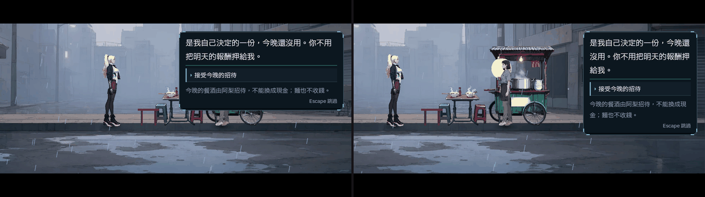
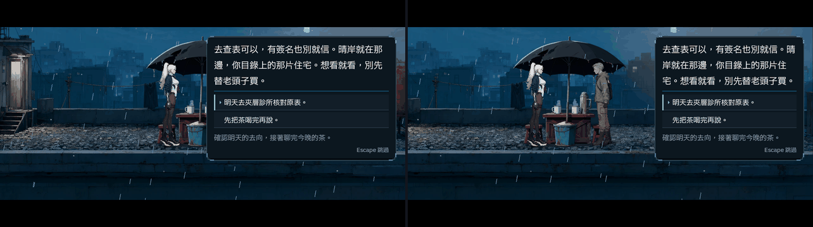

# [NE-492] 過場的文字框不蓋住講者

> 狀態：完成

## 內文

### 需求

第一章麵攤的過場（pm/ST/images/ST-60-ch1-stall-choice.png）：對話與選擇框是佔畫面右上四分之一的大方框，把說話的阿梨整個蓋住，只看得到她的腳；凜站在畫面中間偏左、背對著被蓋住的人。

規則：過場的對話框、選擇框不能蓋住正在說話的人與對話的對象；框的位置依講者在畫面上的位置決定，放不下時鏡頭讓位（平移或拉遠一點）而不是蓋上去。做成共用的擺放判斷並加檢查；先掃一遍所有過場、列出違反的句數，再修。框的外觀歸畫面線，位置與鏡頭歸演出線。

### 來源

- 2026-11-28 主 session 轉達（故事線 ST-60 的圖）。
- `design/22-living-scenes/PRESENTATION_AUDIT.md` 第 21 項。

### 驗收條件

- [x] 掃描所有章節有舞台的過場，列出舊的固定位置蓋住演員臉與上半身的步數
- [x] 對話框與選擇框依在場演員的位置挑不蓋住人的位置（對話框：下或上；選擇框：四個角，必要時用較窄的寬度）；目前位置可用就不換
- [x] 每個位置都蓋到人時，鏡頭平移或拉遠一點讓位，而且不拍到舞台背景圖以外
- [x] 播放器與靜態檢查用同一套算法；自動檢查所有過場的每一句台詞與每個選擇框都不蓋住在場演員
- [x] 「減少動態」時鏡頭讓位直接到位
- [x] 受影響的測試 0 個新失敗；附麵攤與一段兩人並排的過場修前修後

### 測試流程

1. 進到第一章麵攤的招待選擇：選擇框不蓋住阿梨，鏡頭稍微讓開，兩個人都看得到臉與上半身
2. 第二章屋頂喝茶的選擇：選擇框變窄放在旁邊，凜與鷺都看得到
3. 執行 `godot --headless --path . res://tools/text_box_scan.tscn`：每一章的「now」都是 0

---

# 跟其他票的關係

- Blocks：無
- Blocked by：無
- Related：NE-425、NE-491

---

# Commit-1

## 內文

參考：Celeste 的對話框貼著講話的人、在畫面上下切換；多數敘事遊戲的選項框放在不擋人的一側，人站到中間時鏡頭稍微讓開。取「框讓人，不是人讓框；真的讓不開時鏡頭讓」。

掃描五章 137 段有舞台的過場：舊的固定位置（對話框在下、選擇框在右上）有 34 步蓋住在場演員的臉或上半身（第一章 12、第二章 12、第三章 7、其他 3）。

現在播放器在每一句台詞與每個選擇框出現時，依在場演員的臉與上半身（頭頂往下身高的 55%）挑位置：對話框在下方，蓋到人時改到上方；選擇框依序試右上、左上、右下、左下，都不行時改用較窄的寬度再試；目前的位置還可以就不換，不會跳來跳去。每個位置都蓋到人時，鏡頭在 0.35 秒內往旁邊平移或拉遠一點讓位，而且不會拍到舞台背景圖以外；「減少動態」時直接到位。靜態檢查（掃描工具與自動測試）用同一套算法與真正的字型量選擇框大小，結果是 0 步。

### 測試結果

| 項目 | 結果 |
|---|---|
| 掃描工具（所有章節的過場） | 修前 34 步、修後 0 步 |
| 呈現、過場、章節過場、第二與第三章故事、劇本檢查、連續性、主流程 | 6236 項檢查，0 個新失敗 |

### 截圖

第一章麵攤的招待選擇：修前（左）選擇框蓋住阿梨；修後（右）選擇框變窄、鏡頭讓開，兩個人都看得到。

第二章屋頂喝茶的選擇：修前（左）鷺被選擇框蓋住；修後（右）凜與鷺都看得到。

