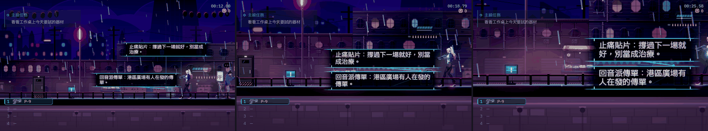
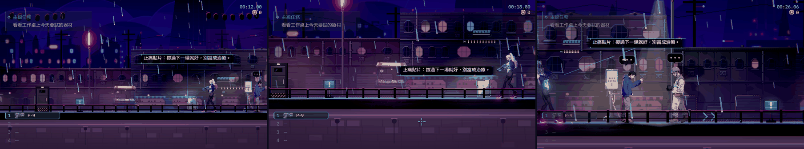
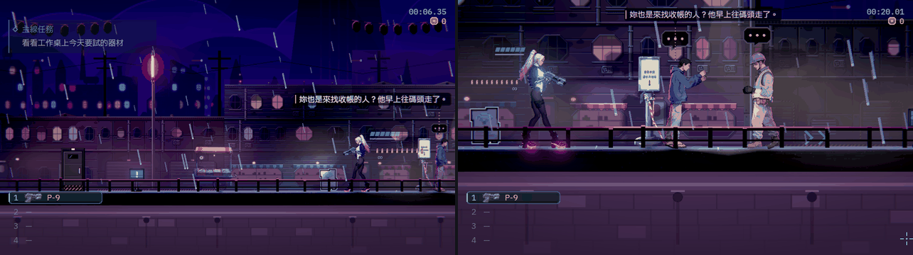

# [NE-493] 世界裡的文字在螢幕上的大小固定

> 狀態：完成

## 內文

### 需求

玩家要讀的字，在螢幕上的大小由字體系統的角色決定，不隨鏡頭遠近或區域的取景變大變小。位置仍然跟著世界裡的人或物（錨在世界座標），字級、最大寬度、行數是螢幕空間的。

1. 範圍：地圖氣泡、路人閒聊、拾取物的說明、互動提示的文字。訂出每一類的字體角色、最大寬度（路人閒聊不超過畫面寬 28%，對凜說的話與拾取說明不超過 36%）與最多行數。
2. 拾取物的說明不能比講話的氣泡優先，也不能蓋住正在講話的氣泡。
3. 做成共用的「錨在世界、大小在螢幕」元件，放在 ui/kit；畫面線之後把教學看板與全像提示牌接上（板子可以留在世界空間，板子上的字要用這個元件）。用法寫進 TYPOGRAPHY.md。
4. 檢查：在鏡頭最緊與最鬆的取景各量一次，同一類文字在螢幕上的字高相同（容許 1 像素）；720p、1080p、21:9 與文字放大 1.2 倍都要通過。

### 來源

- 2026-11-28 主 session 決定（NE-491 驗收時討論的「螢幕空間的字級」）。

### 驗收條件

- [x] 共用元件在 ui/kit，用法與每一類文字的角色、寬度、行數寫進 TYPOGRAPHY.md
- [x] 互動提示、拾取說明、對凜說的話、路人閒聊都用這個元件；字在螢幕上的大小等於字體角色的字級
- [x] 路人閒聊不超過畫面寬 28%，對凜說的話、拾取說明與互動提示不超過 36%
- [x] 拾取說明和氣泡輪流：有人講話時等講完再出現
- [x] 自動檢查：鏡頭倍率 1.4、1.92、1.92 拉近脈衝、2.4 之下，同一類文字的字高在 720p、1080p、21:9、文字 1.0 與 1.2 倍時相差不超過 1 像素
- [x] 自動檢查：所有地圖氣泡的台詞與拾取說明在文字 1.2 倍時不超過行數上限
- [x] 受影響的測試 0 個新失敗；附修前修後同一段在三種倍率下的截圖

### 測試流程

1. 第一章港區街道，靠近發傳單的人與地上的拾取物：互動提示、氣泡、拾取說明的字和 HUD 內文一樣大
2. 有人講話時站在拾取物旁邊：說明等氣泡講完才出來
3. 設定裡把文字放大到 1.2 倍：世界裡的文字跟著變大，仍在寬度上限內

---

# 跟其他票的關係

- Blocks：無
- Blocked by：無
- Related：NE-422、NE-491

---

# Commit-1

## 內文

參考：Hades、Hollow Knight 的對話與提示字在任何鏡頭距離都是同一個大小，跟著講話的人走；Celeste 的對話框不隨畫面縮放。取「位置跟著世界，大小跟著螢幕」。

原本世界裡的字是用世界像素畫的，會跟著鏡頭倍率放大：關卡倍率 1.92 時，9 像素的字在螢幕上約 17 畫面像素，比選單的內文（11）大一半以上；回憶舞台（1.4）和拉近時又不一樣大。

現在有一個共用元件「錨在世界、大小在螢幕」：位置仍是世界座標，字級、寬度、內距、框線是畫面像素，由字體角色決定。四類世界文字：互動提示、拾取說明、對凜說的話用內文（body），路人閒聊用說明小字（caption）；寬度上限是畫面寬的 36%、36%、36%、28%，最多 2、4、3、2 行（文字 1.2 倍時）。拾取說明最多 4 行，因為五件物品的說明在 1.2 倍時需要四行；物品文字沒有改。

拾取說明改成和氣泡輪流講話：有人講話時等講完再出現；附近同時有兩件拾取物時一次講一件。互動提示（按鍵邀請）維持永遠可以顯示。

### 測試結果

| 項目 | 結果 |
|---|---|
| 鏡頭倍率 1.4／1.92／1.92 脈衝／2.4 × 720p／1080p／21:9 × 文字 1.0／1.2 倍 | 同一類文字字高相差 0 像素，等於字體角色的字級 |
| 地圖氣泡台詞與拾取說明的行數（文字 1.2 倍） | 全部在上限內 |
| 呈現、地圖氣泡、世界提示、介面畫面、任務與地圖、戰鬥 HUD、拾取物、NPC、主流程 | 7100 項檢查，0 個新失敗（世界提示套件有一項舊檢查用世界像素量字高，改成量畫面像素後重跑通過） |

### 截圖

修前：同一段港區街道，鏡頭倍率 1.4、1.92、2.4（左到右）——拾取說明的字跟著鏡頭變大。

修後：同樣三種倍率，字的大小一樣，只有世界跟著變大變小；附近另一件拾取物等這一件講完才出來。

修後的氣泡：倍率 1.4（左）與 2.4（右），對凜說的話字高相同。

