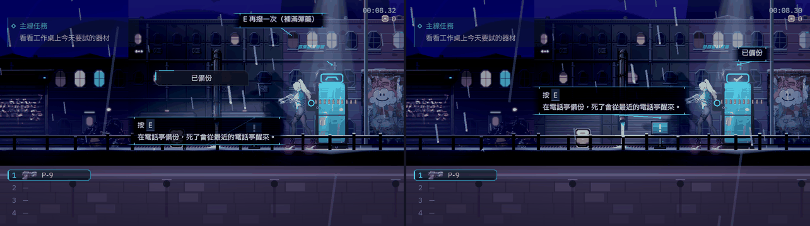
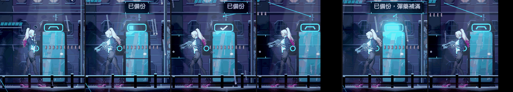
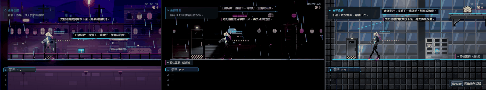
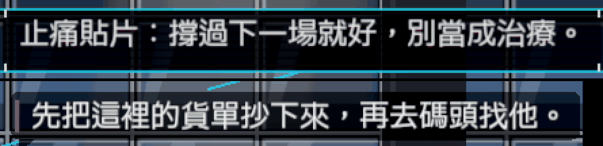

# [NE-494] 電話亭自己演出登記完成

> 狀態：完成

## 內文

### 需求

電話亭是全遊戲最常見的安全點。現在登記後，畫面上方中央出現一塊方框橫幅寫一句說明，和教學看板擠在一起，電話亭本身沒有回應。

1. 「登記完成」要由電話亭這個物件自己演出來（燈、聽筒、螢幕、一聲短音），文字只是輔助；取代畫面上方的方框橫幅。
2. 不擋操作；回訪（再撥一次）時更短。
3. 併入確認（NE-493 的後續）：世界文字從約 17 畫面像素降到內文的 11 後，在 720p、背景雜亂又下雨的場景裡會不會太小、太淡。在最不利的三個位置（第一章街道霓虹最多處、第四章紅光舊廠、第三章冷白辦公大廳）各量一次拾取說明與對凜說的話的文字對比（WCAG AA 4.5:1 同一套量法），不足就加強底板或字重，不把字級調回去；並放大看 720p 下中文筆畫有沒有糊。

### 來源

- 2026-11-28 主 session 轉達。
- `design/22-living-scenes/PRESENTATION_AUDIT.md` 第 4 項。

### 驗收條件

- [x] 登記完成時電話亭自己演：招牌螢幕填滿後亮出勾號、亭子的光漲起再穩、一聲短音；亭子上方一行字輔助
- [x] 畫面上方的方框橫幅拿掉（撥號的結果、話筒裡的標語、第一次死亡後醒來的「電話亭已登記」都改由電話亭說）
- [x] 演出時玩家已經可以操作；再撥一次時演出更短、聲音更輕、不再顯示標語字幕
- [x] 自動檢查：撥號後沒有畫面橫幅、亭子說了標語與結果、演出時玩家可以操作；再撥一次只說補滿彈藥；第一次死亡後醒來的那座亭子說「電話亭已登記」
- [x] 三個最不利位置的世界文字對比量過並寫進票；720p 放大看過中文筆畫
- [x] 受影響的測試 0 個新失敗；附修前修後與演出的連續格

### 測試流程

1. 第一章電話亭巷，走到電話亭按互動鍵：撥號後亭子的招牌填滿、亮出勾號，亭子上方出現「已備份」，畫面中央沒有橫幅；勾號亮著時已經可以走開
2. 再按一次：演出更短，上方出現「已備份，彈藥補滿」
3. 第一次死亡（診間劇情）後在電話亭醒來：亭子上方出現「電話亭已登記：之後死了，會從這裡醒來」

---

# 跟其他票的關係

- Blocks：無
- Blocked by：無
- Related：NE-121、NE-425、NE-493

---

# Commit-1

## 內文

參考：Hollow Knight 坐上長椅時長椅本身亮起、角色有動作；Celeste 的存檔點沒有任何文字；Dark Souls 點燃篝火只有第一次有置中大字。取「回應發生在檢查點本身，文字少而且只在第一次完整」。

撥號的動作照舊（拿起話筒、三聲撥號、話筒裡的錄音、掛上，約 1.1 秒）。掛上後由亭子自己演出登記完成：招牌的小螢幕由左往右填滿（像進度條），接著亮出勾號，最後淡回話筒圖示；亭子的光漲起再穩到已啟動的亮度；一聲短音。亭子上方的一行字只是輔助：第一次撥時先是話筒裡的標語「再來一次，沒關係。」，再換成「已備份」；再撥一次時演出縮短一半以上、聲音更輕，只顯示「已備份，彈藥補滿」，標語只剩聲音。原本的粒子爆開拿掉，只留一次光閃（特效克制）。演出期間玩家已經可以走動與戰鬥。

第一次死亡（診間劇情）後醒來時的「電話亭已登記：之後死了，會從這裡醒來」原本也是畫面上方的橫幅，改由醒來的那座亭子說；找不到亭子時才退回橫幅。

第一章第一座電話亭登記時還會播一段劇情錄音（「歡迎使用天穹備份服務，備份已經完成。」，通訊面板、會凍結畫面），這是故事線的場景，這張沒有動；它和亭子上方的字幕內容重疊，建議故事線決定要不要改成不凍結或交給亭子的聲音。

### 世界文字的對比（NE-493 的後續）

量法：在三個場景各把拾取說明放在畫面左、中、右三處，對凜說的話放在凜頭上，拍「有字」「沒字」兩格。實測：字的亮度對字後面底板最亮的部分（文字框上緣內側、偏亮的 90 百分位）。模型：底板顏色與不透明度疊在「沒字」那格同一塊範圍最亮的 5% 背景上，對字的顏色。

| 位置 | 拾取說明（實測／模型） | 對凜說的話（實測／模型） |
|---|---|---|
| 第一章港區街道（霓虹、下雨） | 12.2～17.2 ／ 15.5～16.5 | 15.9 ／ 16.8～17.3 |
| 第四章舊廠入口（鏽紅燈組） | 10.7～18.1 ／ 16.6～16.7 | 15.9～16.4 ／ 17.8 |
| 第三章辦公大廳（冷白接待燈） | 12.1～16.8 ／ 13.1～14.4 | 11.4 ／ 9.6 |

最差的是冷白大廳裡對凜說的話（模型 9.6:1）：氣泡底板有 18% 透明，白牆會透一點上來。全部高於 AA 的 4.5:1，也高於主要文字要求的高一階（7:1），所以底板與字重不用加強，字級維持內文。第四章舊廠入口取樣的位置偏暗；對比只取決於背景亮度，紅光的亮度低於冷白大廳，所以冷白大廳就是三處裡的最差情況。

720p 放大三倍看：內文 11（720p 是 22 像素）的中文筆畫清楚，「撐」「療」「碼」這類筆畫多的字也分得出每一筆，沒有糊成一團。

### 測試結果

| 項目 | 結果 |
|---|---|
| 電話亭、第一章與第二章地圖、第二章擴充、進度、道具、任務與地圖、介面畫面、投擲物、申請面板、呈現、主流程 | 9056 項檢查，0 個新失敗 |
| 死亡流程、電話亭（改了重生時的說明之後） | 149 項檢查，0 個新失敗 |
| 和最新 main 合併後：主流程、電話亭、死亡流程、呈現 | 3027 項檢查；NE-493 的一項檢查在機器忙時讀到還沒排好的氣泡，改成等氣泡排好後重跑通過 |

### 截圖

修前（左）：撥號後畫面中央一塊「已備份」方框，和教學看板擠在一起。修後（右）：亭子的招牌亮出勾號，上方一行「已備份」。

電話亭的演出（左到右）：通話中、招牌填滿、勾號、回到已啟動；再撥一次（較短）：填滿與「已備份，彈藥補滿」、結束。

世界文字在三個最不利的場景（左到右：第一章港區街道、第四章舊廠入口、第三章辦公大廳）。

冷白辦公大廳 720p 放大三倍：拾取說明與對凜說的話的中文筆畫。

