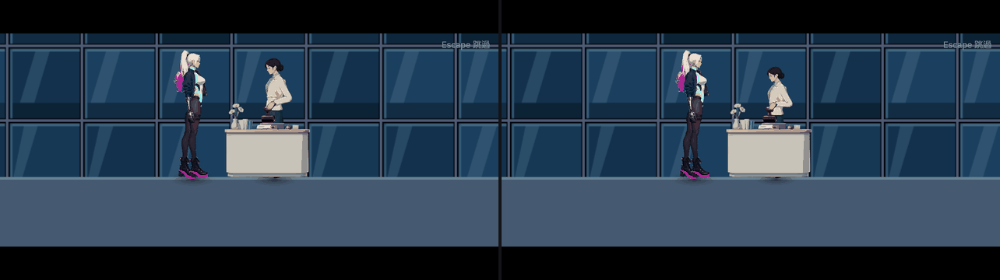

# [NE-496] 過場裡同一個角色的身高前後一致

> 狀態：完成

## 內文

### 需求

總檢第 21 項的自動掃描找到，同一個角色在不同過場裡換算回世界尺寸後的身高不一致：第三章 9 段過場裡老K只有凜的 0.79 倍（其他過場是 0.99），林小姐在一段裡和凜的身高比也偏了。修到一致；資料是故事線的產生器輸出的，改在來源。

### 來源

- 2026-11-28 主 session 轉達。
- 總檢第 21 項（NE-495）第一輪自動掃描的第 9 項「角色比例一致」。

### 驗收條件

- [x] 逐段查過被標出的過場，分清楚是資料錯誤還是刻意的前後景深
- [x] 資料錯誤的改在產生器來源，重新產生輸出，輸出只有該改的那一個數字不同
- [x] 掃描工具不再把刻意的景深算成比例不一致
- [x] 受影響的測試 0 個新失敗；附修前修後

### 測試流程

1. 第三章晴岸接待桌收件章的過場（ch3_t_c15_posted）：林小姐和凜站在同一條地面線上，林比凜矮一點，和看房的兩段一致

---

# 跟其他票的關係

- Blocks：無
- Blocked by：無
- Related：NE-495

---

# Commit-1

## 內文

逐段查了被標出的 10 段：

- 老K在第三章的 9 段（ch3_t_c18～c20）不是資料錯誤：那是辦公大廳隔著玻璃的會議室，老K與葉站在玻璃後的室內，腳底比走廊上的凜高 15 像素，產生器裡寫明了「室內兩人在玻璃後一兩公尺」，縮放 2.4 對凜的 2.95 是刻意的前後景深。截圖看過，室內兩人彼此比例正確、讀得出是在玻璃後面，所以不改。
- 林小姐在接待桌收件章的那一段（ch3_t_c15_posted）是資料錯誤：林和凜站在同一條地面線上，林的身高是凜的 0.96 倍；看房的兩段（晨光、午後窗邊）都是 0.89 倍。改在產生器來源 `tools/story/showroom_stamp_staging.py`（林的縮放 2.22 → 2.06，寫成具名常數並註明理由），用 `tools/story/build_ch3_story.py` 重新產生 `data/story/ch3_clearwater.json`，輸出只差這一個數字。林手上的收件章仍然拿得到、蓋得到。

掃描工具同時修正：只比較站在同一條地面線上（腳底高度相差 4 像素以內）的兩個角色的身高比，刻意的景深不再被算成比例不一致。重掃後第 9 項剩 3 段：老K在當舖前門與櫃檯的舞台被放大到凜的 1.02 倍，在開場與第四章回家的過場是 0.96 倍，相差約 6%，接近門檻，列在總檢表上等決定，這張沒有改。

### 測試結果

| 項目 | 結果 |
|---|---|
| 第三章故事、章節過場、過場 | 2702 項檢查，0 個新失敗 |
| 產生器重新產生 | 只有 ch3_clearwater.json 的一個縮放值不同 |

### 截圖

晴岸接待桌：修前（左）林幾乎和凜一樣高；修後（右）林比凜矮一點，和看房的過場一致。

