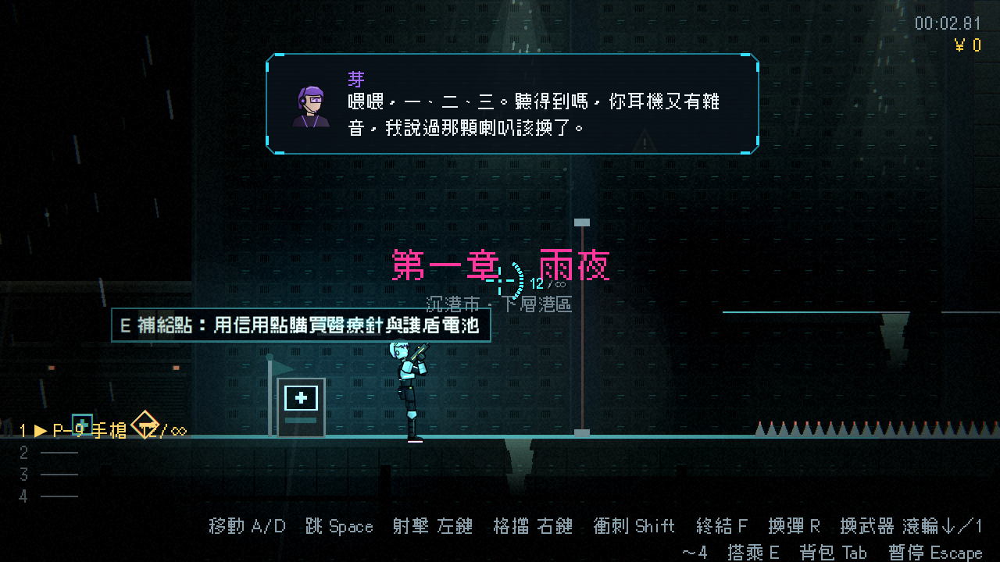
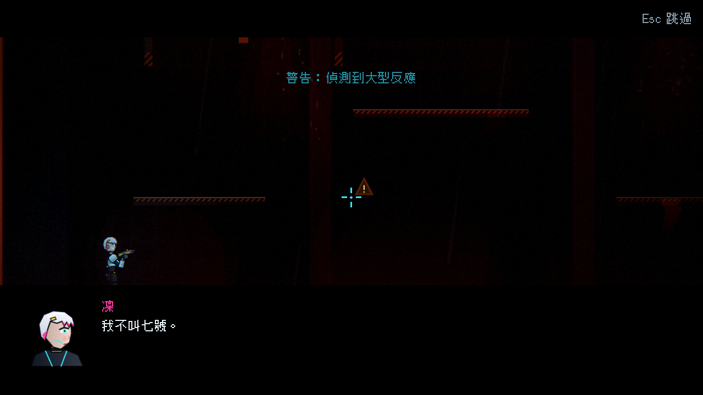

# [NE-49] 重寫第一章劇本並補上更多內容

> 狀態：完成

## 內文

### 需求
第一章的台詞像在念操作說明與金句，內容也不夠多。依新的故事聖經與風格指南重寫，並補上場景人物、更多通訊、收集品與細節。

### 來源
2026-10-03，使用者於開發對話中提出：「完善目前的劇情設計，整體起承轉合可以參照邊緣行者、尼爾之類類似宿命論這種」「劇情最好要有暗線、伏筆等等更有深度的設計」；「文本盡量減少AI感，可以看看實際文本內容應該是什麼」「`監視蜂在頭頂`這種句子就很AI味」。設計見 `design/10-presentation/DESIGN.md`、`design/04-story/`。

### 驗收條件
- [x] 依場景清單寫完第一章全部場景：片頭、開場、通訊、場景人物對話、頭目登場、結尾
- [x] 所有台詞通過劇本品質檢查（教學詞、對比句型、破折號、省略號、驚嘆號、書面連接詞、空泛大詞、單句長度）
- [x] 對白不教操作；每個講者有各自的聲音（句長、口癖、毛病）
- [x] 第一章要埋的伏筆（F01、F03、F04、F05、F06、F08、F09、F10、F11、F12、F13、F14）都有對應的文字或細節
- [x] 第一章收集品增加到 5 件，文字符合風格
- [x] 原有的劇情觸發、劇情道具取得與收集進度功能不變

### 測試流程
1. 完整玩一遍第一章，逐段閱讀台詞
2. 執行劇本品質檢查
3. 對照伏筆表確認埋設點
4. 執行完整測試套件，全部通過

---

# 跟其他票的關係

- Blocks：NE-52
- Blocked by：NE-34、NE-45
- Related：NE-26

---

# Commit-1

## 內文

第一章的台詞像在念操作說明與金句，內容也不夠多。
現在第一章依故事聖經與風格指南重寫：
- 開場：氣象預報報了凌晨三點十二分的停雨，老K報「四萬三」、問手沒事吧，航咳嗽之間哼著沒有歌詞的調子、問能不能順便看天空，凜只回「順便」。
- 十則通訊：芽接上線、屋頂嘴砲、看板在凜站著不動時換詞、芽數出她站了十一秒、盾牌那隻、氣象剛好講到市集、老K知道壁壘的鑰匙在哪、「七號」資料夾、義體跳雜訊、貨櫃前老K說到一半的「算了」。
- 麵攤阿婆與夜班工人各兩段對話（第一次與之後再來）：阿婆講十年前老K揹著兩個孩子、沒看過雨停；工人講上禮拜也有人來領同一個貨櫃。
- 頭目登場：監管者客客氣氣地說歡迎回家，名單念到十六號為止。結尾：六十二％、凜說「船票不買了」、芽說「停了」。
原本教操作的句子（瞄準線、舉盾、往斜上方射擊）、格言（「有錢人住在雲上面」「從來就不是船票」）與「不是……是……」句型全部改掉，凜、芽、老K、阿婆、工人、監管者各有自己的句長與口癖。第一章的收集品是 5 件（宣傳單、貨運清單、老K的語音、航的蠟筆畫、工人的交班紙條），道具文字（照片的接縫、晶片的 91,000、委託單的青色印章、貨運清單的簽收人 K…）一併重寫，每件在 220 字內。伏筆表第一章列的 F01、F03、F04、F05、F06、F08、F09、F10、F11、F12、F13、F14 都有顯有隱的埋設點，對照表放在 `design/04-story/FORESHADOWING.md`。
新增劇本品質檢查：把風格指南的自動檢查（教學詞、對比句型、破折號、省略號、驚嘆號、書面連接詞、空泛大詞、單句長度、抽象名詞密度、講者長度與一致性）做成檢查器，掃描所有場景台詞、動畫過場的台詞、道具文字與章節卡，錯誤與警告等級照指南；遊戲啟動時檢查，也能用命令列列出全部問題。章節卡預告的破折號一併改掉，第二章既有文字中違規的省略號與破折號也先修到通過。
驗收了檢查器本身（好句通過、每種壞句被抓到、門檻與等級正確）、全部劇本與道具文字零錯誤零警告、場景清單與伏筆埋設點、講者聲音（凜的句子最短），以及原有的劇情觸發、劇情道具取得與收集進度。

### 測試結果

| 項目 | 結果 |
|---|---|
| 完整測試套件 | 通過 3291 / 3291 |
| 資料驗證 | 0 錯誤 |
| 執行 log | 無 ERROR |

### 截圖

