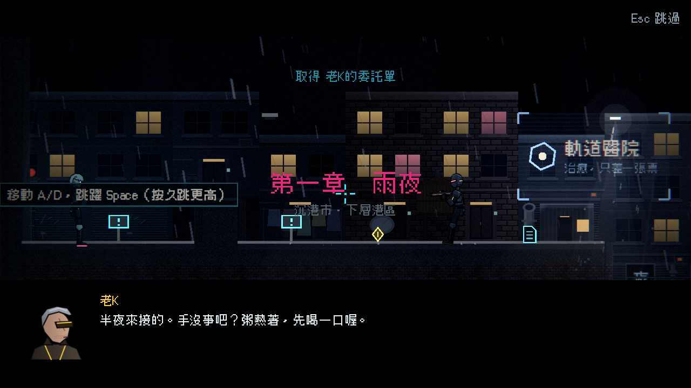
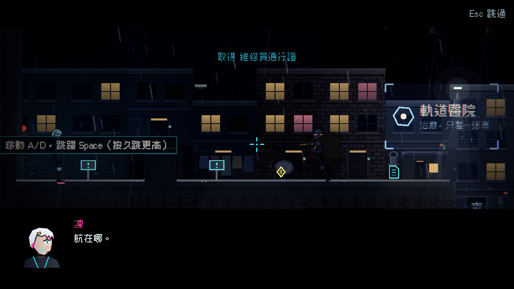
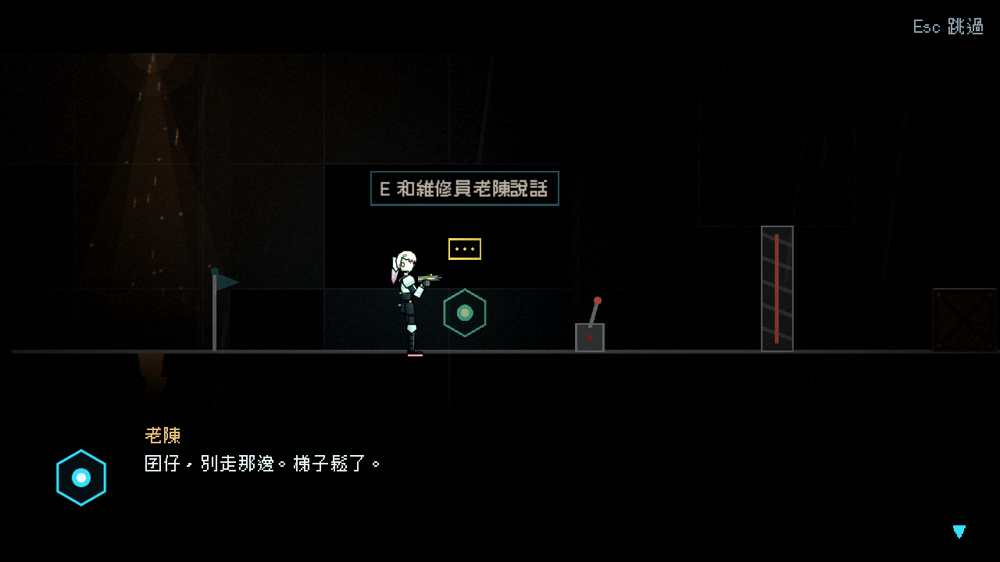

# [NE-50] 重寫第二章劇本並補上更多內容

> 狀態：完成

## 內文

### 需求
第二章的劇本同樣需要依新風格重寫，並補上場景人物、更多通訊、收集品與回收伏筆。

### 來源
2026-10-03，使用者於開發對話中提出：「完善目前的劇情設計，整體起承轉合可以參照邊緣行者、尼爾之類類似宿命論這種」「劇情最好要有暗線、伏筆等等更有深度的設計」；「文本盡量減少AI感，可以看看實際文本內容應該是什麼」「`監視蜂在頭頂`這種句子就很AI味」。設計見 `design/10-presentation/DESIGN.md`、`design/04-story/`。

### 驗收條件
- [x] 依場景清單寫完第二章全部場景：開場、通訊、場景人物對話、記憶、迷你頭目、頭目登場、結尾
- [x] 所有台詞通過劇本品質檢查
- [x] 對白不教操作；每個講者有各自的聲音
- [x] 第二章要埋與要回收的伏筆（F02、F04、F07、F08、F10、F11、F14、F15、F16、F17、F18）都有對應的文字或細節
- [x] 第二章收集品增加到 7 件，文字符合風格
- [x] 原有的劇情觸發、劇情道具取得與收集進度功能不變

### 測試流程
1. 完整玩一遍第二章，逐段閱讀台詞
2. 執行劇本品質檢查
3. 對照伏筆表確認埋設點
4. 執行完整測試套件，全部通過

---

# 跟其他票的關係

- Blocks：NE-53、NE-54
- Blocked by：NE-34、NE-45
- Related：NE-26、NE-49

---

# Commit-1

## 內文

第二章的劇本同樣有教學口吻與格言，內容也不夠多。
現在第二章依新風格重寫：
- 開場：管制通告、老K說「半夜來接的」並問手、粥熱著凜沒回、老K說「不准去」卻交代通行證在左邊抽屜，芽念出名單上航旁邊寫的是「準備中」。
- 十二則通訊：芽說「這條路我熟」、說到上面停一下，升降井、燃料桶、老K說這條井他天天爬，牆裡有人在哭（芽說是管線）、芽說「這條走廊我走過，我是說圖紙上」，電力室、維修機、老K說別回頭，轉運站太安靜。航的兩段語音都有很大的房間與哭聲。
- 記憶：電梯說歡迎回家，童聲數到十六，凜說手在抖。回收員第一次現身：隔著玻璃說依規定該動手，今天不用。
- 場景人物：維修員老陳（十年前的推車、有人在數數）、夾層區住戶（每晚九點帶孩子去健康檢查）、轉運站護理師（把凜當成回來的七號）、牆上的刻痕（07 那道到肩膀），各有兩段以內的對話。
- 頭目登場：回收員先唸流程，說「我是五號，你是第六個」。結尾：空床、還是暖的手環、老K說那條線是他接的、凜說「上來再說」。
- 為還沒做出來的回收燈幕與看守長先寫好通訊文字，等關卡橋段完成後接上。
原本的教學句（紅桶是燃料、通電的格子會閃黃燈、先打掉維修機）、格言（「這條路要付多少，我都付」）與省略號、破折號全部改掉。第二章的收集品是 7 件（新增護理師給的十二號床交接單），道具文字（名冊的 05 與 91,000、手環內側的接點、通行證旁涼掉的粥…）一併重寫，每件在 220 字內。伏筆表第二章列的 F02、F04、F07、F08、F10、F11、F14、F15、F16、F17、F18 都有顯有隱的埋設點（對照表在 `design/04-story/FORESHADOWING.md`）。
驗收了全部劇本與道具文字零錯誤零警告、場景清單與伏筆埋設點、第二章必須存在的細節（牆內哭聲、走廊、刻痕、暖的手環），以及原有的劇情觸發、劇情道具取得與收集進度。

### 測試結果

| 項目 | 結果 |
|---|---|
| 完整測試套件 | 通過 3491 / 3491 |
| 資料驗證 | 0 錯誤 |
| 執行 log | 無 ERROR |

### 截圖

