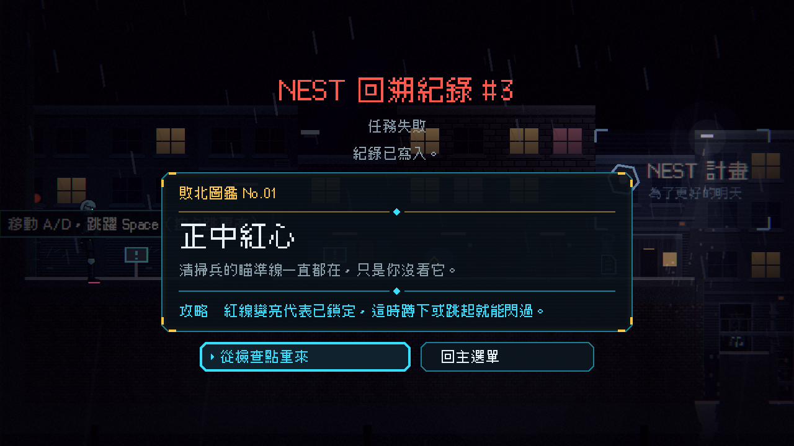
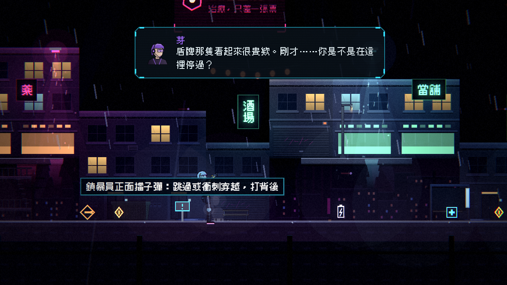
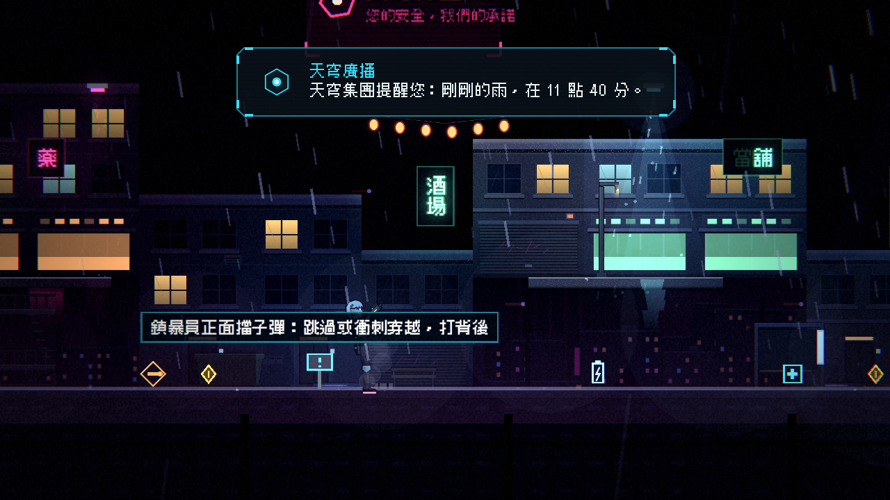

# [NE-51] 加入依死亡次數變化的劇情與回溯紀錄

> 狀態：完成

## 內文

### 需求
玩家的失敗目前只是重來。依故事設計，每次重來是劇情的一部分：死亡畫面顯示回溯編號，累計死亡到一定次數，通訊與廣播的措辭會有細微變化。

### 來源
2026-10-03，使用者於開發對話中提出：「完善目前的劇情設計，整體起承轉合可以參照邊緣行者、尼爾之類類似宿命論這種」「劇情最好要有暗線、伏筆等等更有深度的設計」。設計見 `design/10-presentation/DESIGN.md`、`design/04-story/`。

### 驗收條件
- [x] 死亡畫面顯示「NEST 回溯紀錄 #n」，n 是本輪累計的死亡次數
- [x] 劇本可以為場景設定「死亡次數達到 N 次時改用的台詞」，資料檔即可設定
- [x] 依伏筆表的死亡次數反應表，在對應次數有對應的變化（3、8、15、30、50 次）
- [x] 變化只影響措辭，不影響流程與難度；重新開始新的一輪時次數歸零
- [x] 死亡次數存進檢查點之外的本輪進度，重來不會歸零

### 測試流程
1. 故意死 3、8、15 次，確認每個門檻的變化
2. 開始新的一輪，確認歸零
3. 執行完整測試套件，全部通過

---

# 跟其他票的關係

- Blocks：無
- Blocked by：NE-34
- Related：NE-36、NE-49、NE-50

---

# Commit-1

## 內文

玩家的失敗原本只是重來，死亡畫面寫「回溯 #n」。
現在死亡畫面與重來的雜訊轉場都寫「NEST 回溯紀錄 #n」，n 是本輪累計的死亡次數；這個次數屬於本輪進度，不存進檢查點，回溯、重開關卡、殘機用盡重來、換到下一章都不會歸零，只有開始新的一輪才歸零。
劇本資料可以為場景設定「死亡次數達到 N 次時改用的台詞」（資料檔即可設定，取達到的最高一組），也可以設定死亡畫面的小字、死亡重生後播出的通訊、台詞顯示前的沉默秒數，以及台詞裡的「剛剛死掉的時間」。依伏筆表的反應表做出了變化：
- 3 次：死亡畫面標題下多一行不解釋的小字「紀錄已寫入。」
- 8 次：芽的通訊多一句「剛才……你是不是在這裡停過？」，凜回「沒有。」（第一章三則、第二章三則）
- 15 次：老K少一句碎念，只剩「你臉色很差。」（第一章兩則、第二章兩則）
- 30 次：死亡重生後，天穹廣播念出剛剛死掉的世界時間：「剛剛的雨，在 11 點 40 分。」每次重生都念
- 50 次：重生後芽說「我先關一下。」，十秒後說「回來了。」，沒有說原因，只發生一次
這些變化只影響措辭：場景的觸發位置、一輪只播一次、道具取得、難度與流程都不變；壞掉的資料啟動時指出「哪個場景的第幾個死亡變化」，執行時退回正常台詞。資料格式寫在 `design/10-presentation/DESIGN.md` 第九節。
驗收了死亡次數不隨檢查點回溯、新一輪歸零，每個門檻（3、8、15、30、50 次）的變化，重生後的廣播與沉默，死亡畫面的標題與小字，變化台詞同樣通過劇本品質檢查，以及壞資料的容錯。

### 測試結果

| 項目 | 結果 |
|---|---|
| 完整測試套件 | 通過 3641 / 3641 |
| 資料驗證 | 0 錯誤 |
| 執行 log | 無 ERROR |

### 截圖

