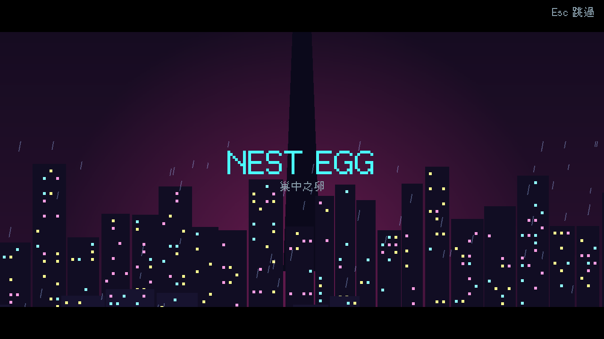
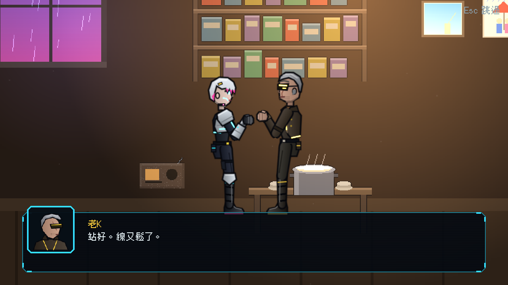
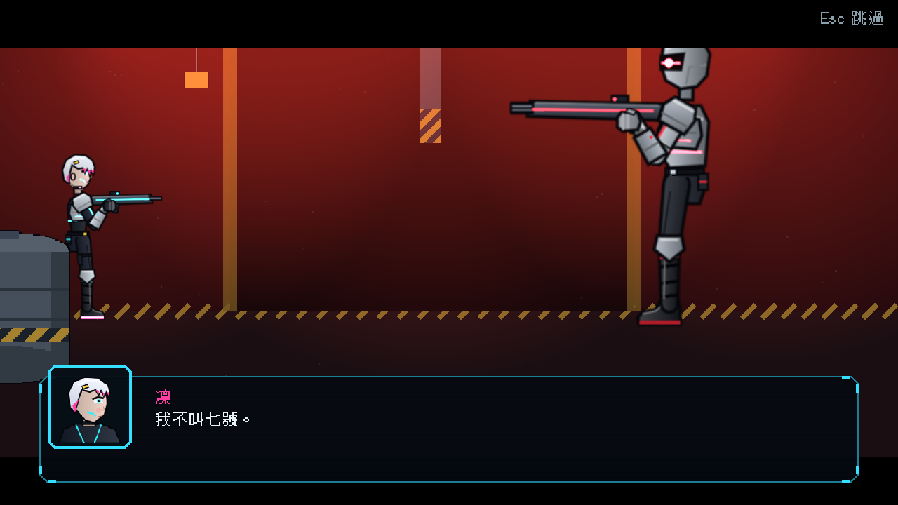
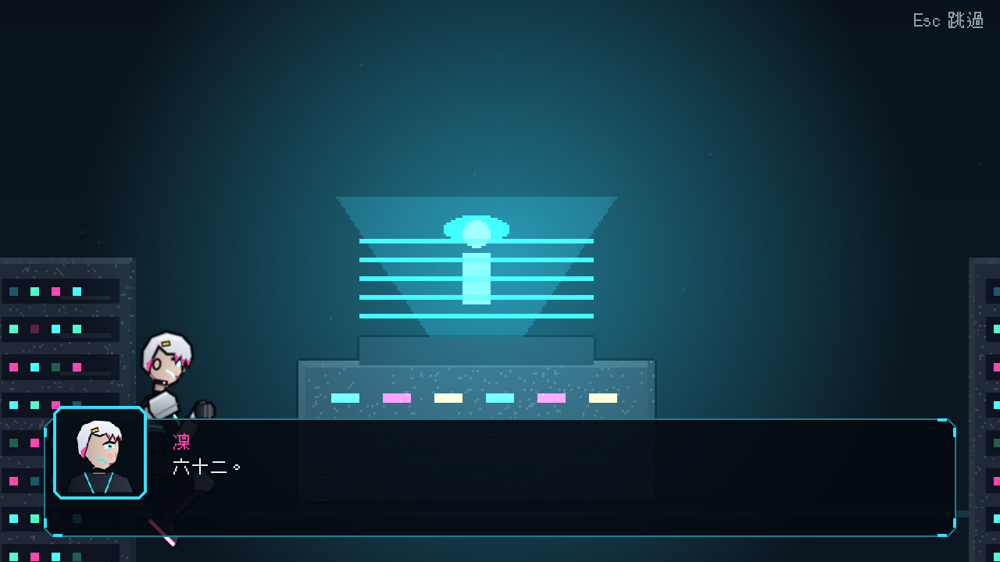
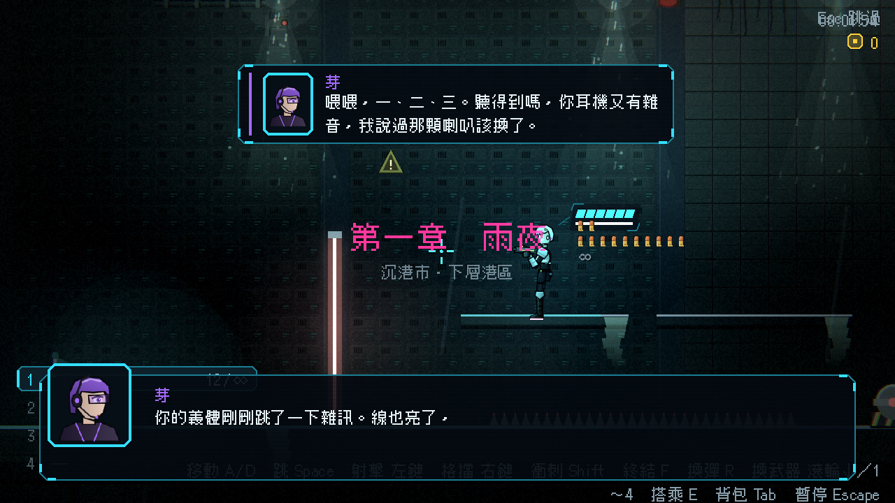

# [NE-52] 製作第一章過場動畫

> 狀態：完成

## 內文

### 需求
第一章的開場、頭目登場與結尾目前只有黑底頭像。依分鏡製作成有畫面與演出的過場動畫，並加上片頭。

### 來源
2026-10-03，使用者於開發對話中提出：「幫我設計一些動畫跟轉場進去，還有過場動畫，就交給你設計了，發揮你的想像力」；「完善目前的劇情設計，整體起承轉合可以參照邊緣行者、尼爾之類類似宿命論這種」「劇情最好要有暗線、伏筆等等更有深度的設計」。設計見 `design/10-presentation/DESIGN.md`、`design/04-story/`。

### 驗收條件
- [x] 片頭（C0）：氣象預報、城市到塔的鏡頭、標題
- [x] 開場（C1）：老 K 的舖子，數錢、航的咳嗽與哼歌、老 K 摸右臂、遞委託單、芽的聲音、出門
- [x] 頭目登場（C2）：機庫、紅燈、監管者轉身、標題卡
- [x] 結尾（C3）：終端與全像、掃描 62%、晶片捏裂、凌晨 3:12 雨停、沉默
- [x] 右臂雜訊（C8）
- [x] 每段演出可略過、不重播、台詞通過劇本檢查，並與劇本文字一致

### 測試流程
1. 從新遊戲看完片頭與開場
2. 玩到頭目與結尾，確認演出
3. 中途略過每一段，確認狀態正確
4. 執行完整測試套件，全部通過

---

# 跟其他票的關係

- Blocks：無
- Blocked by：NE-34、NE-38、NE-44、NE-49
- Related：NE-53

---

# Commit-1

## 內文

第一章的開場、頭目登場與結尾只有黑底頭像與文字，沒有畫面。
現在新遊戲先看到片頭：氣象預報一行行打出來，鏡頭從港口水面升到塔頂，閃電、雷聲後出現標題；接著無縫進入老 K 的舖子，數錢、航的咳嗽、老 K 把手放上凜的右臂、右臂跳了一下雜訊、芽在耳機裡說話，凜走出門。
頭目戰前是紅燈機庫，監管者背對、轉身、單眼亮起，講完後標題卡壓上畫面。擊敗頭目後在終端與全像前看到航的同步進度 62%，凜捏裂晶片，畫面轉黑只剩「03:12」，沉默幾秒後芽說「……停了」。設施裡的右臂雜訊是直接疊在遊戲畫面上的短演出。
過場可以接續（片頭接開場，玩家按 Esc 時整串一起略過）；原本的靜態劇本保留為文字稿，動畫版的每一句台詞都與文字稿一致，由測試比對。
驗收：兩章新增的 5 + 5 段動畫全部通過資料檢查與劇本文字檢查；以完整測試套件與截圖確認畫面。

### 測試結果

| 項目 | 結果 |
|---|---|
| 完整測試套件 | 通過 5043 / 5043 |
| 資料驗證 | 0 錯誤、劇本檢查 0 警告 |
| 執行 log | 無 ERROR |

### 截圖

