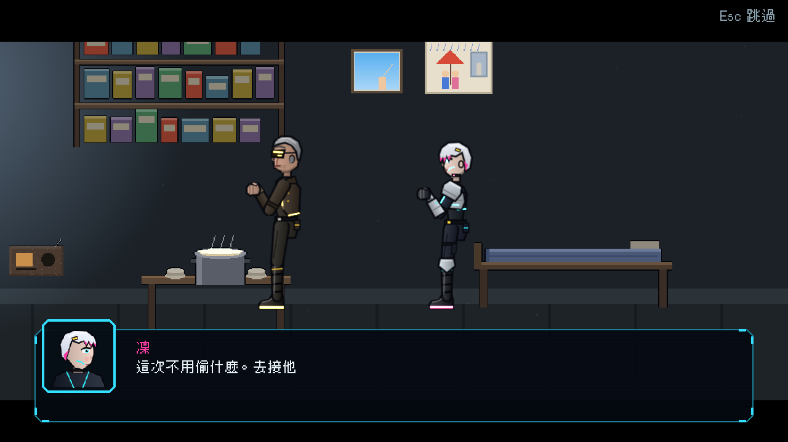
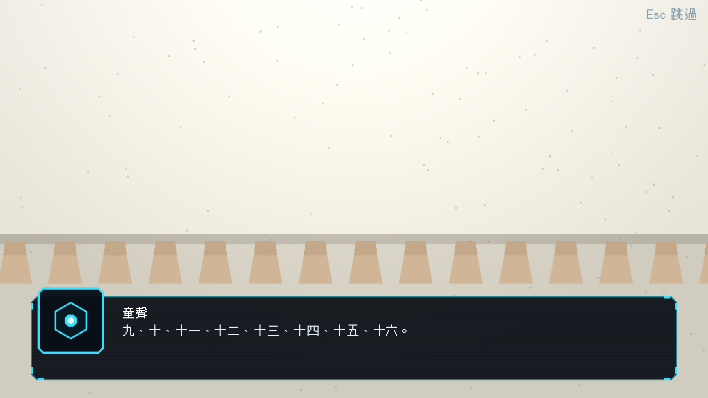
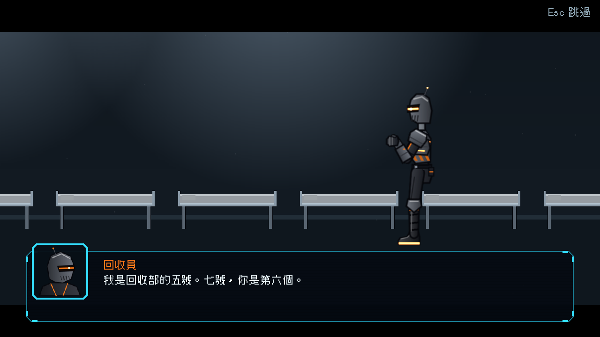
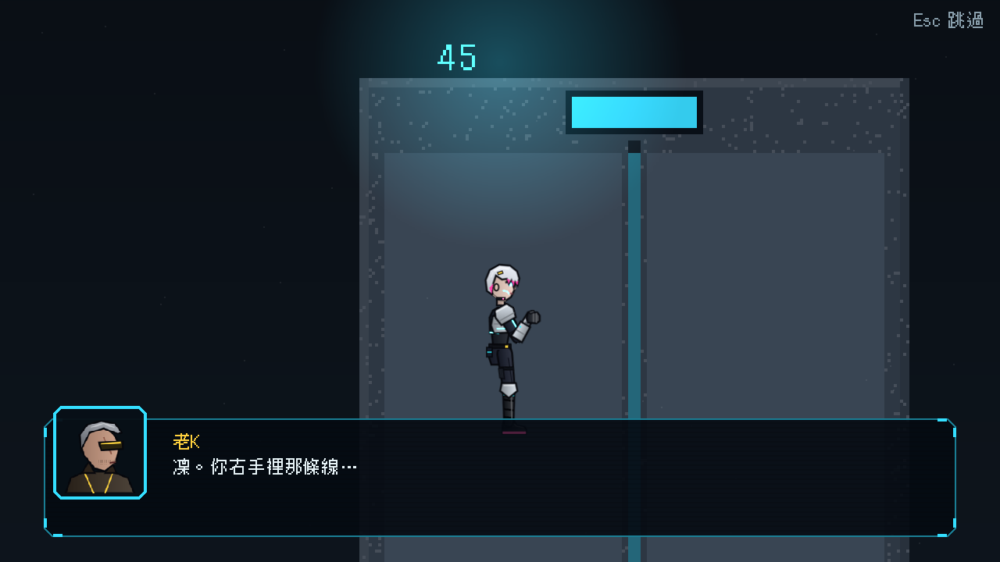
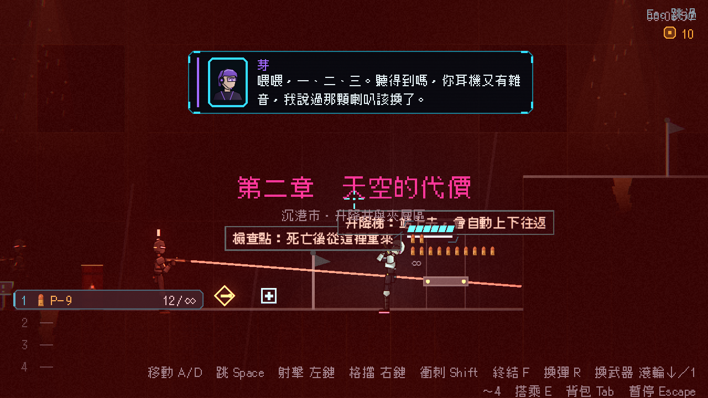

# [NE-53] 製作第二章過場動畫

> 狀態：完成

## 內文

### 需求
第二章的開場、記憶、頭目登場與結尾需要有演出的過場動畫。

### 來源
2026-10-03，使用者於開發對話中提出：「幫我設計一些動畫跟轉場進去，還有過場動畫，就交給你設計了，發揮你的想像力」；「完善目前的劇情設計，整體起承轉合可以參照邊緣行者、尼爾之類類似宿命論這種」「劇情最好要有暗線、伏筆等等更有深度的設計」。設計見 `design/10-presentation/DESIGN.md`、`design/04-story/`。

### 驗收條件
- [x] 開場（C4）：空床、摺好的毯子、沒動的粥、老 K 的說明、通行證、下降到升降井、章節卡
- [x] 記憶（C5）：雜訊、白房間、一排小腳、童聲數到十六、白幕
- [x] 頭目登場（C6）：轉運站走廊、回收員站在病床旁、標題卡
- [x] 結尾（C7）：空的 12 號床、暖的手環、老 K 的通訊、芽停頓、電梯上升、樓層數字、有接縫的藍天、章節結束卡
- [x] 每段演出可略過、不重播、台詞通過劇本檢查，並與劇本文字一致

### 測試流程
1. 玩第二章看完每一段
2. 中途略過，確認狀態正確
3. 執行完整測試套件，全部通過

---

# 跟其他票的關係

- Blocks：無
- Blocked by：NE-34、NE-38、NE-44、NE-50
- Related：NE-52、NE-54

---

# Commit-1

## 內文

第二章的開場、記憶、頭目登場與結尾只有黑底頭像與文字。
現在開場是清晨的舖子：床空著、毯子摺好、粥沒動，老 K 說通行證在左邊抽屜，凜出門後鏡頭沿升降井往下。升降井頂的記憶閃回切進過曝的白房間，鏡頭推向一排小腳，童聲數到十六，畫面白掉。頭目登場在轉運站走廊，回收員站在病床旁照規定先講一遍，標題卡壓上畫面。結尾在空床邊，老 K 的通訊進來時換成電梯門與往上跳的樓層數字，最後停在藍天，天上有一條接縫。
回收燈幕登場用疊加演出（紅色警報、震動、警示音）。台詞與第二章文字稿一致，玩家略過時整段直接結束。
和原票設想不同的地方：回收員只是站在床邊、不拿清單；記憶閃回結束於白幕，沒有畫出那隻小手。

### 測試結果

| 項目 | 結果 |
|---|---|
| 完整測試套件 | 通過 5082 / 5082 |
| 資料驗證 | 0 錯誤、劇本檢查 0 警告 |
| 執行 log | 無 ERROR |

### 截圖

