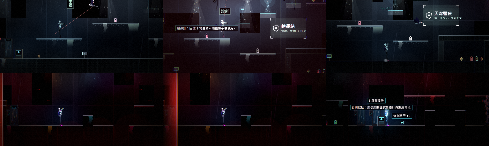
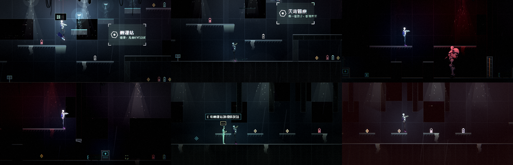

# [NE-54] 擴充第二章關卡內容

> 狀態：完成

## 內文

### 需求
第二章是完整的一關，但體驗偏單薄：缺少場景人物、不同節奏的橋段與迷你頭目。擴充成更完整的一關。

### 來源
2026-10-03，使用者於開發對話中提出：「幫我做完整的第二關」；「完善目前的劇情設計，整體起承轉合可以參照邊緣行者、尼爾之類類似宿命論這種」「劇情最好要有暗線、伏筆等等更有深度的設計」。設計見 `design/10-presentation/DESIGN.md`、`design/04-story/`。

### 驗收條件
- [x] 加入場景人物：維修員老陳、夾層區住戶、轉運站的護理師
- [x] 加入追逐橋段「回收燈幕」：一面向前推進的燈幕從背後逼近，撞上即重來，橋段前後都有檢查點
- [x] 加入迷你頭目「看守長」：電力室尾，有血條、攻擊比一般敵人強，擊敗後解開通往轉運站的閘門
- [x] 夾層區加長並加入中庭，轉運站加入病房區
- [x] 第二批新敵人依設計配置，並有第一次遭遇的安全空間
- [x] 再增加一處隱藏房間與一處只靠光才看得到的路徑
- [x] 第二章收集品、補給點與檢查點配置隨之調整，地圖仍通過可通行檢查
- [x] 輔助、標準、硬核三種難度都能通關

### 測試流程
1. 從頭玩到尾，確認每個新橋段
2. 在追逐橋段死亡，確認從正確的檢查點重來
3. 三種難度各通關一次
4. 執行完整測試套件，全部通過

---

# 跟其他票的關係

- Blocks：NE-55
- Blocked by：NE-45、NE-46、NE-47、NE-48、NE-50
- Related：NE-27

---

# Commit-1

## 內文

第二章只有一路向右的五個區段，沒有追逐、沒有迷你頭目，夾層區和轉運站也很短。
現在第二章從 340 欄加長到 510 欄：
- 夾層區後面接「中庭」：兩層陽台的挑高空間，天花板掛著攀牆者、上空盤旋蝙蝠機；陽台右端有一條只有燈亮才看得見的「光橋」，通往平台上的補給；中庭右邊多了第三個隱藏房間（打破裂縫牆）。
- 「回收燈幕」追逐橋段：走過起點，警報與無線電響起，一面紅色光幕從身後約 18 格處出發，以固定速度推進；矮牆與三格寬的坑洞要邊跑邊跳，追上就死；橋段前後各有檢查點，從橋段之後重生則視為已經過。
- 迷你頭目「看守長」：電力室之後的獨立場地，兩根掩體柱與兩層平台；他睡著，玩家靠近或被遠程打到才醒來、才出現血條；招式是監管者的點射與跳躍震波（後半加扇形彈幕），比一般敵人強但血量少；擊敗後只收起血條、解開通往轉運站的閘門，關卡繼續。
- 轉運站加入病房區：五間病房、每間一張床位，護理師搬進病房，天花板軌道上有吊軌砲。
- 電力室加入一條從天花板垂下的纏絲，升降井上空加入蝙蝠機；新生物只放在空位，不動既有的敵人與檢查點。
三種難度的通關檢查（擊敗回收員後關卡完成）在加長後的地圖上全部通過；追逐橋段用程式以跑速沿地形走完全程（光幕全程距離約 8 秒的緩衝），沒有人工從頭到尾玩一遍。

### 測試結果

| 項目 | 結果 |
|---|---|
| 第二章擴充套件（配置、追逐出發／追上／跑得過／橋段後重生、看守長睡醒與擊敗、閘門、光橋明滅） | 通過 |
| 第二章既有套件、各批敵人配置套件（欄範圍已改成新位置） | 通過 |
| 地圖產生器的可通行檢查（跳躍高度、坑寬、檢查點腳下、追逐橋段障礙高度與前後檢查點） | 0 錯誤 |
| 執行 log | 無預期外 ERROR |

### 截圖

---
