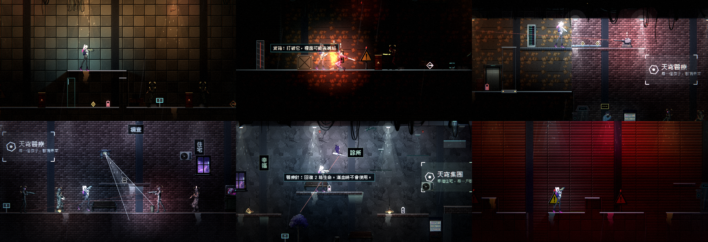
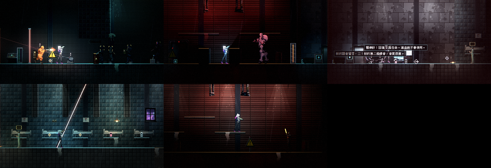

# [NE-55] 重做第二章場景美術

> 狀態：完成

## 內文

### 需求
第二章的地形與牆面同樣是色塊。套用環境元件，讓升降井、夾層區、電力室、轉運站各有自己的材質與道具。

### 來源
2026-10-03，使用者於開發對話中提出：「把第一關的地圖設計的更實際一點，最好是用高解析度的元件來替代掉現在的色塊設計」；「幫我做完整的第二關」。設計見 `design/10-presentation/DESIGN.md`、`design/04-story/`。

### 驗收條件
- [x] 升降井、夾層區、電力室、轉運站、頭目場地各用一組材質、立面與道具
- [x] 電力室的設備、轉運站的病床與護理站、夾層區的住宅與走廊都有對應的場景物件
- [x] 可以站的地方看得出來；裝飾不遮擋敵人、子彈與危險物
- [x] 暗場可讀性量測每個區段都通過
- [x] 原有的機關、可破壞物、收集品、檢查點與劇情觸發功能不變

### 測試流程
1. 從頭玩到尾，確認每個區段的外觀
2. 執行暗場可讀性量測
3. 執行完整測試套件，全部通過

---

# 跟其他票的關係

- Blocks：無
- Blocked by：NE-39、NE-54
- Related：NE-40

---

# Commit-1

## 內文

第二章的地形與牆面是同一種金屬面板，看不出是升降井、夾層區、電力室還是轉運站。
現在第二章套用環境主題，十個區段各有自己的地形材質、室內牆面與道具：
- 升降井入口與升降井：鋼板與格柵地面、舊金屬牆；升降梯井口、管線、警示牌、貨箱與油桶、攝影機，上層維修走道有機櫃與橫管。
- 夾層區：磚牆的住宅街——販賣機、冷氣、長椅、暖光燈、塗鴉、看板、窗戶、孩子的蠟筆畫。
- 中庭：深色牆面、樹、長椅、陽台上的暖光燈。
- 回收燈幕：機庫的牆，警示牌、地面標線、應急燈與攝影機。
- 電力室：格柵牆、機櫃、控制台、管線、電纜、攝影機與應急燈。
- 看守長場地與頭目戰：機庫牆、機庫燈、龍門吊、油槽。
- 轉運站與病房區：設施地板、電梯門、全像終端、販賣機；病房五張病床、牆上的蠟筆畫與無線電、暖光燈。
天花板依區段換成不同材質；道具不蓋在敵人、危險物與實體上，平台道具沒有卡進地形，前層道具不遮住敵人。全部用既有的環境元件，沒有新素材；護理站的櫃台沒有現成素材，用全像終端與控制台代替。
暗場可讀性量測十個區段都通過；夾層區的玩家對比 0.60 剛好在門檻上，牆面換成較暗的磚牆才過（原本的混凝土牆 0.51）。

### 測試結果

| 項目 | 結果 |
|---|---|
| 第二章美術套件（主題、道具擺放、覆蓋區、關卡可進入） | 通過 |
| 第二章既有套件、環境套件 | 通過 |
| 暗場可讀性量測（玩家／邊緣／敵人對比） | 十個區段全部通過 |
| 執行 log | 無預期外 ERROR |

### 截圖

---
