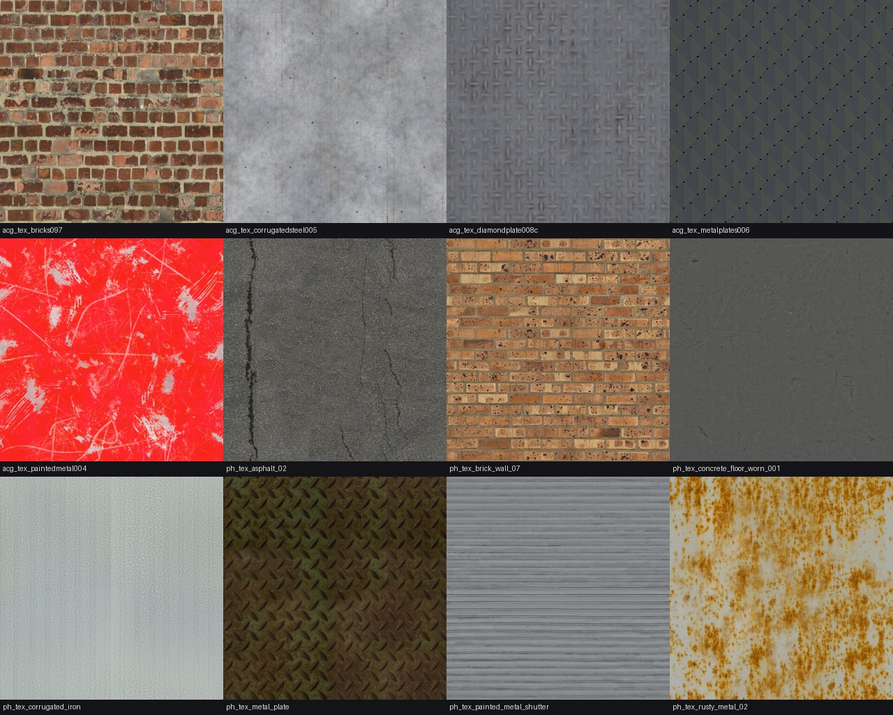
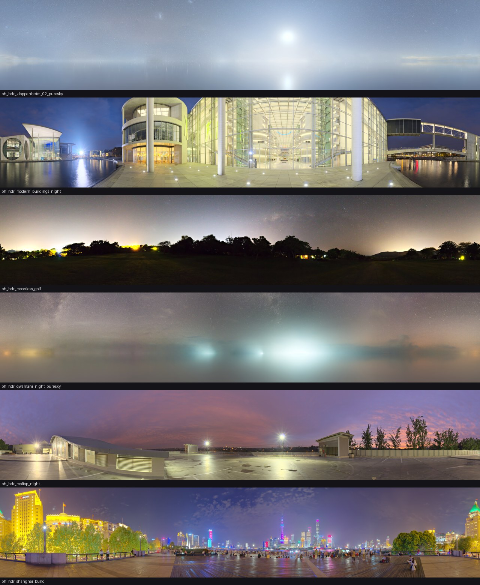
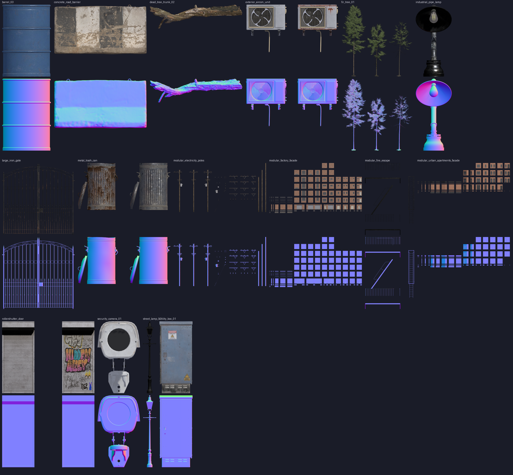

# [NE-56] 找出免費素材來源並登記授權

> 狀態：完成

## 內文

### 需求
完成前不得開始大量替換：需要先確認有哪些免費、可商用的高解析度素材來源（材質、模型、天空、樹、工廠、賽博龐克場景），把可用的存下來並記錄授權，讓之後每一張替換票都能直接取用，也能向任何人證明素材的出處。

### 來源
2026-10-03，使用者於開發對話中提出：「我想要用高解析度的免費素材換掉目前的場景、背景之類的素材，然後換上光影」；「樹、工廠、雲、賽博龐克風格的場景素材等等的都可以」；角色素材由使用者另行處理，本批只處理角色以外的東西。設計見 `design/11-free-assets/DESIGN.md`。

### 驗收條件
- [x] 評估至少 4 個來源，記錄授權、內容、取得方式與是否採用的理由
- [x] 只採用 CC0 授權的素材；授權有疑慮的來源不下載
- [x] 存下範例素材：材質至少 10 種、夜景天空至少 5 張、3D 模型至少 15 個（含樹、工廠與街道道具）
- [x] 每個下載的素材都有授權紀錄（作者、授權、出處網址），可重新下載
- [x] 產出範例預覽圖（材質、天空、模型渲染各一張）供使用者挑選方向

### 測試流程
1. 執行下載工具，確認所有範例下載成功且授權清單完整
2. 開啟預覽圖，逐項確認素材品質與風格
3. 刪掉原始檔後重新執行下載工具，檔案復原

---

# 跟其他票的關係

- Blocks：NE-57
- Blocked by：無
- Related：NE-39

---

# Commit-1

## 內文

場景素材都是程式畫的低解析度圖，想換成高解析度的免費素材，但不知道哪裡有可商用、量夠大、風格合用的來源。
評估了 Poly Haven、ambientCG、Kenney、OpenGameArt、itch.io 免費包五個來源，結論與授權原則寫進設計文件：只收 CC0，主力是 Poly Haven（材質、3D 模型、夜景天空）與 ambientCG（材質），Kenney 與 OpenGameArt 備選，itch.io 免費包因為多半禁止再散布不採用。
已下載並登記授權的範例：材質 19 種、天空全景 9 張、3D 模型 16 個（路燈、冷氣機、電線桿、鐵閘、捲門、公寓與工廠立面套件、樹、油桶、垃圾桶等），每一項的作者、授權與出處網址都在授權清單裡，原始檔不進版控、可由下載工具重抓。
驗收：下載工具對全部項目執行成功、授權清單 CC0 全覆蓋；三張範例預覽圖（材質、天空、模型渲染）已給使用者看過。

### 截圖

