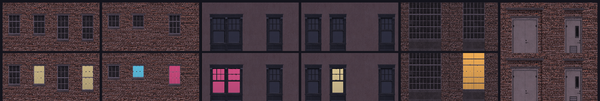

# [NE-57] 建立素材下載與加工工具

> 狀態：完成

## 內文

### 需求
素材要大量替換，不能每張手工處理。需要一組可重跑的工具：依清單下載素材、把 3D 模型渲染成帶法線與自發光的 2D 貼圖、把材質加工成遊戲規格並依色盤調色，之後新增素材只要改清單。

### 來源
2026-10-03，使用者於開發對話中提出：「我想要用高解析度的免費素材換掉目前的場景、背景之類的素材，然後換上光影」；「樹、工廠、雲、賽博龐克風格的場景素材等等的都可以」；角色素材由使用者另行處理，本批只處理角色以外的東西。設計見 `design/11-free-assets/DESIGN.md`。

### 驗收條件
- [x] 依清單下載素材，單項失敗不影響其他項目，錯誤訊息指出是哪一項、哪個網址
- [x] 3D 模型可渲染成反照率、法線、自發光三張貼圖，法線方向與遊戲的受光慣例一致
- [x] 材質可輸出為遊戲規格的可平鋪貼圖（本體、頂面、側邊）並附法線，平鋪無接縫
- [x] 調色參數放在清單，不寫死在程式；同一份清單重跑結果一致
- [x] 輸出的素材尺寸與總大小可被檢查，超過上限時報錯

### 測試流程
1. 對範例模型執行渲染，確認三張貼圖正確
2. 對範例材質執行加工，把成品平鋪成大面積確認無接縫
3. 改清單的調色參數重跑，成品隨之改變

---

# 跟其他票的關係

- Blocks：NE-58、NE-59、NE-60、NE-61、NE-62、NE-63、NE-64、NE-65
- Blocked by：NE-56
- Related：無

---

# Commit-1

## 內文

素材要大量替換，不能每張手工處理。
現在有一組可重跑的工具：依清單下載素材並登記授權；把 3D 模型渲染成反照率、法線與自發光三張貼圖；把套件模型（一個檔案排著很多件）自動切件並編號；把 PBR 材質加工成地形用的本體、頂面、側邊與法線；把全景圖切成左右無縫的天空長條；把立面組裝成模組並隨機點亮窗戶；把渲染結果寫成道具貼圖並改道具資料。調色參數都在清單裡；同一份清單重跑結果一致。另有大小與授權檢查（環境美術總量、單檔大小、清單來源是否都有 CC0 紀錄）、材質預覽與前後對照工具，以及不讓舊的暫代圖產生器覆蓋已換成免費素材的項目的保護。
驗收：對範例模型渲染出三張貼圖、法線方向與遊戲受光慣例一致；材質平鋪無接縫（量測值 0.5～2.9，門檻 3）；調整清單的亮度重跑後成品隨之改變；超過大小上限時報錯。

### 測試結果

| 項目 | 結果 |
|---|---|
| 完整測試套件 | 通過 5261 / 5261 |
| 資料驗證 | 0 錯誤 |
| 執行 log | 無 ERROR |

### 截圖

