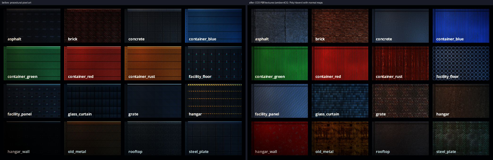

# [NE-58] 地形材質換成高解析度 PBR

> 狀態：完成

## 內文

### 需求
地形目前是程式畫的低解析度色塊。換成真實材質（柏油、混凝土、磚、金屬板、貨櫃鋼板、格柵等）並附法線，讓地面與牆體在光源下有凹凸與質感。

### 來源
2026-10-03，使用者於開發對話中提出：「我想要用高解析度的免費素材換掉目前的場景、背景之類的素材，然後換上光影」；「樹、工廠、雲、賽博龐克風格的場景素材等等的都可以」；角色素材由使用者另行處理，本批只處理角色以外的東西。設計見 `design/11-free-assets/DESIGN.md`。

### 驗收條件
- [x] 現有 16 種地形材質全部換成免費素材加工的版本，每種有本體、頂面、側邊三張與法線
- [x] 解析度明顯高於現況，放大看得到材質細節；大面積平鋪看不出接縫與明顯重複
- [x] 顏色符合各區段的色盤與光源，不比周圍的角色與敵人更搶眼
- [x] 新增一種材質只需要資料與圖片；缺圖時顯示替代圖並記錄具體路徑
- [x] 暗場可讀性量測每個區段都通過

### 測試流程
1. 開材質畫廊逐一檢查 16 種材質（含法線效果）
2. 從頭玩第一章與第二章，確認地面與牆體外觀與光影
3. 刪掉一張貼圖，確認遊戲照常並有錯誤訊息
4. 執行暗場可讀性量測與完整測試套件，全部通過

---

# 跟其他票的關係

- Blocks：NE-66
- Blocked by：NE-57
- Related：NE-39、NE-55

---

# Commit-1

## 內文

地形的 16 種材質原本是程式畫的 64 像素色塊，貼近看沒有質感。
現在全部換成 ambientCG 與 Poly Haven 的 CC0 材質加工的版本：柏油、混凝土、磚牆、波浪鋼板（貨櫃四色）、金屬板、鏽蝕金屬、格柵、玻璃帷幕、機庫地板與牆面等，每種的本體、頂面、側邊都附法線，貼圖密度是原本的 2 倍（每個邏輯像素 8 個貼圖像素），每次重複涵蓋 32～64 個邏輯像素（原本 16），大面積平鋪不容易看出重複。每種材質有自己的貼圖倍率欄位，室內牆面也有；沒改的材質維持原本的 4 倍。亮度壓到與原本相近，並讓法線細節在光源下浮現。
驗收：16 種材質逐一用受光預覽檢查；暗場可讀性量測貨運站 1.07、設施入口 0.87，與換之前（0.91、0.84）相當；第一章「屋頂巷弄」換之前就低於門檻（−0.24，與角色美術有關），換材質後 −0.15，沒有更差。

### 測試結果

| 項目 | 結果 |
|---|---|
| 完整測試套件 | 通過 5261 / 5261 |
| 資料驗證 | 0 錯誤 |
| 執行 log | 無 ERROR |

### 截圖

