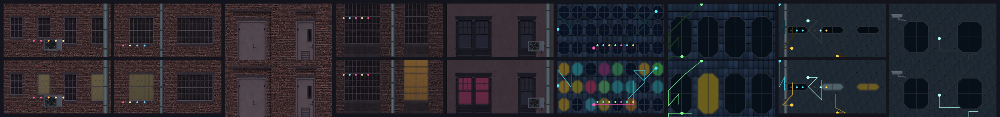

# [NE-59] 建築立面換成高解析度

> 狀態：完成

## 內文

### 需求
建築立面目前是程式畫的方格窗與色塊。換成真實的公寓、工廠、店面與捲門外觀，窗戶有發光層，讓街道與屋頂背後的牆面看起來是真的建築。

### 來源
2026-10-03，使用者於開發對話中提出：「我想要用高解析度的免費素材換掉目前的場景、背景之類的素材，然後換上光影」；「樹、工廠、雲、賽博龐克風格的場景素材等等的都可以」；角色素材由使用者另行處理，本批只處理角色以外的東西。設計見 `design/11-free-assets/DESIGN.md`。

### 驗收條件
- [x] 現有 7 種建築立面全部換成免費素材加工的版本（一樓、標準樓層、女兒牆模組）
- [x] 窗戶有自發光層，亮窗與暗窗交錯、不重複排列得太規律
- [x] 每種立面有法線貼圖，牆面凹凸在光源下可見
- [x] 樓層高度、窗位與原有立面相容，現有關卡不需要改地圖
- [x] 暗場可讀性量測每個區段都通過

### 測試流程
1. 開材質畫廊檢查 7 種立面
2. 從頭玩第一章，確認街道、屋頂與市場的牆面外觀
3. 執行暗場可讀性量測與完整測試套件，全部通過

---

# 跟其他票的關係

- Blocks：NE-66
- Blocked by：NE-57
- Related：NE-39、NE-40

---

# Commit-1

## 內文

建築立面是程式畫的方格窗與色塊，看起來不像真的建築。
現在 5 種立面（老公寓、磚造樓房、鐵捲門樓房、倉庫、街邊店面）換成 Poly Haven 小巷套件的真實外牆：磚牆、灰泥牆、木框推拉窗、鐵格窗、拱窗、鐵門與車庫門，附法線；每個樓層模組的窗戶依機率亮或暗，顏色在暖黃、淡黃、青、洋紅之間挑，整扇窗一起亮（有窗框與格條），固定亂數種子所以每次重建結果一致。模組尺寸規格不變（寬 64、一樓 40、標準樓層 32、女兒牆 8，貼圖密度是原本的 1.5 倍），現有關卡不用改。窗光比原本暗一半：大面積亮窗在玩家身旁會把暗場對比吃掉（貨運站玩家對比由 1.35 掉到 0.1），調暗後回到 1.0 以上。
還沒換的是設施牆面與玻璃帷幕大樓兩種（設施牆面用在第一章設施入口，玻璃帷幕大樓還沒有地方使用），它們維持原本的程式繪製圖。
驗收：前後對照截圖（四個區段）；暗場可讀性量測貨運站 1.07、設施入口 0.87、霓虹市集 3.89、停電走廊 6.71、頭目機庫 8.47 都通過；屋頂巷弄換之前就低於門檻（−0.24），換立面後 −0.15，沒有更差。

### 測試結果

| 項目 | 結果 |
|---|---|
| 完整測試套件 | 通過 5261 / 5261 |
| 資料驗證 | 0 錯誤 |
| 執行 log | 無 ERROR |

### 截圖

# Commit-2

## 內文

第一批立面的窗戶是純矩形或純弧形，牆面也只有窗戶，看起來像程式暫代圖。
現在剩下的兩種（玻璃帷幕大樓、設施牆面）也換成真實材質加窗格；所有立面的窗戶不再是矩形或圓弧：切角八邊形窗加窗格，磚造樓房另有鐵格窗。牆面加上裝飾：電路走線與發光節點、LED 指示燈列、水管與管夾、冷氣機、攝影機、警示燈。窗光邊緣柔化並帶淡淡光暈，窗光層與裝飾燈光會緩慢閃爍（一部分區塊像電壓不穩），純紅的點是屋頂信標、規律明滅；這些由共用的著色器處理，沒有每影格腳本。7 種立面全數完成。
驗收：前後對照截圖與裝飾預覽；暗場可讀性量測第一章六個區段全部通過（屋頂巷弄 0.74、霓虹市集 3.71、貨運站 1.34、設施入口 1.44、停電走廊 9.26、頭目機庫 13.52）；量測在乾淨的美術環境（角色美術為上一次提交）下進行，因為工作目錄裡的角色美術正在另一邊修改，會讓玩家對比跟著變。

### 測試結果

| 項目 | 結果 |
|---|---|
| 針對性測試（環境元件、過場動畫、章節過場） | 通過 1199 / 1199 |
| 暗場可讀性量測（第一章六個區段，乾淨的美術環境） | 全部通過 |
| 資料驗證 | 0 錯誤 |
| 執行 log | 無 ERROR（測試刻意觸發的容錯訊息除外） |

### 截圖

