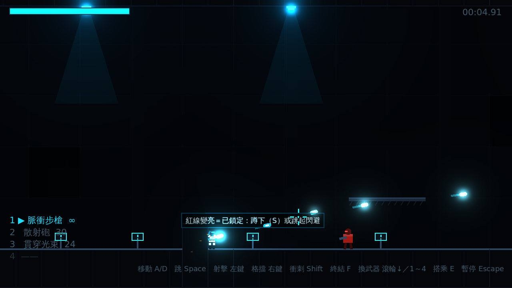
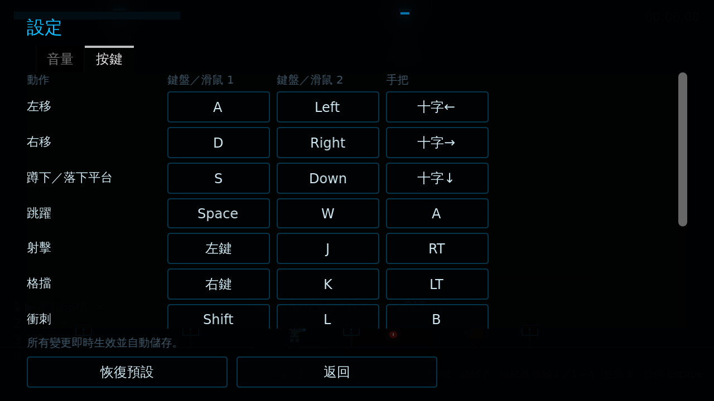

# [NE-5] 改用滑鼠瞄準射擊操作

> 狀態：完成

## 內文

### 需求
射擊改為滑鼠操作：滑鼠 360 度瞄準、左鍵射擊、滾輪切換武器、Shift 衝刺（衝刺時無敵），讓射擊從 8 方向變成精準點射；手把以右搖桿瞄準。

### 來源
2026-10-02，使用者於開發對話中提出：「我希望射擊是透過滑鼠來操作。滾輪更換武器、左鍵射擊、右鍵格擋、shift 衝刺（衝刺時無敵）」。

### 驗收條件
- [x] 角色永遠面向準星，子彈從槍口朝準星方向射出
- [x] 左鍵射擊、滾輪循環切換武器、數字鍵 1～4 直接選武器
- [x] 最多攜帶 4 把武器，各自保留彈藥
- [x] 準星連射時擴散、命中時出現命中標記、擊殺時變色
- [x] 遊戲中隱藏系統游標，選單與暫停時顯示
- [x] Shift 衝刺期間不會受傷
- [x] 手把可用右搖桿瞄準、RT 射擊
- [x] 設定畫面可把動作綁到滑鼠按鍵與滾輪
- [x] 舊版存檔的按鍵設定自動改回新預設

### 測試流程
1. 進入關卡，移動滑鼠繞角色一圈射擊，確認子彈方向與準星一致
2. 用滾輪與數字鍵切換武器，確認彈藥分開計算
3. 衝刺穿過敵方子彈，確認不受傷
4. 在設定畫面把射擊改到滑鼠中鍵並確認可用
5. 執行完整測試套件，全部通過

---

# 跟其他票的關係

- Blocks：NE-6、NE-10
- Blocked by：無
- Related：NE-2

---

# Commit-1

## 內文

原本只能用方向鍵做 8 方向射擊，瞄準粗糙，也無法用滑鼠操作。
現在改為滑鼠 360 度瞄準：角色永遠面向準星，左鍵射擊、滾輪或數字鍵 1～4 切換武器，Shift 衝刺期間無敵；武器欄最多 4 把、各自保留彈藥。準星會隨連射擴散、命中時出現命中標記、擊殺時變紅。遊戲中隱藏系統游標，暫停與選單時恢復。手把以右搖桿瞄準、RT 射擊。設定畫面可以把任何動作綁到滑鼠按鍵或滾輪；舊版的按鍵設定會自動改回新預設。
驗證了搖桿與滑鼠瞄準方向、轉身、滾輪與數字鍵換武器、彈藥分開計算與打空自動切回、命中標記、衝刺無敵、扳機射擊、滑鼠按鍵綁定與互換、舊版設定轉換；並實際渲染確認準星與子彈方向一致。

### 測試結果

| 項目 | 結果 |
|---|---|
| 完整測試套件 | 通過 134 / 134 |
| 資料驗證 | 0 錯誤 |
| 執行 log | 無 ERROR |

### 截圖

