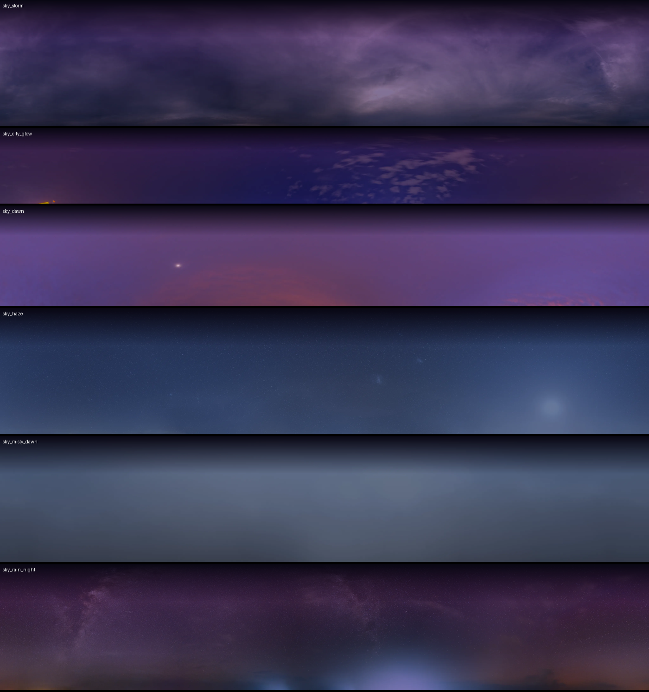
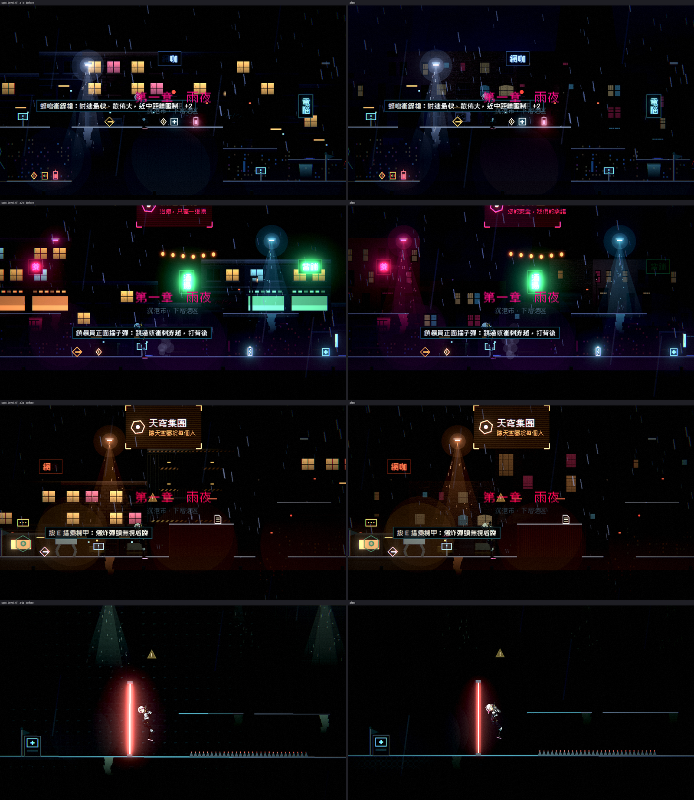

# [NE-60] 替換天空與雲

> 狀態：完成

## 內文

### 需求
背景天空目前是程式畫的漸層。換成真實的夜空、雲層與城市光暈，讓遠處有層次與空氣感，並依章節換不同的天空（雨夜、凌晨、第二章的塔內）。

### 來源
2026-10-03，使用者於開發對話中提出：「我想要用高解析度的免費素材換掉目前的場景、背景之類的素材，然後換上光影」；「樹、工廠、雲、賽博龐克風格的場景素材等等的都可以」；角色素材由使用者另行處理，本批只處理角色以外的東西。設計見 `design/11-free-assets/DESIGN.md`。

### 驗收條件
- [x] 至少 4 種天空，涵蓋雨夜、城市光暈、凌晨與第二章場景
- [x] 左右無縫，捲動與視差時看不出接縫；解析度足以在全螢幕下不模糊
- [x] 天空的亮度與色調壓在不干擾前景可讀性的範圍，地平線處接上遠景天際線自然
- [x] 關卡以資料指定天空；缺圖時退回原本的程式天空並記錄具體路徑
- [x] 既有的雨、閃電、探照燈與塔頂信標仍然正常顯示

### 測試流程
1. 從頭玩第一章與第二章，確認每個區段的天空
2. 刪掉天空貼圖，確認退回程式天空並有錯誤訊息
3. 執行完整測試套件，全部通過

---

# 跟其他票的關係

- Blocks：NE-61、NE-65、NE-66
- Blocked by：NE-57
- Related：NE-8、NE-40

---

# Commit-1

## 內文

背景天空是程式畫的漸層，沒有雲也沒有層次。
現在關卡主題可以指定一張照片天空：從全景圖切出地平線以上的長條，左右無縫、慢速視差，壓在程式天空上，上緣透明漸層接上原本的夜空；缺圖時退回程式天空並記錄具體路徑。已加工 6 種天空（暴雨雲、雨夜星空、城市光暈與雲、凌晨紫霧、月光薄霧、清晨薄霧），第一章用暴雨雲。雨、閃電、探照燈與塔頂信標照舊。第二章的主題還沒建立（NE-55），建立後可直接指定凌晨與薄霧兩種。
驗收：前後對照截圖；新增天空測試（貼圖規格、有天空多一層視差、缺圖時不多不少一層並指出路徑）；暗場可讀性量測沒有比換之前更差。

### 測試結果

| 項目 | 結果 |
|---|---|
| 完整測試套件 | 通過 5261 / 5261 |
| 資料驗證 | 0 錯誤 |
| 執行 log | 無 ERROR |

### 截圖

