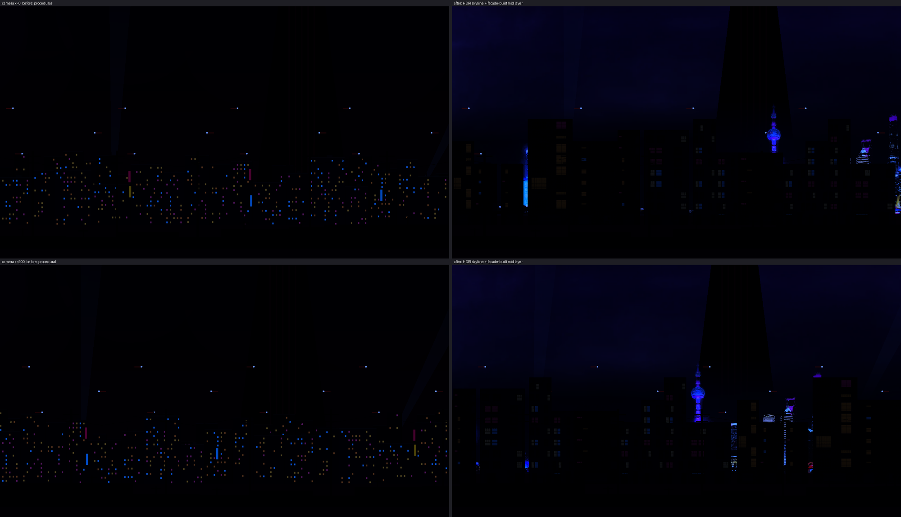
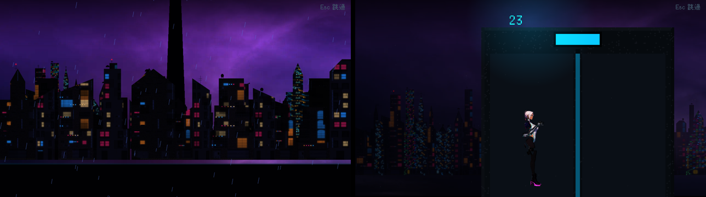
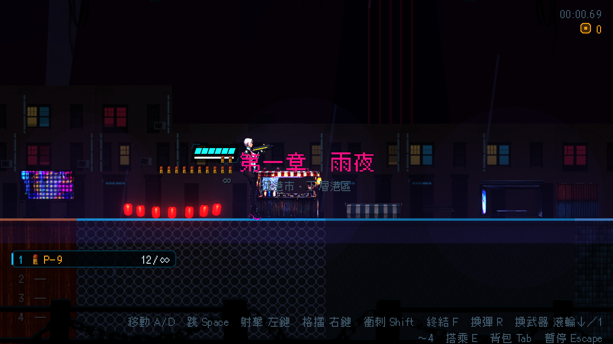

# [NE-61] 替換遠景天際線與中景樓群

> 狀態：完成

## 內文

### 需求
遠景與中景目前是程式畫的剪影樓群。換成真實城市天際線與樓群，帶窗光與霓虹，建立賽博龐克夜景的縱深。

### 來源
2026-10-03，使用者於開發對話中提出：「我想要用高解析度的免費素材換掉目前的場景、背景之類的素材，然後換上光影」；「樹、工廠、雲、賽博龐克風格的場景素材等等的都可以」；角色素材由使用者另行處理，本批只處理角色以外的東西。設計見 `design/11-free-assets/DESIGN.md`。

### 驗收條件
- [x] 遠景、中景、近景三層全部換成素材加工的版本，各層有自發光窗光
- [x] 各層有清楚的由遠到近層次：越遠越淡、越偏藍、越慢
- [x] 霓虹招牌與全像廣告維持原有演出，不被新背景蓋住
- [x] 左右無縫；各層貼圖不超過檔案大小上限
- [x] 暗場可讀性量測每個區段都通過

### 測試流程
1. 從頭玩第一章，確認遠、中、近三層與視差
2. 執行暗場可讀性量測與相關測試套件（環境元件、過場動畫、章節過場），全部通過

---

# 跟其他票的關係

- Blocks：NE-65、NE-66
- Blocked by：NE-57、NE-60
- Related：NE-8、NE-40

---

# Commit-1

## 內文

遠景與中景是程式畫的剪影與小點，看不出是城市。
遠景一開始用真實城市天際線照片，使用者看了覺得太突兀（2026-10-03），改成與中景同一套做法：由立面模組組出遠方樓群（兩排前後、較小較暗、有尖塔與屋頂雜物），窗光另成一層自發光；中景由立面模組組出一排樓群：兩排前後（後排較暗較矮）、輪廓有階梯、斜屋頂、人字屋頂、切角與帶尖塔的樓，屋頂有天線、水塔、天線上的紅色信標、碟型天線與通風管，窗光柔邊。兩層的窗光與信標與立面共用同一份閃爍著色器。
還沒換的是近景（前景管線與剪影）。
驗收：只畫背景的預覽截圖前後對照；暗場可讀性量測沒有比換之前更差（乾淨美術環境下全部通過）。

### 測試結果

| 項目 | 結果 |
|---|---|
| 針對性測試（環境元件、過場動畫、章節過場） | 通過 1199 / 1199 |
| 暗場可讀性量測（第一章六個區段，乾淨的美術環境） | 全部通過 |
| 資料驗證 | 0 錯誤 |
| 執行 log | 無 ERROR（測試刻意觸發的容錯訊息除外） |

### 截圖

# Commit-2

## 內文

近景（比可玩區域更靠近鏡頭的那層）還是程式畫的黑色色塊管線與欄杆。
現在近景由生成的剪影條帶組成：頂端是一根橫管加上長短不一的垂吊電纜，地面以下是掛著鏈條的鏽蝕欄杆；近乎全黑、邊緣只留一圈冷色輪廓光，左右鏡像拼成可重複的一段。吊著的電纜會隨風擺動，管線上的小燈（LED 與信標）會規律明滅，雨簾照舊。貼圖缺失時退回原本的程式剪影，並記錄具體路徑。
遠景、中景、近景三層至此全部換完，三層都有自發光窗光或小燈。
驗收：關卡實景與道具畫廊截圖看過；暗場可讀性量測與換之前相同（第一章六個區段的數值差異都在 0.05 內；其中 5 個區段在目前主線上就低於門檻，是凜新造型造成的，不是本票）。

### 測試結果

| 項目 | 結果 |
|---|---|
| 針對性測試（環境元件、過場動畫、章節過場、道具、第二章） | 通過 1463 / 1463 |
| 素材預算檢查 | 通過（27 MB / 60 MB） |
| 執行 log | 無 ERROR（測試刻意觸發的容錯訊息除外） |

### 截圖

