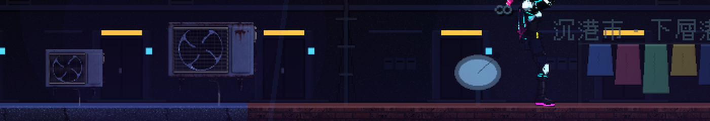
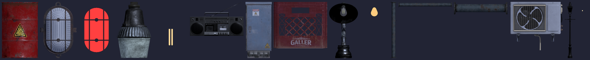
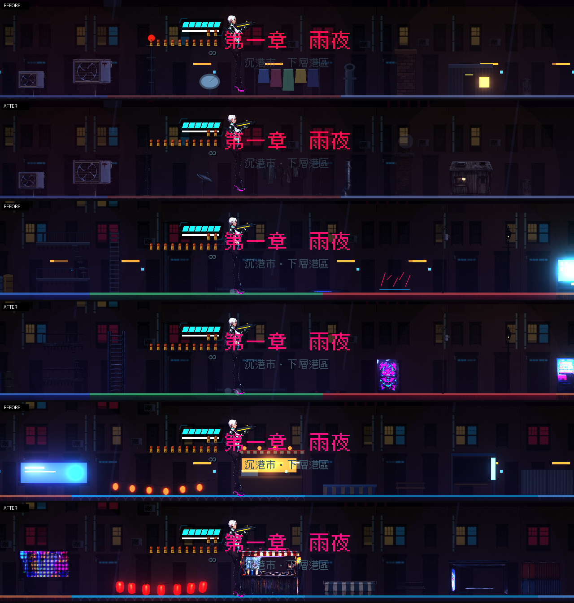

# [NE-62] 替換屋頂與街道道具

> 狀態：完成

## 內文

### 需求
屋頂與街道的道具（冷氣機、水塔、逃生梯、路燈、垃圾桶、電箱、電線桿、麵攤、販賣機等）目前是程式畫的色塊。換成 3D 模型渲染的真實物件，附法線與自發光，路燈與招牌仍能發光。

### 來源
2026-10-03，使用者於開發對話中提出：「我想要用高解析度的免費素材換掉目前的場景、背景之類的素材，然後換上光影」；「樹、工廠、雲、賽博龐克風格的場景素材等等的都可以」；角色素材由使用者另行處理，本批只處理角色以外的東西。設計見 `design/11-free-assets/DESIGN.md`。

### 驗收條件
- [x] 屋頂與街道類道具全部換成素材加工的版本（有免費模型的用模型渲染，沒有的用本機 Qwen 生成，不再有保留舊圖的項目）
- [x] 每個道具有法線貼圖；會發光的有自發光層，路燈與招牌的光源與閃爍行為不變
- [x] 道具比例與角色相稱，單向平台、遮光等既有行為不變
- [x] 擺放資料不需要改，新增道具只需要資料與圖片
- [x] 道具不遮擋敵人、子彈與危險物

### 測試流程
1. 開道具畫廊逐一檢查
2. 從頭玩第一章的屋頂與街道，確認道具外觀與光影
3. 執行相關測試套件（環境元件、道具、過場動畫），全部通過

---

# 跟其他票的關係

- Blocks：NE-64、NE-66
- Blocked by：NE-57
- Related：NE-39、NE-40

---

# Commit-1

## 內文

屋頂與街道的道具是程式畫的色塊。
先換了 6 個有現成模型的道具：兩種冷氣室外機（乾淨與鏽蝕）、路燈（燈泡有自發光層，光源位置跟著新尺寸等比移動）、電線桿、牆上攝影機、垃圾桶，附法線。道具以底邊對齊地面，所以尺寸改變不會讓它陷進地裡；有單向平台的道具（逃生梯、雨棚、麵攤）不動，因為平台位置跟著原本的比例。
還沒換的是其餘屋頂與街道道具（水塔、天線、逃生梯、麵攤、販賣機、公車站牌等），沒有合適的免費模型的要列出清單保留原圖。
驗收：道具畫廊與實景截圖逐個檢查；道具貼圖規格測試改成「至少 4 倍解析度、不超過 1024、長寬比與邏輯大小一致」。

### 測試結果

| 項目 | 結果 |
|---|---|
| 完整測試套件 | 通過 5261 / 5261 |
| 資料驗證 | 0 錯誤 |
| 執行 log | 無 ERROR |

### 截圖

# Commit-2

## 內文

第二批道具換成 Poly Haven 的模型：油桶（燃料）、牆上緊急燈（含紅色發光）、吊燈（燈泡有發光層）、舊收音機、電箱、貨箱、檯燈（燈泡發光）、三種管線（垂直、水平、設施管線，由套件模型切件、旋轉，法線一併旋轉）。道具以資料保存原本的尺寸（錨點），重跑不會把上一次的結果當成原尺寸。

### 截圖

# Commit-3

## 內文

其餘的屋頂與街道道具（水塔、天線、碟型天線、通風管、煙囪、屋頂小屋、油桶、長椅、垃圾箱、販賣機、公車站、廣告看板、橫直式霓虹、燈籠串、衣繩、塗鴉、逃生梯與爬梯、麵攤、雨棚、水窪）還是程式畫的色塊，而且找不到合適的免費模型。
改用本機 Qwen 生成透明背景的寫實物件（正側面、沒有透視），再自動算出法線與自發光層；物件保持自然比例、面積約等於原本，不再硬拉成舊的方框。水窪用程式畫，倒影帶霓虹色。
有單向平台的逃生梯與麵攤，圖裡的甲板位置會自動對到平台資料的位置，關卡裡可站的地方完全不變。
新增動畫：燈籠串、衣繩跟著風擺動；天線信標規律明滅；廣告看板、販賣機、公車站牌的畫面有緩慢上移的掃描光帶；煙囪冒蒸汽（只在畫面內）；水窪有雨滴漣漪。
驗收：道具畫廊換前換後逐一對照；第一章六個區段實景截圖無錯誤、無 ERROR；道具資料中的平台、光源、遮光欄位與換之前相同（光源位置只隨尺寸等比移動）。

### 測試結果

| 項目 | 結果 |
|---|---|
| 針對性測試（環境元件、道具、過場動畫、章節過場、第二章） | 通過 1463 / 1463 |
| 素材預算檢查 | 通過（27 MB / 60 MB） |
| 執行 log | 無 ERROR（測試刻意觸發的容錯訊息除外） |

### 截圖

