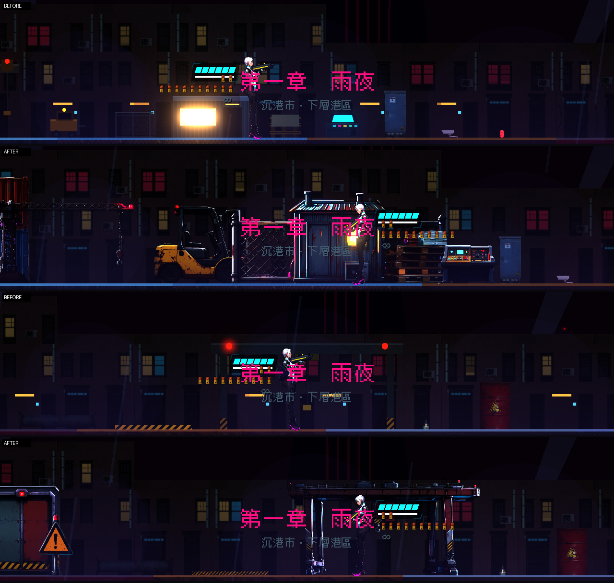

# [NE-63] 替換貨運站、設施與機庫道具

> 狀態：完成

## 內文

### 需求
貨運站、設施與機庫的道具（貨箱堆、起重機、閘門、控制台、管線、攝影機、油桶等）換成真實模型渲染的版本，讓工業場景有重量與鏽蝕感。

### 來源
2026-10-03，使用者於開發對話中提出：「我想要用高解析度的免費素材換掉目前的場景、背景之類的素材，然後換上光影」；「樹、工廠、雲、賽博龐克風格的場景素材等等的都可以」；角色素材由使用者另行處理，本批只處理角色以外的東西。設計見 `design/11-free-assets/DESIGN.md`。

### 驗收條件
- [x] 貨運站、設施、機庫類道具全部換成素材加工的版本（有免費模型的用模型渲染，沒有的用本機 Qwen 生成，不再有保留舊圖的項目）
- [x] 每個道具有法線貼圖；螢幕、指示燈、警示燈等有自發光層
- [x] 大型道具（起重機、閘門）解析度足夠，放大不糊
- [x] 既有的機關、可破壞物與檢查點外觀不變，行為不變

### 測試流程
1. 開道具畫廊逐一檢查
2. 從頭玩第一章的貨運站、設施與頭目場地
3. 執行相關測試套件（環境元件、道具、過場動畫），全部通過

---

# 跟其他票的關係

- Blocks：NE-66
- Blocked by：NE-57
- Related：NE-39、NE-40

---

# Commit-1

## 內文

貨運站、設施與機庫的道具是程式畫的色塊。
先換了其中有現成模型的：燃料桶、緊急燈、機庫吊燈、電箱（伺服器機櫃位置）、設施管線、攝影機（見 NE-62 的第二批）；吊車、龍門吊、控制台、堆高機、閘門、貨櫃背景沒有合適的免費模型，維持原圖。

### 截圖

# Commit-2

## 內文

吊車、龍門吊、控制台、堆高機、閘門、貨櫃、棧板、圍籬、工人小屋、懸垂電纜、警示牌、全像終端、地面警示線等道具沒有合適的免費模型，仍是程式畫的色塊。
改用本機 Qwen 生成透明背景的寫實物件（正側面、沒有透視），再自動算出法線與自發光層：龍門吊與吊車臂有黃黑警示條紋和紅色警示燈，控制台的螢幕與指示燈、工人小屋的窗光、全像終端的投影都是發光層；大型道具的貼圖解析度是邏輯尺寸的 6～8 倍，放大不糊。地面警示線用程式畫，帶磨損與剝落。
新增動畫：吊車、龍門吊、堆高機、閘門、警示牌的紅色警示燈規律明滅；控制台與全像終端的畫面有掃描光帶並輕微閃爍；工人小屋的窗光微閃；懸垂電纜隨風擺動。
既有的機關、可破壞物與檢查點沒有動。
驗收：道具畫廊換前換後逐一對照；第一章貨運站與頭目機庫實景截圖無錯誤。

### 測試結果

| 項目 | 結果 |
|---|---|
| 針對性測試（環境元件、道具、過場動畫、章節過場、第二章） | 通過 1463 / 1463 |
| 素材預算檢查 | 通過（27 MB / 60 MB） |
| 執行 log | 無 ERROR（測試刻意觸發的容錯訊息除外） |

### 截圖

# Commit-3

## 內文

貨運站、設施與機庫的道具也一併改成賽璐璐畫風（與凜、肖像同一國：平塗色、乾淨描邊、硬邊陰影、冷白輪廓光），並依真實尺寸放大：堆高機約 2.2 公尺、閘門 2.5 公尺、工人小屋 2.6 公尺、控制台 1.1 公尺、圍籬 2 公尺、棧板 1.5 公尺。吊車與龍門吊維持原本的大尺寸。
控制台的螢幕與指示燈、小屋的窗光、全像終端的投影、各處的紅色警示燈都保留自發光層與動畫。
驗收：道具畫廊換前換後逐一對照；第一章貨運站與頭目機庫實景截圖無錯誤。

### 測試結果

| 項目 | 結果 |
|---|---|
| 針對性測試（環境元件、道具、過場動畫、章節過場、第二章、劇情內容） | 通過 2086 / 2086 |
| 素材預算檢查 | 通過 |
| 執行 log | 無 ERROR（測試刻意觸發的容錯訊息除外） |

### 截圖

