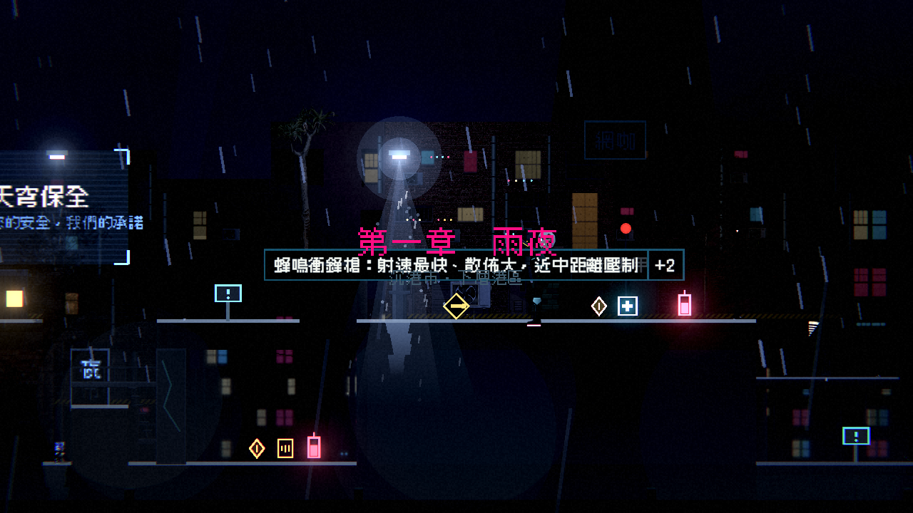

# [NE-64] 加入樹木與植被

> 狀態：完成

## 內文

### 需求
沉港市下層港區目前沒有任何植物。加入樹木、枯木與雜草，用在屋頂花園、廢棄角落與第二章的轉運站，替冰冷的場景補上一點生命，也能當作視覺引導。

### 來源
2026-10-03，使用者於開發對話中提出：「我想要用高解析度的免費素材換掉目前的場景、背景之類的素材，然後換上光影」；「樹、工廠、雲、賽博龐克風格的場景素材等等的都可以」；角色素材由使用者另行處理，本批只處理角色以外的東西。設計見 `design/11-free-assets/DESIGN.md`。

### 驗收條件
- [x] 至少 6 種樹與植被（含枯木），各有法線
- [x] 樹可以擺在背景與前景，前景的樹半透明、不遮擋敵人與子彈
- [x] 樹葉可隨風輕微搖動；搖動不產生每影格配置，數量多時效能不下降
- [x] 植被以資料擺放，現有地圖不需要改就能新增

### 測試流程
1. 開道具畫廊檢查樹與植被
2. 在測試場景放滿樹，確認畫面流暢
3. 執行完整測試套件，全部通過

---

# 跟其他票的關係

- Blocks：NE-66
- Blocked by：NE-57、NE-62
- Related：NE-62

---

# Commit-1

## 內文

下層港區沒有任何植物。
新增 9 種植物與雜物：松樹兩種、冷杉兩種、歪脖子樹、藍花楹、箭袋樹、樹墩、枯枝，以及半透明的前景松樹與冷杉（沿用同一張圖，放大 1.4 倍、透明度 0.55，不遮住敵人與子彈）。會搖動的植物用共用的著色器搖動：頂端擺動最大、根部不動，每棵以所在位置錯開節奏，同幅度共用一份材質，沒有每影格腳本也沒有每棵一份資源。第一章地圖擺了 10 處（屋頂花園、街角、貨運站）；新增植物只需要資料與圖片。
驗收：新增植物測試（種類與數量、法線、前景半透明、搖動共用材質且不跑每影格更新、第一章有擺放）；前景樹的位置避開所有敵人與危險物（既有的擺放檢查通過）。

### 測試結果

| 項目 | 結果 |
|---|---|
| 針對性測試（環境元件、過場動畫、章節過場） | 通過 1199 / 1199 |
| 暗場可讀性量測（第一章六個區段，乾淨的美術環境） | 全部通過 |
| 資料驗證 | 0 錯誤 |
| 執行 log | 無 ERROR（測試刻意觸發的容錯訊息除外） |

### 截圖

