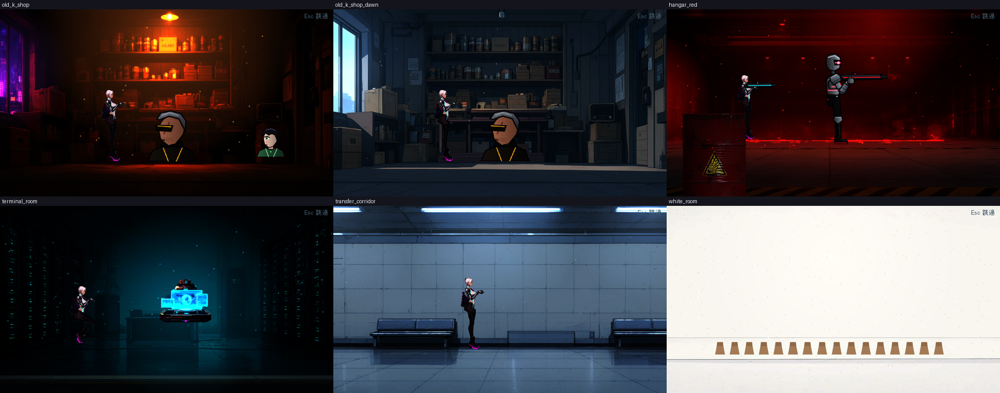
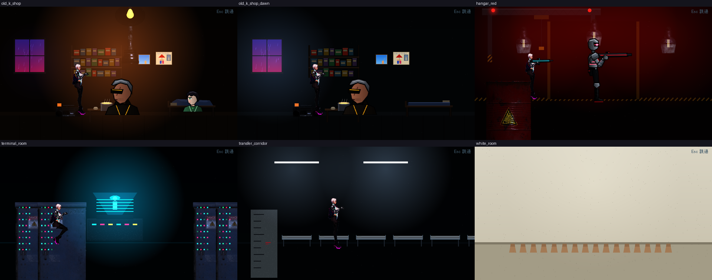

# [NE-65] 替換過場動畫舞台背景

> 狀態：完成

## 內文

### 需求
過場動畫的舞台（雨夜沉港、機庫、轉運站走廊、電梯等）是程式畫的圖層。換成同一批免費素材做的背景，讓過場畫面與遊戲內的場景一致。

### 來源
2026-10-03，使用者於開發對話中提出：「我想要用高解析度的免費素材換掉目前的場景、背景之類的素材，然後換上光影」；「樹、工廠、雲、賽博龐克風格的場景素材等等的都可以」；角色素材由使用者另行處理，本批只處理角色以外的東西。設計見 `design/11-free-assets/DESIGN.md`。

### 驗收條件
- [x] 現有舞台背景改用素材加工的圖層（室外用天空、樓群與道具，室內用本機 Qwen 生成的整張場景圖），導演腳本與演出順序不需要改
- [x] 鏡頭推拉與視差時畫質足夠，不出現接縫與模糊
- [x] 每個舞台的色調、光源與該章節遊戲內一致
- [x] 所有既有過場動畫仍能完整播放，略過鍵正常

### 測試流程
1. 逐一預覽所有舞台
2. 播放各章過場動畫，確認演出不變
3. 執行相關測試套件（過場動畫、章節過場、環境元件），全部通過

---

# 跟其他票的關係

- Blocks：NE-66
- Blocked by：NE-57、NE-60、NE-61
- Related：NE-38、NE-52、NE-53

---

# Commit-1

## 內文

過場動畫的舞台是程式畫的圖層。
「雨夜沉港」舞台換成同一批免費素材：暴雨雲天空、真實天際線與前後樓群（含窗光閃爍與屋頂信標明滅），原本的程式天際線拿掉；圖片圖層新增「線性取樣」與「窗光生命」兩個選項（像素圖維持最近點取樣），導演腳本與演出順序不用改。另外換了三個：藍天縫隙（真實藍天與雲）、電梯上升（窗外是暴雨雲與霓虹天際線）、升降井下降（管線加管夾的水管取代長條）。老 K 的舖子、機庫、轉運站走廊、白房間等室內舞台還沒換。
驗收：舞台預覽截圖；過場動畫與章節過場的既有測試通過。

### 截圖

# Commit-2

## 內文

老 K 的舖子（夜晚與清晨）、機庫、終端室、轉運站走廊、白房間這六個室內舞台還是程式畫的色塊與像素道具。
全部改成本機 Qwen 生成的整張場景圖，並對齊角色站的地板線：舖子是橘黃燈泡照著鐵罐貨架、窗外透進紫粉霓虹；清晨版從夜晚版修改而來，構圖與物件位置一致，燈泡熄滅、窗外變成冷色晨光；機庫是深紅色警報光的空曠大廳；終端室是兩側伺服器機櫃加青色光；轉運站走廊是冷色日光燈的地下設施；白房間是過曝的空白房間。導演腳本與演出順序沒有改。
每個舞台都加了動畫：舖子燈泡與窗外霓虹閃爍、光裡漂浮著塵粒；機庫四顆警報燈以固定節奏脈動、空中飄著餘燼；終端室的全像終端放在桌上、青色光緩慢起伏並飄著數據粒子；走廊日光燈閃爍；白房間的光緩慢呼吸、飄著細塵。
驗收：十個舞台預覽截圖逐一看過，角色站位與地板線吻合；過場動畫、章節過場的既有測試通過，略過鍵正常。

### 測試結果

| 項目 | 結果 |
|---|---|
| 針對性測試（過場動畫、章節過場、環境元件、道具、第二章） | 通過 1463 / 1463 |
| 素材預算檢查 | 通過（27 MB / 60 MB） |
| 執行 log | 無 ERROR（測試刻意觸發的容錯訊息除外） |

### 截圖

# Commit-3

## 內文

寫實風格的室內場景和凜、老 K 的肖像（動漫畫風）放在一起落差太大。
六個室內舞台（老 K 舖子夜晚與清晨、機庫、終端室、轉運站走廊、白房間）全部改成賽璐璐畫風的動畫背景（Edgerunners 式的平塗色、乾淨墨線、硬邊陰影），構圖、地板線與動畫（燈光脈動與閃爍、塵粒、數據粒子、餘燼）不變。清晨版仍從夜晚版修改而來，構圖一致。轉運站走廊的三盞日光燈各自閃爍。
驗收：十個舞台預覽截圖逐一看過，角色站位與地板線吻合；過場動畫、章節過場的既有測試通過，略過鍵正常。

### 測試結果

| 項目 | 結果 |
|---|---|
| 針對性測試（過場動畫、章節過場、環境元件、道具、第二章、劇情內容） | 通過 2086 / 2086 |
| 素材預算檢查 | 通過 |
| 執行 log | 無 ERROR（測試刻意觸發的容錯訊息除外） |

### 截圖

