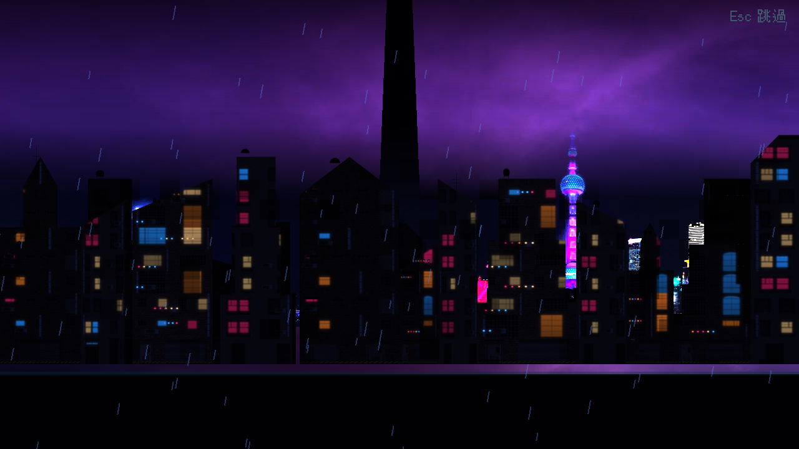
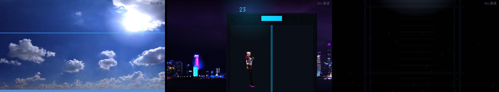

# [NE-65] 替換過場動畫舞台背景

> 狀態：進行中

## 內文

### 需求
過場動畫的舞台（雨夜沉港、機庫、轉運站走廊、電梯等）是程式畫的圖層。換成同一批免費素材做的背景，讓過場畫面與遊戲內的場景一致。

### 來源
2026-10-03，使用者於開發對話中提出：「我想要用高解析度的免費素材換掉目前的場景、背景之類的素材，然後換上光影」；「樹、工廠、雲、賽博龐克風格的場景素材等等的都可以」；角色素材由使用者另行處理，本批只處理角色以外的東西。設計見 `design/11-free-assets/DESIGN.md`。

### 驗收條件
- [ ] 現有舞台背景改用免費素材加工的圖層，導演腳本與演出順序不需要改
- [ ] 鏡頭推拉與視差時畫質足夠，不出現接縫與模糊
- [ ] 每個舞台的色調、光源與該章節遊戲內一致
- [x] 所有既有過場動畫仍能完整播放，略過鍵正常

### 測試流程
1. 逐一預覽所有舞台
2. 播放各章過場動畫，確認演出不變
3. 執行完整測試套件，全部通過

---

# 跟其他票的關係

- Blocks：NE-66
- Blocked by：NE-57、NE-60、NE-61
- Related：NE-38、NE-52、NE-53

---

# Commit-1

## 內文

過場動畫的舞台是程式畫的圖層。
「雨夜沉港」舞台換成同一批免費素材：暴雨雲天空、真實天際線與前後樓群（含窗光閃爍與屋頂信標明滅），原本的程式天際線拿掉；圖片圖層新增「線性取樣」與「窗光生命」兩個選項（像素圖維持最近點取樣），導演腳本與演出順序不用改。另外換了三個：藍天縫隙（真實藍天與雲）、電梯上升（窗外是暴雨雲與霓虹天際線）、升降井下降（管線加管夾的水管取代長條）。老 K 的舖子、機庫、轉運站走廊、白房間等室內舞台還沒換。
驗收：舞台預覽截圖；過場動畫與章節過場的既有測試通過。

### 截圖

