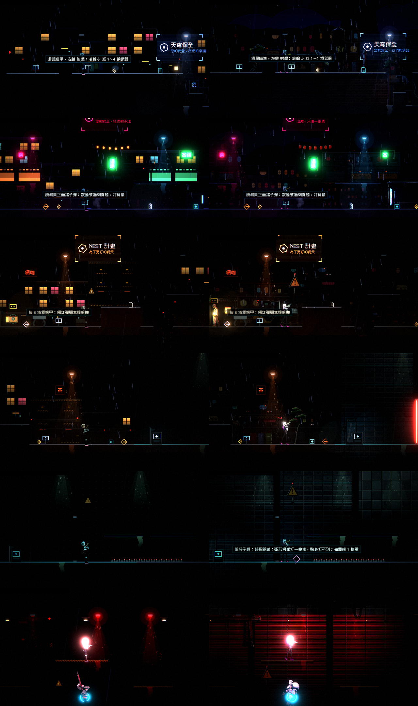
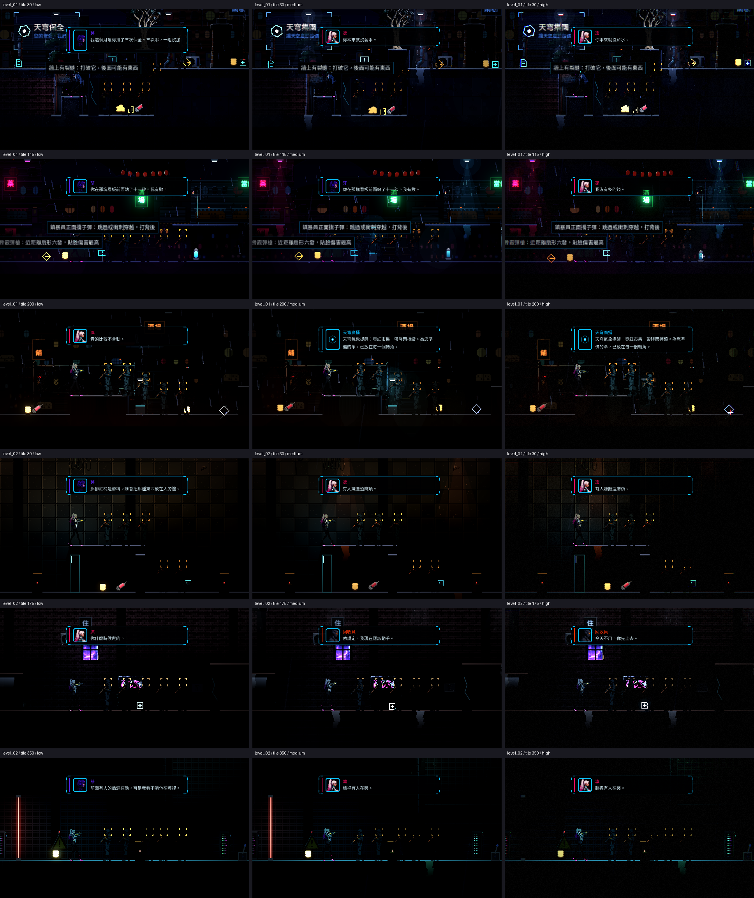
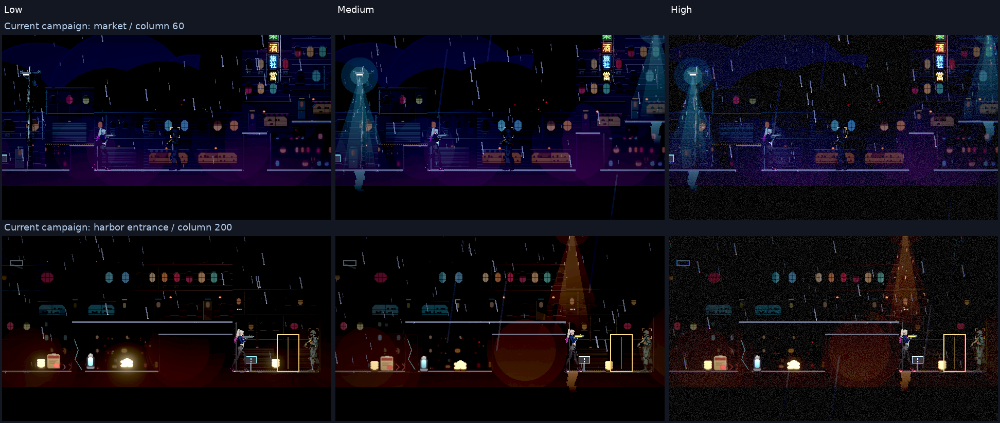
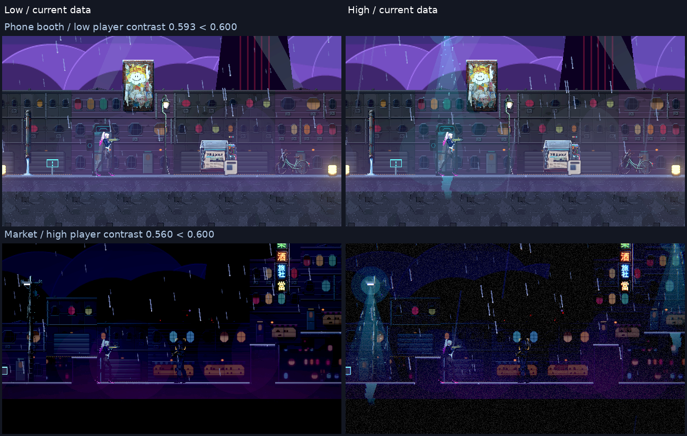
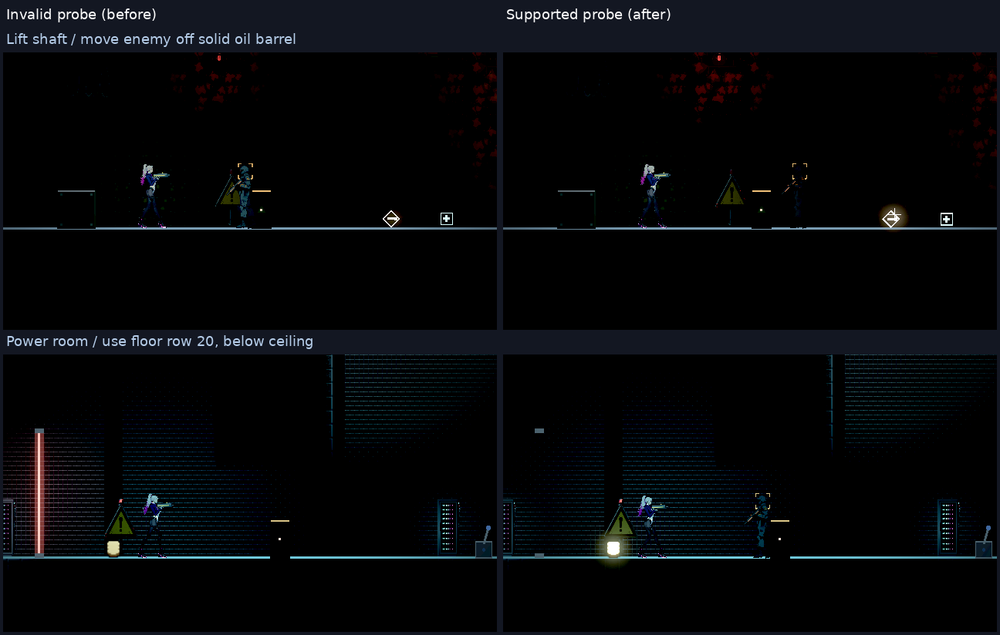

# [NE-66] 統一調色與光影整合

> 狀態：進行中

## 內文

### 需求
寫實素材比原本的像素美術亮、彩度低，直接放進去會與霓虹夜景、動漫風格的角色脫節。需要統一調色，讓所有替換的素材接上同一套光影、霧、泛光與色盤，並確認角色在新背景前依然清楚。

### 來源
2026-10-03，使用者於開發對話中提出：「我想要用高解析度的免費素材換掉目前的場景、背景之類的素材，然後換上光影」；「樹、工廠、雲、賽博龐克風格的場景素材等等的都可以」；角色素材由使用者另行處理，本批只處理角色以外的東西。設計見 `design/11-free-assets/DESIGN.md`。

### 驗收條件
- [x] 所有替換素材套用同一套調色規則，調色參數放在資料，可一處調整全部
- [x] 新素材的法線、自發光、霧與體積光都與光影系統正確配合，沒有不受光的平面
- [ ] 角色與敵人在每個區段都與背景清楚分離（暗場可讀性量測通過）
- [ ] 光影品質「低」時畫面仍可讀，效能不低於替換前的水準
- [ ] 整體畫面截圖與替換前對照，由使用者確認風格方向

### 測試流程
1. 對照替換前後的每個區段截圖
2. 切換光影品質三檔檢查
3. 執行暗場可讀性量測、效能量測與完整測試套件，全部通過

---

# 跟其他票的關係

- Blocks：NE-67
- Blocked by：BG-17、NE-58、NE-59、NE-60、NE-61、NE-62、NE-63、NE-64、NE-65、BG-1、BG-2、BG-3、BG-4、BG-5、BG-10、BG-16
- Related：NE-18、NE-23、NE-25

---

# Commit-1

## 內文

替換素材已全部是賽璐璐畫風後的整合檢查：暗場可讀性量測改為雙向並加入敵人（BG-13），第一章 6 區段中 5 區段玩家與敵人都達標、貨運站玩家 0.59（門檻 0.6），第二章 6 區段全達標；戰鬥負載基準已建立（BG-12）。光影品質「低」檔量測：第二章 6 個區段可讀性全部達標，夾層戰鬥每影格 9.7 ms（高檔 12.4 ms）。
發現光影品質「中」檔幾乎沒有效能差異（12.5 ms），開了 BG-16。尚未做：整體畫面與替換前的風格對照要使用者確認、調色規則集中到資料的檢查、完整的前後效能對照，所以票維持進行中。

# Commit-2

## 內文

調色原本分散在五支加工腳本裡各寫一份，沒有集中調整的地方。現在調色算法收成一份共用的，並新增一份全域調色資料：預設不改變任何像素，要統一調整整批素材的亮度、彩度、色調時改這一份（可分「全部」與「材質、立面、背景、天空、道具、場景圖」各類別），重跑對應腳本即可，自發光層不受影響。重跑材質、天空、背景、立面後像素與原本完全相同。素材檢查腳本新增驗證這份資料，以及每件道具（共用庫與各場景包，共 503 件）都有法線貼圖、標示有自發光的都有發光層；環境元件測試新增同樣的檢查，並確認共用庫道具載入後都是帶法線的受光貼圖，沒有不受光的平面。
角色與背景分離：第一、二章 12 個區段在光影品質「高」與「低」兩檔的玩家、邊緣、敵人對比全部達標，十一組新增光影預設在場景背景上的 17 個組合也全部達標（BG-13、BG-14）。
替換前後的同機對照（替換前取 NE-53 的提交，同一台機器、同樣的關卡位置與五隻站著的小兵；因為是軟體渲染，縮小解析度才看得出差異）：繪製呼叫少了 3～17%（低檔 507／505／457 對 544／511／469），但每影格耗時在低檔多 4～25%（31.6／33.0／32.5 對 30.3／30.5／26.0 毫秒）、高檔多 7～14%，貼圖記憶體由 59 MB 增到 362 MB，關卡畫面上的環境貼圖約 18 MB 增為 116 MB。因此「效能不低於替換前」這條沒有達成，已開 BG-17 處理；這個量測在軟體渲染下，實機 GPU 的差距要用 BG-12 的量測再確認。
風格對照圖（左：替換前、右：現在，由上而下為屋頂巷弄入口、霓虹市集、貨運站前段、貨運站後段、設施入口、頭目機庫）已附上，風格方向等使用者確認。

### 測試結果

| 項目 | 結果 |
|---|---|
| 暗場可讀性量測（第一、二章，高檔） | 12 / 12 區段達標 |
| 暗場可讀性量測（第一、二章，低檔） | 12 / 12 區段達標 |
| 環境元件測試套件 | 通過（含新增的法線與自發光涵蓋檢查） |
| 素材檢查（大小、授權、調色資料、法線與發光層） | 通過 |

### 截圖

# Commit-3

## 內文

承接 BG-17 的環境匯入優化，保留既有全域調色、LightKit、25 份光影 profile 與角色設定。新增目前 main 第一／二章各三處的低／中／高檔原生 Forward+ 對照與風格審查材料，沒有重新生成素材或改地圖擺位。三檔差異與重現命令、需要使用者回答的風格項目見 [審查材料](attachments/NE-66-review.md)。完整章節與舞台修前／修後另見 BG-17，不把縮圖或檔案大小當 GPU 記憶體。

### 本次驗證與阻塞

- BG-17 已合入 main（709b5bd9）；實際環境匯入 payload 307.3 → 152.9 MiB，但低檔耗時仍超過替換前 105%，實體 GPU 配置記憶體未驗證。
- 同機 640×360、每點 16 個樣本重新檢查兩章 16 個區段：玩家與邊緣通過，低檔頭目機庫、回收燈幕、看守長的敵人對比不足；高檔停電段、升降井入口、回收燈幕、電力室不足。未改動的 6f4805be 也可重現相關失敗，詳見 BG-17 原始 before／after log。取消過時的全部通過勾選，不以旧 12 段結果代替新版本驗收。
- 本次完整遊戲測試 77 組／50,204 checks、零 new／known failures；其後整合 ST-3 與 ST-15，補跑 1,612 與 2,630 checks，皆零 new／known failures。未新增 known_failures。NE-66 本身只新增文件與原生截图，固定以 709b5bd9 執行 changed 選擇檢查，不冒稱文檔改動跑過新的遊戲測試。
- 三檔圖每點 30-frame 樣本僅供畫面對照，不能當性能驗收；使用相同主機、Godot 4.7、llvmpipe Forward+，GPU 鎖逐次執行，截图在取樣後存檔。無實體 GPU，也未代替使用者確認風格。CI 查詢 Forbidden，尚未核對。
- 票維持「進行中」：BG-17 耗時與暗場條件未通過；「使用者確認風格」保留等待審查。角色霓虹／曝亮交 NE-222，不修改其核心檔案或合入的全局參數。

### 截圖

# Commit-4

## 內文

取得最新 main 的 ST-6 第一章與角色成果，補當前九份關卡資料、十四點的低／高檔，以及市集兩點三檔對照。原生 HDR 審查 PNG 沿用主分支的 sRGB 擷取，線性對比量測與門檻保持不變，舊交付圖保留為歷史。

第一章低檔 13／14 點通過，電話亭玩家對比 0.593 未達 0.600；高檔 13／14 點通過，市集玩家 0.560；中檔街道兩點通過。第二章首輪八點有效，兩點因探針撞油桶或落到天花板而無效；僅修正工具站立基準，兩點低／高重新量測皆站立有效且通過。十點覆蓋由首輪八有效點與兩個重測點構成，不冒稱初次整包通過。地圖、家具位置、光源、角色與全局調色未變更。

### 測試結果

- 固定差異基準 dfacf916：`tools/run_tests_changed.sh dfacf916` 選 ReadabilityTargetsSuite，134 checks、零 new／known failures；沒有空集合或完整測試聲明。
- 原生擷取檢查（HDR／LDR 已知色、alpha、尺寸、LDR bytes）退出 0；四組修正後第二章點有效。第一章未達標與第二章首輪無效的退出 1 均保留，沒有豁免。
- 主機改為 EPYC 7763／Forward+ llvmpipe，無實體 GPU；不與前輪 EPYC 9V74 性能互比，沒有新增 VRAM 或低檔 105% 通過聲明。原生完整關卡工具仍有 resources-at-exit 清理 ERROR，與無效或未達標一併記錄；未宣稱 log 全無 ERROR。
- 圖片解碼、報告與引用、diff 檢查通過；CI API Forbidden，未核對遠端 CI。

### 截圖與材料

[精確數據、原生条件、重現與接手介面](attachments/NE-66-followup/review.md)。票維持進行中，保留 BG-17 效能、目前第一章兩處可讀性與使用者風格確認；未修改或假造相依完成。

推送前整合到 127628ed，保留其他 Session 的 NE-71／NE-88 文檔與圖片，程式與取樣資料無差異；固定 dfacf916 重跑受影響測試仍為 134 checks／0 new／0 known failures，見本輪 rebased-tests.log。

首度推送因 main 同時前進而拒絕；重新 fetch／rebase 到 58d24bc4，保留 NE-223 的工具／文件／圖片，環境與取樣程式無相依差異。固定 dfacf916 再驗 134 checks／0 new／0 known，原始摘要另存 race-rebased-tests.log，正常快轉重推，未 force。
