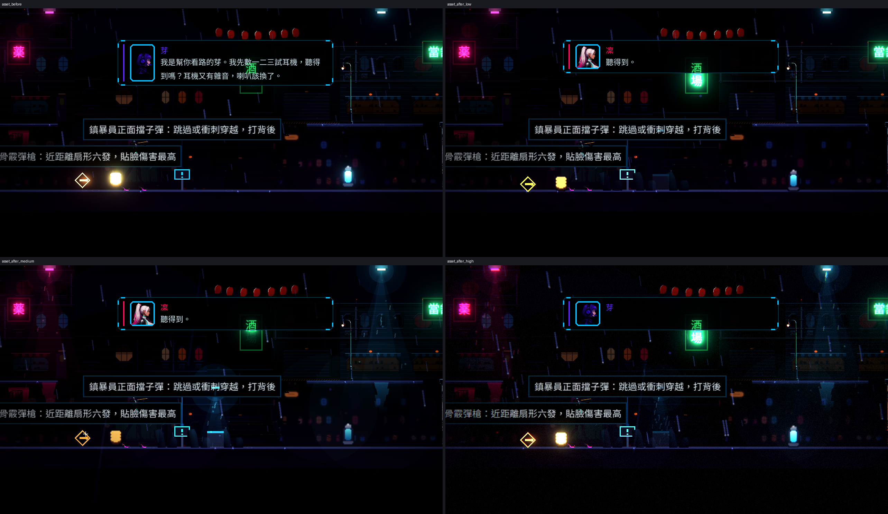
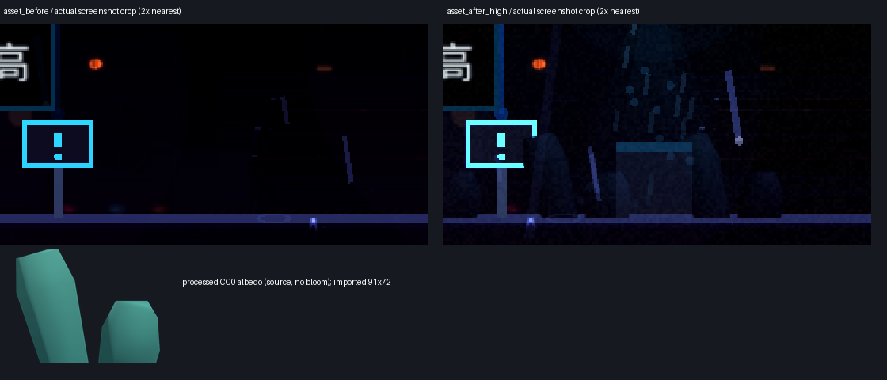

# [NE-67] 把素材替換流程寫成 Skill

> 狀態：審查中

## 內文

### 需求
整批替換做完之後，來源、做法與放進遊戲時的注意事項散在票與對話裡。整理成一份 Skill，以後想再換一批素材或新增場景時，可以直接照著做，不用重新摸索。

### 來源
2026-10-03，使用者於開發對話中提出：「我想要用高解析度的免費素材換掉目前的場景、背景之類的素材，然後換上光影」；「樹、工廠、雲、賽博龐克風格的場景素材等等的都可以」；角色素材由使用者另行處理，本批只處理角色以外的東西。設計見 `design/11-free-assets/DESIGN.md`。

### 驗收條件
- [x] Skill 涵蓋：來源與授權原則、下載、各類素材（材質、道具、天空、背景、樹）的加工、放進遊戲的資料格式、調色與光影、驗收
- [x] Skill 內有踩過的坑與判斷準則（例如哪些素材不能用、解析度與大小上限、風格落差的處理）
- [x] 照著 Skill 從零新增一個素材並放進遊戲，不需要查其他文件
- [x] Skill 放在專案內，開新對話時可被自動叫用

- [ ] 新對話只說「幫我換一個新的路燈素材」的自動叫用與完成驗證（待使用者審查）

### 測試流程
1. 開新對話，只說「幫我換一個新的路燈素材」，確認會叫用 Skill 並能完成

---

# 跟其他票的關係

- Blocks：無
- Blocked by：NE-66
- Related：無

---

# Commit-1

## 內文

專案內原本就有素材替換的 Skill，但停在換素材的中途：沒有全域調色、光影預設與可讀性量測、場景包、前後效能對照，也沒有在沒有 GPU 的雲端容器裡匯入、量測與截圖的做法。現在補成完整流程：來源與授權、下載、各類素材加工與放進遊戲的資料格式、沒有免費素材時用 Qwen 生成、場景包、全域調色、光影預設與暗場可讀性量測（含調整順序與踩過的坑）、前後效能與記憶體對照、驗收清單，過時的「還沒做」段落已移除。
還沒做：「照著 Skill 從零新增一個素材」與「開新對話說『幫我換一個新的路燈素材』」要在新對話實際走一次才能確認，所以這兩條留著未勾；NE-66 的風格方向也還在等使用者確認，票維持進行中。

# Commit-2

## 內文

依完整 free-asset-pipeline Skill 新增一件合適的小型 CC0 草叢，而非沿用成品快取。來源是 Kenney 官方 Starter-Kit-FPS、固定 185fd2326d74a5cf858cffc616f87cf9696f9cc0；README 明確將美術列為 CC0（不拿軟體 MIT 當美術授權）。既有 downloader 新增此官方来源的固定版本與 SHA-256 驗證；既有 build_props 補 GLB，沒有模型時失敗，避免误用舊 render。

新增 `kenney_sedge` 草叢的顏色圖、法線及 PropData；只在本件資料調暗／降彩度／偏冷，保留全域調色与既有美術。world size 22.7×18、搖動 0.6，原圖 182×144；實際匯入 91×72、無 mipmaps，RGBA payload 每層 26,208 bytes。低檔關法線、中／高檔沿現有 LitTextures 與搖動材質受光，無自發光層。

真實第一章市集建立三個 PropNode，拍新增前／低／中／高；原關卡、家具、角色與骨架未變更。預覽位置不寫入正式 map；正式擺位的 id／top_left／底邊介面交 Session 3。兩組 Skill 與設計同步寫入可重現命令、來源、匯入規則、跨 Session 分工及新對話驗收限制，見 [完整重現與接手材料](attachments/NE-67/reproduce.md)。

### 驗證

- 從空的本票 raw 目錄抓取來源；重新移出本票快取、重新下載與渲染加工；顏色、法線與 .tres 雜湊三項全部一致。
- 3 項來源測試通過：損壞快取不覆蓋、不明美術授權在下載模型前拒絕、浮動版本／越界目的地在任何下載前拒絕。
- `check_assets.py` 通過；Godot 真實遊戲預覽載入 PropLibrary、PropData.validate 與三個 PropNode，四張原生 1280×720 Forward+ 圖成功保存。使用共用 GPU 鎖，無 ComfyUI／新生成端。
- 受影響測試固定基準 3dc68526，結果附下；未把新失敗加入 known_failures。工具結束有既有 ObjectDB／resources-at-exit 清理警告，未宣稱 log 完全無 ERROR；沒有 GDScript 解析錯誤。

票改「審查中」只代表本次加工與遊戲預覽已交付；NE-66 全局風格／效能／暗場仍未通過，並未偽造相依完成。新對話測試沒有在本 Session 執行；保留未勾選與原測試提示，請使用者在新對話留下實際結果。正式擺位依 Session 3 接手。

### 截圖

### 最終測試結果

`tools/run_tests_changed.sh 3dc68526`：27 組、41,732 checks、new／known failures 皆 0（99 秒）。另有來源 Python 測試 3 項通過、資產檢查通過、技能兩份逐位元相同、JSON／Python 編譯與 diff whitespace 檢查通過。原始結果見 attachments/NE-67/tests.log。
