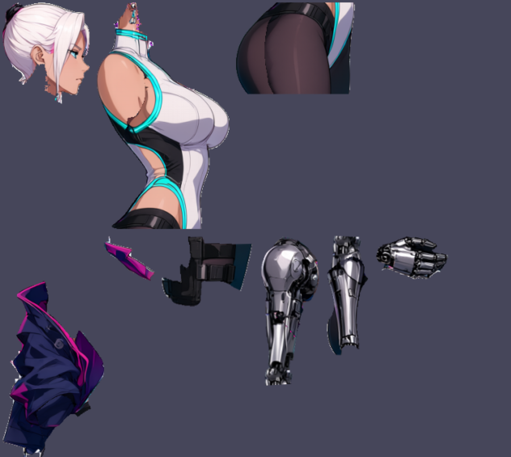
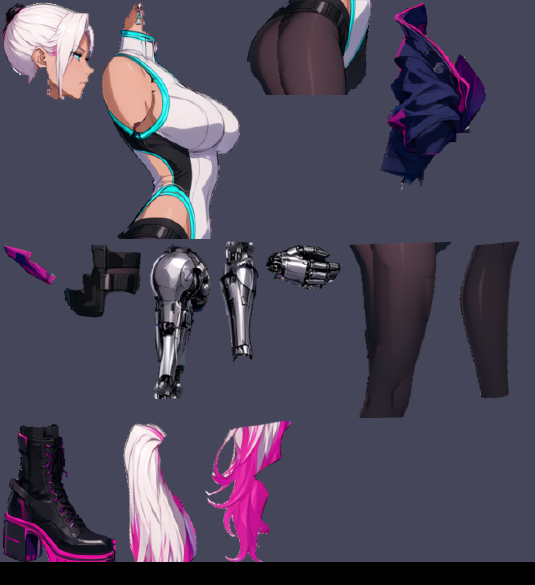
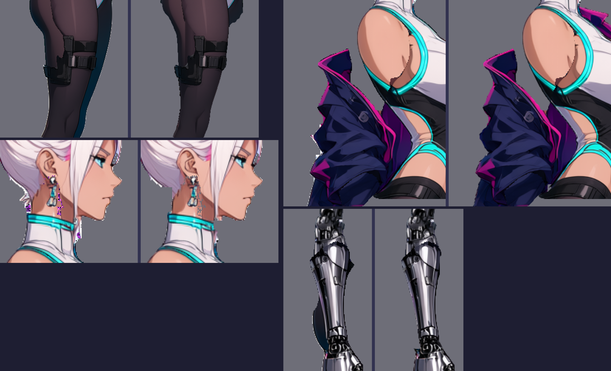
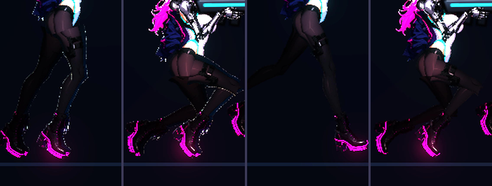
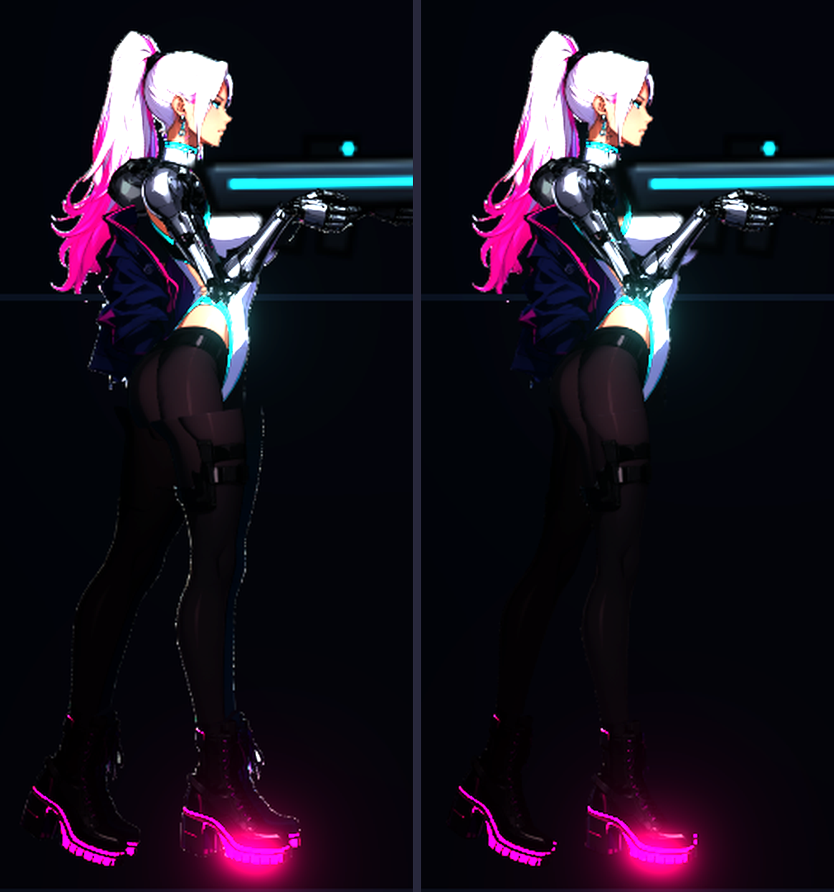
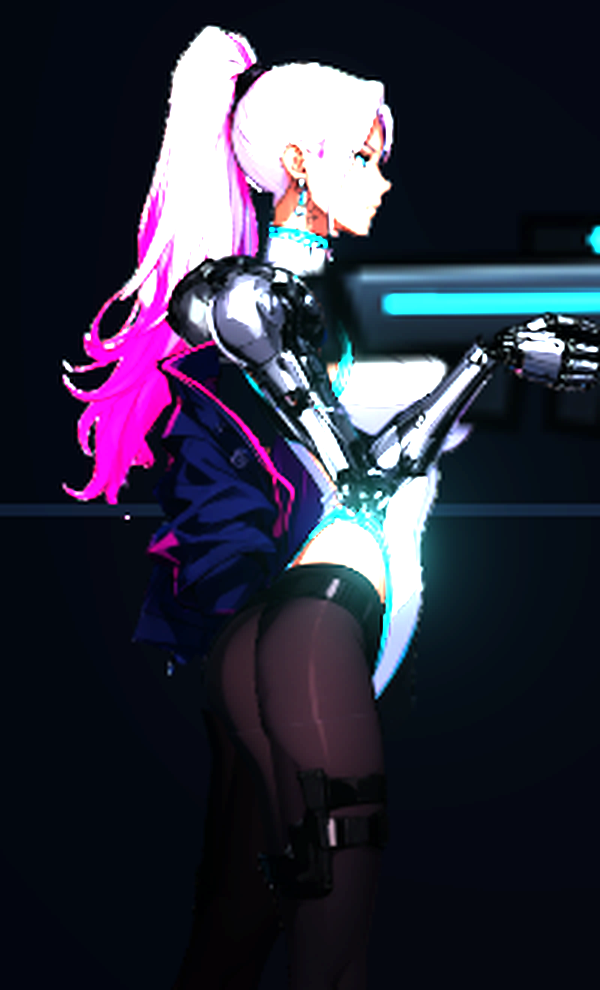
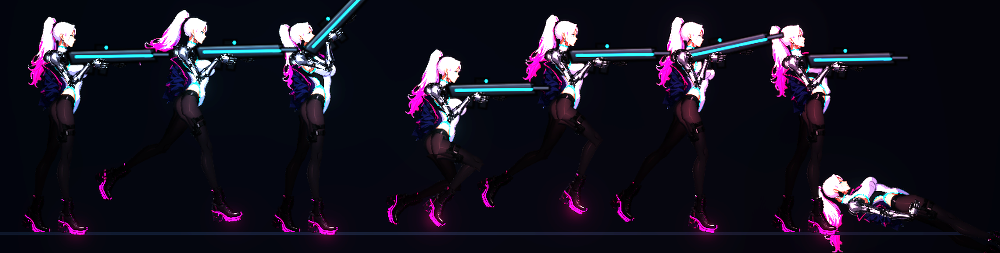
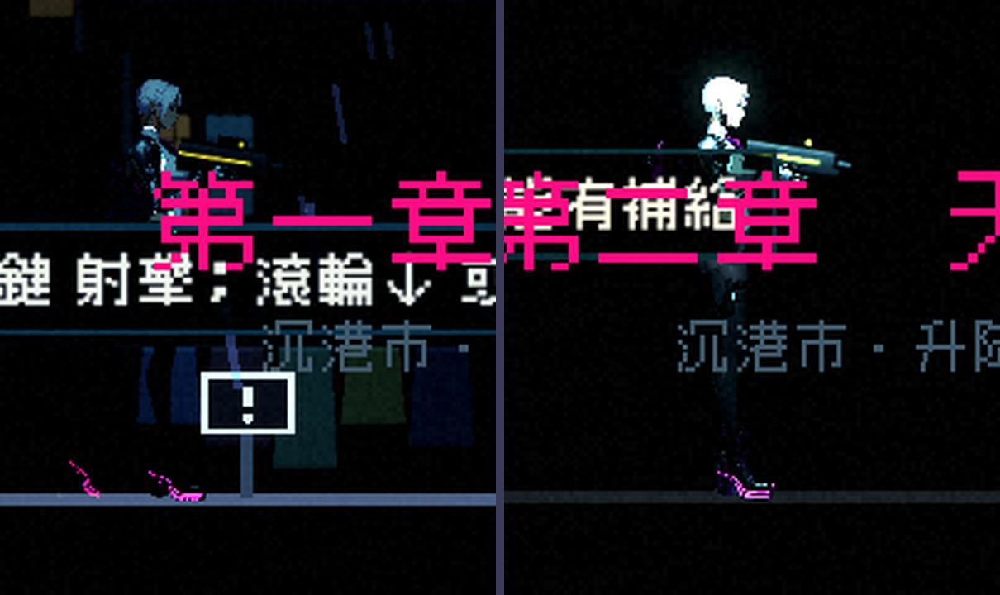

# [NE-68] 修整凜新零件圖的細節

> 狀態：完成

## 內文

### 需求
凜已改為約 7.5 頭身的新造型，13 張零件圖由透明背景的側面圖用 SAM 3.1 分件、再由 Qwen 補全被擋住的部分切出，已經放進遊戲且 8 種動作都沒有錯位。但零件圖與原圖相比還有一批可以看出的瑕疵，需要逐項修到放大看也不突兀。

背景（給接手的人）：
- 流程文件：`design/03-art-pipeline/CHARACTER_PIPELINE.md`（每一步的輸入、輸出、零件掛載表、替換方式）。一鍵腳本：`tools/comfyui/build_character.py`，規格：`tools/comfyui/specs/rin_side.json`，配方：`tools/comfyui/recipes/rin.json`。
- 中間產物都在 `art_src/characters/rin2/`：`base_rgba.png`（透明背景原圖）、`sam/`（SAM 遮罩）、`04_stages/`（剝層圖）、`05_groups/`（補全前後對照）、`06_parts/`（每個零件的完整圖層，座標同原圖）、`06_parts/ownership.png`（每個像素屬於哪個零件）、`08_preview/`（預覽圖）。
- 遊戲裡的零件：`art/characters/rin/parts/`，共 13 件。
- 預覽指令：`godot --path . res://tools/rig_preview.tscn -- --out=<絕對路徑>.png --chars=rin`，另有 `--closeup`、`--head`、`--damage --zoom=4.2`。
- 已知瑕疵的截圖都在 NE-17 的進度紀錄（第 29～34 項）。

要處理的瑕疵（逐項）：
1. 大腿零件上有 Qwen 補全時畫出來的多餘線條（像口袋輪廓的矩形細線），原圖沒有。
2. 手臂的肘部補全區看起來像拼貼，上臂與前臂交界的光澤、線條不連續。
3. 骨盆、大腿、小腿在關節切開處有細微色差或一圈細線。
4. 零件邊緣（尤其腿的外緣）在遊戲內有 1 像素的點狀亮邊，是半透明邊緣經法線與打光後造成。
5. 頭部零件下緣殘留一小段耳環與頸部碎片。
6. 夾克有一塊獨立浮在頸旁的領口碎片，下緣有一小塊暗色殘留。
7. 馬尾尾端左側有一條原圖本來就有的青色細條，確認是否要保留。
8. 皮膚與絲襪暗部在遊戲光線下與原圖的明暗對比，確認不會偏橘或過暗。

### 來源
2026-10-03，使用者在開發對話中要求「把還沒做的事情寫成票」。瑕疵清單來自該次對話中逐張檢視的預覽與遊戲內截圖。

### 驗收條件
- [x] 上述 8 項逐項處理完，每一項在票上附修前、修後的對照截圖
- [x] 預覽的特寫（站姿、瞄準）放大 2 倍看，沒有多餘線條、碎片、拼貼感或色塊
- [x] 8 種動作（待機、跑、瞄準、蹲、跳、格擋、硬直、倒下）關節處沒有露縫或色差
- [x] 修改後的零件尺寸與支點與目前相同，不需要改程式與角色定義
- [x] 手繪修正的圖放進 `art_src/characters/rin2/overrides/`，重跑一鍵腳本不會被蓋掉
- [x] 第一章第一關與第二章各一張遊戲內截圖，凜顯示正常

### 測試流程
1. 執行 `tools/comfyui/build_character.py --from textures`，確認零件圖重新產生且覆蓋修正圖
2. 執行預覽的 `--closeup`、`--head`，檢查上面 8 項
3. 執行預覽的 8 種動作，檢查關節
4. 進第一章第一關，跑、跳、瞄準，目視檢查

---

# 跟其他票的關係

- Blocks：無
- Blocked by：NE-17
- Related：NE-70、NE-71

---

# Commit-1

## 內文

凜的零件圖放大看有一批瑕疵：遠側腿與遠側靴的藍綠殘影跟著前腿走、腿與手臂邊緣一圈點狀亮邊、大腿上多出口袋輪廓線、頭部下緣殘留耳環與頸部碎片、夾克領口碎片浮在脖子旁、夾克下緣有暗色殘塊、手臂外側有一塊深色殘影。
現在零件圖產生流程多了一道「清理」：移除遠側腿與靴、用周圍的絲襪色重新補平口袋線、把半透明邊緣的白色光暈改成內側顏色、清掉游離的小碎屑與零星白點／洋紅點、手臂與腿的輪廓抹平階梯狀鋸齒；夾克領口獨立成一個零件掛在脖子上。需要手繪修的圖仍可放進手繪覆蓋資料夾，重跑流程不會被蓋掉。

8 項處理結果：
1. 大腿多餘線條：已移除，補全區改成依上下兩端顏色漸層填補，保留絲襪的光澤與暗面。
2. 手臂肘部：深色殘影與突出尖角移除，輪廓抹平；補全區與上下段的明暗保留，看起來是一段接著一段的義肢關節，不再有色塊。
3. 關節接縫與色差：跑步、蹲下的髖、膝、踝都沒有露縫或色差（見關節對照圖）。
4. 1 像素點狀亮邊：消失（見關節對照圖，修前腿邊一圈亮點，修後沒有）。
5. 頭部下緣：耳環殘片與頸部碎片已清掉，耳環與臉完整。
6. 夾克：領口碎片改為獨立零件，下緣暗色殘塊與白色碎屑已移除。
7. 馬尾尾端左側的淡色細條：確認是原圖就有的髮絲高光，保留。
8. 皮膚與絲襪顏色：零件圖沒有重新上色（只改邊緣），顏色與原圖一致；遊戲內夜景燈光下整體偏暗，是燈光環境所致，不是貼圖偏色。

另外查出站姿時大腿上端有一塊亮色方框：前腳與前手臂被沿用舊 Q 版骨架的左右偏移量往前推了一小段，和骨盆、夾克、衣服對不齊，切口邊緣變成一個方框。已把前側手腳的偏移改為 0，後側手腳縮小，臀部到大腿與肩到手臂都連續；零件在關節切口處也不再保留透明邊，法線貼圖不會在切口沿線打出亮邊。

驗收了 8 項逐項前後對照、預覽特寫與八種動作的關節、第一章與第二章的遊戲內畫面，結果都正常。依使用者指示，沒有跑完整測試套件，只驗證本票範圍。

### 測試結果

| 項目 | 結果 |
|---|---|
| 零件重新產生並套用手繪覆蓋 | 通過（14 件，覆蓋資料夾為空時略過） |
| 預覽特寫、頭部、八種動作 | 關節無露縫、無色差 |
| 遊戲內第一章、第二章 | 凜顯示正常，無錯誤訊息 |
| 完整測試套件 | 依使用者指示未執行 |

### 截圖

---
