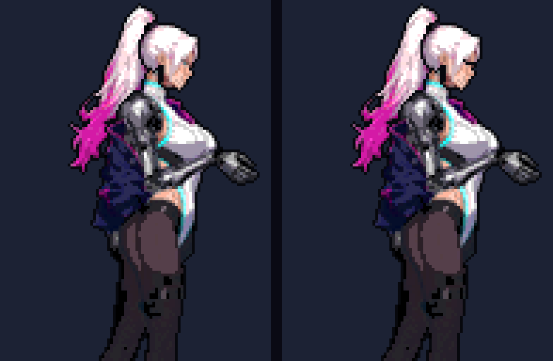
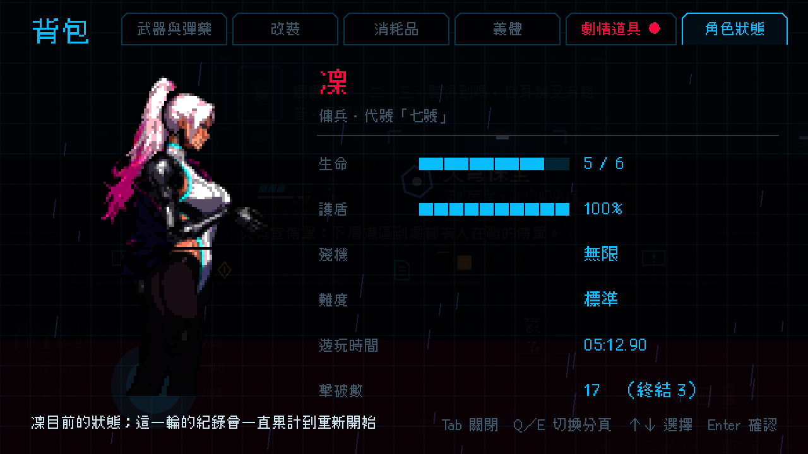
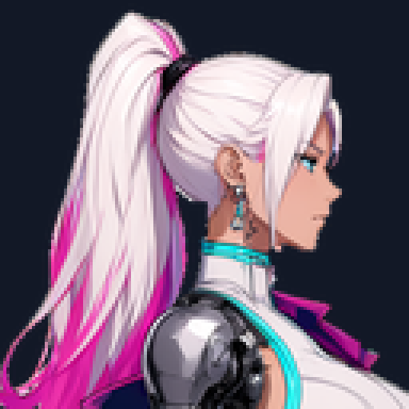
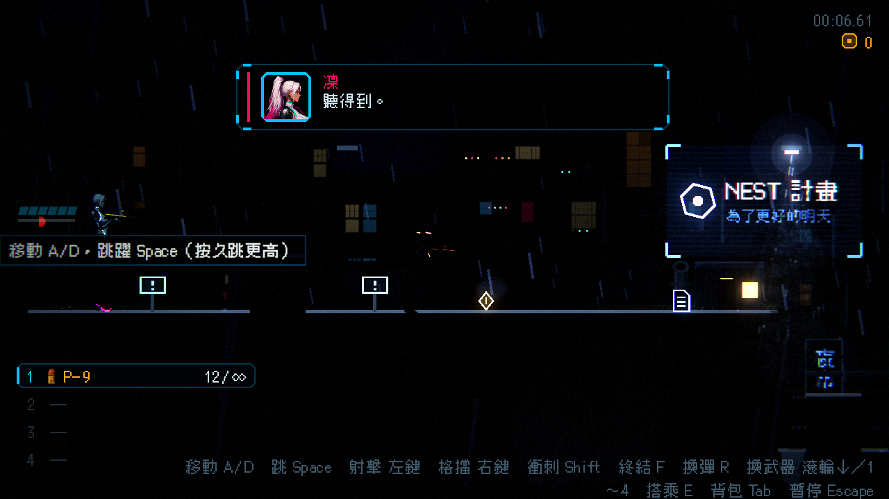

# [NE-69] 重做凜的眨眼與頭像立繪

> 狀態：完成

## 內文

### 需求
凜換成新造型後，遊戲裡所有用到她臉的地方還是舊的或沒有設定：背包立繪的眨眼、對話的頭像、背包立繪本身。需要依新造型重做，並讓眨眼正常運作。

背景（給接手的人）：
- 新角色定義 `art/characters/rin/character.json` 目前沒有 `portrait.blink`（眨眼設定：頭部貼圖上要抹成膚色的眼睛範圍四邊形、閉眼時畫的眼線）。舊凜有，新流程的腳本（`tools/comfyui/cut_layers.py`）已支援從規格的 `blink` 欄位算出，只是規格還沒填。眼睛在原圖 `art_src/characters/rin2/base_rgba.png` 的位置大約在臉部右側（鼻尖約 (487,132)，眼睛在其左上），需要放大量出四個角點與眼線兩端。
- 頭像與背包立繪是用角色骨架渲染產生的：`tools/art/paint_portraits.gd`（會讀 `portrait.blink` 產生閉眼層），清單在 `tools/art/paint_assets.gd` 的 `PORTRAITS`（含 `rin`）。背包裡的呈現在 `ui/inventory/pixel_portrait.gd`（眨眼、呼吸、頭髮擺動）。
- 流程文件：`design/03-art-pipeline/CHARACTER_PIPELINE.md`。

要做的事：
1. 在規格 `tools/comfyui/specs/rin_side.json` 加上 `blink`（頭部零件的眼睛範圍與眼線），重跑 `textures` 步驟，確認 `character.json` 出現 `portrait.blink`。
2. 重新產生凜的頭像與背包立繪（睜眼層、閉眼層）。
3. 新造型是 7.5 頭身，頭像與立繪的取景要重新調整（以前是 Q 版大頭）：頭像取頭與肩，立繪取全身或大半身，不能切掉馬尾與臉。
4. 確認 `paint_assets.tscn` 重新產生時不會把凜的角色貼圖用程式畫的舊圖蓋掉（凜已不再有 `painter_style`，要確認清單與流程）。

### 來源
2026-10-03，使用者在開發對話中要求把還沒做的事情寫成票；眨眼與頭像在該次對話的「還沒做」清單中。

### 驗收條件
- [x] `character.json` 有 `portrait.blink`，眼睛範圍剛好蓋住眼睛、不抹到眉毛與睫毛
- [x] 背包立繪的睜眼、閉眼兩層用新造型產生，眨眼時看起來自然（閉眼線在眼睛原位）
- [x] 對話頭像使用新造型，取景包含完整的臉與髮型，沒有被切掉
- [x] 背包立繪取景完整，馬尾與臉都在畫面內，不模糊、不鋸齒
- [x] 其他角色的頭像與立繪不受影響
- [x] 附背包立繪（睜眼、閉眼）與對話頭像的截圖

### 測試流程
1. 規格加上 `blink` 後執行 `tools/comfyui/build_character.py --from textures`
2. 執行頭像與立繪的產生工具（`paint_portraits`），開啟背包畫面，等待眨眼
3. 進任一有凜說話的對話，檢查頭像
4. 截圖：背包（睜眼、閉眼）、對話一張

---

# 跟其他票的關係

- Blocks：無
- Blocked by：NE-17
- Related：NE-71

---

# Commit-1

## 內文

凜換成新造型後，眨眼設定是空的（背包立繪不會眨眼），背包立繪與對話頭像仍是舊的 Q 版大頭，取景也不適合 7.5 頭身。
現在：
- 角色定義有眨眼設定，眼睛範圍剛好蓋住眼睛、不抹到眉毛；閉眼時眼線畫在眼睛原位。
- 背包立繪重新產生睜眼與閉眼兩層，取景改成頭頂到大腿中段，頭與馬尾完整，臉部與頭髮清楚；待機姿勢的瞄準角度放低，頭部不再低垂。
- 對話頭像（對話框、無線電、過場字幕共用）改由新造型直接切出的肩部以上畫像，包含完整的臉、髮型與馬尾上半。
- 角色製作流程跑到貼圖步驟時會一併產生這張頭像；「重畫所有頭像」的工具不再包含凜，不會蓋掉。
- 新增 `portraits` 截圖情境（無線電中凜回答的畫面）。
其他角色的頭像與立繪沒有被動到（只有凜的檔案有變動）。依使用者指示，沒有跑完整測試套件，只驗證本票範圍。

### 測試結果

| 項目 | 結果 |
|---|---|
| 眨眼設定寫入角色定義 | 通過（含眼睛四邊形與眼線） |
| 背包立繪睜眼／閉眼兩層 | 通過，閉眼層只差眼睛處 |
| 背包畫面（角色狀態頁） | 立繪完整顯示 |
| 無線電對話（凜回答） | 頭像完整顯示，無錯誤訊息 |
| 其他角色頭像與立繪 | 檔案未異動 |
| 完整測試套件 | 依使用者指示未執行 |

### 截圖

---
