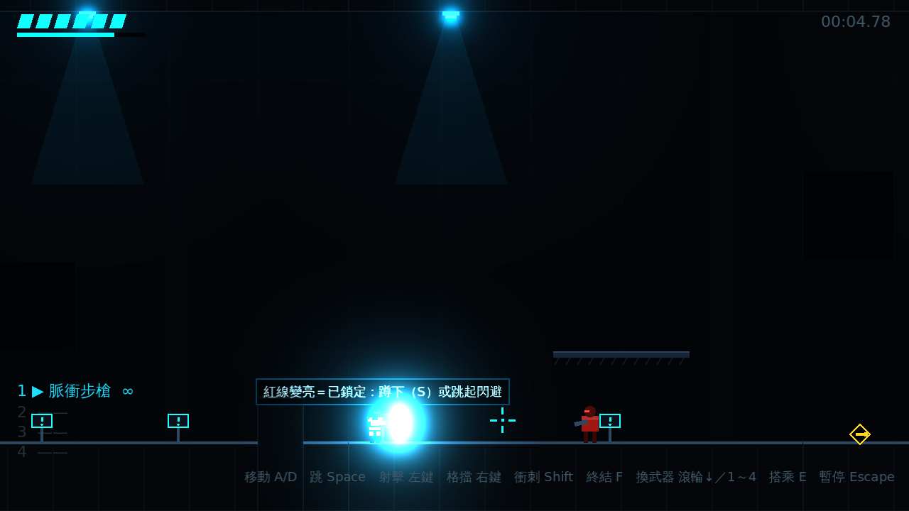
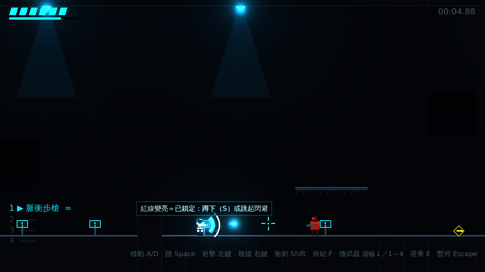

# [NE-6] 新增格擋與完美反彈

> 狀態：完成

## 內文

### 需求
新增按住右鍵格擋：擋下準星方向的子彈與接觸攻擊；剛按下的瞬間格擋可把子彈朝準星反彈。讓防守有技巧上限，並與衝刺形成不同用途。

### 來源
2026-10-02，使用者於開發對話中提出：「右鍵格擋」。

### 驗收條件
- [x] 按住右鍵時角色舉起護盾，準星方向扇形內的子彈與接觸攻擊被擋下且不扣血
- [x] 剛按下的短時間內格擋子彈會朝準星方向反彈並造成加倍傷害，有專屬的頓幀與音效
- [x] 格擋消耗護盾能量並在 HUD 顯示，放開後自動回復
- [x] 能量耗盡時破防並短暫硬直
- [x] 爆炸無法格擋
- [x] 格擋中移動變慢且不能射擊
- [x] 手把以 LT 格擋

### 測試流程
1. 面對清掃兵按住右鍵，確認子彈被擋下
2. 在子彈到達前一刻按下右鍵，確認子彈反彈並擊中敵人
3. 連續格擋到能量耗盡，確認破防硬直
4. 站在自爆蟲爆炸範圍內格擋，確認仍會受傷
5. 執行完整測試套件，全部通過

---

# 跟其他票的關係

- Blocks：NE-10
- Blocked by：NE-5
- Related：無

---

# Commit-1

## 內文

原本只能靠衝刺與蹲下閃避，防守沒有技巧上限。
現在按住右鍵（手把 LT）會朝準星方向舉起能量護盾：扇形範圍內的子彈與接觸攻擊被擋下且不扣血，但會消耗護盾能量，放開後自動回復；能量耗盡會破防並短暫硬直、一段時間不能再格擋。剛舉盾的瞬間為完美格擋：子彈改為我方所有、朝準星方向加速飛回並造成兩倍傷害，近身攻擊則讓攻擊者暈眩，並伴隨頓幀、閃光與專屬音效。格擋中移動變慢且不能射擊；爆炸無法格擋，必須用衝刺閃避。HUD 生命值下方新增護盾能量條。
驗證了完美格擋反彈方向、一般格擋消耗能量、背後攻擊不被擋下、格擋中無法射擊、破防硬直與鎖定、爆炸穿透護盾、完美格擋近身攻擊使敵人暈眩；並實際渲染確認護盾與反彈子彈的畫面。

### 測試結果

| 項目 | 結果 |
|---|---|
| 完整測試套件 | 通過 143 / 143 |
| 資料驗證 | 0 錯誤 |
| 執行 log | 無 ERROR |

### 截圖

