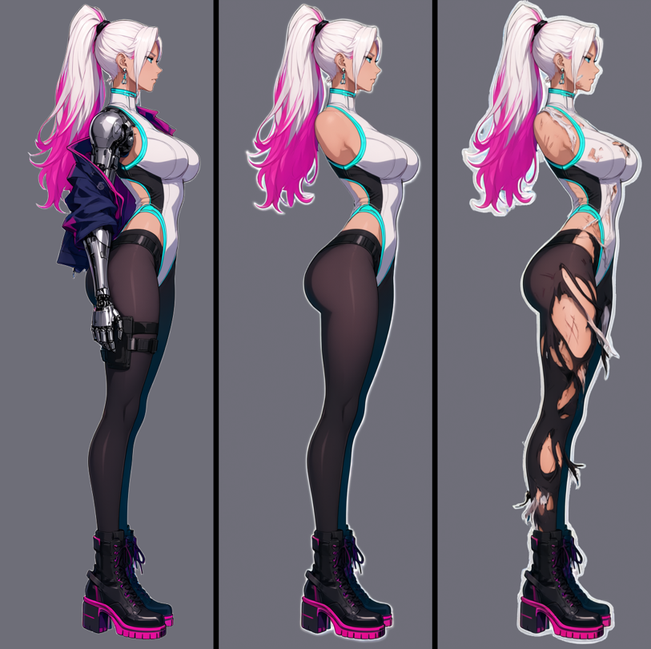
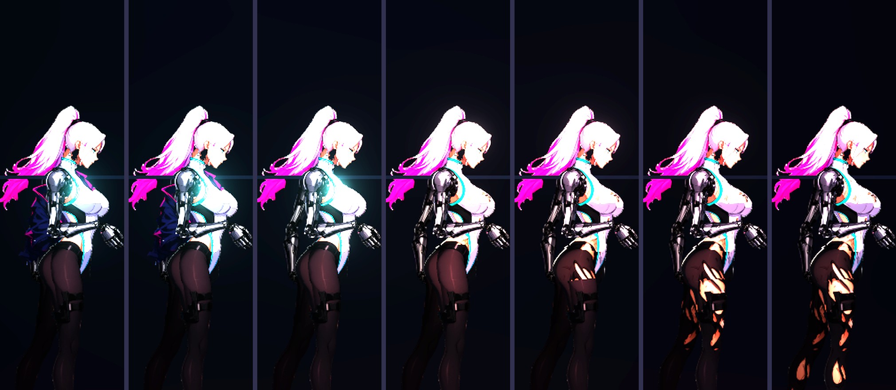
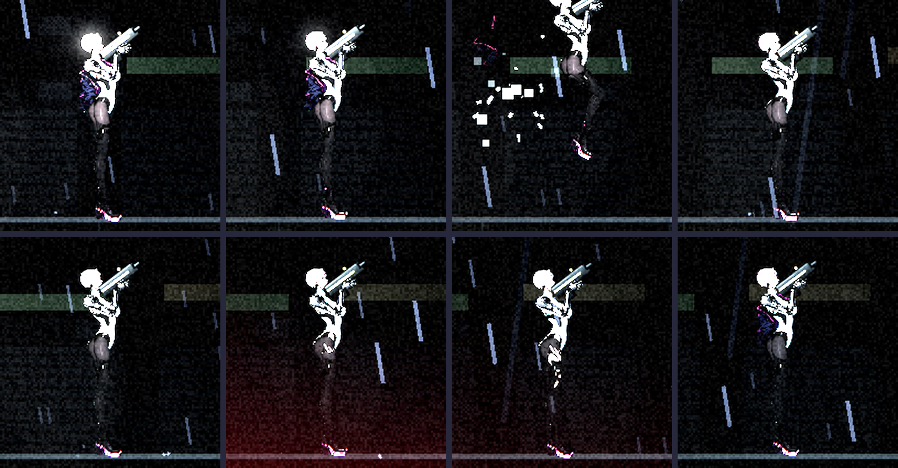

# [NE-70] 製作凜受傷時衣物脫落

> 狀態：完成

## 內文

### 需求
凜原本的設計是受傷時裝甲依序脫落。新造型沒有裝甲，使用者希望改成衣物依生命值逐片被打飛、露出破損的底層，並且絲襪最後才脫落。新流程目前沒有接上這個機制，需要補做。

背景（給接手的人）：
- 遊戲裡既有機制：角色定義裡零件可以設 `armor_order`（脫落順序，小的先掉），程式依生命比例顯示或隱藏，減少時該片會噴飛（`game/rig/character_rig.gd` 的 `set_armor_ratio`，玩家端在 `game/player/player_visual.gd` 呼叫）。只要在 `character.json` 的零件加上 `armor_order` 即可套用，不需要改程式。預覽工具有 `--damage` 模式（生命 100%→0% 七個階段）。
- 舊造型的實驗過程與結果在 NE-17 進度紀錄第 12～14 項：做法是 Qwen 依原圖改圖產生「衣物撕裂」的底層（保持姿勢與比例），再把完整版衣物切成幾片疊在上面，依順序脫落。
- 新流程的現況：零件圖是完整穿著的樣子，夾克是一整件、連身衣與絲襪沒有拆成可脫落的片。新流程文件：`design/03-art-pipeline/CHARACTER_PIPELINE.md`。
- 重要的做法限制：Qwen 補全時會把不該畫的東西重畫進來，所以要用「剝層」（整張圖交給 Qwen 移除某些東西、補完後面）加上只取缺口的方式；詳見文件第 3 步細節。

設計決定（使用者已確認）：
- 脫落順序：夾克 → 連身衣 → 絲襪，絲襪最後才掉，到 0% 時仍保留破損的絲襪殘片。
- 露出程度的底線：底層保留遮住關鍵部位的破損碎布，不做全裸、不畫露點的版本。

要做的事：
1. 用透明背景的原圖請 Qwen 產生破損底層（衣物撕裂、皮膚有擦傷，關鍵部位仍有碎布），對位誤差要在 1 像素內。
2. 把完整版衣物切成可脫落的片：夾克、連身衣上半、連身衣下半、絲襪大腿、絲襪小腿，各自設定脫落順序。
3. 底層的零件同樣依關節切成零件，圖層順序在完整版衣物之下。
4. 生命 100% 時畫面要與目前完整穿著的外觀一致（不能露出底層的邊緣或色塊）。
5. 把這個步驟加進一鍵腳本與流程文件。

### 來源
2026-10-03，使用者在開發對話中提出「補上破衣效果，畢竟現在都換上非審查的模型了」「衣服跟絲襪都做上破損的配件效果，即使全破也要保留一部分的絲襪」。

### 驗收條件
- [x] 預覽的 `--damage` 七個階段，衣物依「夾克 → 連身衣 → 絲襪」順序逐片消失
- [x] 生命 100% 的畫面與完整穿著的外觀一致，沒有底層邊緣露出或色塊
- [x] 生命 0% 時仍保留破損的絲襪殘片與遮住關鍵部位的碎布，沒有全裸
- [x] 遊戲內玩家受傷時，對應的衣物片噴飛，音效與粒子沿用裝甲脫落的效果
- [x] 回復生命後衣物片依比例重新出現（沿用既有行為）
- [x] 8 種動作下底層與衣物片關節沒有錯位、露縫
- [x] 流程文件補上破損底層與衣物片的步驟、輸入輸出
- [x] 附七個階段的預覽截圖與一張遊戲內受傷的截圖

### 測試流程
1. 產生破損底層與衣物片後，執行預覽 `--damage --zoom=4.2`，檢查七個階段
2. 預覽 8 種動作，檢查關節
3. 進遊戲，讓凜被敵人打到不同血量，確認逐片脫落與噴飛
4. 吃補給回血，確認衣物片回來

---

# 跟其他票的關係

- Blocks：無
- Blocked by：NE-17
- Related：NE-68、NE-71

---

# Commit-1

## 內文

新造型的凜受傷時沒有任何變化（舊的裝甲脫落機制沒接到新零件）。
現在她的衣物依生命比例逐片被打飛，露出撕裂的底層，每一步約 20%：夾克（領口、上半、兩段下擺一起）→ 連身衣胸口 → 連身衣下半 → 絲襪大腿 → 絲襪小腿。生命 100% 時外觀與完整穿著完全一致；到 0% 仍留著撕裂的連身衣碎布遮住胸口與下腹、絲襪殘片留在大腿與小腿，沒有全裸。回血時衣物片依比例回來。
底層是請 Qwen 先把夾克、義肢、手、槍套整個移除並補完後面（身體完整可見），再把那張圖的衣物撕裂（連身衣破洞與擦傷、絲襪大洞與脫線），兩次編輯都和原圖完全對位（誤差 0 像素），再套用完整零件的輪廓，所以底層與衣物片同形狀。試了三個種子，選了保留臀部曲線、撕裂程度適中的一張。
同一次修掉的兩個相關問題：(1) 衣物片同一步可以有多片（夾克四片、前後腳的同一段絲襪），一起飛走；(2) 腿與手臂在關節處的切口改成垂直於骨頭，不再沿影像橫列切，並且切口那側不留透明邊，法線貼圖不會在臀腿交界打出一條亮線。
驗收了七個生命階段的預覽、八種動作、遊戲內被打六次與回血的畫面，結果都正常。依使用者指示，沒有跑完整測試套件。

設計決定的說明：票內「嘗試做全裸、畫露點的版本」與驗收條件「沒有全裸、關鍵部位仍有碎布遮住」互相衝突，這次依驗收條件做（保留碎布與絲襪殘片）；若要更暴露的版本，換底層的撕裂提示詞與種子重跑即可，不必動程式。

### 測試結果

| 項目 | 結果 |
|---|---|
| 預覽七個階段（100%→0%） | 夾克 → 連身衣 → 絲襪依序消失，0% 仍有碎布與絲襪殘片 |
| 100% 外觀 | 與完整穿著一致 |
| 八種動作 | 底層與衣物片無錯位、無露縫 |
| 遊戲內被打六次 | 對應的衣物片噴飛，音效與粒子沿用裝甲脫落 |
| 回血 | 衣物片依比例回來 |
| 完整測試套件 | 依使用者指示未執行 |

### 截圖

---
