# [NE-71] 驗證凜新外觀在遊戲內的表現

> 狀態：進行中

## 內文

### 需求
承接最新凜的素材與 NE-222 修正，在目前第一、二章完整實玩並複驗操作、碰撞、武器、過場、光影與多角色效能。Commit-1 是歷史驗證；本次以最新角色定義、規格與上游合入版本為基準。

背景（給接手的人）：
- 凜現在使用專屬骨架 `art/rigs/humanoid_tall.json`（骨頭比例與其他角色使用的 `humanoid.json` 不同，動畫程式共用）。目前角色定義 `art/characters/rin/character.json` 的 `scale` 是 1.15，`texture_scale` 是 0.04205（來源密度重切，世界縮放不變）；歷史 1.4 倍已由 Commit-1 調整，不以本票舊文字改回。其他角色不受影響。
- 玩家的碰撞框在 `game/player/player.gd` 的 `BODY_SIZE`（12×44）沒有改動。凜變高後，頭會探出碰撞框一些，需要確認關卡的低矮通道、蹲下通道、掩體高度是否仍合理。
- 武器掛點在骨架定義的 `weapon_anchor`（目前是依肩膀位置推算的初始值），持槍時雙手的位置、槍口（子彈生成點）需要實際檢查。
- 為了讓凜不再是尺寸規格的基準，已改了兩處：`tests/suite/test_characters.gd` 的 `REFERENCE` 與 `tools/art/paint_assets.gd` 的 `GUIDE_SOURCE` 都改成 `old_k`。需要確認相關測試與工具單獨執行是通過的。
- 流程文件：`design/03-art-pipeline/CHARACTER_PIPELINE.md`。

要檢查與處理的項目：
1. 八種動作在遊戲內的樣子：待機、跑、跳、落下、蹲、衝刺、格擋、硬直、死亡。
2. 站立時腳底是否剛好踩在地面（不懸空、不陷進地面）；蹲下與死亡倒地時身體位置。
3. 瞄準各角度（上下 105 度）手臂與槍的樣子，槍口位置與子彈出口對得上。
4. 近戰與終結技（`can_be_finished` 相關）的動作與位置是否合理。
5. 碰撞：頭是否卡進天花板、蹲下是否能通過原本的矮通道、被打到的判定位置（受擊框）與畫面是否差太多；必要時調整碰撞框或縮放（優先調縮放，避免動到所有關卡）。
6. 過場動畫與對話：第一章與第二章所有有凜出現的過場（`tools/screenshot.gd` 的 `cutscene`、`chapter2` 情境），演員縮放（腳本裡 `scale` 2.0 等）是否仍然合適，位置是否對。
7. 光影：法線與發光在各關卡燈光下的樣子（轉運站、停電、霓虹市集），暗處是否仍看得見。
8. 效能：零件圖尺寸與舊版相比、同屏多個角色時的幀率沒有明顯下降。

### 來源
2026-10-03，使用者在開發對話中要求把還沒做的事情寫成票。使用者並指示驗收以「該票範圍在遊戲裡正常」為準，不跑完整測試套件。

### 驗收條件
- [ ] 上述 8 項逐項檢查，問題都已修正或在票上說明為何不修
- [ ] 第一章與第二章的所有關卡可以正常通關，沒有被凜的新尺寸卡住的地方（須記錄操作者、起訖、路線與通關畫面；地圖分析或自動按鍵情境不代替完整實玩）
- [x] 蹲下可以通過所有原本能通過的矮通道
- [ ] 槍口位置與子彈出口一致，持槍雙手位置自然
- [ ] 所有凜出現的過場與對話畫面位置、大小正常
- [x] 凜的法線與發光在三種代表性燈光下正常，暗處仍看得見
- [x] 同屏有多個敵人時幀率與改動前相比沒有明顯下降
- [x] 以下單獨執行通過：角色相關測試（`tests/suite/test_characters.gd` 所屬的角色測試）、`tools/art/paint_assets.tscn` 不會蓋掉凜的貼圖
- [ ] 附各項的遊戲內截圖（至少：第一章一張、第二章一張、蹲下通道一張、過場一張、停電一張）

### 本次複驗基準（2026-10-09）

目前複驗基線為 `88f9485a`（角色／地圖來源相對dfacf916未變）。NE-222 已在 `4f425a65` 修正開場站姿，`3492a42e` 修正過場位移／步態速率，`f487f13c` 修正整張身體零件飛散，`5045de7f` 交付穿著外套，`ebc65bf5` 保留來源解析度，`afdb70cc` 分離左右手與掌心握點。這些是已合入的局部成果，沿用而不重做；NE-222 仍為進行中，蹲跪候選不是正式遊戲動畫，完整倒地與全部件尚未通過。

NE-17 的 `484085b6` 記錄使用者「同意沿用定稿並修復」；此同意不追認歷史覆蓋批准，也不替代本票通關。第一章過場 ST-9／ST-10 仍在進行，序章 ST-16 待辦；Session 5 的 NE-66 `19df828b` 已補HDR正確編碼與站立探針三檔對照；電話亭low的0.593114、市集high的0.560391仍低於0.600門檻，效能與使用者風格審查仍有阻塞。NE-97 `aae089c8`、NE-118 `5f9e3981` 已更新第二章敵人配置，實玩須採新名單與四種近戰遭遇。

本次已更新資料與證據索引，並於Godot4.7單獨執行CharactersSuite及--only=rin防覆寫檢查；沒有人工通關、操作重播或硬體量測。歷史結果保留在 Commit-1，不把舊144幀、淨高64或上游自動播放寫成本次實玩。

### 完整實玩與截圖矩陣

每列實玩結果均為「未執行」。第一章從新遊戲連續完成主要路線與章末；旁支區域也須進出，保留死亡／讀檔後的重入紀錄。第二章從正常入口連續玩到回收員戰與章末。不得跳座標、移除敵人、增加無敵或直接設定通關旗標來代替通關。

| 區域／版本 | 尺寸（格） | 實際操作檢查 | 實玩／截圖 |
|---|---:|---|---|
| 電話亭巷（`ch1_booth_alley`） | 56 × 24 | 電話亭互動、握話筒與返回街道 | 未執行／無本次遊戲圖 |
| 復原館（`ch1_lounge`） | 56 × 24 | 死亡後復原、NPC 互動與出口 | 未執行／無本次遊戲圖 |
| 當舖（`ch1_pawnshop`） | 112 × 24 | 開場、地下訓練、樓梯與出入口 | 未執行／無本次遊戲圖 |
| 當舖（天亮）（`ch1_pawnshop_dawn`） | 112 × 24 | 章末返回、正常章末卡 | 未執行／無本次遊戲圖 |
| 屋頂（`ch1_rooftop`） | 72 × 24 | 上下樓梯、跳躍與平台邊緣 | 未執行／無本次遊戲圖 |
| 宵夜麵攤（`ch1_stall`） | 48 × 24 | NPC 互動、返回當舖 | 未執行／無本次遊戲圖 |
| 港區街道（`ch1_street`） | 208 × 24 | 矮處蹲走、槍口、收帳人交戰、街道各出口 | 未執行／無本次遊戲圖 |
| 倉庫深處（`ch1_vault`） | 124 × 24 | 深處戰鬥、取得資料盤、返回主線 | 未執行／無本次遊戲圖 |
| 碼頭倉庫（`ch1_warehouse`） | 166 × 24 | 看門狗戰、受擊／格擋、進入深處 | 未執行／無本次遊戲圖 |
| 第一章　雨夜（`level_01`） | 350 × 24 | 舊版回歸；不代替第一章傘的 9 區域 | 未執行／無本次遊戲圖 |
| 第二章　天空的代價（`level_02`） | 510 × 24 | 逐區段攀爬、停電、矮處、群戰、頭目與章末 | 未執行／無本次遊戲圖 |

### 各項複驗與證據

| 項目 | 操作與捕捉情境 | 通過證據／本次結果 |
|---|---|---|
| 動作／腳底 | 站、跑、跳、下落、一般蹲／低姿走／持槍單膝跪瞄、衝刺、格擋、硬直、仰躺／俯臥；兩面向與完整切換，地面與平台 | 遊戲倍率與過場倍率，附地面線；未執行 |
| 矮通道 | 每區域實際跑入／蹲入、蹲瞄後退出，含頭貼天花板 | 可正常通行且頭／受擊判定合理；未執行 |
| 槍口／雙手 | 水平、上下 105°、蹲瞄；實際射擊並看第一發出口 | 同幀瞄準起點、槍口與子彈；未執行 |
| 近戰／終結 | 近戰各招、可終結敵人與格擋反彈 | 身體中心、武器與判定對上；未執行 |
| 過場／對話 | 全部有凜的動畫過場，加 NPC、背包與通訊 | 位置、比例、外套、雙手、姿勢與上下文；未執行 |
| 三種光影 | 轉運站、停電、霓虹市集；頭靠燈、受擊、開槍、格擋 | Forward+ 原圖與曝光 log、鞋／軀幹／骨盆發光；未執行 |
| 多角色效能 | 同屏 12 人，同機相同設定的修前／修後、暖機後重複 | FPS、平均／p99、繪製與記憶體；未執行 |
| 自動回歸 | 角色、骨架、動作、NPC、武器、過場、曝光受影響套件與暫代圖工具 | CharactersSuite：442檢查／0失敗；paint_assets --only=rin：寫入0，2380份art PNG／JSON hash未變；其他完整動作與人工操作未驗 |

目前有凜的動畫過場索引（直接核對載入中的故事資料，仍須在穩定基線實看）：

- `ch1_kasa`：`ch1_c01_open`、`ch1_c09_wake`、`ch1_c14_home`。
- `cutscenes_ch1`：`cut_c1_shop`、`cut_c2_hangar`、`cut_c3_terminal`。
- `cutscenes_ch2`：`cut_c4_dawn`、`cut_c6_corridor`、`cut_c7_elevator`。

現有工具的用途已核對：`rin_fit` 會拍姿勢與舊 level_01 的通道，`rin_perf` 比較目前 trooper／rin 並非重畫前後版本，`chapter2` 會跳位置及增加生命；它們可以補充畫面／動畫數據，不能充當完整實玩或重畫前效能基準。可用 `cutscenes:<場景 id>`、`exposure_lamp@ch1_vault@0`、`exposure_states@level_02`、`lighting` 補拍；最終仍須覆蓋矩陣中的實際區域。

人工紀錄格式：基線 commit／Godot 版本／操作者／日期與起訖／新遊戲或讀檔／路線／實際操作／通關或問題／原始圖與 log。實機性能另記 GPU、解析度、品質、VSync、角色數、生成工作狀態與前後基線；使用者同意另記使用者回覆，不由執行者代勾。

### 已合入成果與問題對應

以下畫面與報告均由上游保存，本次實際讀取／看圖，不宣稱重新擷取或重跑上游測試。

| 情境 | 已有證據與當前判定 | 對應票 |
|---|---|---|
| 開場凜無故蹲著 | 已改 idle 站姿，最新來源密度[開場原圖](images/NE-222-source-density-opening/ch1_c01_open_07.png)已實看；完整三場姿勢／操作仍未由本票驗證 | NE-222 Commit-3／18、ST-16 |
| 左右手與衣袖 | [原生握持對照](images/NE-222-hand-attachments-comparison.png)已實看；最新[接點報告](images/NE-222-hand-attachments-joint-report.json)仍860／23040違規，未通過 | NE-222 Commit-19 |
| 蹲跪、人體輪廓與倒地 | 新部件仍為候選；[整體轉平拒收圖](images/NE-222-death-rotation-rejected.png)已看，不能當仰躺／俯臥通過 | NE-222 Commit-10／15／19 |
| 受傷後整張身體零件飛散 | 上游已修正；本票仍需正常戰鬥受傷→回血→致死，兼驗敵人真正裝甲脫落 | NE-222 Commit-11 |
| 過場走路滑步／快踏 | 上游已依舞台位移與倍率修正；[連續演出](images/NE-222-cutscene-walk/after.mp4)只屬該基線，不代表全部件或本次人工操作 | NE-222 Commit-9 |
| 頭靠燈與暗場 | 既有曝光修正保留；[最新三檔](images/NE-66-followup-three-tiers.png)與[未達標點](images/NE-66-followup-readability-issues.png)已實看；電話亭low／市集high仍不足 | NE-66 Commit-4、NE-213、NE-222 |

接點問題最小定位：凜、近側衣袖肘接點、`aim_up`、1倍、影格18（0.316667秒），兩方向各有2個孔洞像素。來源為上游[完整原生alpha資料](images/NE-222-hand-attachments-joint-audit.zip)中的 `aim_up_1.0_018.png`，本次已取出原圖查看；按現有接點工具以rin、六個腕／袖口／肘接點、八狀態、120格、兩面向及1／3.4倍重跑，再用像素檢查重驗。這是報告已有的失敗定位，非本次重新量測；原因與修復由NE-222接手，不改共用骨架或素材。

現有共享鎖已支援Windows／POSIX，並以git共用目錄定位跨worktree鎖；先前Commit-2的msvcrt限制屬舊版本。本次確認既有Godot4.7與軟體Vulkan可用，已執行CPU headless回歸；沒有實機GPU或人工操作紀錄，硬體性能與完整兩章實玩仍未驗。NE-224保留給主Session的最終整合檢查不以雲端文件取代。

### 測試流程
1. 執行 `tools/screenshot.tscn` 的各情境（`stages`、`cutscene`、`chapter2`、`lighting`、`block`、`death`），逐張檢查凜
2. 手動玩第一章與第二章，特別注意矮通道、掩體、瞄準上方、格擋與死亡
3. 開背包、開對話，檢查頭像與立繪（頭像部分見 NE-69）
4. 單獨執行角色測試，確認通過

---

# 跟其他票的關係

- Blocks：無
- Blocked by：NE-17
- Related：NE-68、NE-69、NE-70

---

# Commit-1

## 內文

凜的新造型只在預覽工具與一張截圖確認過，遊戲裡實際用起來有幾個問題，這次逐項檢查並修正：
1. 八種動作：站、跑、跳、落下、蹲、衝刺、格擋、硬直、死亡在預覽與遊戲內都正常（見截圖）。
2. 腳底：遊戲內鞋底貼在地面上，不懸空也不陷進去；蹲下與倒下的位置正常。
3. 瞄準：凜比原本的角色高很多，但瞄準起點還是舊的固定高度（離腳底 35），畫面上的槍卻在約 56 的高度，準星瞄的位置比子彈實際飛行的線低約 21 像素。現在瞄準起點由骨架的武器掛點量出，與手上的槍同高；子彈本來就從畫面上的槍口射出，位置與出口一致。近戰揮砍弧與終結技光環也改成繞著畫面上的身體中心畫。
4. 碰撞與大小：整體放大 1.4 倍時身高約 69，頭探出碰撞框約 25 像素，敵人的子彈會從畫面上的頭部穿過去卻沒有命中。改成 1.15 倍（身高約 56，與其他人形一致）；碰撞框與受擊框沒有動。兩關最矮的通道淨高都是 64，沒有非蹲不可的地方，站著與蹲著都能通過；沒有改任何關卡。
5. 過場與對話：第一、二章所有過場裡的凜位置、大小正常，頭像與對話框正常。
6. 光影：停電（近乎全黑）時有補光，凜清楚看得見；轉運站與霓虹市集一樣偏暗，頭髮、白色連身衣、槍與鞋底發光看得清楚，黑色絲襪與長靴在暗處接近背景（和小兵同樣暗）。
7. 效能：同屏 12 個凜與 12 個小兵都維持畫面更新上限 144 幀，處理時間相近；凜每個多約 11 次繪製呼叫（破損底層在完整衣物都在時不繪製，已省掉）。
同一次修了單獨執行角色測試會失敗的問題（測試用小兵當規格基準，找不到凜獨有的後髮、裝甲零件的規格），並確認重畫所有暫代圖的工具不會蓋掉凜的貼圖與頭像。
依使用者指示，沒有跑完整測試套件，只驗證本票範圍。

### 測試結果

| 項目 | 結果 |
|---|---|
| 角色相關測試（單獨執行） | 通過（628 項、0 失敗） |
| 重畫暫代圖的工具（--only=rin） | 寫入 0 個檔案，不會蓋掉凜 |
| 預覽與遊戲內八種動作 | 正常 |
| 第一章、第二章遊戲畫面與所有過場 | 凜顯示正常，無錯誤訊息 |
| 最矮通道（淨高 64） | 站姿與蹲姿都通過 |
| 三種光影 | 轉運站、市集偏暗但可讀；停電有補光 |
| 12 個凜 vs 12 個小兵 | 144 幀、處理時間相近 |
| 完整測試套件 | 依使用者指示未執行 |

### 截圖

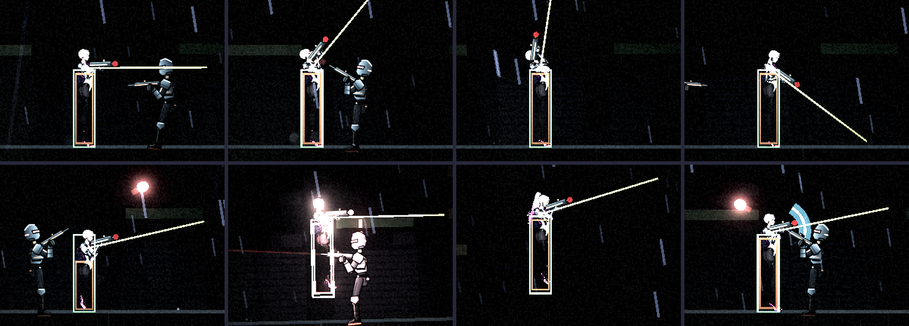

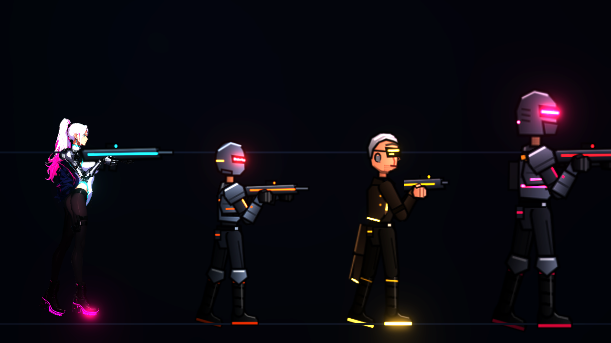

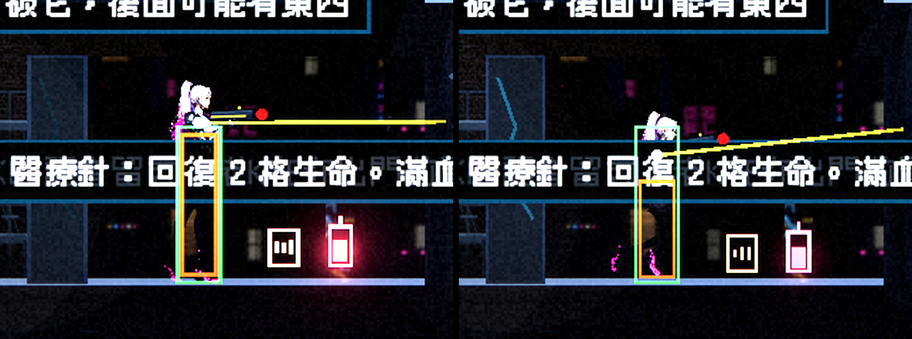

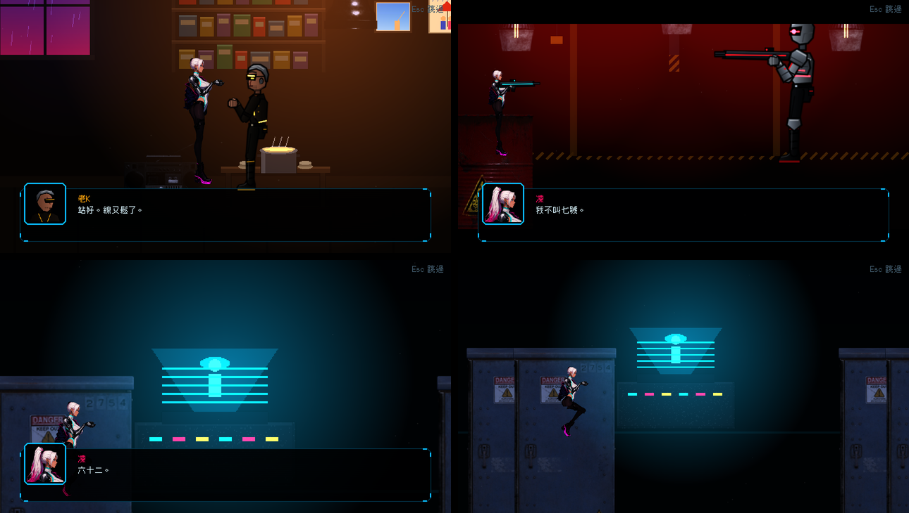

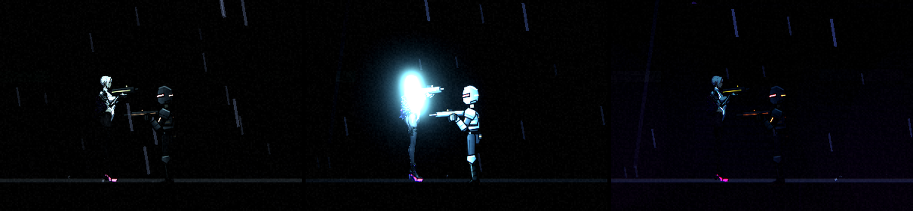

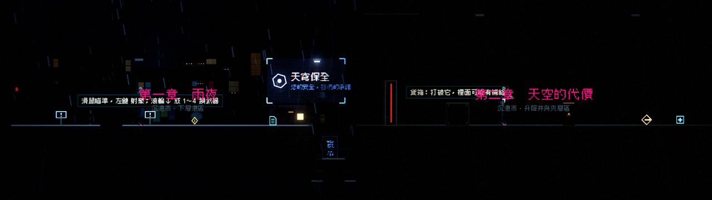

---

# Commit-2

## 內文

本次交付驗收準備材料：以目前第一章 9 個區域、第二章與舊關卡回歸重新整理完整實玩矩陣，核對凜目前為 1.15 倍、動畫過場與現有截圖工具的覆蓋範圍。歷史勾選改為最新上游合入後重新驗證，Commit-1 原始結果保留。沒有變更角色、骨架、第一章生成器或光影。

本段為資料與文件交付，不是本票最終驗收；狀態保留進行中。

### 測試結果

| 項目 | 結果 |
|---|---|
| 最新基線 | 6f4805be（2026-10-08 核對） |
| 區域與過場索引 | 11 個區域／關卡資源；有凜的載入中動畫過場逐項核對 |
| 文件與圖表 | 本次矩陣與文件預覽，引用／尺寸與內容核對 |
| 受影響測試選擇 | 僅文件與 pm 圖表；選擇器不選遊戲套件，不宣稱遊戲測試通過 |
| 完整人工通關 | 未執行；自動測試與地圖分析不代替 |
| 實機效能／使用者同意 | 未量測／未取得 |
| 環境核對 | Linux 雲端，Godot 4.6.3；指定 4.7 與實機 GPU 不可用；共享鎖使用 msvcrt、屬 Windows，不修改它或操作 ComfyUI |

### 截圖

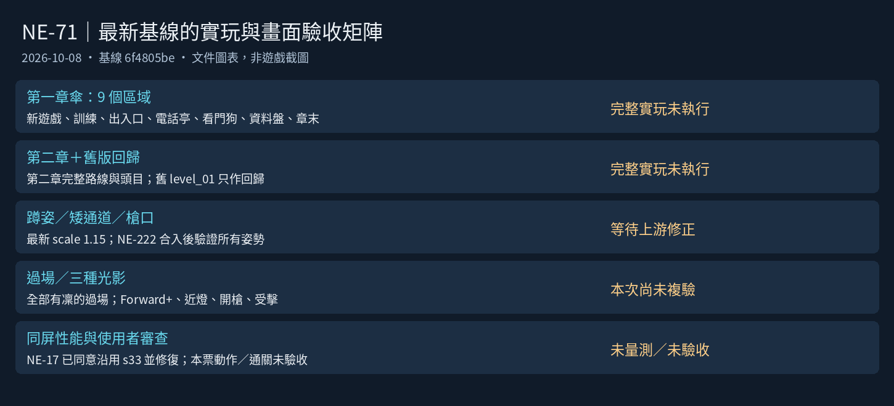

# Commit-3

## 內文

承接推送期間新合入的 NE-17 預覽與使用者同意，校正本票當前依賴資訊。使用者接受沿用 s33 並修復，與完整實玩、修後動作、實機性能分開記錄；本票狀態與複驗條件維持未完成。

### 測試結果

| 項目 | 結果 |
|---|---|
| 上游預覽與同意核對 | 152ea056 的現行凜預覽、484085b6 的明確同意紀錄已核對，兩張原圖已實看 |
| 受影響測試選擇 | 本次只有依賴紀錄與文件圖表，無遊戲套件；未執行人工通關或性能量測 |
| 文件引用與圖表 | 文件圖表已更新，同意範圍不擴大為動作驗收 |

### 截圖

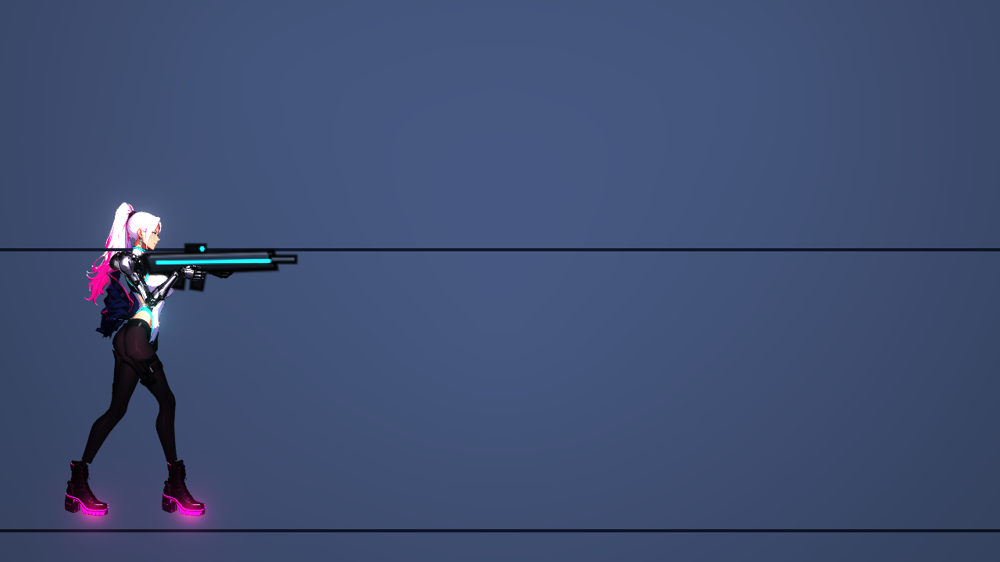

---

# Commit-4

## 內文

承接已合入的開場、過場步態、衣物飛散、穿著外套、來源密度與握持修正，校正最新複驗基準，移除「開場仍蹲著」及「修正都尚未合入」的過時敘述。補入一般蹲、低姿移動、跪瞄、仰躺／俯臥的區分，以及現有接點失敗的角色、影格、倍率和原圖索引。第一、二章完整實玩矩陣保留，不以配置或自動測試替代。

本段是整合準備資料更新；本票仍進行中，未完成的遊戲驗收不勾選。

### 檢查結果

| 項目 | 結果 |
|---|---|
| 基線與最新程式 | dfacf916；凜scale=1.15、texture_scale=0.04205，開場idle、過場速度空間與左右手掛點靜態核對 |
| 上游證據閱讀 | 開場、握持對照、倒地拒收圖及接點原圖已實看；860／23040仍失敗，不當修後全通過 |
| 文件與圖表 | 最新相依、證據連結、PNG尺寸／內容及差異檢查 |
| tools/run_tests_changed.sh dfacf916 | 僅本票文件與圖表，沒有受影響遊戲套件；未宣稱遊戲測試通過 |
| 人工通關／硬體效能／使用者逐動作同意 | 未執行／未量測／未取得；各自保留 |

### 文件圖表與上游原生證據

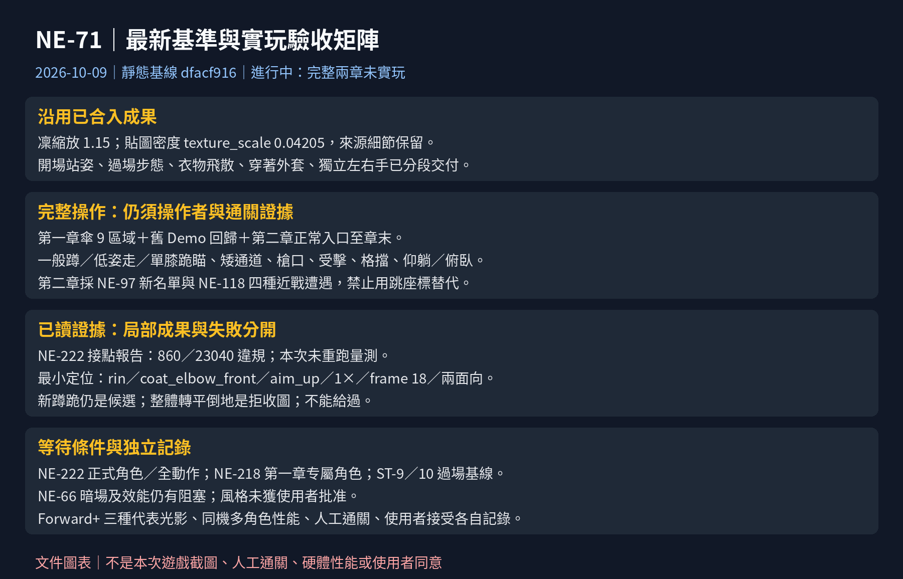

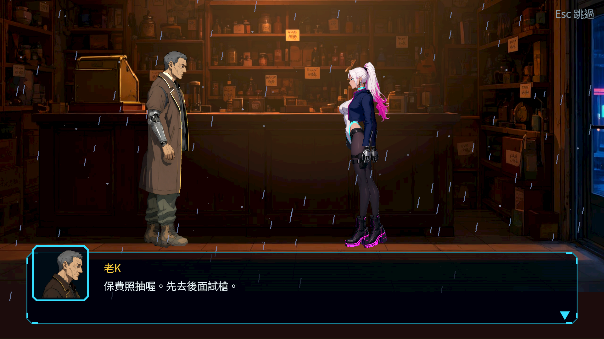

---

# Commit-5

## 內文

確認雲端現有Godot4.7後，補上本票可独立交付的角色單獨回歸與暫代圖防覆寫檢查。沒有painter_style的凜在--only=rin且不帶--guides時不成為產圖目標；實跑寫入0，前後2380份art PNG／JSON完全相同，含凜與頭像。只勾此已實驗的驗收條件，完整兩章實玩、通道、槍口、過場、三檔與多角色性能仍未勾；狀態進行中。

同時承接NE-66最新修正後的三檔證據，將電話亭low與市集high未達0.600的數值、位置與原因回指原票。保留接點與動作問題給NE-222，不改共用骨架、素材或全局光影。

### 檢查結果

| 項目 | 結果 |
|---|---|
| 基線／引擎／模式 | 88f9485a；Godot 4.7.stable.official.5b4e0cb0f，CPU headless／Dummy音訊；共享鎖，不操作ComfyUI |
| CharactersSuite單獨執行 | 442 checks、0 failures、0 known failures；涵蓋現有來源密度與雙手握點契約，不代表人體／全接點畫面通過 |
| paint_assets --only=rin | exit 0；wrote 0 files；2380份art PNG／JSON前後SHA-256一致，新增／移除／改變0 |
| tools/run_tests_changed.sh 88f9485a | 本票差異只有文件、日誌、JSON與圖表，選擇器無遊戲套件；上列角色套件為按票需求明確指定的實跑，不將空集合當測試通過 |
| 文件／引用／預覽 | 引用、結果數量、PNG尺寸／內容與diff檢查；只新增1項實際驗證勾選 |
| 人工完整兩章／實機性能／逐動作使用者同意 | 未執行／未量測／未取得；上游尚未穩定，不重產全套遊戲畫面 |

### 日誌與文件預覽

[角色回歸原始日誌](images/NE-71-characters-20261009.log) · [防覆寫原始日誌](images/NE-71-paint-rin-20261009.log) · [前後來源雜湊與命令](images/NE-71-paint-preservation-20261009.json)

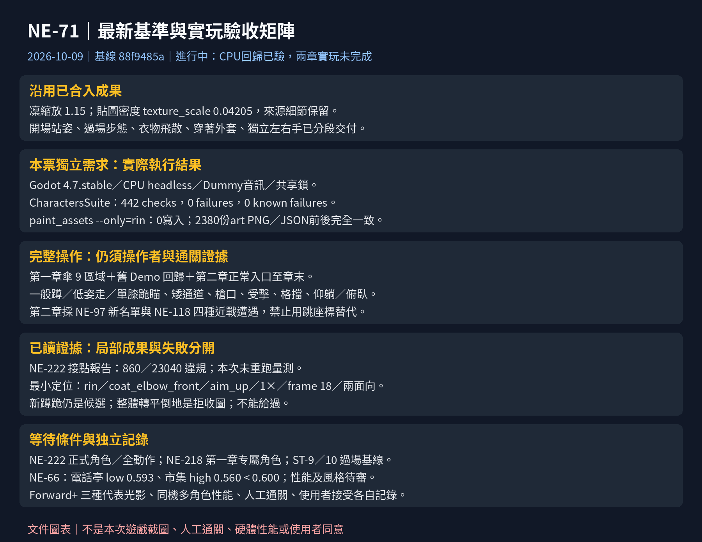

# Commit-6（背包角色立繪的光照）

## 內文

倉庫和停電區的角色補光曾讓背包立繪失去臉部與衣服細節。角色狀態現在使用自己子視窗的光照，在三種場景下都能讀出原立繪的亮部與輪廓。

### 測試結果

| 項目 | 結果 |
|---|---|
| 受影響的測試 | 11 套、6,479 項、0 新失敗、0 已知失敗 |
| 晴日、倉庫、停電 | 三個原生立繪緩衝區校驗一致，三處世界補光各依關卡設定 |
| 120% 文字原生畫面 | 倉庫近白像素 6,710 降到 11，輪廓及姿勢一致 |

[三種光影對照與完整測試](attachments/NE-71-status-lighting-2026-11-19/README.md)

### 截圖

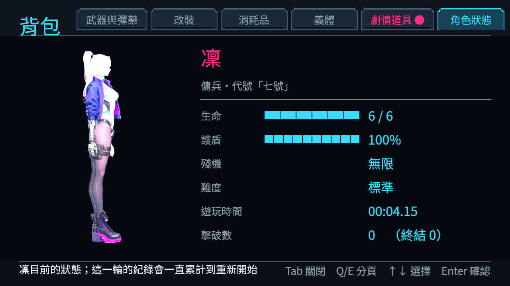

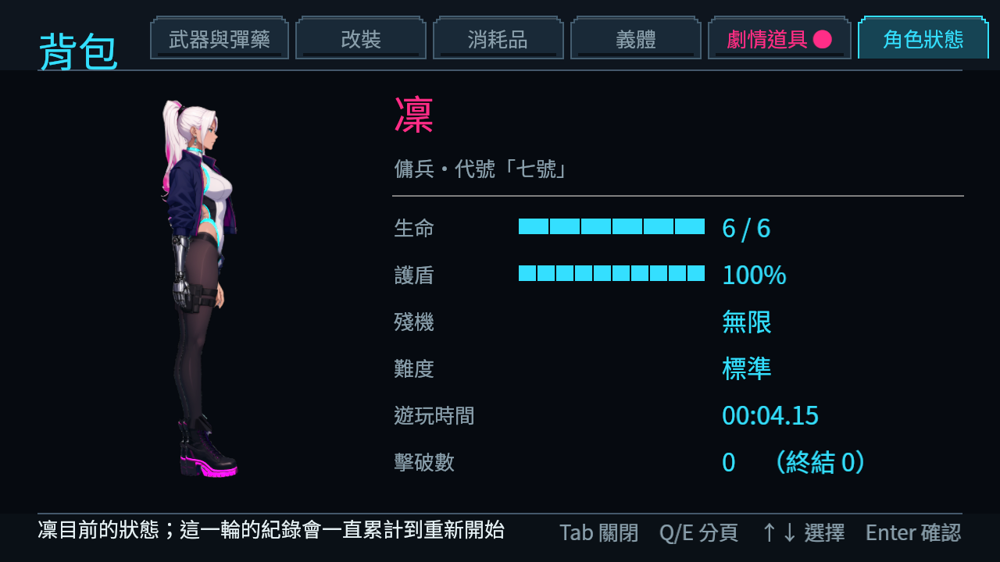

---

# Commit-7（凜在三種場景光影下的原生驗收）

## 內文

在轉運站、停電走廊及第二章公眾攤道原關卡，用 RX 9070 XT／Forward+ HDR 2D 比較低、中、高三檔。沿用遊戲的角色材質、場景燈光與預設亮度。每個光影檔另取 16 個原生 HDR 影格，按既有輪廓對比規則量測。

| 區域 | 低 | 中 | 高 |
|---|---:|---:|---:|
| 轉運站 | 0.80 | 0.78 | 0.78 |
| 停電走廊 | 2.74 | 2.89 | 2.90 |
| 公眾攤道 | 3.45 | 3.58 | 3.68 |

角色對比門檻為 0.60，九組最低 0.78；平台亮邊門檻為 1.00，九組最低 1.79。凜的頭髮、胸前亮色和鞋底能從背景辨認；暗處的褲腿保留深色輪廓。

在同一位置暫時關閉四個部位的法線或發光層，並以原材質重拍。中、高檔三處均可量到法線差異，低檔按照光影設定省略法線。胸前與兩腳的發光都有實際像素差異。單獨切換骨盆發光，在三處的站姿與蹲姿都沒有畫面差異，在公眾攤道暫時隱藏軀幹後恢復 9 個發光取樣，定位為兩片素材疊合造成的遮蔽。骨盆發光留在 NE-222 的分件檢查。人物可辨識區域中，三色都接近白的最高比例是 0.417%。

### 測試結果

| 項目 | 結果 |
|---|---|
| 原生光影 | 三區 × 三檔，各 16 格，144 格。角色與地面對比全部達標。 |
| 原生材質 | 78 項擺位、光影檔與材質檢查全過。鞋與胸發光在三區都有差異；骨盆另外保存六組對照。 |
| 受影響測試 | 本次為驗收紀錄與畫面，標準選擇器判定無受影響的程式測試。 |

[原生截圖、HDR 對比與材質開關紀錄](attachments/NE-71-native-lighting-2026-11-20/evidence.zip)

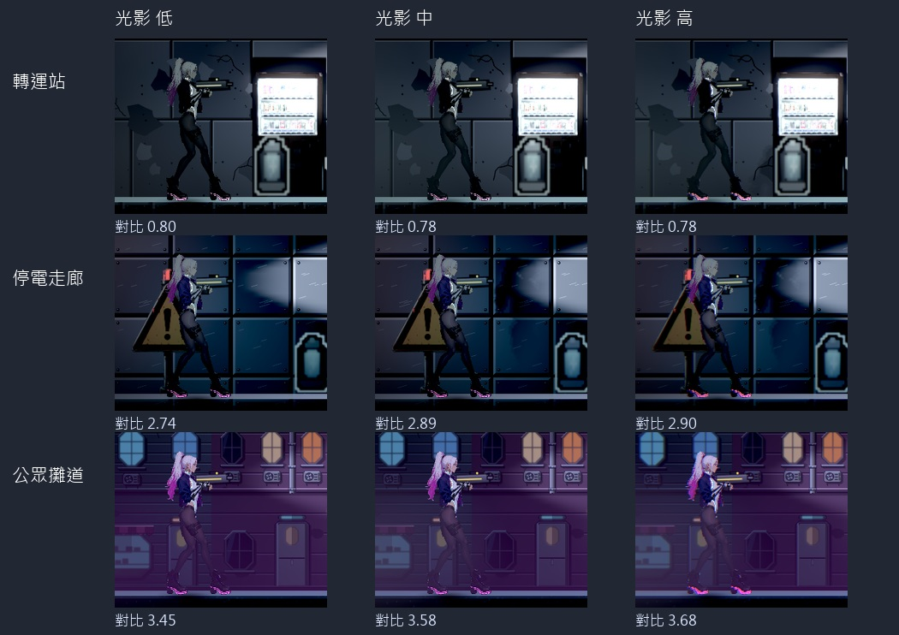

---

# Commit-8（K-7 蹲射由地面上方發射）

## 內文

凜單膝跪地用 K-7 朝下瞄準時，槍口原先穿過地面，子彈在地下生成後直接消失。修後沿原方向收近持槍位置，用靴底所在的平面及彈頭大小估算高度。握點仍由原有雙手求解；收槍遇到手肘屈曲極限時，保留握持支撐。

### 測試結果

- RX 9070 XT Forward+，同一港街存檔、兩面向與正常鏡頭／3.4 倍，共 16 發前後配對。K-7 垂直蹲射由地面下 3.24 改為地面上 2.31 世界單位，生成位置和畫面槍口一致，下一格在地表碰撞。K-7 水平蹲射、P-9 垂直蹲射及 K-7 站立向下的槍口、兩掌和彈量一致。
- 八種槍型的兩面向各掃描 12 個角度，共 192 個骨架樣本。兩手握位誤差增加小於 0.001 世界單位；長槍的極端角度有些仍不足以容納整個彈頭，軌道砲另列為姿勢驗收。原生發射與碰撞驗證涵蓋 K-7 和 P-9。
- 受影響 Godot 回歸 67 組、93,976 項，0 新失敗、0 已知失敗、0 腳本錯誤，717 秒。首輪雲蛇淡出檢查失敗，隔離該套件的 233 項全過，完整重跑的結果列於上方。

[原生畫面、彈道、雙手握點與測試紀錄](attachments/NE-71-crouched-muzzle-2026-11-21/evidence.zip)

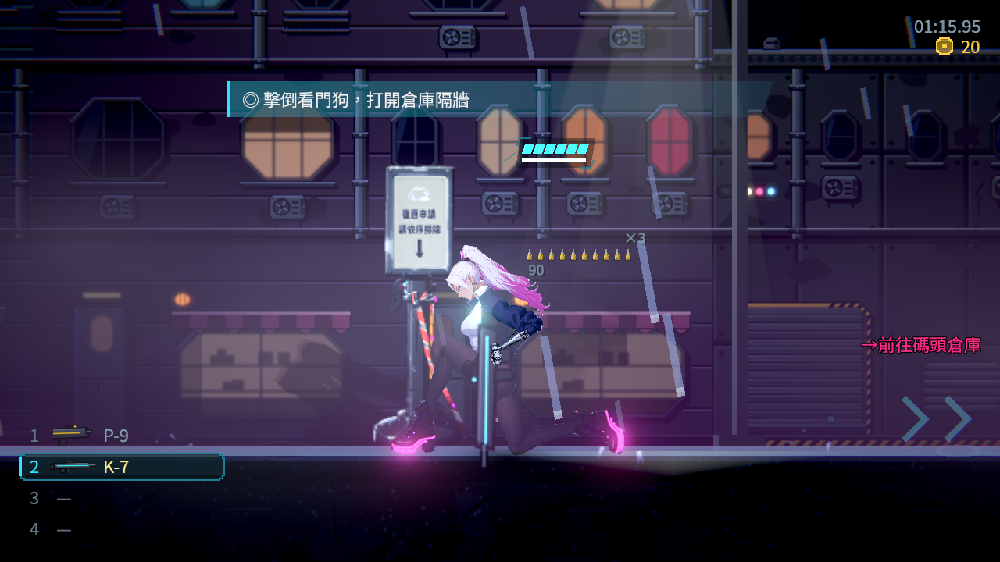

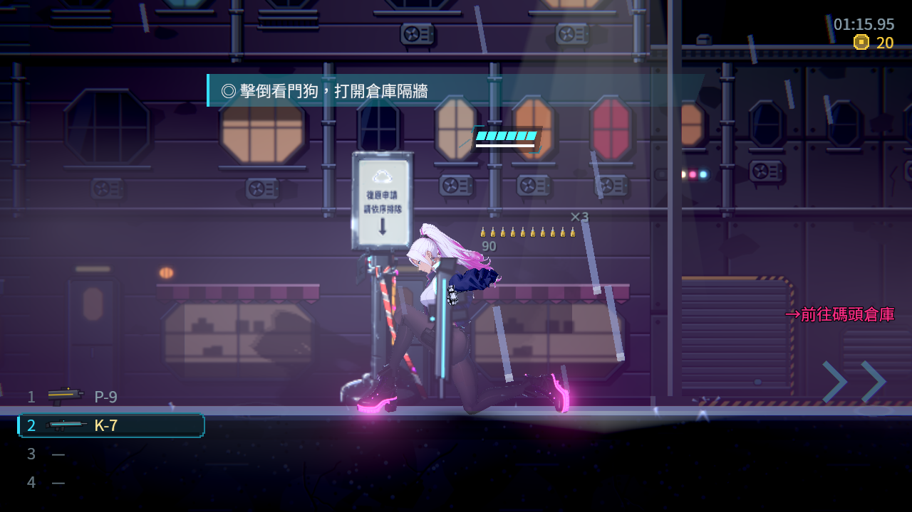

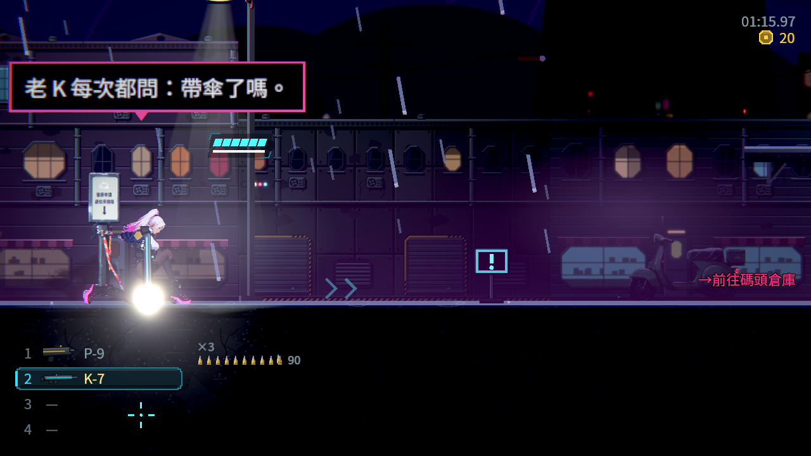

---

# Commit-9（低天花板實測與合成瞄準工具）

## 內文

凜的動作和光影截圖工具現在直接設定測試角色的瞄準方向。跑這兩個情境時，桌面滑鼠可以照常使用。共用截圖入口也已更新兩個曝光受擊樣本所需的傷害來源，三種情境能正常執行。低天花板測試用實際關卡碰撞檢查兩個方向，依序走到中段、蹲下、放開並走到另一側。

### 測試結果

- 掃描現行前兩章 21 區與兩張舊關卡，找出 11 條原站立碰撞框放得下的連續低段。現行序章與帳房各 80 世界單位，舊關卡 64 至 80。11 段共 22 個方向，128 項無頭檢查全過。完整角色外觀與天花板間距最少 4.42 世界單位。舊第二章另有兩段 32 的格位，低於原碰撞框的 44。
- 舊關卡中的七個障礙分別經原槍擊或原開關清除，包括裂牆、玻璃、油桶和兩道閘門。現行兩段也在 RX 9070 XT Forward+ 捕捉 8 張原生圖。按住蹲鍵時凜維持原有的停步，放開後恢復行走。
- 原動作與光影工具用合成瞄準完成 13 張 Forward+ 截圖，另外完成 5 張曝光截圖，檢查視窗在取景前設為無焦點。受影響 Godot 回歸 1 組、198 項，0 新失敗、0 已知失敗、0 腳本錯誤，23 秒。

[26 張原生畫面、地圖尺寸、碰撞與逐段操作](attachments/NE-71-ceiling-clearance-2026-11-21/evidence.zip)

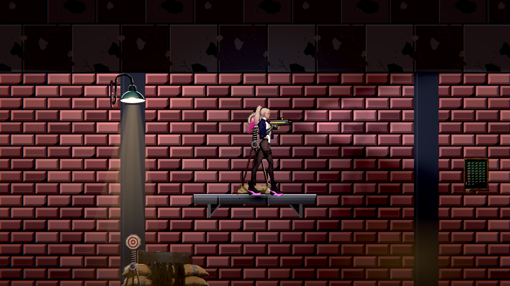

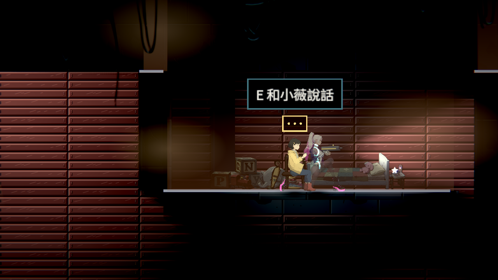

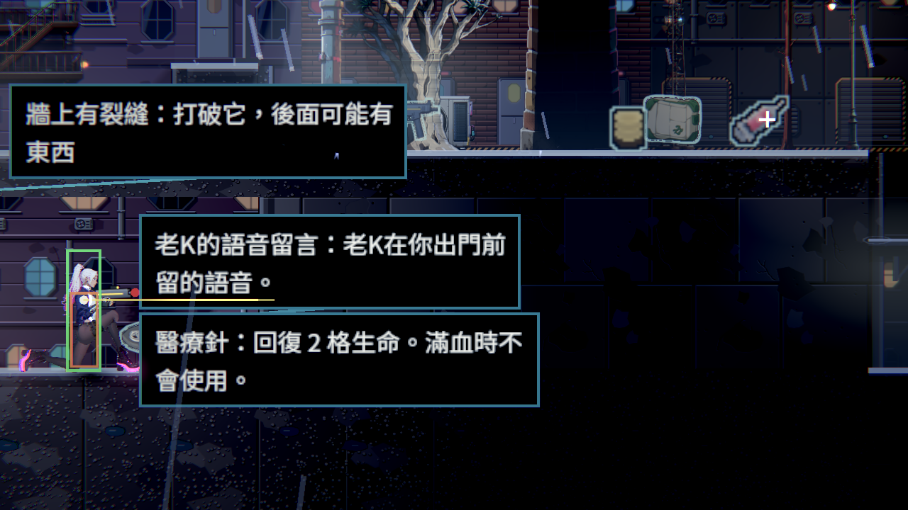

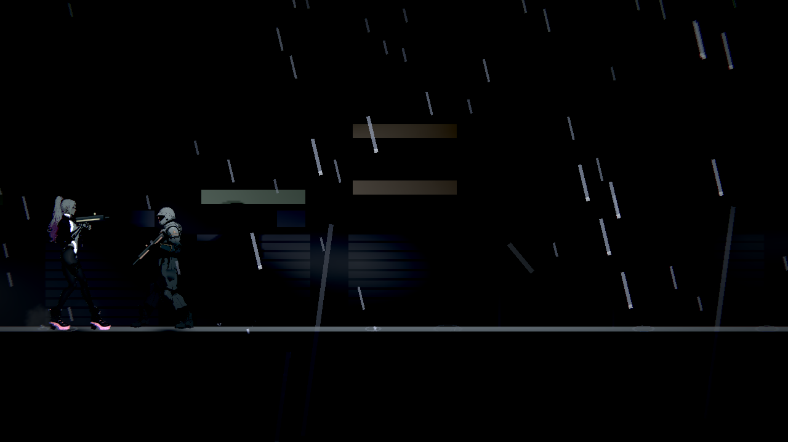

---

# Commit-10（軌道砲跪瞄時讓開地面）

## 內文

凜跪著把長槍接近垂直瞄向腳邊時，手肘會先到折疊極限。軌道砲的彈頭可能一出膛就已碰到地面。現在正沿瞄準線收槍還不夠時，兩手在共同可達範圍內把槍抬高，繞開手肘完全折疊的位置。槍管角度、彈頭半徑、射擊方向和地形碰撞照原規則。

### 測試結果

- 港街現有存檔，用合成瞄準在兩面向以 85°、91.5° 開火。八組無頭和 Forward+ 對照，原出膛位置碰地且彈頭未移動，修後槍口距地 3.31 世界像素，半徑 3 的彈頭確實從槍口往下移動約 0.38 像素才碰地。水平軌道砲、朝下 P-9 的槍口位置相同。P-9 保留原有隨機散佈。
- 八種槍型、兩面向、十二角度共 192 組。四種武器的 32 組向下持槍姿勢需要額外抬高。兩手握點最大誤差低於 0.000008 世界像素。原生截圖使用 RX 9070 XT、Forward+ 與合成瞄準。
- 主角骨架聚焦 2,681 項全過。受影響回歸 59 組、66,992 項，0 新失敗、0 已知失敗、0 腳本錯誤，700 秒。

[實際發射、原生畫面、八把槍的量測與回歸](attachments/NE-71-railgun-floor-2026-11-21/evidence.zip)

### 截圖

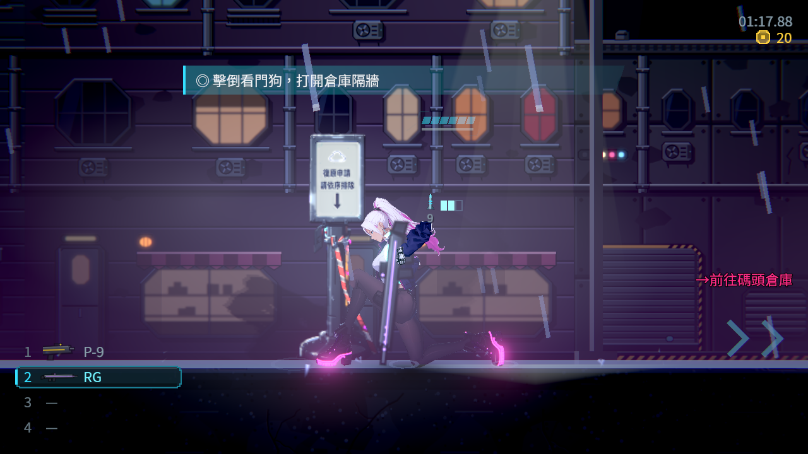
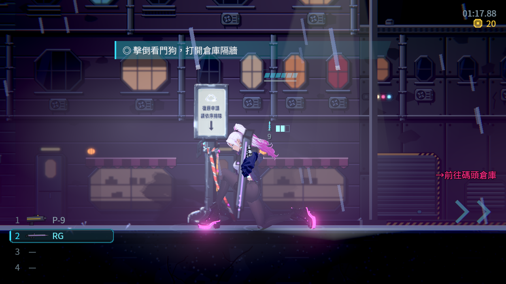
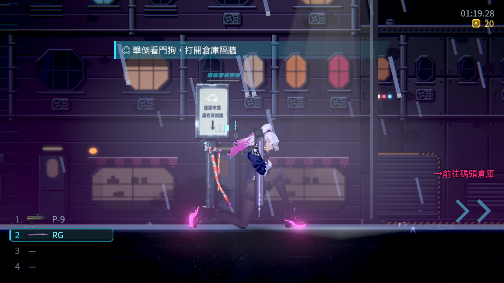

---

# Commit-11（同格快速轉向或拉低瞄準時的首發）

## 內文

同一格轉向或改變瞄準角度再開火，原本會沿新方向射擊，卻從上一格槍口出膛。現在開火先用新方向更新當前持槍與雙手，再取槍口。扣彈、射速、後座與身體動畫沿用原時序。

### 測試結果

- 港街同份存檔，兩面向的無頭及 RX 9070 XT Forward+，各驗水平轉陡下、陡下轉反向水平。八次前後對照均重現原版使用舊槍口。修後陡下仍從地面上方 3.31 世界像素出膛，反向水平的第一發改從面向側射出。四次固定瞄準對照的槍口不變，射擊方向、速度和彈藥扣除一致。
- 實機另在扣彈事件當下記錄後座前的位置。三發起點與該時刻畫面槍口皆一致，誤差小於 0.001 世界像素。取景使用合成瞄準。
- 輸入聚焦 151 項全過。受影響回歸 77 組、100,124 項，0 新失敗、0 已知失敗、0 腳本錯誤，847 秒。
- 首輪並行的合成手把放箱斷言有一項失敗，原始輸出隨附件保留。同一份程式單跑投擲物套件全過，完整重跑結果如上。

[同格輸入、槍口與真實子彈位置、原生畫面及回歸](attachments/NE-71-turn-shot-2026-11-21/evidence.zip)

### 截圖

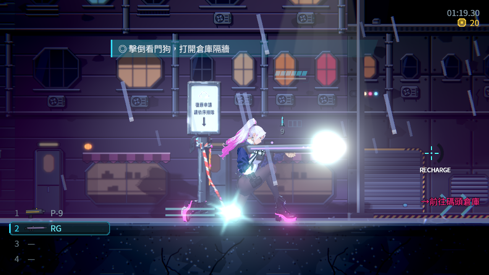
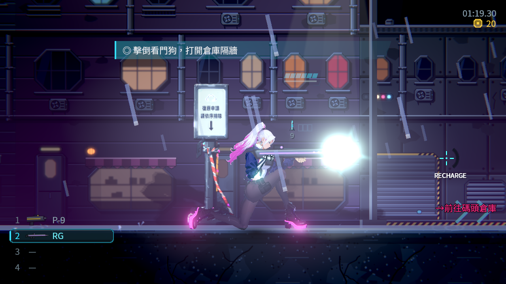
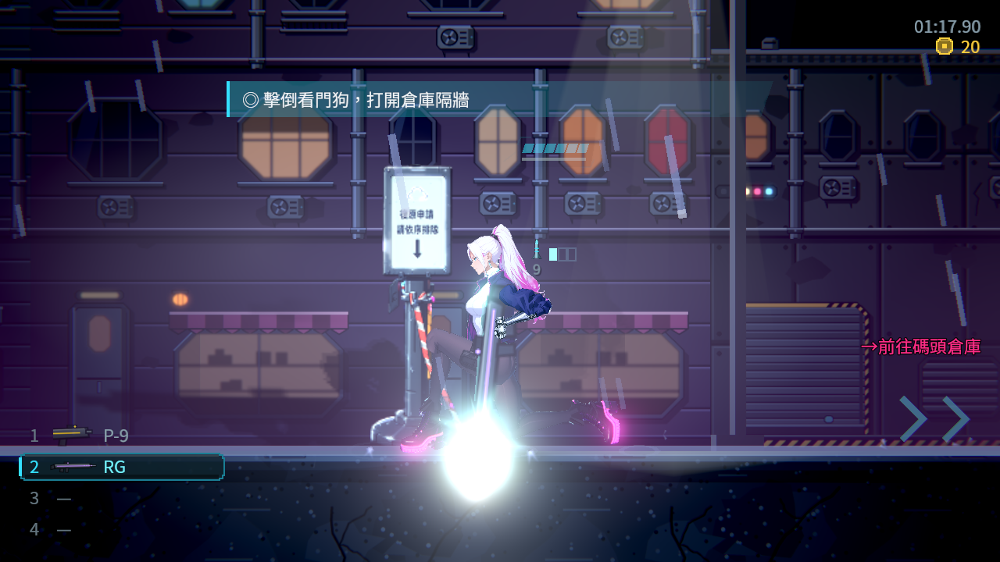

---

# Commit-12（凜重綁前後的同屏效能）

## 內文

同一測試場放入凜與 11 名正式敵人，以轉運站、停電及霓虹市集三種燈光比較重綁前後。舊版使用 `705a9c640f` 的凜貼圖、骨架與動作資料，兩組使用同一份 `543d1e8a` 遊戲和敵人控制器。每個程序暖機三秒，再量十秒。本次使用 RX 9070 XT、Godot 4.7.2 Forward+、1280×720、高光影、未限制幀率。第一輪有敵人在巡邏中走出畫面，擴大同一鏡頭後重測兩版。

### 測試結果

| 光影 | 平均 FPS | 幀時間中位數（ms） | p99（ms） | 平均繪製呼叫 | 貼圖記憶體峰值（MiB） |
|---|---:|---:|---:|---:|---:|
| 轉運站 | 151.82 → 155.20 | 5.43 → 5.35 | 10.67 → 10.57 | 803.65 → 797.98 | 155.02 → 144.09 |
| 停電 | 158.69 → 155.97 | 5.19 → 5.23 | 10.38 → 10.87 | 801.95 → 798.84 | 155.02 → 144.09 |
| 霓虹市集 | 158.83 → 162.32 | 5.14 → 5.08 | 10.39 → 10.46 | 807.32 → 799.06 | 155.02 → 144.09 |

- 四個程序合計 18,864 幀。主角及 11 名敵人保持同屏，三種場景皆有正式投射物。按既有群戰標準，FPS 下降最多 10%、幀時間中位數增加最多 10%、p99 增加最多 15%。
- 凜的 PNG 檔案由 57 張、1,451,318 bytes 改為 63 張、2,526,387 bytes。表格的貼圖記憶體另由渲染器實測。
- 受影響選擇器為文件證據交付，0 套。數據適用於本機、該場景及同一設定。

[原始畫面、原始量測與歷史資產校驗](attachments/NE-71-crowd-performance-2026-11-21/evidence.zip)

### 截圖

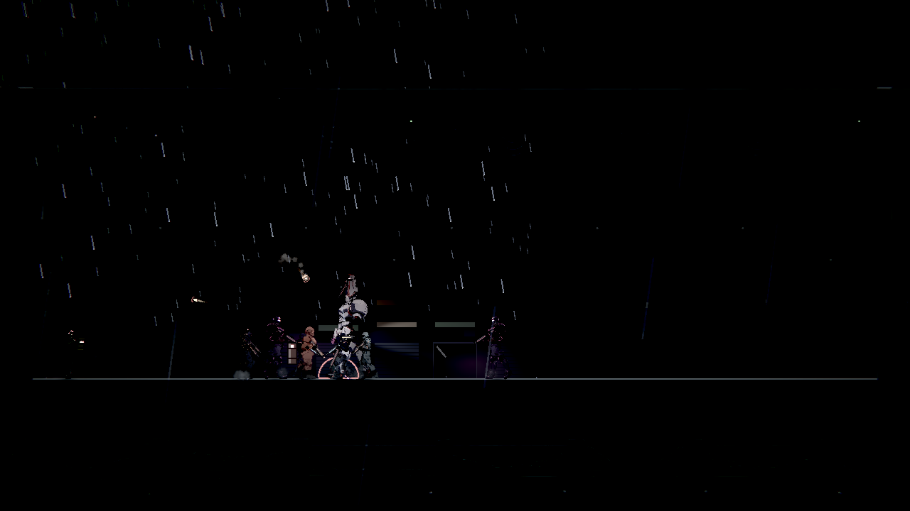

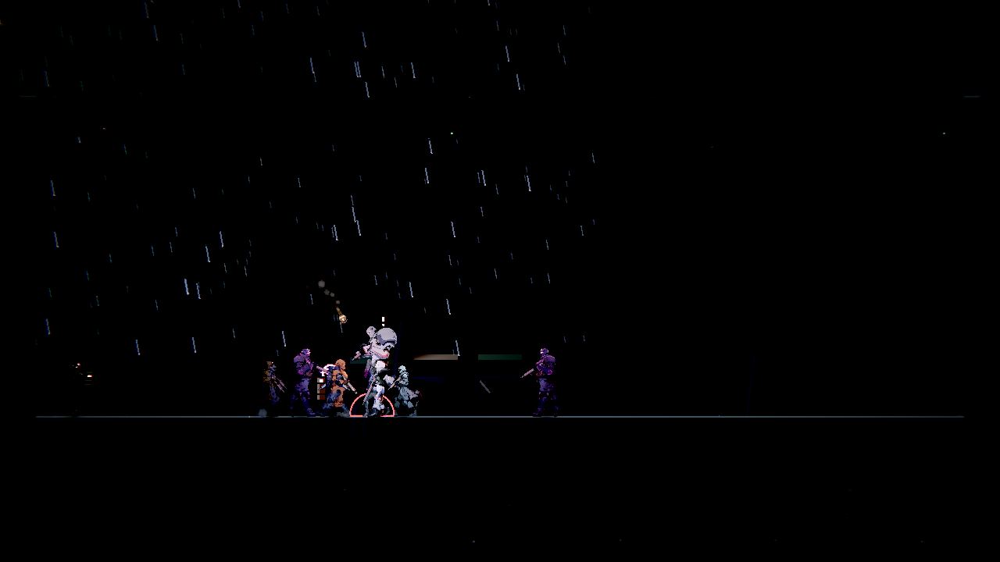
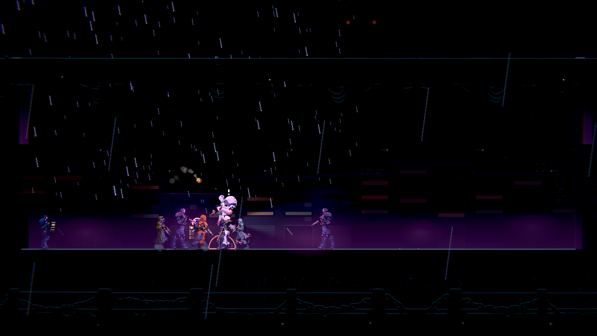

---

# Commit-13（複驗凜在第一、二章的過場取景）

## 內文

- 用目前的正式故事資料及過場舞台建立第一章 44 段、第二章 37 段有凜的動畫過場。初始站位、坐姿及蹲姿的角色繪製範圍都在安全畫面內，最窄的邊界留 2.29 邏輯像素。
- 診所甦醒、回家廚房、小瑋談話及裝卸箱子四段各以無頭流程和 RX 9070 XT Forward+ 1280×720 複驗，共各十個節點。廚房追蹤 1,516 幀，後段辮子網格的透明外框略越過黑邊。用同幀有角色及移去角色的畫面比對，黑邊下第一個有效畫素在 y=87，視窗畫面從 y=86 開始，保留現行構圖。
- 過場和程式未改動，受影響測試選擇器為 0 套。逐段完整分支、動畫姿勢及實玩通關仍待驗。

[原始畫面、過場量測與重現腳本](attachments/NE-71-cutscene-framing-2026-11-21/evidence.zip)

### 截圖

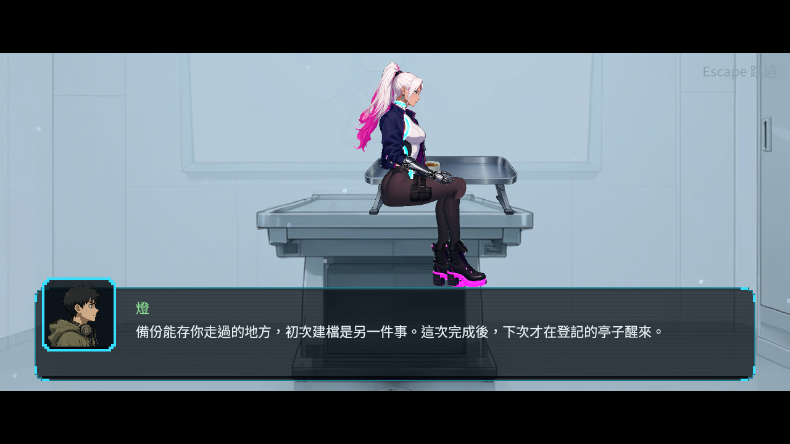
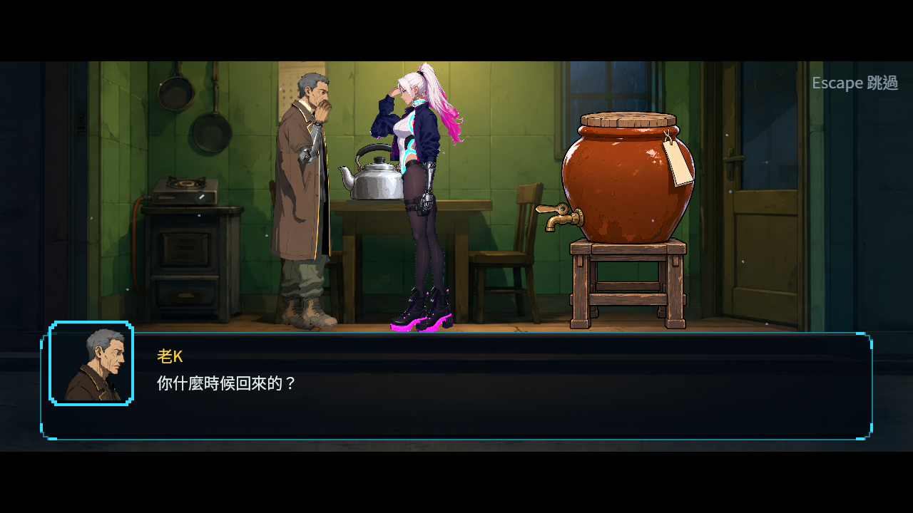
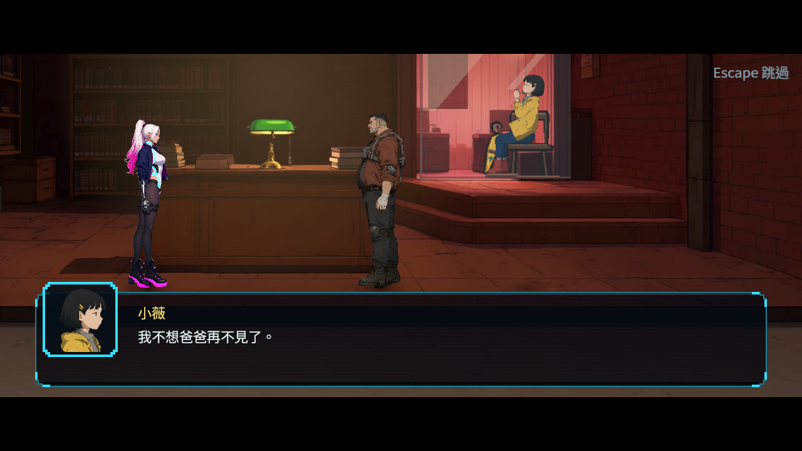
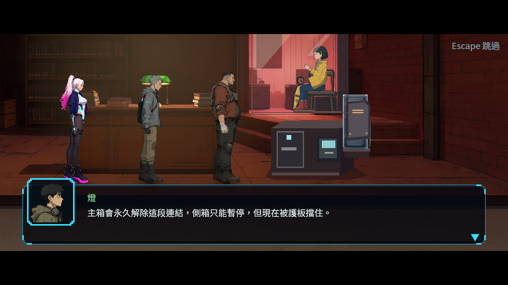

---

# Commit-14（放開盾的同一格同步槍口）

## 內文

凜放開格擋並立刻射擊時，遊戲已允許開火，槍械求解卻仍沿用上一格縮短握槍距離的格擋姿勢。把格擋狀態移入共用的持槍取樣，同一格先更新握點再發射。按住格擋時仍擋住射擊。後座及盾面的收起動畫按原時序播放。

### 測試結果

- 第一章港區街道用正式 P-9，向左、向右的無頭流程及 RX 9070 XT Forward+ 向右取景都重現問題。舊版第一發比未格擋的槍口內縮約 2.80 世界像素；修正後實際彈頭貼合扣彈當下伸出的槍口，誤差低於 0.001。沒舉盾直接開火的起點一致。
- 新回歸在舊程式重現一次失敗。修正版本的受影響測試通過 31 套、49,274 項。

[原生比較、實際彈道及回歸日誌](attachments/NE-71-guard-release-2026-11-21/evidence.zip)

### 截圖

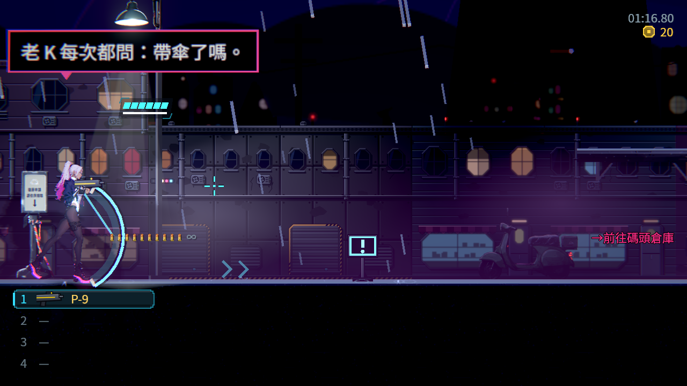
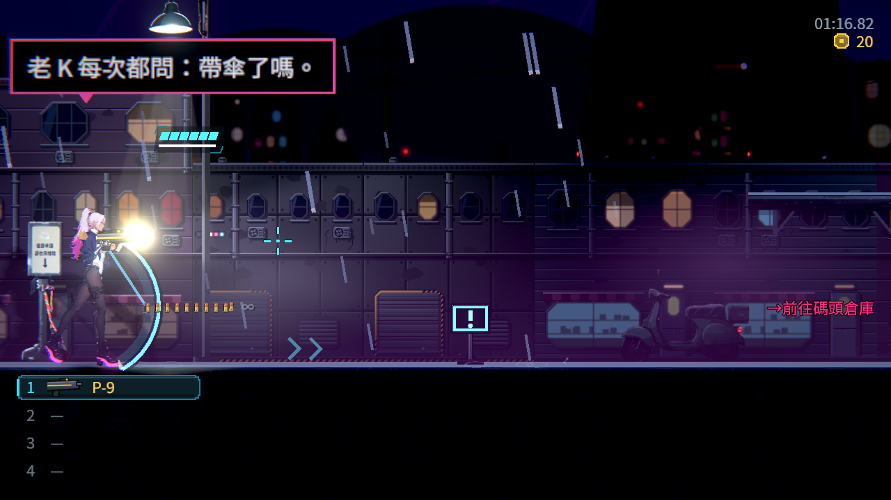

---

# Commit-15（矮通道可蹲行）

## 內文

按住蹲下再按左右即可慢走。移動時以較短的步幅貼地前進，停下回到原有的蹲姿或持槍跪瞄。按鍵與手把設定底部的一句說明會跟著目前裝置和改鍵更新。

### 測試結果

| 項目 | 結果 |
|---|---|
| 實心低頂 | 第一、二章共 21 份正式關卡，九處可穿過的實心低頂淨高 48。舊版 18 趟站走通過，18 趟蹲行停在原地。修後 36 趟全過，站走的速度、抵達位置與影格數一致。 |
| 既有通道與舊圖 | 同一組原地圖可走的 11 段全程蹲行，左右 22 趟通過。沿用原槍擊與開關打開路障。 |
| 原生畫面 | 序章與下貨道以 RX 9070 XT Forward+ 重跑 12 趟。六趟蹲行通過時頭頂的模型範圍與低頂至少相隔 1.17 世界像素，靴底深入小於 0.001。 |
| 單向平台與輸入 | 16 處兩端可通行的單向平台下方共 64 趟通過。另三處的一端為實牆，原位置列入附件。合成左搖桿對角輸入 12 趟全過。按鍵改成 N 時，720p、120% 文字的設定頁顯示新按鍵。 |
| 受影響回歸 | 78 套、100,048 項全過，657 秒，無腳本錯誤。 |

[正式關卡取樣、原生原圖與回歸紀錄](attachments/NE-71-crouch-clearance-2026-11-21/evidence.zip)

### 截圖

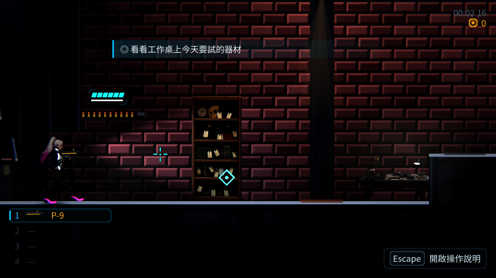
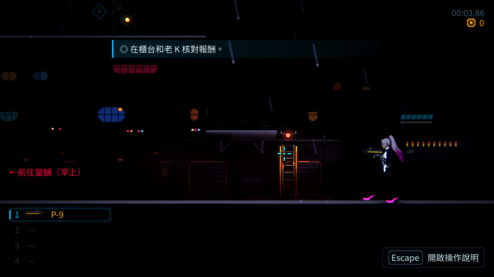
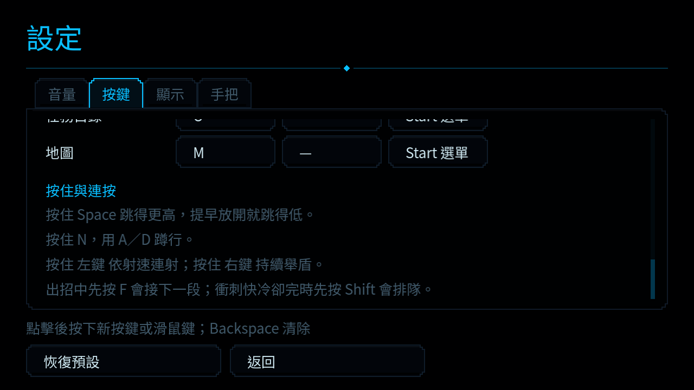
