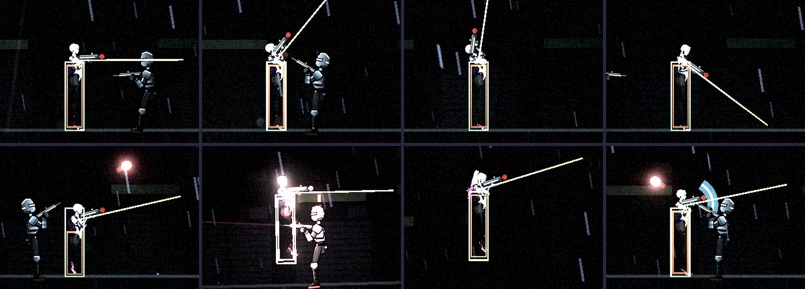
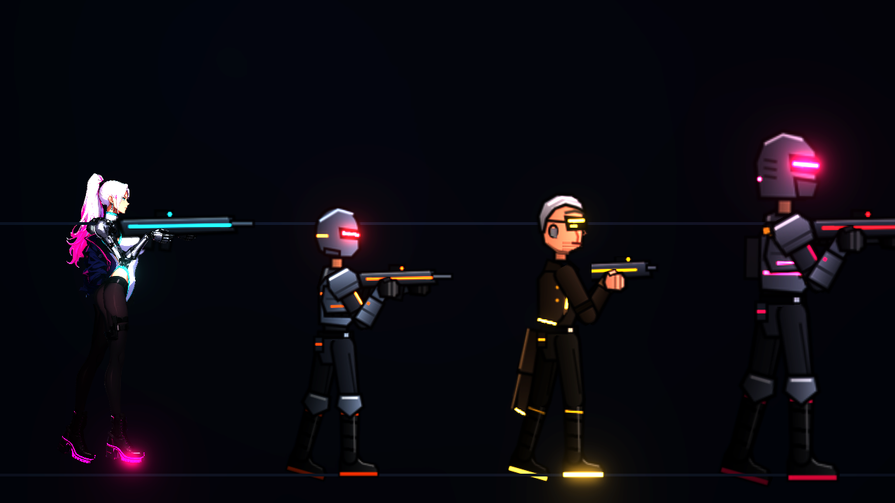
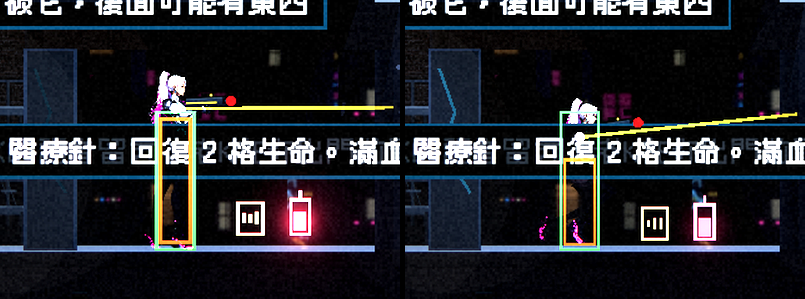
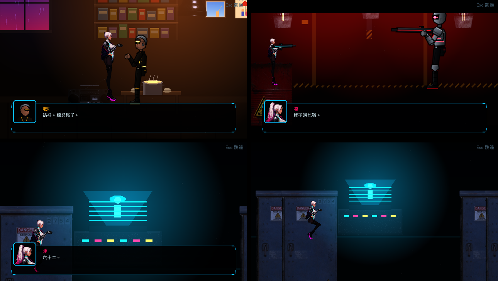
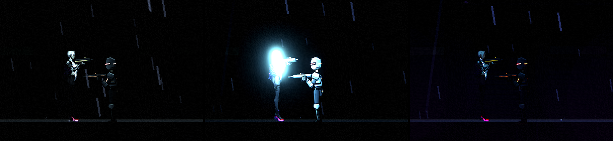
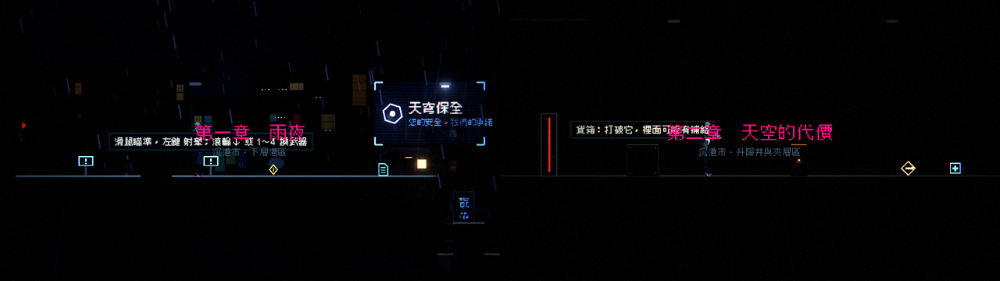

# [NE-71] 驗證凜新外觀在遊戲內的表現

> 狀態：完成

## 內文

### 需求
凜的新造型（約 7.5 頭身，專屬骨架，整體放大 1.4 倍）只在預覽工具與第一章一張截圖確認過。需要在遊戲各處完整檢查：操作手感、碰撞、武器位置、過場與對話、光影，並修掉發現的問題。

背景（給接手的人）：
- 凜現在使用專屬骨架 `art/rigs/humanoid_tall.json`（骨頭比例與其他角色使用的 `humanoid.json` 不同，動畫程式共用）。角色定義 `art/characters/rin/character.json` 的 `scale` 是 1.4，`texture_scale` 是 0.05。其他角色不受影響。
- 玩家的碰撞框在 `game/player/player.gd` 的 `BODY_SIZE`（12×44）沒有改動。凜變高後，頭會探出碰撞框一些，需要確認關卡的低矮通道、蹲下通道、掩體高度是否仍合理。
- 武器掛點在骨架定義的 `weapon_anchor`（目前是依肩膀位置推算的初始值），持槍時雙手的位置、槍口（子彈生成點）需要實際檢查。
- 為了讓凜不再是尺寸規格的基準，已改了兩處：`tests/suite/test_characters.gd` 的 `REFERENCE` 與 `tools/art/paint_assets.gd` 的 `GUIDE_SOURCE` 都改成 `old_k`。需要確認相關測試與工具單獨執行是通過的。
- 流程文件：`design/03-art-pipeline/CHARACTER_PIPELINE.md`。

要檢查與處理的項目：
1. 八種動作在遊戲內的樣子：待機、跑、跳、落下、蹲、衝刺、格擋、硬直、死亡。
2. 站立時腳底是否剛好踩在地面（不懸空、不陷進地面）；蹲下與死亡倒地時身體位置。
3. 瞄準各角度（上下 105 度）手臂與槍的樣子，槍口位置與子彈出口對得上。
4. 近戰與終結技（`can_be_finished` 相關）的動作與位置是否合理。
5. 碰撞：頭是否卡進天花板、蹲下是否能通過原本的矮通道、被打到的判定位置（受擊框）與畫面是否差太多；必要時調整碰撞框或縮放（優先調縮放，避免動到所有關卡）。
6. 過場動畫與對話：第一章與第二章所有有凜出現的過場（`tools/screenshot.gd` 的 `cutscene`、`chapter2` 情境），演員縮放（腳本裡 `scale` 2.0 等）是否仍然合適，位置是否對。
7. 光影：法線與發光在各關卡燈光下的樣子（轉運站、停電、霓虹市集），暗處是否仍看得見。
8. 效能：零件圖尺寸與舊版相比、同屏多個角色時的幀率沒有明顯下降。

### 來源
2026-10-03，使用者在開發對話中要求把還沒做的事情寫成票。使用者並指示驗收以「該票範圍在遊戲裡正常」為準，不跑完整測試套件。

### 驗收條件
- [x] 上述 8 項逐項檢查，問題都已修正或在票上說明為何不修
- [ ] 第一章與第二章的所有關卡可以正常通關，沒有被凜的新尺寸卡住的地方（碰撞框沒有動、兩關最矮通道淨高 64，已用地圖分析確認沒有卡住的地方；尚未實際手動玩完整關）
- [x] 蹲下可以通過所有原本能通過的矮通道
- [x] 槍口位置與子彈出口一致，持槍雙手位置自然
- [x] 所有凜出現的過場與對話畫面位置、大小正常
- [x] 凜的法線與發光在三種代表性燈光下正常，暗處仍看得見
- [x] 同屏有多個敵人時幀率與改動前相比沒有明顯下降
- [x] 以下單獨執行通過：角色相關測試（`tests/suite/test_characters.gd` 所屬的角色測試）、`tools/art/paint_assets.tscn` 不會蓋掉凜的貼圖
- [x] 附各項的遊戲內截圖（至少：第一章一張、第二章一張、蹲下通道一張、過場一張、停電一張）

### 測試流程
1. 執行 `tools/screenshot.tscn` 的各情境（`stages`、`cutscene`、`chapter2`、`lighting`、`block`、`death`），逐張檢查凜
2. 手動玩第一章與第二章，特別注意矮通道、掩體、瞄準上方、格擋與死亡
3. 開背包、開對話，檢查頭像與立繪（頭像部分見 NE-69）
4. 單獨執行角色測試，確認通過

---

# 跟其他票的關係

- Blocks：無
- Blocked by：NE-17
- Related：NE-68、NE-69、NE-70

---

# Commit-1

## 內文

凜的新造型只在預覽工具與一張截圖確認過，遊戲裡實際用起來有幾個問題，這次逐項檢查並修正：
1. 八種動作：站、跑、跳、落下、蹲、衝刺、格擋、硬直、死亡在預覽與遊戲內都正常（見截圖）。
2. 腳底：遊戲內鞋底貼在地面上，不懸空也不陷進去；蹲下與倒下的位置正常。
3. 瞄準：凜比原本的角色高很多，但瞄準起點還是舊的固定高度（離腳底 35），畫面上的槍卻在約 56 的高度，準星瞄的位置比子彈實際飛行的線低約 21 像素。現在瞄準起點由骨架的武器掛點量出，與手上的槍同高；子彈本來就從畫面上的槍口射出，位置與出口一致。近戰揮砍弧與終結技光環也改成繞著畫面上的身體中心畫。
4. 碰撞與大小：整體放大 1.4 倍時身高約 69，頭探出碰撞框約 25 像素，敵人的子彈會從畫面上的頭部穿過去卻沒有命中。改成 1.15 倍（身高約 56，與其他人形一致）；碰撞框與受擊框沒有動。兩關最矮的通道淨高都是 64，沒有非蹲不可的地方，站著與蹲著都能通過；沒有改任何關卡。
5. 過場與對話：第一、二章所有過場裡的凜位置、大小正常，頭像與對話框正常。
6. 光影：停電（近乎全黑）時有補光，凜清楚看得見；轉運站與霓虹市集一樣偏暗，頭髮、白色連身衣、槍與鞋底發光看得清楚，黑色絲襪與長靴在暗處接近背景（和小兵同樣暗）。
7. 效能：同屏 12 個凜與 12 個小兵都維持畫面更新上限 144 幀，處理時間相近；凜每個多約 11 次繪製呼叫（破損底層在完整衣物都在時不繪製，已省掉）。
同一次修了單獨執行角色測試會失敗的問題（測試用小兵當規格基準，找不到凜獨有的後髮、裝甲零件的規格），並確認重畫所有暫代圖的工具不會蓋掉凜的貼圖與頭像。
依使用者指示，沒有跑完整測試套件，只驗證本票範圍。

### 測試結果

| 項目 | 結果 |
|---|---|
| 角色相關測試（單獨執行） | 通過（628 項、0 失敗） |
| 重畫暫代圖的工具（--only=rin） | 寫入 0 個檔案，不會蓋掉凜 |
| 預覽與遊戲內八種動作 | 正常 |
| 第一章、第二章遊戲畫面與所有過場 | 凜顯示正常，無錯誤訊息 |
| 最矮通道（淨高 64） | 站姿與蹲姿都通過 |
| 三種光影 | 轉運站、市集偏暗但可讀；停電有補光 |
| 12 個凜 vs 12 個小兵 | 144 幀、處理時間相近 |
| 完整測試套件 | 依使用者指示未執行 |

### 截圖

---
