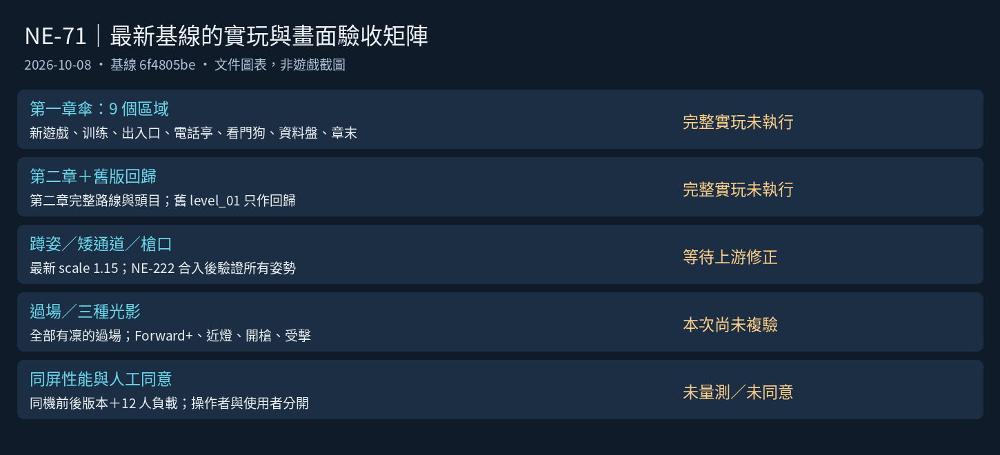

# [NE-71] 驗證凜新外觀在遊戲內的表現

> 狀態：進行中

## 內文

### 需求
承接最新凜的素材與 NE-222 修正，在目前第一、二章完整實玩並複驗操作、碰撞、武器、過場、光影與多角色效能。Commit-1 是歷史驗證；本次以最新角色定義、規格與上游合入版本為基準。

背景（給接手的人）：
- 凜現在使用專屬骨架 `art/rigs/humanoid_tall.json`（骨頭比例與其他角色使用的 `humanoid.json` 不同，動畫程式共用）。目前角色定義 `art/characters/rin/character.json` 的 `scale` 是 1.15，`texture_scale` 是 0.05；歷史 1.4 倍已由 Commit-1 調整，不以本票舊文字改回。其他角色不受影響。
- 玩家的碰撞框在 `game/player/player.gd` 的 `BODY_SIZE`（12×44）沒有改動。凜變高後，頭會探出碰撞框一些，需要確認關卡的低矮通道、蹲下通道、掩體高度是否仍合理。
- 武器掛點在骨架定義的 `weapon_anchor`（目前是依肩膀位置推算的初始值），持槍時雙手的位置、槍口（子彈生成點）需要實際檢查。
- 為了讓凜不再是尺寸規格的基準，已改了兩處：`tests/suite/test_characters.gd` 的 `REFERENCE` 與 `tools/art/paint_assets.gd` 的 `GUIDE_SOURCE` 都改成 `old_k`。需要確認相關測試與工具單獨執行是通過的。
- 流程文件：`design/03-art-pipeline/CHARACTER_PIPELINE.md`。

要檢查與處理的項目：
1. 八種動作在遊戲內的樣子：待機、跑、跳、落下、蹲、衝刺、格擋、硬直、死亡。
2. 站立時腳底是否剛好踩在地面（不懸空、不陷進地面）；蹲下與死亡倒地時身體位置。
3. 瞄準各角度（上下 105 度）手臂與槍的樣子，槍口位置與子彈出口對得上。
4. 近戰與終結技（`can_be_finished` 相關）的動作與位置是否合理。
5. 碰撞：頭是否卡進天花板、蹲下是否能通過原本的矮通道、被打到的判定位置（受擊框）與畫面是否差太多；必要時調整碰撞框或縮放（優先調縮放，避免動到所有關卡）。
6. 過場動畫與對話：第一章與第二章所有有凜出現的過場（`tools/screenshot.gd` 的 `cutscene`、`chapter2` 情境），演員縮放（腳本裡 `scale` 2.0 等）是否仍然合適，位置是否對。
7. 光影：法線與發光在各關卡燈光下的樣子（轉運站、停電、霓虹市集），暗處是否仍看得見。
8. 效能：零件圖尺寸與舊版相比、同屏多個角色時的幀率沒有明顯下降。

### 來源
2026-10-03，使用者在開發對話中要求把還沒做的事情寫成票。使用者並指示驗收以「該票範圍在遊戲裡正常」為準，不跑完整測試套件。

### 驗收條件
- [ ] 上述 8 項逐項檢查，問題都已修正或在票上說明為何不修
- [ ] 第一章與第二章的所有關卡可以正常通關，沒有被凜的新尺寸卡住的地方（須記錄操作者、起訖、路線與通關畫面；地圖分析或自動按鍵情境不代替完整實玩）
- [ ] 蹲下可以通過所有原本能通過的矮通道
- [ ] 槍口位置與子彈出口一致，持槍雙手位置自然
- [ ] 所有凜出現的過場與對話畫面位置、大小正常
- [ ] 凜的法線與發光在三種代表性燈光下正常，暗處仍看得見
- [ ] 同屏有多個敵人時幀率與改動前相比沒有明顯下降
- [ ] 以下單獨執行通過：角色相關測試（`tests/suite/test_characters.gd` 所屬的角色測試）、`tools/art/paint_assets.tscn` 不會蓋掉凜的貼圖
- [ ] 附各項的遊戲內截圖（至少：第一章一張、第二章一張、蹲下通道一張、過場一張、停電一張）

### 本次複驗基準（2026-10-08）

歷史結果保留在 Commit-1；上方條件改為最新上游合入後的複驗條件，本次尚未勾選。NE-222（待辦）的蹲姿、接縫、外套、左右手及開場修正尚未合入；第一章過場基線 ST-9／ST-10、序章 ST-16 尚未交付，最終光影配置須待 Session 5 合入後記錄其 commit。NE-17 的使用者覆蓋同意仍未勾選，工程複驗與使用者同意分開。

本次只核對最新資料並準備矩陣，不把歷史的 144 幀、淨高 64 或舊圖當成本次量測。

### 完整實玩與截圖矩陣

每列實玩結果均為「未執行」。第一章從新遊戲連續完成主要路線與章末；旁支區域也須進出，保留死亡／讀檔後的重入紀錄。第二章從正常入口連續玩到回收員戰與章末。不得跳座標、移除敵人、增加無敵或直接設定通關旗標來代替通關。

| 區域／版本 | 尺寸（格） | 實際操作檢查 | 實玩／截圖 |
|---|---:|---|---|
| 電話亭巷（`ch1_booth_alley`） | 56 × 24 | 電話亭互動、握話筒與返回街道 | 未執行／無本次遊戲圖 |
| 復原館（`ch1_lounge`） | 56 × 24 | 死亡後復原、NPC 互動與出口 | 未執行／無本次遊戲圖 |
| 當舖（`ch1_pawnshop`） | 112 × 24 | 開場、地下訓練、樓梯與出入口 | 未執行／無本次遊戲圖 |
| 當舖（天亮）（`ch1_pawnshop_dawn`） | 112 × 24 | 章末返回、正常章末卡 | 未執行／無本次遊戲圖 |
| 屋頂（`ch1_rooftop`） | 72 × 24 | 上下樓梯、跳躍與平台邊緣 | 未執行／無本次遊戲圖 |
| 宵夜麵攤（`ch1_stall`） | 48 × 24 | NPC 互動、返回當舖 | 未執行／無本次遊戲圖 |
| 港區街道（`ch1_street`） | 208 × 24 | 矮處蹲走、槍口、收帳人交戰、街道各出口 | 未執行／無本次遊戲圖 |
| 倉庫深處（`ch1_vault`） | 124 × 24 | 深處戰鬥、取得資料盤、返回主線 | 未執行／無本次遊戲圖 |
| 碼頭倉庫（`ch1_warehouse`） | 166 × 24 | 看門狗戰、受擊／格擋、進入深處 | 未執行／無本次遊戲圖 |
| 第一章　雨夜（`level_01`） | 350 × 24 | 舊版回歸；不代替第一章傘的 9 區域 | 未執行／無本次遊戲圖 |
| 第二章　天空的代價（`level_02`） | 510 × 24 | 逐區段攀爬、停電、矮處、群戰、頭目與章末 | 未執行／無本次遊戲圖 |

### 各項複驗與證據

| 項目 | 操作與捕捉情境 | 通過證據／本次結果 |
|---|---|---|
| 動作／腳底 | 站、跑、跳、下落、蹲、蹲走、衝刺、格擋、硬直、死亡；各起始／峰值／結束，地面與平台 | 遊戲倍率與過場倍率，附地面線；未執行 |
| 矮通道 | 每區域實際跑入／蹲入、蹲瞄後退出，含頭貼天花板 | 可正常通行且頭／受擊判定合理；未執行 |
| 槍口／雙手 | 水平、上下 105°、蹲瞄；實際射擊並看第一發出口 | 同幀瞄準起點、槍口與子彈；未執行 |
| 近戰／終結 | 近戰各招、可終結敵人與格擋反彈 | 身體中心、武器與判定對上；未執行 |
| 過場／對話 | 全部有凜的動畫過場，加 NPC、背包與通訊 | 位置、比例、外套、雙手、姿勢與上下文；未執行 |
| 三種光影 | 轉運站、停電、霓虹市集；頭靠燈、受擊、開槍、格擋 | Forward+ 原圖與曝光 log、鞋／軀幹／骨盆發光；未執行 |
| 多角色效能 | 同屏 12 人，同機相同設定的修前／修後、暖機後重複 | FPS、平均／p99、繪製與記憶體；未執行 |
| 自動回歸 | 角色、骨架、動作、NPC、武器、過場、曝光受影響套件與暫代圖工具 | 獨立 log；本次僅文件差異，未執行遊戲測試 |

目前有凜的動畫過場索引（直接核對載入中的故事資料，仍須在穩定基線實看）：

- `ch1_kasa`：`ch1_c01_open`、`ch1_c09_wake`、`ch1_c14_home`。
- `cutscenes_ch1`：`cut_c1_shop`、`cut_c2_hangar`、`cut_c3_terminal`。
- `cutscenes_ch2`：`cut_c4_dawn`、`cut_c6_corridor`、`cut_c7_elevator`。

現有工具的用途已核對：`rin_fit` 會拍姿勢與舊 level_01 的通道，`rin_perf` 比較目前 trooper／rin 並非重畫前後版本，`chapter2` 會跳位置及增加生命；它們可以補充畫面／動畫數據，不能充當完整實玩或重畫前效能基準。可用 `cutscenes:<場景 id>`、`exposure_lamp@ch1_vault@0`、`exposure_states@level_02`、`lighting` 補拍；最終仍須覆蓋矩陣中的實際區域。

人工紀錄格式：基線 commit／Godot 版本／操作者／日期與起訖／新遊戲或讀檔／路線／實際操作／通關或問題／原始圖與 log。實機性能另記 GPU、解析度、品質、VSync、角色數、生成工作狀態與前後基線；使用者同意另記使用者回覆，不由執行者代勾。

### 已知問題與對應

| 情境 | 已有證據／原因 | 對應票 |
|---|---|---|
| 開場凜無故蹲著 | 最新 `ch1_c01_open` 仍指定 squat；歷史畫面見 NE-205 | NE-222、ST-16 |
| 蹲姿、腰臀／肩腕接縫、外套、左右手 | 使用者已指出退化；各動作複驗由上游修正後接續 | NE-222 |
| 頭靠燈變成白團 | NE-213 已有 Forward+ 修前／修後圖；本次須與霓虹發光同時複驗 | NE-213、NE-222 |

### 測試流程
1. 執行 `tools/screenshot.tscn` 的各情境（`stages`、`cutscene`、`chapter2`、`lighting`、`block`、`death`），逐張檢查凜
2. 手動玩第一章與第二章，特別注意矮通道、掩體、瞄準上方、格擋與死亡
3. 開背包、開對話，檢查頭像與立繪（頭像部分見 NE-69）
4. 單獨執行角色測試，確認通過

---

# 跟其他票的關係

- Blocks：無
- Blocked by：NE-17
- Related：NE-68、NE-69、NE-70

---

# Commit-1

## 內文

凜的新造型只在預覽工具與一張截圖確認過，遊戲裡實際用起來有幾個問題，這次逐項檢查並修正：
1. 八種動作：站、跑、跳、落下、蹲、衝刺、格擋、硬直、死亡在預覽與遊戲內都正常（見截圖）。
2. 腳底：遊戲內鞋底貼在地面上，不懸空也不陷進去；蹲下與倒下的位置正常。
3. 瞄準：凜比原本的角色高很多，但瞄準起點還是舊的固定高度（離腳底 35），畫面上的槍卻在約 56 的高度，準星瞄的位置比子彈實際飛行的線低約 21 像素。現在瞄準起點由骨架的武器掛點量出，與手上的槍同高；子彈本來就從畫面上的槍口射出，位置與出口一致。近戰揮砍弧與終結技光環也改成繞著畫面上的身體中心畫。
4. 碰撞與大小：整體放大 1.4 倍時身高約 69，頭探出碰撞框約 25 像素，敵人的子彈會從畫面上的頭部穿過去卻沒有命中。改成 1.15 倍（身高約 56，與其他人形一致）；碰撞框與受擊框沒有動。兩關最矮的通道淨高都是 64，沒有非蹲不可的地方，站著與蹲著都能通過；沒有改任何關卡。
5. 過場與對話：第一、二章所有過場裡的凜位置、大小正常，頭像與對話框正常。
6. 光影：停電（近乎全黑）時有補光，凜清楚看得見；轉運站與霓虹市集一樣偏暗，頭髮、白色連身衣、槍與鞋底發光看得清楚，黑色絲襪與長靴在暗處接近背景（和小兵同樣暗）。
7. 效能：同屏 12 個凜與 12 個小兵都維持畫面更新上限 144 幀，處理時間相近；凜每個多約 11 次繪製呼叫（破損底層在完整衣物都在時不繪製，已省掉）。
同一次修了單獨執行角色測試會失敗的問題（測試用小兵當規格基準，找不到凜獨有的後髮、裝甲零件的規格），並確認重畫所有暫代圖的工具不會蓋掉凜的貼圖與頭像。
依使用者指示，沒有跑完整測試套件，只驗證本票範圍。

### 測試結果

| 項目 | 結果 |
|---|---|
| 角色相關測試（單獨執行） | 通過（628 項、0 失敗） |
| 重畫暫代圖的工具（--only=rin） | 寫入 0 個檔案，不會蓋掉凜 |
| 預覽與遊戲內八種動作 | 正常 |
| 第一章、第二章遊戲畫面與所有過場 | 凜顯示正常，無錯誤訊息 |
| 最矮通道（淨高 64） | 站姿與蹲姿都通過 |
| 三種光影 | 轉運站、市集偏暗但可讀；停電有補光 |
| 12 個凜 vs 12 個小兵 | 144 幀、處理時間相近 |
| 完整測試套件 | 依使用者指示未執行 |

### 截圖

---

# Commit-2

## 內文

本次交付驗收準備材料：以目前第一章 9 個區域、第二章與舊關卡回歸重新整理完整實玩矩陣，核對凜目前為 1.15 倍、動畫過場與現有截圖工具的覆蓋範圍。歷史勾選改為最新上游合入後重新驗證，Commit-1 原始結果保留。沒有變更角色、骨架、第一章生成器或光影。

本段為資料與文件交付，不是本票最終驗收；狀態保留進行中。

### 測試結果

| 項目 | 結果 |
|---|---|
| 最新基線 | 6f4805be（2026-10-08 核對） |
| 區域與過場索引 | 11 個區域／關卡資源；有凜的載入中動畫過場逐項核對 |
| 文件與圖表 | 本次矩陣與文件預覽，引用／尺寸與內容核對 |
| 受影響測試選擇 | 僅文件與 pm 圖表；選擇器不選遊戲套件，不宣稱遊戲測試通過 |
| 完整人工通關 | 未執行；自動測試與地圖分析不代替 |
| 實機效能／使用者同意 | 未量測／未取得 |
| 環境核對 | Linux 雲端，Godot 4.6.3；指定 4.7 與實機 GPU 不可用；共享鎖使用 msvcrt、屬 Windows，不修改它或操作 ComfyUI |

### 截圖

