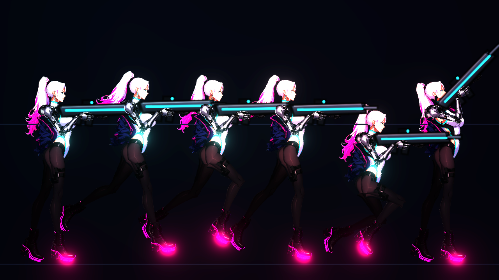
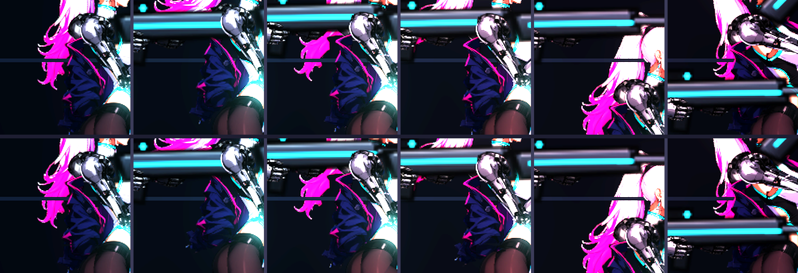

# [NE-72] 為凜的夾克與槍套加上動畫

> 狀態：完成

## 內文

### 需求
凜的夾克與大腿槍套在新流程中已經是獨立的配件零件，但目前只是靜止地掛在骨頭上，沒有任何動作。希望夾克的下擺與領口、槍套隨移動產生次級動態，讓角色更生動；同時確認瞄準抬手時，夾克不會錯誤地遮住手臂。

背景（給接手的人）：
- 配件零件：`art/characters/rin/parts/jacket.png`（掛在 `chest` 骨頭，圖層 z=4，含洋紅襯裡，領口有一塊獨立的碎片）、`holster.png`（掛在 `leg_front_upper`，z=4）。掛載表與支點見 `design/03-art-pipeline/CHARACTER_PIPELINE.md` 第 3 節。
- 現有的次級動態是骨架動畫程式 `game/rig/humanoid_animator.gd` 的彈簧骨：`SPRING_BONES`（`coat_1`、`coat_2`、`hair_1`、`hair_2`），依速度、上升下落與微風算目標角度，以阻尼彈簧追隨。凜的骨架 `art/rigs/humanoid_tall.json` 已有這幾根骨頭（衣襬骨頭目前沒有零件掛在上面）。
- 原圖上夾克的袖子在肘部蓋住義肢，但骨架裡手臂的圖層高於夾克（z=8 對 z=4），所以靜止時看不到袖子蓋住手臂；瞄準時手臂抬起、夾克留在身側，不會遮住手臂。若要做袖子隨手臂移動，需要把夾克拆成「身體部分」與「袖子」兩片，袖子掛在上臂骨頭上。
- 生成與切件工具：`tools/comfyui/build_character.py`、規格 `tools/comfyui/specs/rin_side.json`（`groups`、`parts`）。夾克的完整版是用「剝層」（整張圖移除手臂與槍套後取夾克）得到，見文件第 3 步細節。

要做的事：
1. 決定夾克的拆法：至少拆出「領口」「肩袖」「下擺」其中兩到三片，使它們可以各自擺動；拆法要在規格裡設定，並重跑流程。
2. 夾克下擺掛到彈簧骨（或新增彈簧骨），隨跑步向後飄、跳躍上升時下垂、下落時被氣流掀起，參數沿用現有衣襬與頭髮的風格。
3. 槍套隨大腿擺動，並且在大腿彎曲（跑、蹲）時不穿幫、不脫離腿。
4. 袖子（若有拆出）掛在上臂骨頭，瞄準抬手時跟著手臂，不遮住手臂與手。
5. 動畫參數可調：幅度與阻尼放進資料（角色定義或動畫設定），不寫死在程式裡。

### 來源
2026-10-03，使用者在開發對話中指示「夾克、槍套、衣服等等的都當成配件切割出來，這些未來都可以加上動畫之類的東西」。

### 驗收條件
- [x] 夾克下擺在跑、跳、落下時有次級動態：跑步向後飄、跳起下垂、下落掀起，停下後自然回到靜止
- [x] 夾克各片之間（領口、肩袖、下擺）在擺動時沒有露縫或撕裂
- [x] 瞄準各角度（上下 105 度）夾克與袖子不遮住手臂與手
- [x] 槍套跟著大腿擺動，蹲下與大步跑時不脫離腿、不穿進身體
- [x] 動畫幅度與阻尼可以在資料中調整
- [x] 生命 100% 的靜止外觀與目前一致
- [x] 附跑、跳、落下、蹲的預覽截圖，與一段文字說明各片的動作

### 測試流程
1. 規格拆出夾克片後執行 `tools/comfyui/build_character.py --from parts`
2. 預覽 8 種動作，檢查夾克與槍套
3. 進遊戲跑、跳、蹲、瞄準，目視檢查
4. 調整幅度參數，確認有效果且不誇張

---

# 跟其他票的關係

- Blocks：無
- Blocked by：NE-17
- Related：NE-68、NE-70

---

# Commit-1

## 內文

凜的夾克與大腿槍套原本是靜止地掛在骨頭上，夾克下擺不會隨動作飄，也沒有可調的動畫參數。
現在夾克拆成「領口」（掛在脖子）、「上半」（披在肩上）與兩段「下擺」，下擺跟著彈簧骨動：
- 跑步：下擺向後飄，越下面越遠；停下後慢慢回到垂下的位置。
- 上升：下擺被壓向身體、自然下垂。
- 下落：下擺被氣流掀起、向後揚起。
- 站著：維持與原圖一致的垂下樣子，只有微風帶來的細微晃動。
- 槍套綁在大腿上，跟著大腿轉動；跑步大步、蹲下時貼著腿，沒有脫離或穿進身體。
- 袖子沒有另外拆：夾克像披在肩上，手臂從裡面滑出來，手臂圖層比夾克高，所以瞄準各角度（含仰射 105 度）夾克都不會遮住手臂與手。
動畫的幅度、回彈與阻尼放在骨架檔的次級動態設定裡，可以逐根調整，沒有設定的舊骨架維持原本的預設值，其他角色不受影響。
驗收了站、跑、上升、下落、蹲、仰射的預覽，各片之間沒有露縫，生命 100% 的靜止外觀與原圖一致。依使用者指示，沒有跑完整測試套件。

各片動作說明：
- 領口：跟著脖子與頭轉，不獨立擺動。
- 上半：跟著胸骨，隨呼吸與上身前傾移動。
- 下擺上段（根部掛在上半下緣）：跑步擺幅約 25 度，回彈較硬。
- 下擺下段（掛在上段底下）：擺幅再加約 17 度，阻尼較低，所以尾端比根部晚一點、飄得更遠。

### 測試結果

| 項目 | 結果 |
|---|---|
| 預覽：站、跑、上升、下落、蹲、仰射 | 夾克下擺依動作擺動，無露縫 |
| 靜止外觀 | 與原圖一致 |
| 其他骨架角色（預設彈簧） | 預覽正常，無錯誤訊息 |
| 完整測試套件 | 依使用者指示未執行 |

### 截圖

---
