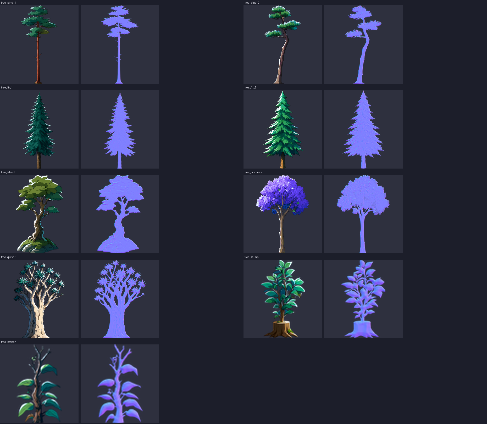
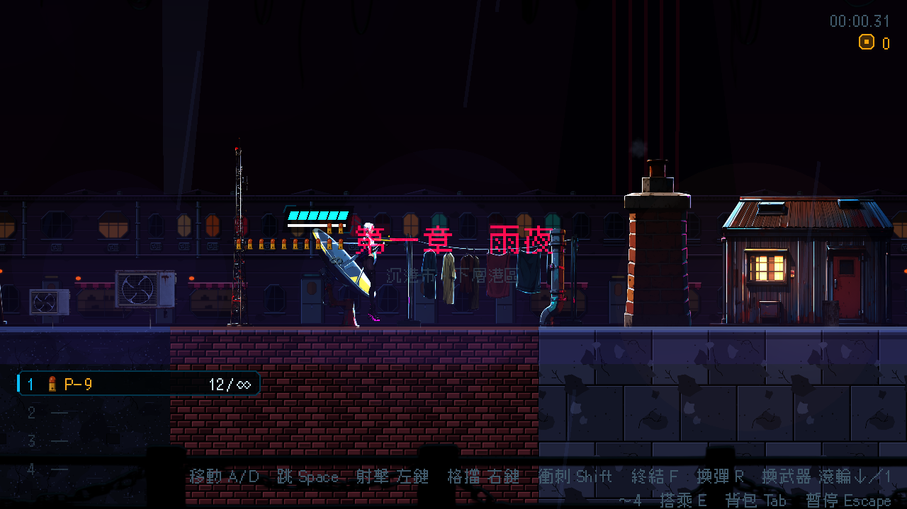

# [NE-75] 改用賽璐璐畫風重做樹木與植被

> 狀態：完成

## 內文

### 需求
樹木與植被（冷杉、松樹、紫葳、小島樹、箭袋樹、枯枝、樹樁）是用免費模型渲染的寫實版本，與賽璐璐畫風的道具不一致。改成賽璐璐畫風，樹冠用平塗色塊與乾淨的輪廓，仍會被風吹動，前景樹仍是半透明、不遮擋敵人與子彈。

### 來源
2026-10-03，使用者決定道具與場景改走賽璐璐畫風：「賽璐璐風格吧」。NE-64 的樹是寫實模型渲染，風格不一致。設計見 `design/11-free-assets/DESIGN.md`。

### 驗收條件
- [x] 所有樹與植被改為賽璐璐畫風，畫廊逐種看過
- [x] 仍會被風吹動（頂端擺動、根部不動），同幅度共用材質，不增加每影格開銷
- [x] 前景樹仍是半透明，不遮擋敵人、子彈與危險物
- [x] 每種都有法線貼圖；尺寸與角色、道具相稱
- [x] 第一章原本擺放樹木的區段外觀正常

### 測試流程
1. 開道具畫廊檢查所有植物
2. 從頭玩第一章，確認樹木的擺動與前景樹的透明度
3. 執行環境元件相關測試套件

---

# 跟其他票的關係

- Blocks：NE-66
- Blocked by：無
- Related：NE-64、NE-62

---

# Commit-1

## 內文

樹木與植被是免費模型渲染的寫實版本，與賽璐璐的道具不一致。
9 種（兩種松樹、兩種冷杉、小島樹、紫葳、箭袋樹、樹樁、枯枝）改用本機 AI 以賽璐璐畫風生成：平塗的葉色、深色描邊、冷白亮邊，每種附法線。風吹擺動的資料沒有改（頂端擺動、根部不動、同幅度共用材質），兩種前景樹維持原本的寬度與半透明，不遮擋敵人、子彈與危險物（松樹與冷杉為此壓扁成原本寬度）。樹樁與枯枝第一版生成出帶葉子的植物，改寫提示詞後得到枯木。
驗收：道具畫廊與第一章實景看過，樹木外觀與擺動正常；環境與道具相關測試套件全數通過，包含前層道具不遮敵人的檢查。

### 測試結果

| 項目 | 結果 |
|---|---|
| 相關測試套件（環境元件、道具、過場動畫） | 通過 1299 / 1299 |
| 素材檢查（大小與總量） | 通過（環境素材 22.7 MB／60 MB，單檔最大 0.6 MB） |
| 執行 log | 無非預期的 ERROR |

### 截圖

