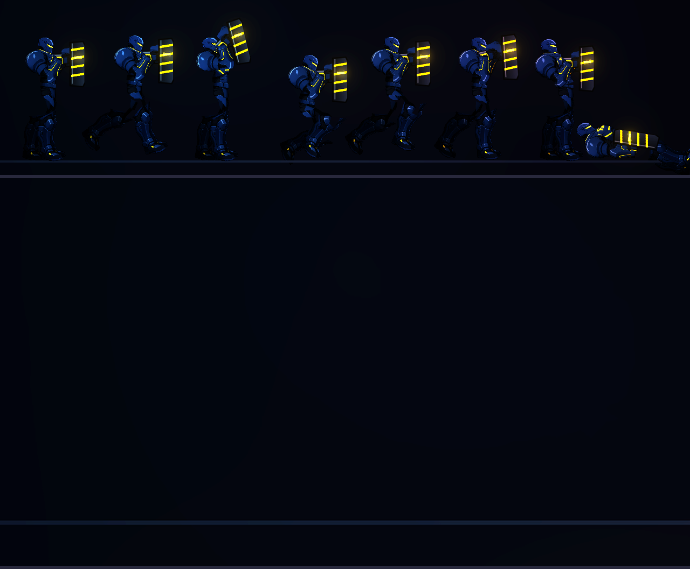
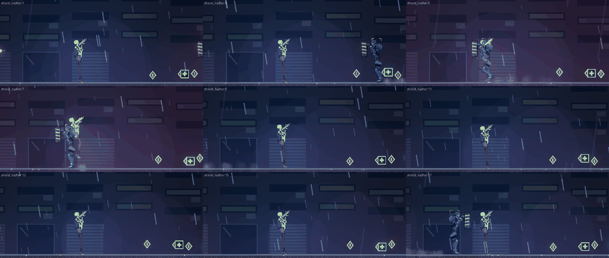
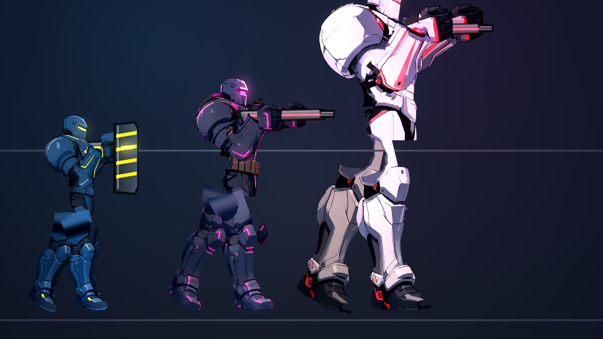
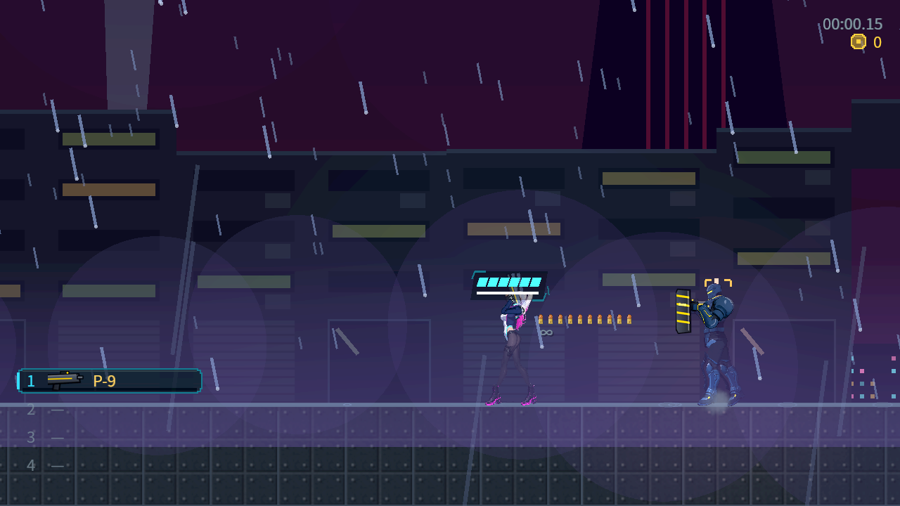
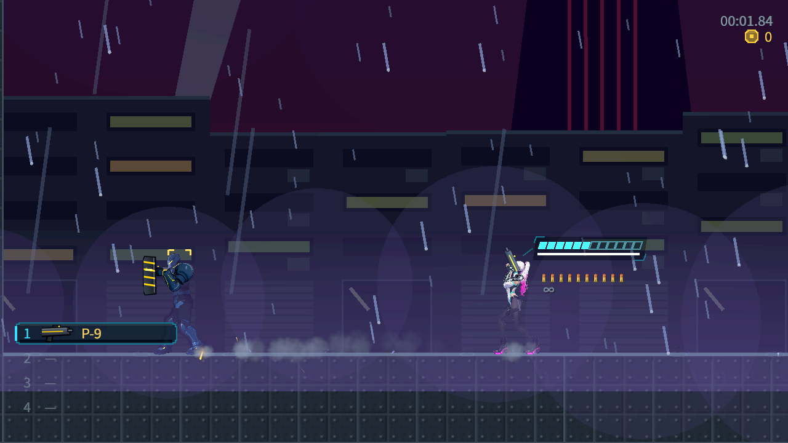
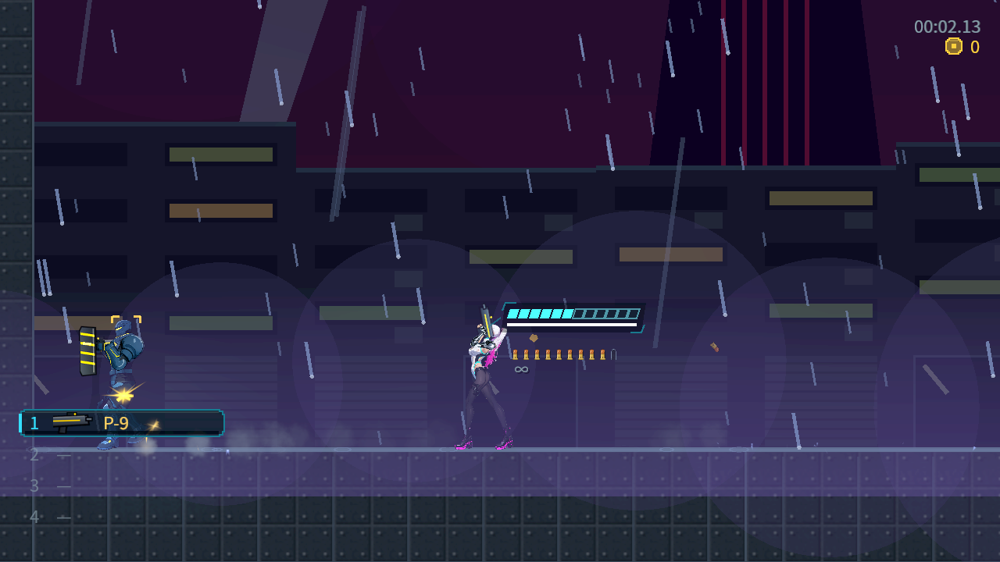
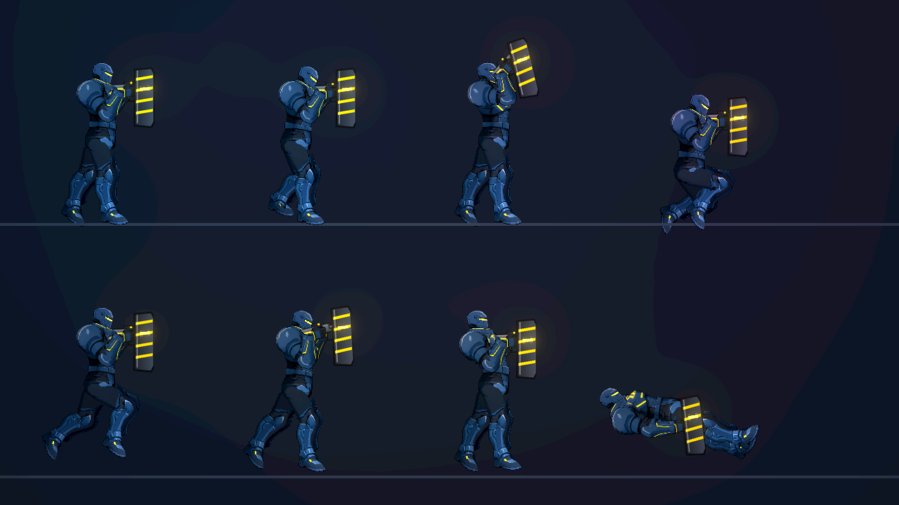
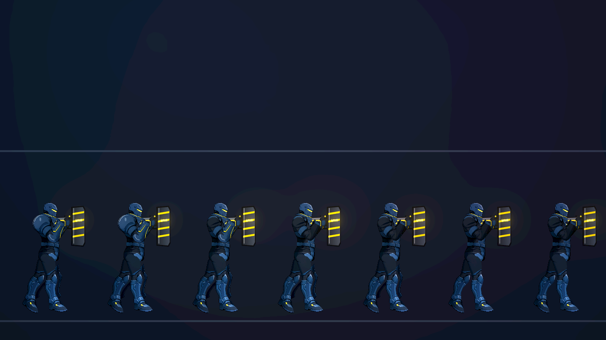

# [NE-79] 重畫鎮暴員

> 狀態：進行中

## 內文

### 需求
鎮暴員（shield_rusher，外觀名稱 `enforcer`）。目前是程式畫的暫代圖（或整隻用程式直接畫），要和凜一樣精細：由 Qwen 畫出透明背景的側面全身圖，再依這個角色自己的骨骼分成零件，裝甲做成獨立零件，受傷時逐片脫落。

外觀設定：深藍灰重甲，大面積肩甲，黃色警示線，一手持盾、一手手槍
比例：寬，約 6.5 頭身，身高約 58　發光色：黃。

### 來源
2026-10-03，使用者在凜（NE-17、NE-68～72）完成後要求重畫敵人與其他 NPC、精細度與凜一致、敵人依各自骨骼分件、可以的話替 NPC 加動畫；並確認先做人形、每個敵人有自己的比例、所有 NPC 都做、芽當成可操控角色設計。設計見 `design/12-cast-redraw/DESIGN.md`。

### 驗收條件
- [x] 外觀符合設定（深藍灰重甲，大面積肩甲，黃色警示線，一手持盾、一手手槍）
- [x] 比例是這個角色獨有的（寬，約 6.5 頭身，身高約 58），與其他敵人並排時能一眼分辨
- [x] 零件圖由定稿立繪切出，放大 2 倍看沒有多餘線條、碎片、拼貼感或色塊，邊緣沒有點狀亮邊
- [x] 裝甲（肩甲、胸甲、護臂、護膝等，依角色而定）是獨立零件，依生命比例逐片脫落噴飛，底下的身體完整，生命 100% 時外觀與完整立繪一致
- [ ] 預覽的八種動作（待機、跑、瞄準、蹲、跳、格擋、硬直、倒下）關節沒有露縫或錯位，手持武器位置自然、槍口位置正確
- [x] 發光部位（依設定）附上對應的發光層，位置與新圖一致
- [x] 遊戲內身高與碰撞框相稱（頭探出碰撞框的程度與其他敵人相近），受擊判定位置與畫面沒有明顯差距
- [x] 遊戲內的預兆、受擊閃白、死亡與掉落表現沿用原本的，沒有壞掉；在該敵人出現的關卡光影下清楚可辨
- [x] 盾牌是獨立零件，衝撞與舉盾時位置正確，不遮住手與槍
- [x] 盾牌的擋彈判定位置與畫面一致
- [x] 附預覽（站姿特寫、八種動作、裝甲脫落各階段）與遊戲內截圖

### 測試流程
1. 依 `design/03-art-pipeline/CHARACTER_PIPELINE.md` 以配方與規格重新產生，確認零件、角色定義、法線都正確
2. 預覽站姿特寫、頭部放大、八種動作與裝甲脫落階段
3. 進入該敵人出現的關卡，與它交戰，確認預兆、受擊、裝甲脫落、死亡

---

# 跟其他票的關係

- Blocks：NE-88
- Blocked by：NE-73、NE-181、NE-224
- Related：NE-71

---

# Commit-1

## 內文

鎮暴員（盾牌沿用原本的盾牌圖放大 5 倍，掛在後手）原本是程式畫的暫代圖。現在用新流程（NE-73）重畫：Qwen 畫出透明背景的側面全身圖，依這個角色自己的骨骼分件，肩甲、前臂護甲、護膝、胸甲是獨立零件，受傷時逐步飛走；身高、比例與配色依 `design/12-cast-redraw/DESIGN.md`。預覽的八種動作關節沒有露縫，持武器位置與槍口正確。
已驗證的項目已打勾；還沒做的是在遊戲裡實際交戰檢查（預兆位置、受擊判定、死亡掉落、關卡光影下的辨識度與碰撞框相稱），所以狀態維持「進行中」。依使用者指示，沒有跑完整測試套件，只跑角色與敵人相關的測試（1534 項、0 失敗）。

### 截圖

---

# Commit-2

## 內文

鎮暴員換成新外觀後只檢查過預覽。這次在遊戲裡逐項看：碰撞框 46、畫面高 58，頭探出 11，頭部弱點判定框套在頭上。盾牌是獨立零件，衝撞與舉盾時都在身體前方，沒有遮住手與槍；前方來的攻擊被擋、背後與暈眩時不擋，與畫面上盾牌的位置一致。預兆、受擊閃白、死亡與掉落正常。在貨運站、霓虹市集、動力室光影下對比 0.78、0.65、0.95，高於門檻 0.45。
預覽中發現大腿上半是塊狀的漸層，跑與跳時像方塊在髖部擺動，這不是遊戲內檢查能修的，另開 NE-181 處理，所以「預覽的八種動作沒有碎塊或變形」這條退回未勾，本票維持進行中。

### 測試結果

| 項目 | 結果 |
|---|---|
| 受影響範圍測試（敵人、骨架、過場、特效等 38 個套件） | 25253 項、0 新失敗（砲彈改動後再跑一次，近戰套件在滿載時因逾時失敗 6 項，單獨重跑兩次都 25／25 通過，與本次改動無關） |
| 資料驗證 | 0 錯誤 |
| 執行 log | 無 ERROR |
| 貨運站、霓虹市集、動力室光影下對比 | 0.78 / 0.65 / 0.95（門檻 0.45） |

### 截圖

---

# Commit-3

## 內文

鎮暴員的交戰檢查補上了實際玩家與敵人流程：敵人自行警戒並進入衝撞，玩家正面射擊由盾牌擋下，衝撞命中玩家；玩家移到敵人背後後，實際手槍子彈可造成傷害。正面擋彈時敵人生命維持 8、彈匣由 12 降到 11；衝撞使玩家生命由 12 降到 6；背後命中使敵人生命由 8 降到 7。三張 Forward+ 截圖讀回時暫停模擬，記錄的前後狀態相同。

### 測試結果

| 項目 | 結果 |
|---|---|
| NE-79 實際戰鬥 CPU 預檢 | 13 項通過、0 失敗 |
| Forward+ 戰鬥截圖與凍結狀態檢查 | 16 項通過、0 失敗 |
| 證據檔案驗證 | 3 張原生 1280×720 PNG、事件結果與原始記錄一致；單位元組損壞負向檢查有拒絕 |
| 執行 log | Godot 4.7.2，無 SCRIPT ERROR 或 ERROR |

### 截圖

[可重跑方式與證據索引](attachments/NE-79-organic-combat/README.md)。這組交戰與截圖不替代八種動作的關節檢查；該驗收條件仍維持未勾選。

---

# Commit-4

## 內文

新增並登記鎮暴員 CPU 無頭回歸：正式動作資料、已登記的蓄力／暈眩／衝撞收尾入口與過渡，左右面向各固定 60Hz 更新 2,635 次；檢查裝甲逐階移除後同一底層部位、盾牌、持槍與槍口的骨骼相對位置，以及重複掛件和既有死亡優先序。六種負控制會被拒絕。沒有重做 Commit-3 已交付的真實戰鬥。

### 測試結果

| 項目 | 結果 |
|---|---|
| 官方 Godot 4.7.2 CPU 無頭，新登記套件 | 986 項、0 失敗、退出碼 0；無 SCRIPT ERROR/ERROR |
| 修改前／後局部相關套件 | 5904／6890 項、0 新或 known failures、退出碼 0；既有負控制各三條 ERROR，如實保留 |
| changed runner | 未登記時重現 0 項，不能算通過；登記後自動選全套，由範圍 guard 拒跑退出 1；最終改用正式局部 runner 實跑八套件，沒有跑完整測試 |
| 環境與畫面 | 使用授權 cloud scratch，未核對 Nest-Egg 命名配置；官方版本與 SHA 已核對；無 GPU 或 rendered frame，沒有新增圖片 |
| 主 Session 本機複驗 | 最新 runtime 89b16e63，正式八套件 6,890 項、0 新／known failures、exit 0；新套件確實執行；三條既有負控制 ERROR 保留、無 SCRIPT ERROR |
| 主 Session 原生診斷圖 | RTX 4070 SUPER／Forward+，八姿勢與七階裝甲各 1280×720，exit 0、無 ERROR；逐格人體與接縫仍未據此勾選 |

[CPU 覆蓋、命令、基線與原始記錄](attachments/NE-79-cloud-action-regression/README.md)。這次不接受人體、全 alpha 接點、來源圖多肢、八動作畫面或操作手感；jump/dodge 是正式 animator 分支，不是新增敵人玩法，裝甲只驗證部位可見性而非受傷飛散。仍等待 NE-224 本地 Forward+ 和操作整合，本票維持進行中、驗收勾選不變。

雲端因無 push 認證保留提交，主 Session 核對 patch 雜湊、審讀並本機複驗後接收整合。[本機複驗記錄](attachments/NE-79-cloud-action-regression/local/README.md)。下列為本機新增的診斷畫面，八姿勢中的倒地輪廓不作自然趴／仰躺的通過證據。

### 本機截圖

