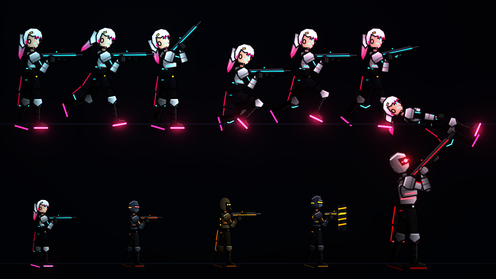
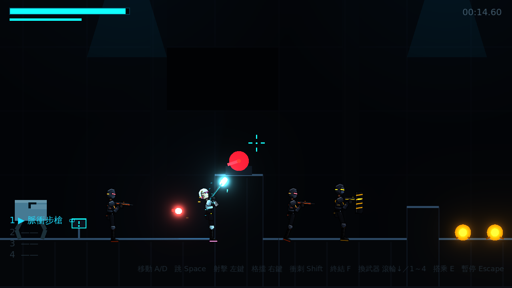
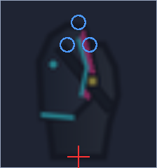

# [NE-7] 建立骨架角色與美術替換流程

> 狀態：完成

## 內文

### 需求
角色改為骨架綁定的零件式角色，並放大角色比例。暫代圖以程式繪製，正式美術（例如 ComfyUI 產出）只要依規格畫出同名圖片直接替換即可，不需要改程式。主角與人形敵人、頭目共用同一套骨架與動畫。

### 來源
2026-10-02，使用者於開發對話中提出：「之後應該會想辦法用 comfyui 之類的東西去繪製，但我不確定要繪製出甚麼你才可以把它綁定到骨架上，像是人物模型、一些部件、武器、裝甲等等」「直接以骨架的方式，自己嘗試用程式繪製你需要的圖，然後綁定到骨架上」「人物比例有點小……希望人物設計的好看一點」。

### 驗收條件
- [x] 主角、人形敵人與頭目都以骨架加零件圖片呈現，共用同一套動作
- [x] 動作包含待機、跑步、跳躍、落下、蹲下、衝刺、格擋、受傷、死亡，雙手持槍跟隨準星
- [x] 頭髮與衣襬有隨動作擺動的次級動態
- [x] 受傷時裝甲零件逐片脫落並噴飛
- [x] 角色比例約為原本的 2 倍，移動與跳躍手感依新比例調整
- [x] 零件圖片缺失時以醒目的替代圖顯示並記錄錯誤，遊戲不會崩潰
- [x] 有美術交付文件，寫明每個零件的名稱、畫布尺寸、關節支點與替換步驟，並附上可直接參考的暫代圖

### 測試流程
1. 進入關卡做出所有動作，確認零件沒有錯位或穿幫
2. 移動準星一圈，確認雙手與槍枝跟隨
3. 受傷數次，確認裝甲逐片脫落
4. 用任一張圖片覆蓋一個零件並重開遊戲，確認新圖出現在正確位置
5. 刪除一個零件圖片，確認出現替代圖且遊戲正常
6. 執行完整測試套件，全部通過

---

# 跟其他票的關係

- Blocks：NE-10
- Blocked by：無
- Related：無

---

# Commit-1

## 內文

原本角色是程式畫的小型火柴人，身高只有地形兩格左右，也沒有辦法換成正式美術。
現在所有人形角色（主角凜、天穹保全、擲彈兵、鎮暴員與頭目監管者）都改為骨架加零件圖片：共用同一套人形骨架與程式動畫，包含待機、跑步、跳躍、落下、蹲下、衝刺、格擋、硬直與倒地；雙手會握著槍枝跟隨準星，頭髮與衣襬隨動作擺動；受傷時裝甲零件逐片脫落並噴飛。霓虹飾條、義眼等自發光部位以獨立發光層呈現並產生泛光。角色比例放大約 2 倍、鏡頭拉近，移動、跳躍與衝刺手感依新比例重新調校；格擋改以子彈飛行方向判定，放大後仍能正確擋住瞄準身體中心的子彈，破防後需回復一定能量才能再次舉盾。
美術流程方面，零件圖目前由程式繪製並輸出成 PNG，正式美術依美術交付規格畫出同尺寸、同支點的圖片直接覆蓋即可；規格文件列出每個零件的畫布、支點、子關節與建議的 ComfyUI 流程，並附上每個零件的對位參考圖。找不到零件圖時會顯示醒目的替代圖並記錄錯誤，遊戲照常運作。
驗證了五個角色的定義與所有零件圖、發光層、武器圖都存在且骨頭參照正確、雙手確實握在槍把上、槍口位置正確、裝甲依生命比例隱藏並在受傷時噴出碎片、缺圖與缺定義的容錯；並以預覽工具與實際遊戲截圖確認動作與比例。

### 測試結果

| 項目 | 結果 |
|---|---|
| 完整測試套件 | 通過 374 / 374 |
| 資料驗證 | 0 錯誤 |
| 執行 log | 無非預期 ERROR（僅測試刻意觸發的缺圖容錯訊息） |

### 截圖

