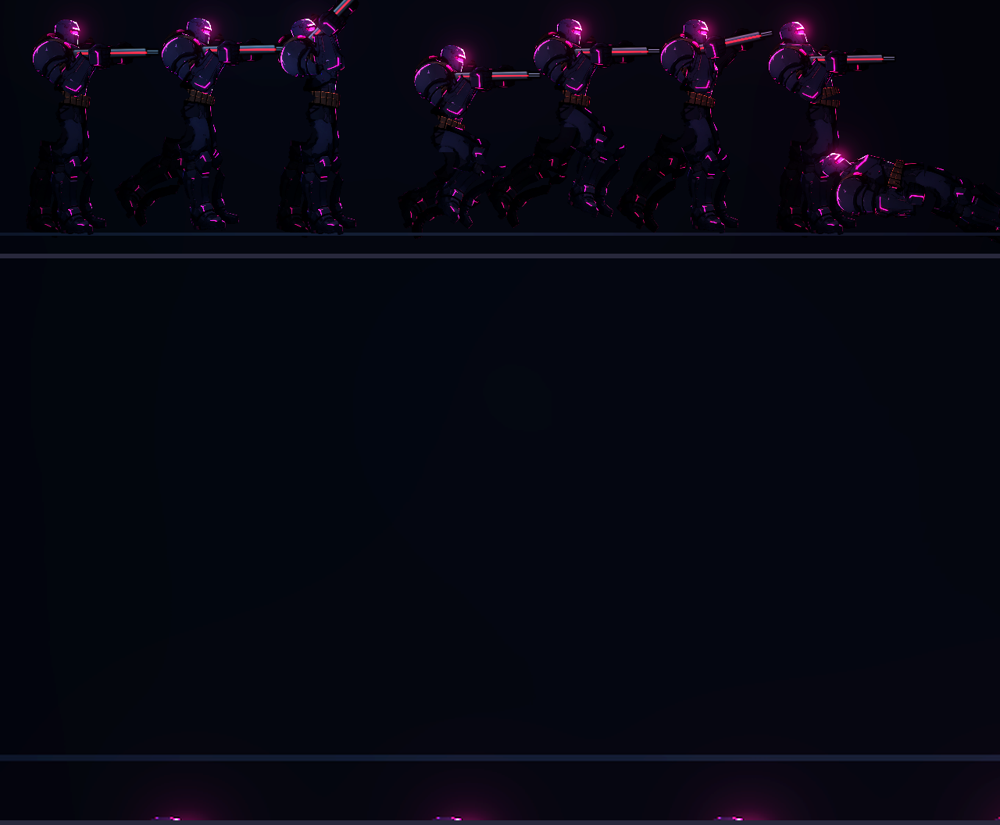
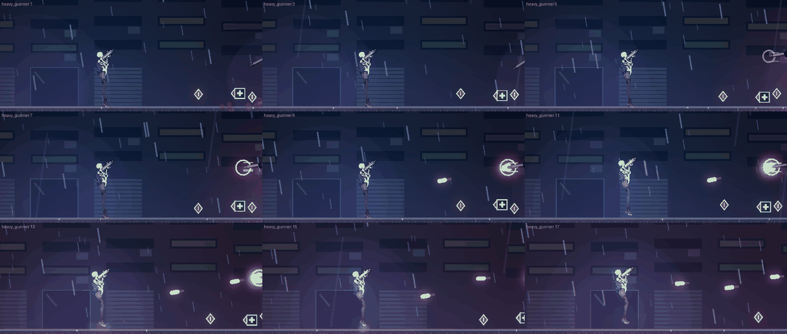
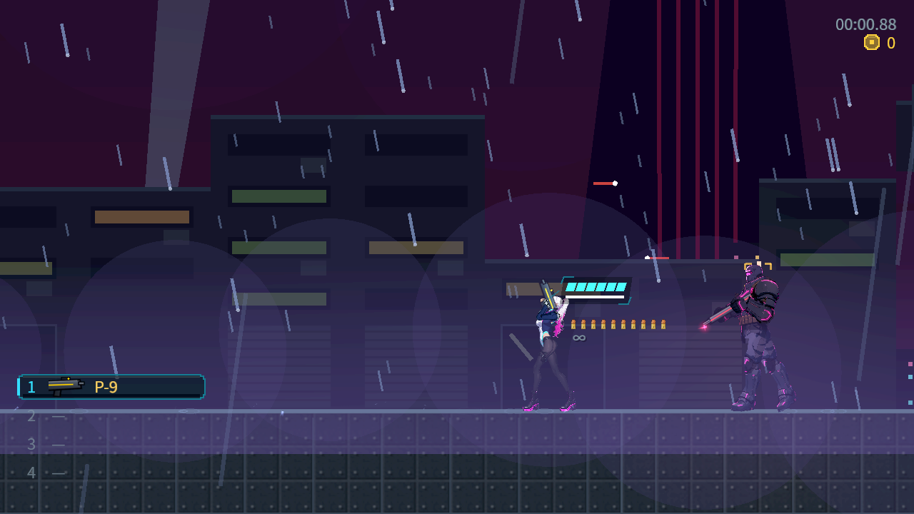
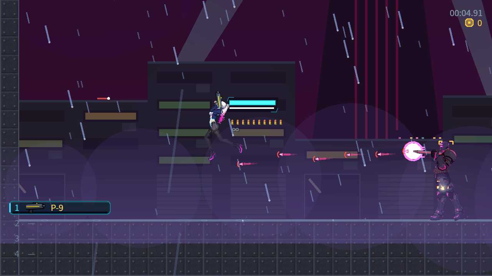
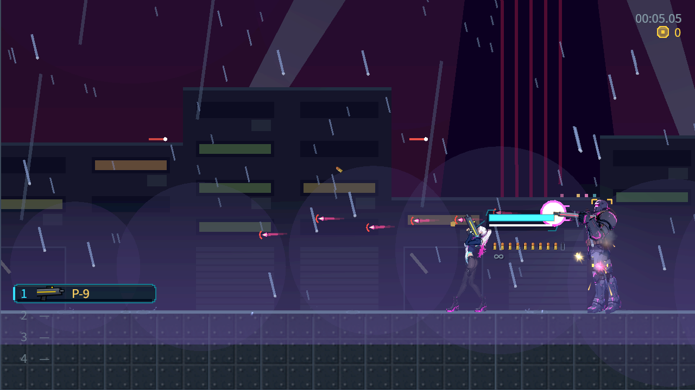
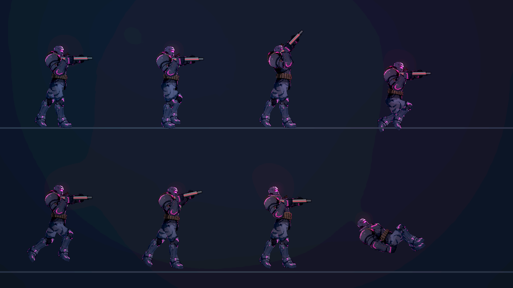
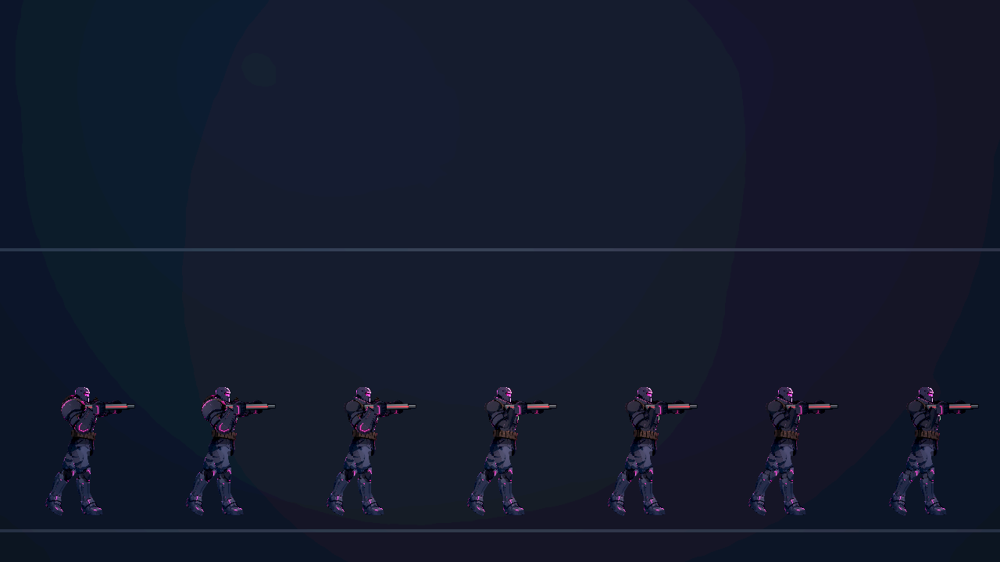
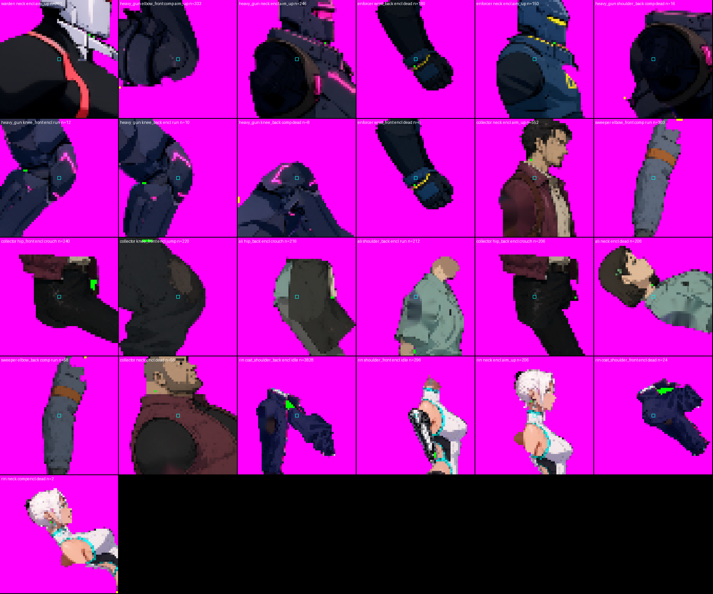

# [NE-80] 重畫重裝機槍手

> 狀態：進行中

## 內文

### 需求
重裝機槍手（heavy_gunner）。目前是程式畫的暫代圖（或整隻用程式直接畫），要和凜一樣精細：由 Qwen 畫出透明背景的側面全身圖，再依這個角色自己的骨骼分成零件，裝甲做成獨立零件，受傷時逐片脫落。

外觀設定：全身重甲，背負彈鏈，機槍；一般敵人中體型最大
比例：寬壯，約 5.5 頭身，身高約 69　發光色：洋紅。

### 2026-10-11 使用者要求與停工交接索引

重裝角色全部件及八動作的原生外觀須獨立驗收；資料、武器、裝甲或CPU回歸通過不代替接縫、承重和人體。與雲端整合驗收NE-224維持原分工。

[角色製作、品質要求、拒收例子與業界原始參考](../user_guide.md) · [本次停工交接](../handoff/character-art-2026-10-11.md)。本次只整理既有需求與證據，既有驗收勾選和真實狀態保持原樣。

### 來源
2026-10-03，使用者在凜（NE-17、NE-68～72）完成後要求重畫敵人與其他 NPC、精細度與凜一致、敵人依各自骨骼分件、可以的話替 NPC 加動畫；並確認先做人形、每個敵人有自己的比例、所有 NPC 都做、芽當成可操控角色設計。設計見 `design/12-cast-redraw/DESIGN.md`。

### 驗收條件
- [x] 外觀符合設定（全身重甲，背負彈鏈，機槍；一般敵人中體型最大）
- [x] 比例是這個角色獨有的（寬壯，約 5.5 頭身，身高約 69），與其他敵人並排時能一眼分辨
- [x] 零件圖由定稿立繪切出，放大 2 倍看沒有多餘線條、碎片、拼貼感或色塊，邊緣沒有點狀亮邊
- [x] 裝甲（肩甲、胸甲、護臂、護膝等，依角色而定）是獨立零件，依生命比例逐片脫落噴飛，底下的身體完整，生命 100% 時外觀與完整立繪一致
- [ ] 預覽的八種動作（待機、跑、瞄準、蹲、跳、格擋、硬直、倒下）關節沒有露縫或錯位，手持武器位置自然、槍口位置正確
- [x] 發光部位（依設定）附上對應的發光層，位置與新圖一致
- [x] 遊戲內身高與碰撞框相稱（頭探出碰撞框的程度與其他敵人相近），受擊判定位置與畫面沒有明顯差距
- [x] 遊戲內的預兆、受擊閃白、死亡與掉落表現沿用原本的，沒有壞掉；在該敵人出現的關卡光影下清楚可辨
- [x] 機槍的旋轉與彈鏈位置自然
- [x] 附預覽（站姿特寫、八種動作、裝甲脫落各階段）與遊戲內截圖

### 測試流程
1. 依 `design/03-art-pipeline/CHARACTER_PIPELINE.md` 以配方與規格重新產生，確認零件、角色定義、法線都正確
2. 預覽站姿特寫、頭部放大、八種動作與裝甲脫落階段
3. 進入該敵人出現的關卡，與它交戰，確認預兆、受擊、裝甲脫落、死亡

---

# 跟其他票的關係

- Blocks：NE-88
- Blocked by：NE-73、NE-181、NE-224
- Related：NE-71

---

# Commit-1

## 內文

重裝機槍手原本是程式畫的暫代圖。現在用新流程（NE-73）重畫：Qwen 畫出透明背景的側面全身圖，依這個角色自己的骨骼分件，肩甲、前臂護甲、護膝、胸甲是獨立零件，受傷時逐步飛走；身高、比例與配色依 `design/12-cast-redraw/DESIGN.md`。預覽的八種動作關節沒有露縫，持武器位置與槍口正確。
已驗證的項目已打勾；還沒做的是在遊戲裡實際交戰檢查（預兆位置、受擊判定、死亡掉落、關卡光影下的辨識度與碰撞框相稱），所以狀態維持「進行中」。依使用者指示，沒有跑完整測試套件，只跑角色與敵人相關的測試（1534 項、0 失敗）。

### 截圖

---

# Commit-2

## 內文

重裝機槍手換成新外觀後只檢查過預覽。這次在遊戲裡逐項看：碰撞框 56、畫面高 69，頭探出 13，頭部弱點判定框套在頭上。機槍預熱時槍管旋轉的光環與子彈都從機槍口出去，彈鏈在腰間的位置自然。預兆、受擊閃白、死亡與掉落正常。在動力室、住宅區光影下對比 0.70 與 0.77，高於門檻 0.45。
預覽中發現大腿上半是塊狀的漸層（與鎮暴員同樣的問題），另開 NE-181 處理，所以「預覽的八種動作沒有碎塊或變形」這條退回未勾，本票維持進行中。

### 測試結果

| 項目 | 結果 |
|---|---|
| 受影響範圍測試（敵人、骨架、過場、特效等 38 個套件） | 25253 項、0 新失敗（砲彈改動後再跑一次，近戰套件在滿載時因逾時失敗 6 項，單獨重跑兩次都 25／25 通過，與本次改動無關） |
| 資料驗證 | 0 錯誤 |
| 執行 log | 無 ERROR |
| 動力室、住宅區光影下對比 | 0.70 / 0.77（門檻 0.45） |

### 截圖

---

# Commit-3

## 內文

補上可重跑的局部自然交戰紀錄。重裝機槍手在實際關卡環境自行發現玩家，預熱、掃射後進入散熱。封閉護甲擋下真實手槍子彈且生命維持 14；自然掃射計數 13 發，其中 7 次扣除玩家生命；散熱期間的真實手槍命中令敵人生命 14→12。

為持續觀察，測試玩家生命設定為 999，散熱時將玩家移至短射程位置；敵人的狀態、生命與裝甲沒有強制變更。這次只驗證上述交戰路徑，八動作條件保留未勾選，狀態維持進行中。三張原生畫面僅作交戰情境紀錄：讀回期間模擬保持不變，但畫面可能保留上一格動畫，不能代替逐格姿勢與接縫驗收。

來源版本、原始事件、完整 log、素材雜湊及重跑說明見 [自然交戰紀錄](attachments/NE-80-organic-combat/README.md)。

### 測試結果

| 項目 | 結果 |
|---|---|
| 局部自然交戰 headless | 10 項、0 失敗；公開重跑再次 10／0 |
| 原生 Forward+ 交戰與讀回 | 13 項、0 失敗，三張 1280×720 原始截圖 |
| 紀錄與來源核對 | 原始位元組、版本來源、素材與截圖雜湊一致；錯誤來源與圖片損壞負控制被拒絕 |
| 執行 log | 無 SCRIPT ERROR／ERROR |
| 交付範圍 | 僅驗證工具與紀錄；完整測試交由 CI |

### 截圖

---

# Commit-4

## 內文

重裝機槍手的正式外觀補上獨立CPU回歸：票內八動作及步行、兩面向、空手／真實機槍，在固定60Hz完整循環與起停轉向中，骨長、父子接點、唯一可見部件、裝甲恢復與下層、握點及槍口契約均通過。七種故障控制各被拒絕，沒有放寬既有門檻。實際玩家手槍在自然交戰中再次重現封閉護甲14→14、散熱14→12，敵人自然掃射13發。

這是CPU子範圍交付；雲端沒有原生畫面，主 Session 接收後補上本機原生診斷。人體、全部接點、一像素接縫、Forward+法線／發光／HDR2D及操作手感仍依原條件由NE-224驗收。票維持進行中，八動作外觀條件沒有因數值測試勾選。

### 測試結果

| 項目 | 結果 |
|---|---|
| 官方引擎 | 官方ZIP SHA512相符，解出binary SHA512另存；版本4.7.2.stable.official.ed1daf0bf |
| 專用CPU回歸 | 25,508 checks、0 failures；七種負控制逐項拒絕，實際子彈14→14／14→12 |
| 固定起點局部依賴 | 11個實際套件、34,410 checks、0新／已知失敗，exit0；完整測試交CI |
| 執行診斷 | 成功執行無SCRIPT ERROR；三個既有故意無效資料ERROR與原註冊表8,902 checks基線一致，完整保留 |
| 選擇器 | 註冊導致ALL，攔下完整測試後明列局部--only；首次無效啟動及中止紀錄保留，不算通過 |
| 原生圖片 | 無native；CPU結果不計人體、像素接縫、光照或操作驗收 |
| 主 Session 本機複驗 | 最新 79e0fa53 基準保留兩個新 suite 註冊，12 個局部套件、35,396 checks、0 新／known failures、exit 0；兩個新 suite 均確實執行 |
| 主 Session 原生診斷 | RTX 4070 SUPER／Forward+、八姿勢及七階裝甲各 1280×720；初次槍管裁切拒收、重拍全列在畫面內；不計逐格人體／接縫通過 |

[固定來源、完整命令／stdout／stderr／exit、原始證據與root驗收範圍](attachments/NE-80-cloud-art-regression/README.md) · [實際結果](attachments/NE-80-cloud-art-regression/results.json)。

雲端正常 push 因缺身份失敗而保留 commit；主 Session 核對完整 patch 與證據雜湊、審讀及本機複驗後接收整合。[本機結果與重現方式](attachments/NE-80-cloud-art-regression/local/README.md)。

### 本機截圖

---

# Commit-5

## 內文

重裝機槍手的八個動作一直有接點稽核的失敗沒有分清楚：哪些是真的看得到背景的缺口，哪些只是輪廓邊緣的凹口。

這次做了兩件事。第一，頭與軀幹之間補上藏在頭底下的重疊，並把頭與軀幹上的小凹洞補起來（手臂零件有既有的手腕修補鎖定，沒有動）。第二，接點檢查多了一組診斷數字，把失敗分成三種：輪廓邊緣的單像素凹口、檢查範圍把彎曲的肢體切成兩塊、真正的缺口（封閉的洞、游離碎片、關節中心沒蓋到）。判定標準沒有放寬，只是多報這組數字。

結果：14 類接點、8 種狀態、兩個面向、兩種倍率共 53,760 個取樣，825 個失敗，其中真正的缺口 296 個（頸部頭盔與衣領之間 246、膝蓋摺痕 22、倒地時肩後的游離小點 16），其餘是輪廓凹口或檢查範圍切到肢體。真正的缺口放大看都是 1～3 個像素、在兩個零件交界的凹處。這些還沒有歸零，八種動作的驗收條件維持未勾選。

### 測試結果

| 項目 | 結果 |
|---|---|
| 逐格接點稽核 | 53,760 個取樣，825 個失敗，其中真正的缺口 296 個 |
| 受影響範圍測試 | 6 組、5,761 項檢查，0 新失敗、0 已知失敗 |
| 檢查工具自我檢查 | 完整輪廓通過；單像素孔洞與斷開的兩塊仍判為失敗 |

### 截圖

分支 `feature/character-art`。
