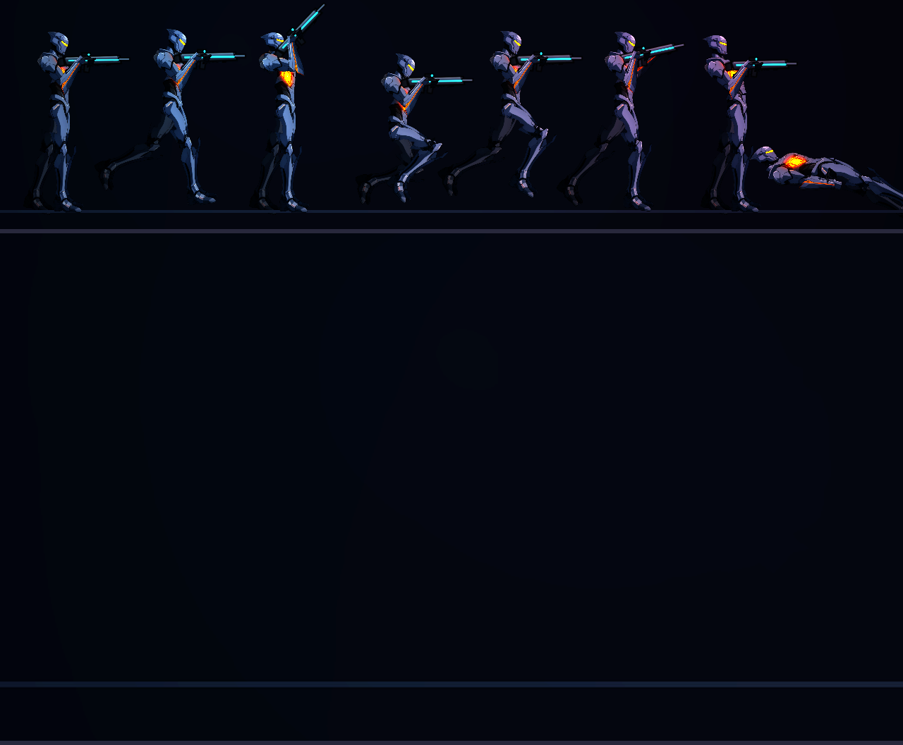
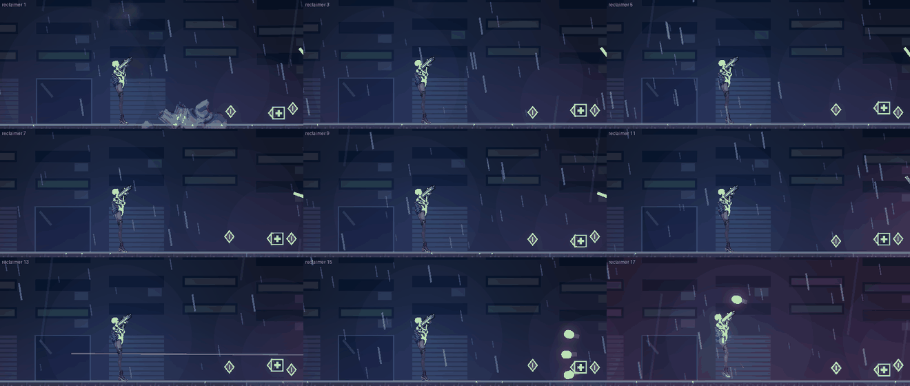
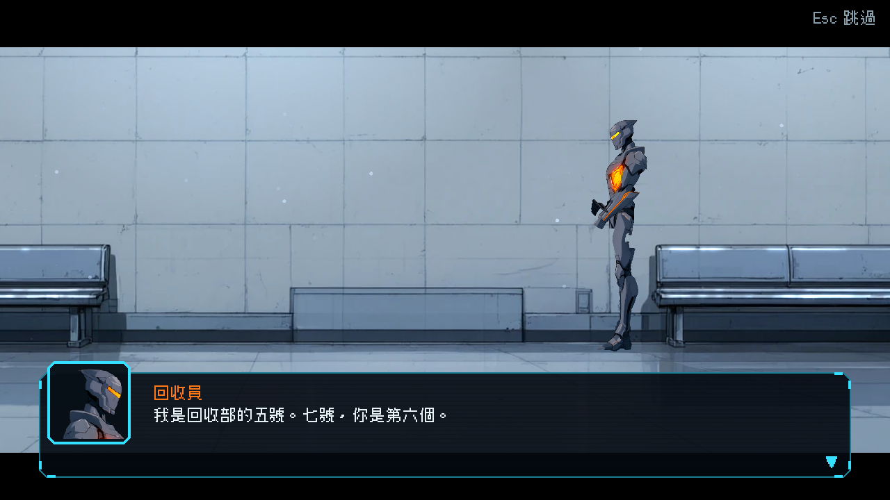
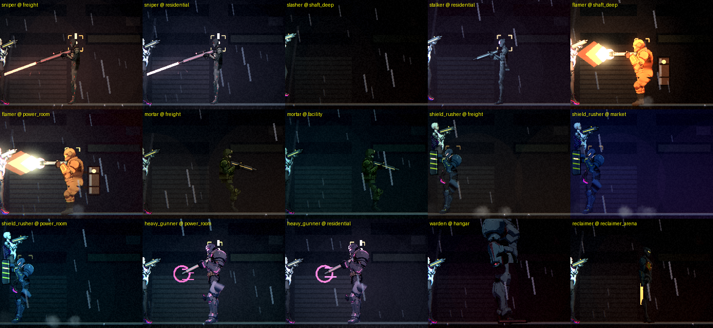

# [NE-82] 重畫頭目回收員

> 狀態：完成

## 內文

### 需求
頭目回收員（reclaimer，外觀名稱 `reclaimer`）。目前是程式畫的暫代圖（或整隻用程式直接畫），要和凜一樣精細：由 Qwen 畫出透明背景的側面全身圖，再依這個角色自己的骨骼分成零件，裝甲做成獨立零件，受傷時逐片脫落。

外觀設定：石板灰機動型，刀刃與外露核心，橘色線
比例：修長，約 7 頭身，身高約 64　發光色：橘。

### 來源
2026-10-03，使用者在凜（NE-17、NE-68～72）完成後要求重畫敵人與其他 NPC、精細度與凜一致、敵人依各自骨骼分件、可以的話替 NPC 加動畫；並確認先做人形、每個敵人有自己的比例、所有 NPC 都做、芽當成可操控角色設計。設計見 `design/12-cast-redraw/DESIGN.md`。

### 驗收條件
- [x] 外觀符合設定（石板灰機動型，刀刃與外露核心，橘色線）
- [x] 比例是這個角色獨有的（修長，約 7 頭身，身高約 64），與其他敵人並排時能一眼分辨
- [x] 零件圖由定稿立繪切出，放大 2 倍看沒有多餘線條、碎片、拼貼感或色塊，邊緣沒有點狀亮邊
- [x] 裝甲（肩甲、胸甲、護臂、護膝等，依角色而定）是獨立零件，依生命比例逐片脫落噴飛，底下的身體完整，生命 100% 時外觀與完整立繪一致
- [x] 預覽的八種動作（待機、跑、瞄準、蹲、跳、格擋、硬直、倒下）關節沒有露縫或錯位，手持武器位置自然、槍口位置正確
- [x] 發光部位（依設定）附上對應的發光層，位置與新圖一致
- [x] 遊戲內身高與碰撞框相稱（頭探出碰撞框的程度與其他敵人相近），受擊判定位置與畫面沒有明顯差距
- [x] 遊戲內的預兆、受擊閃白、死亡與掉落表現沿用原本的，沒有壞掉；在該敵人出現的關卡光影下清楚可辨
- [x] 衝刺斬的蹲低、刀刃亮起與硬直時核心外露，位置與新外觀一致
- [x] 對話頭像與頭目戰前後的過場改用新造型
- [x] 附預覽（站姿特寫、八種動作、裝甲脫落各階段）與遊戲內截圖

### 測試流程
1. 依 `design/03-art-pipeline/CHARACTER_PIPELINE.md` 以配方與規格重新產生，確認零件、角色定義、法線都正確
2. 預覽站姿特寫、頭部放大、八種動作與裝甲脫落階段
3. 進入該敵人出現的關卡，與它交戰，確認預兆、受擊、裝甲脫落、死亡
4. 玩一次頭目戰，確認衝刺斬、硬直、第二階段

---

# 跟其他票的關係

- Blocks：NE-88
- Blocked by：NE-73
- Related：NE-71

---

# Commit-1

## 內文

回收員（改用骨架外觀；頭目的招式預兆沿用原本的程式，刀刃與外露核心接在骨架上）原本是程式畫的暫代圖。現在用新流程（NE-73）重畫：Qwen 畫出透明背景的側面全身圖，依這個角色自己的骨骼分件，肩甲、前臂護甲、護膝、胸甲是獨立零件，受傷時逐步飛走；身高、比例與配色依 `design/12-cast-redraw/DESIGN.md`。預覽的八種動作關節沒有露縫，持武器位置與槍口正確。
已驗證的項目已打勾；還沒做的是在遊戲裡實際交戰檢查（預兆位置、受擊判定、死亡掉落、關卡光影下的辨識度與碰撞框相稱），所以狀態維持「進行中」。依使用者指示，沒有跑完整測試套件，只跑角色與敵人相關的測試（1534 項、0 失敗）。

### 截圖

---

# Commit-2

## 內文

回收員換成新外觀後，碰撞框只有 46，畫面高 64，頭探出 18，是所有人形敵人裡最多的，打頭會落空；核心外露時的弱點光環畫在碰撞框 62% 高的位置，比新外觀的胸口低約 13 像素。
現在碰撞框高改成 54（頭探出 10，與其他敵人相近），核心光環跟著新外觀的胸口走。衝刺斬蓄力時蹲低、刀臂舉到身後，衝刺時前伸、刀刃發亮，硬直時核心在胸口外露；瞬移瞄準的預告線從新槍口出去，衝刺路線預告貼地、刀刃跟著前手。戰前過場與對話頭像用新造型，站在走廊裡比例正常。預兆、受擊閃白、死亡與掉落正常。在回收員場地光影下對比 1.07，高於門檻 0.45。

### 測試結果

| 項目 | 結果 |
|---|---|
| 受影響範圍測試（敵人、骨架、過場、特效等 38 個套件） | 25253 項、0 新失敗（砲彈改動後再跑一次，近戰套件在滿載時因逾時失敗 6 項，單獨重跑兩次都 25／25 通過，與本次改動無關） |
| 資料驗證 | 0 錯誤 |
| 執行 log | 無 ERROR |
| 回收員場地光影下對比 | 1.07（門檻 0.45） |

### 截圖

---
