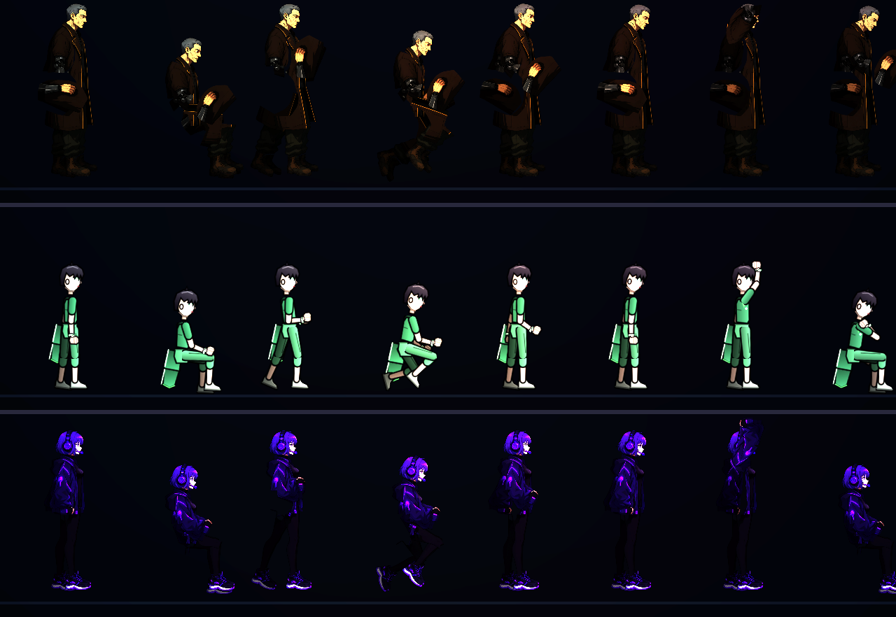

# [NE-83] 建立 NPC 動畫

> 狀態：完成

## 內文

### 需求
NPC 目前只是站著不動的剪影或靜止的骨架，沒有「活著的感覺」。要新增一個 NPC 專用的動畫器，由程式驅動骨架（不逐格畫），動畫設定放在資料裡：共通的待機呼吸、說話時點頭與手勢（對話進行時啟動）、聆聽、朝向玩家、揮手；姿勢：站、坐、靠牆、蹲；以及每個 NPC 專屬的工作循環（攪鍋、敲打、整理、看平板等，由資料指定）。過場演員與場景中的 NPC 共用同一套。沒有設定的 NPC 至少有待機呼吸。先以現有的骨架外觀（老 K、芽、航）測試，之後由各角色票套用。

### 來源
2026-10-03，使用者在凜（NE-17、NE-68～72）完成後要求重畫敵人與其他 NPC、精細度與凜一致、敵人依各自骨骼分件、可以的話替 NPC 加動畫；並確認先做人形、每個敵人有自己的比例、所有 NPC 都做、芽當成可操控角色設計。設計見 `design/12-cast-redraw/DESIGN.md`。

### 驗收條件
- [x] 新增 NPC 動畫器，戰鬥用的人形動畫器與現有敵人、玩家行為不受影響
- [x] 待機呼吸、說話（點頭與手勢，隨對話開始與結束）、聆聽、朝向玩家、揮手都能運作
- [x] 站、坐、靠牆、蹲四種姿勢能運作，坐與靠牆時身體位置正確
- [x] 專屬工作循環可由資料指定（循環名稱、幅度、節奏），幅度與節奏不需要改程式就能調
- [x] 資料中沒有動畫設定或指定的循環不存在時，使用待機呼吸並記錄錯誤，不會崩潰
- [x] 過場演員與場景中的 NPC 使用同一套，過場腳本可以指定動畫
- [x] 以老 K、芽、航各示範一個工作循環與說話動作
- [x] 附各動作與姿勢的預覽截圖與說明

### 測試流程
1. 在預覽工具逐一檢查共通動作與姿勢
2. 進入有 NPC 的場景，靠近並對話，確認說話動作隨對話開始與結束
3. 在過場中指定動畫，確認與場景中一致
4. 調整資料中的幅度與節奏，確認有效果

---

# 跟其他票的關係

- Blocks：NE-84～NE-87、NE-89
- Blocked by：無
- Related：NE-45、NE-72

---

# Commit-1

## 內文

NPC 原本只是站著不動的剪影或靜止的骨架。現在有 NPC 動畫器：站著時雙手自然下垂、呼吸；可以坐、靠牆、蹲；對話時點頭與比手勢（隨對話開始與結束淡入淡出），玩家靠近時微微偏頭聆聽，可以揮手；每個角色可以有專屬工作循環（攪鍋、擦手、敲打、看平板、整理器材、咳嗽、拉被子、打字、打哈欠、看紙條、張望、抱孩子），有些循環只在週期的某段時間發生（例如每 8 秒咳 1.6 秒）。動作的角度與節奏全部是資料（`art/rigs/npc_animations.json`），NPC 資料的 `loop_scale` 可以整體放大縮小，不需要改程式。角色在走、跑、蹲、格擋、持武器或瞄準時仍用原本的人形動畫，所以過場裡的演員不受影響。
場景人物（資料的姿勢與循環）與過場演員共用同一套；過場的 actor 步驟可以指定 `pose`、`loop`，說某位講者的台詞時對應的演員會點頭比手勢，其他演員聆聽。已套用：第一章舖子裡老 K 攪粥、航坐在床上拉被子（航原本是頭像剪影，現在是骨架外觀）、第二章老 K 擦手；五個 NPC 各自指定了姿勢與循環（阿婆攪鍋、夜班工人靠牆打哈欠、護理師看平板、老陳蹲著敲打、住戶抱孩子張望）。
資料有錯（不存在的骨頭、姿勢或循環）時記錄具體位置並退回站姿；NPC 資料的循環名稱會被驗證。依使用者指示，沒有跑完整測試套件，只跑動畫、NPC、過場、劇本與角色相關的測試（1754 項、0 失敗）。

### 測試結果

| 項目 | 結果 |
|---|---|
| 動畫資料引用的骨頭都存在（三種骨架） | 通過 |
| 坐下降低骨盆、靠牆後仰、說話動手臂、聆聽偏頭、揮手舉臂、循環動手臂、幅度倍率、有 gate 的循環 | 通過 |
| 未知姿勢與循環不崩潰、走動與持武器退回人形動畫 | 通過 |
| 過場（第一章舖子）演員動作與頭像 | 正常 |
| 動畫、NPC、過場、劇本與角色相關測試 | 1754 項、0 失敗 |
| 完整測試套件 | 依使用者指示未執行 |

### 截圖

---
