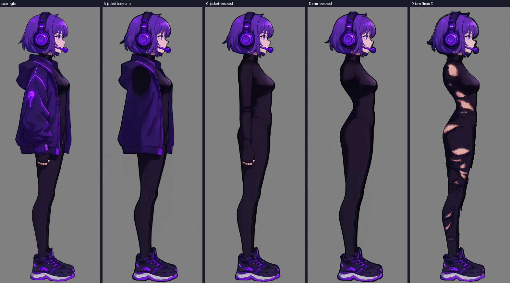
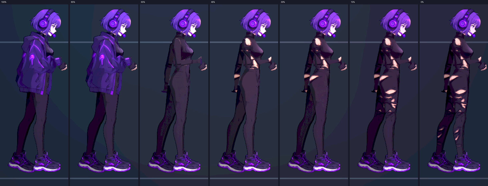
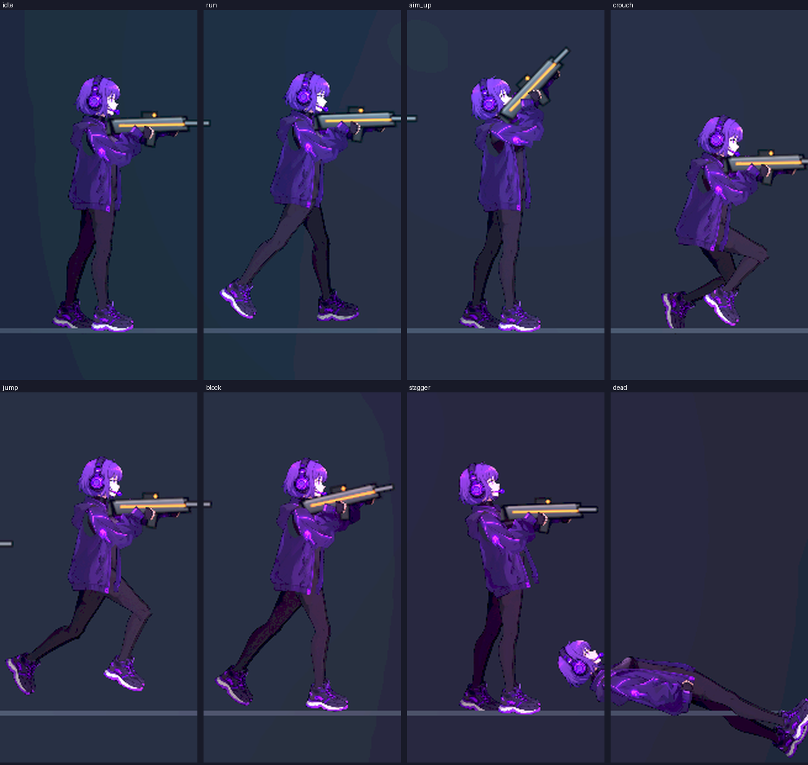
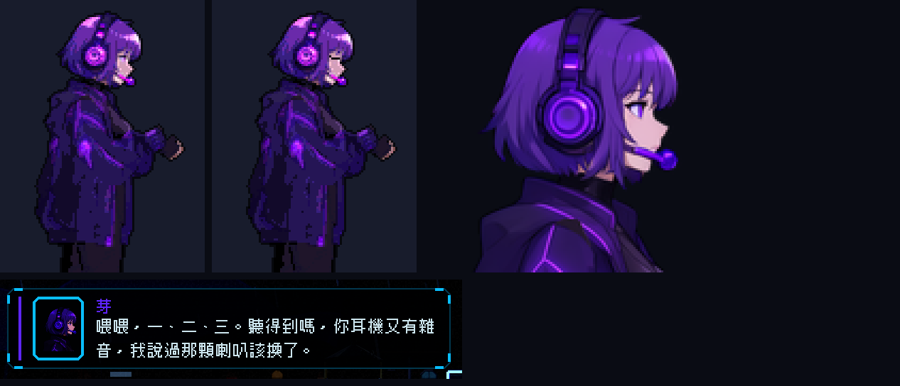
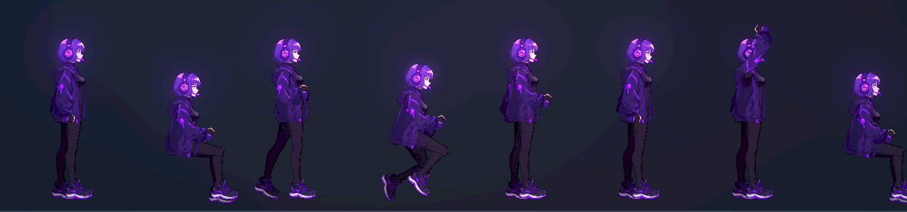
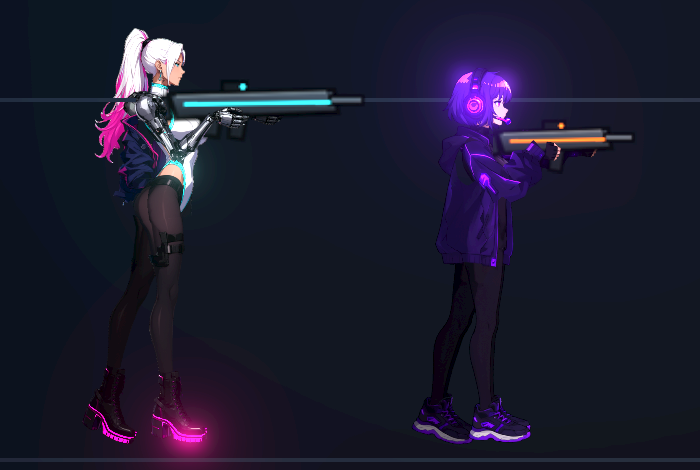

# [NE-84] 重畫芽並依可操控角色規格製作

> 狀態：完成

## 內文

### 需求
芽目前是程式畫的 Q 版骨架外觀。要用凜的流程重畫，而且依「可操控角色」的規格做（這一次只做資產，切換成芽來操作的玩法另外討論）：完整動作、與碰撞框相容的身高、眨眼、背包立繪、對話頭像、受傷時衣物逐片脫落、法線與發光。外觀依設定：嘴很毒、心很軟的駭客搭檔，戴耳機，紫色頭髮（#5f3d9c）、深紫外套、洋紅線條。同時套用 NPC 動畫（NE-83）的一個專屬動作（戴耳機敲鍵盤、抬頭）。

### 來源
2026-10-03，使用者在凜（NE-17、NE-68～72）完成後要求重畫敵人與其他 NPC、精細度與凜一致、敵人依各自骨骼分件、可以的話替 NPC 加動畫；並確認先做人形、每個敵人有自己的比例、所有 NPC 都做、芽當成可操控角色設計。設計見 `design/12-cast-redraw/DESIGN.md`。

### 驗收條件
- [x] 外觀符合設定（戴耳機、紫髮、深紫外套、線條配色），與凜明顯不同的造型與比例
- [x] 零件圖放大 2 倍看沒有多餘線條、碎片或拼貼感，邊緣沒有點狀亮邊
- [x] 預覽的八種動作與各瞄準角度（含蹲、衝刺）沒有錯位，持武器位置與槍口正確，肩膀高度由骨架量出
- [x] 身高與縮放和碰撞框相容（頭探出碰撞框的程度與凜相近）
- [x] 有眨眼設定，背包立繪（睜眼、閉眼）與對話頭像由新造型切出，取景完整
- [x] 受傷時衣物依生命比例逐片脫落，露出撕裂的底層，0% 仍留碎布，不全裸，回血後回來
- [x] 法線與發光層正確，在三種代表性光影下可辨識
- [x] 套用 NPC 動畫的專屬動作（戴耳機敲鍵盤、抬頭）與說話動作
- [x] 過場與通訊畫面裡的芽（頭像）顯示正常
- [x] 附預覽、遊戲內、頭像與動作的截圖

### 測試流程
1. 以配方與規格重新產生，檢查零件與角色定義
2. 預覽八種動作、頭部與衣物脫落階段
3. 開背包與對話，檢查頭像與立繪，等待眨眼
4. 在過場看 NPC 動畫

---

# 跟其他票的關係

- Blocks：NE-88
- Blocked by：NE-73、NE-83
- Related：NE-69、NE-70、NE-71

---

# Commit-1

## 內文

芽用新流程重畫（Qwen 側面圖、分件、法線），並做出衣物逐片脫落：夾克（帽子與背心、前襟、兩隻袖子）→ 連身衣上半與手臂 → 腰臀 → 大腿 → 小腿，每步一組；底層是撕裂的連身衣與褲子（Qwen 兩階段編輯：先移除夾克、再移除手臂、再撕裂；種子 61／62／73），0% 仍有碎布與殘片，沒有全裸。這一部分由 subagent 在背景生成並驗收，我另外核對了預覽圖與測試。
我另外處理：把 `p`（紫色）加進發光層的色域，芽的耳機與麥克風現在有發光層；`make_damage.py` 取色改為只用不透明且內縮 2 像素的像素，避免 Qwen 的淺色光暈進到破損層。
已驗證的項目已打勾。還沒做所以維持「進行中」：眨眼設定、背包立繪（睜眼閉眼）、套用 NPC 動畫的專屬動作（戴耳機敲鍵盤、抬頭）、各瞄準角度與衝刺的完整預覽、遊戲內身高與碰撞框的相容檢查。已知的取捨：手臂的破損層顏色取自沒有手臂的版本；階段圖 D 的光暈是手動清掉的（重畫 D 要重做，或之後讓流程自動處理）；胸口有兩小塊高光烙印沒處理。依使用者指示，沒有跑完整測試套件，只跑角色測試（361 項、0 失敗）。

### 截圖

---

# Commit-2

## 內文

芽的眨眼設定、背包立繪與對話頭像是缺的：背包立繪不會眨眼、頭像還是舊的，也還沒確認身高與 NPC 動作。
現在角色定義有眨眼設定（眼睛範圍剛好蓋住眼睛，閉眼時眼線畫在原位）；背包立繪重新產生睜眼與閉眼兩層，取景放大到頭頂到大腿中段，頭髮、耳機與麥克風完整；對話頭像由新造型直接切出肩部以上，包含完整的臉、髮型與耳機。重新畫立繪的工具把芽加進清單，取景依角色個別設定，不會影響凜；取膚色的判斷也涵蓋粉色膚色，閉眼那一層不會留下雜色。
站姿身高 54，比凜（59）矮一些，頭探出碰撞框 8.5 像素（凜 14），肩膀高度由骨架量出 40，與碰撞框相容。NPC 動畫：坐姿加上戴耳機敲鍵盤、偶爾抬頭看的循環、說話時點頭與手勢、揮手，都套用在新造型上沒有缺塊或露縫。通訊畫面（第一章開場的芽）頭像顯示完整、不裁切。
依使用者指示，沒有跑完整測試套件，只跑角色與 NPC 動畫相關測試（894 項、0 失敗）。

### 測試結果

| 項目 | 結果 |
|---|---|
| 眨眼設定寫入角色定義 | 通過 |
| 背包立繪睜眼／閉眼兩層、對話頭像 | 通過（放大逐張看） |
| 站姿身高與碰撞框 | 通過（54，頭探出 8.5） |
| NPC 坐姿打字、說話、揮手 | 通過（預覽） |
| 通訊畫面頭像 | 通過（遊戲內截圖） |
| 角色與 NPC 動畫相關測試 | 894 項、0 失敗 |
| 完整測試套件 | 依使用者指示未執行 |

### 截圖

---
