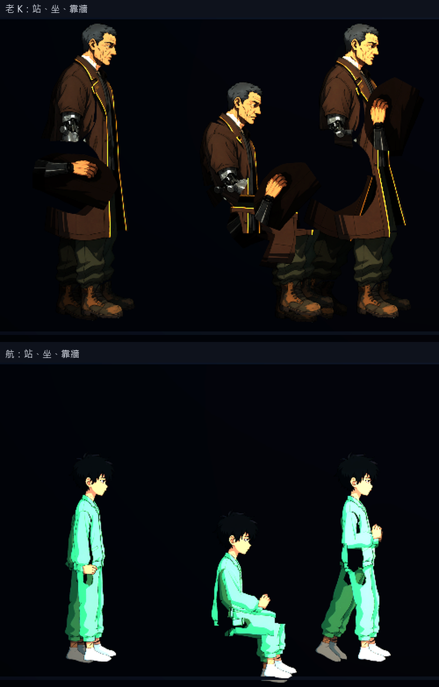
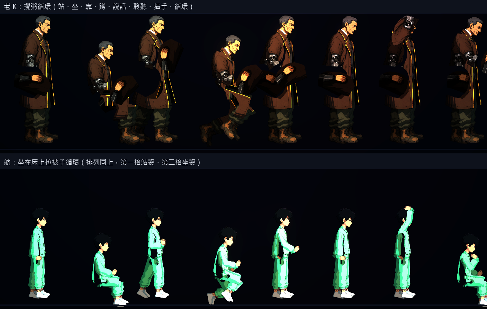
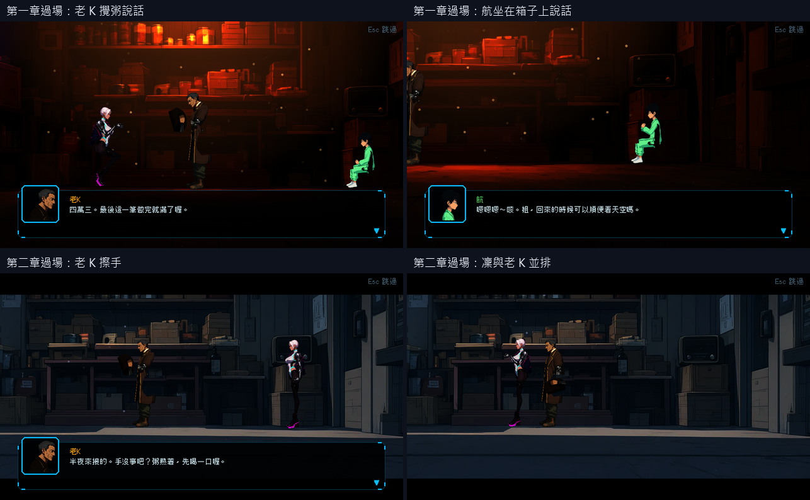
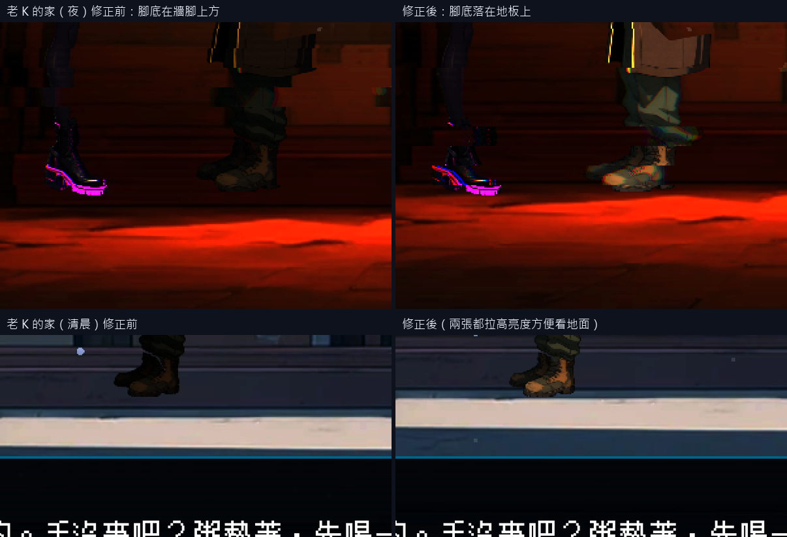
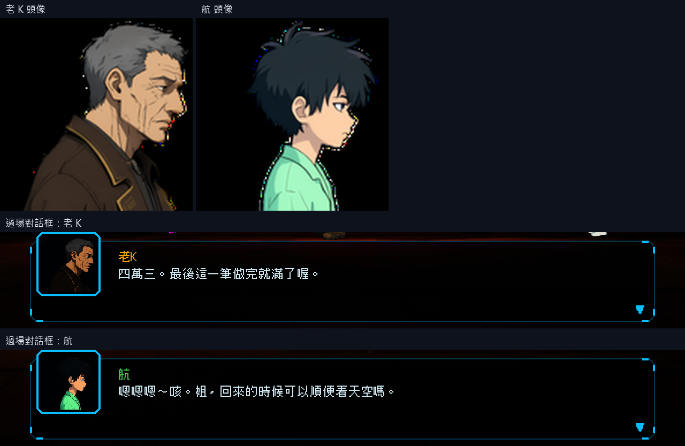

# [NE-85] 重畫老 K 與航

> 狀態：完成

## 內文

### 需求
老 K 與航目前是用頭像做的剪影（或程式畫的 Q 版外觀），而且對話頭像借用「天穹廣播」的暫代圖或是程式畫的舊圖。要用凜的流程重畫成同等精細度：Qwen 畫側面全身圖、分件、清理、法線與發光，並依角色專屬設定套用 NPC 動畫（NE-83）；對話頭像由新造型切出。NPC 不戰鬥，不需要裝甲與破衣。

老 K：收留他們的掮客與義體技師，世故疲憊愛碎念，灰髮、深褐外套、黃色線條，右手常碰別人的手臂。航：十一歲生病的孩子，淺髮、淺綠衣服，體弱，多半坐或躺在床上。比例：老 K 約 6.5 頭身、略駝；航約 5 頭身、瘦小。

### 來源
2026-10-03，使用者在凜（NE-17、NE-68～72）完成後要求重畫敵人與其他 NPC、精細度與凜一致、敵人依各自骨骼分件、可以的話替 NPC 加動畫；並確認先做人形、每個敵人有自己的比例、所有 NPC 都做、芽當成可操控角色設計。設計見 `design/12-cast-redraw/DESIGN.md`。

### 驗收條件
- [x] 外觀符合設定，每個角色的比例與造型各自獨特
- [x] 零件圖放大 2 倍看沒有多餘線條、碎片或拼貼感，邊緣沒有點狀亮邊
- [x] 角色在場景與過場裡的位置、大小與腳底接地正常（腳不懸空、不陷入地面）
- [x] 老 K 的專屬動作：攪粥、擦手、說話手勢明顯；站著與靠著都自然
- [x] 航的專屬動作：坐在床上、咳嗽、拉被子；坐姿位置正確（身體落在床上）
- [x] 過場裡的航不再是頭像剪影，改用骨架外觀
- [x] 有自己的對話頭像（由新造型切出，取景完整），對話框與過場字幕顯示正常
- [x] 法線與發光（有發光部位的話）正確，在該角色所在場景的光影下清楚可辨
- [x] 附預覽、場景內、頭像與動作的截圖

### 測試流程
1. 以配方與規格產生，檢查零件與角色定義
2. 在預覽工具看站姿特寫與各動畫
3. 進入該角色所在的場景，靠近並對話，確認動畫與頭像
4. 在相關過場中檢查位置與大小

---

# 跟其他票的關係

- Blocks：NE-88
- Blocked by：NE-73、NE-83
- Related：NE-83、NE-45

---

# Commit-1

## 內文

老 K 與航用新流程重畫（Qwen 側面圖 → 分件 → 法線），並套用 NPC 動畫（NE-83）：專屬工作循環與姿勢、說話與聆聽；對話頭像由新造型切出；場景人物與過場都改用骨架外觀。已打勾的是已經驗證的項目。
還沒做所以狀態維持「進行中」：使用者在預覽裡觀察到有些角色的零件分割或骨架對應有問題（已另開 NE-90 處理），修正前不算完成；場景位置、腳底接地與光影下的辨識度也還沒逐一在遊戲內檢查。依使用者指示，沒有跑完整測試套件。

---

# Commit-2

## 內文

在遊戲裡逐一看老 K 與航出現的兩段過場（第一章雨夜的店、第二章清晨的店）時發現三個問題：人物腳底停在牆腳上方一點，看起來沒踩到地板；航縮得比老 K 與凜小很多，和他們的身材比例對不上；老 K 的深色大衣在深紅與深藍的舞台前幾乎和背景糊在一起，只看得到臉。
現在兩段過場的人物與鏡頭整體往下挪，腳底踩在地板上，鏡頭構圖不變；航的大小改成和凜、老 K 同一個倍率；老 K 的衣物提亮（臉與手不動，避免過曝），大衣的棕色與黃色線條看得清楚。
驗收：兩段過場逐格檢查，老 K 與凜的靴底貼著地板邊緣，航的鞋子也踩在地板上；老 K 與背景的亮度對比，雨夜的店從約 1.2 倍提高到約 2 倍，清晨的店從 0.85 倍（比背景還暗）提高到約 1.5 倍；三人並排比例合理。航坐在箱子前面，舞台背景本來就沒有畫床，目前以箱子當座位，位置自然。老 K 的專屬動作、航的坐姿與頭像在預覽與過場中維持正常。

### 測試結果

| 項目 | 結果 |
|---|---|
| 完整測試套件 | 依使用者指示未跑；只跑相關七組（NPC、NPC 動畫、角色、過場、章節過場、劇情內容、劇情檢查）：通過 1778 / 1778 |
| 資料驗證 | 0 錯誤 |
| 執行 log | 只有故意餵壞資料的測試產生的錯誤訊息，沒有其他 ERROR |

### 截圖

---
