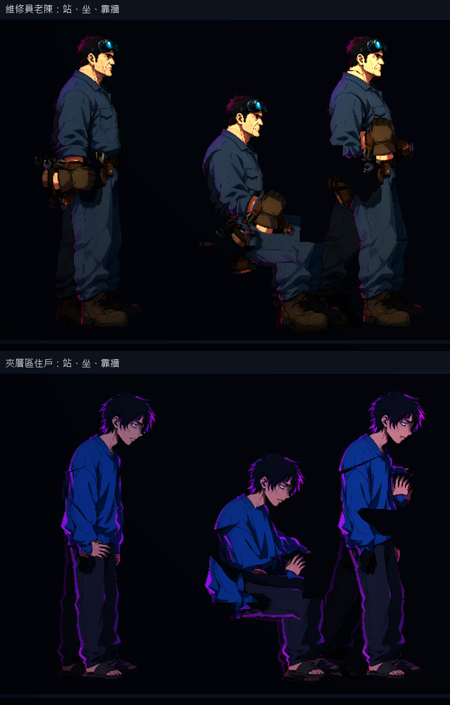
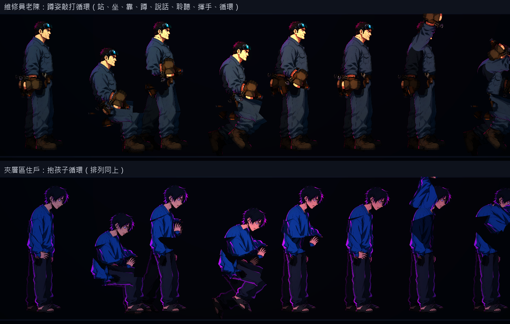
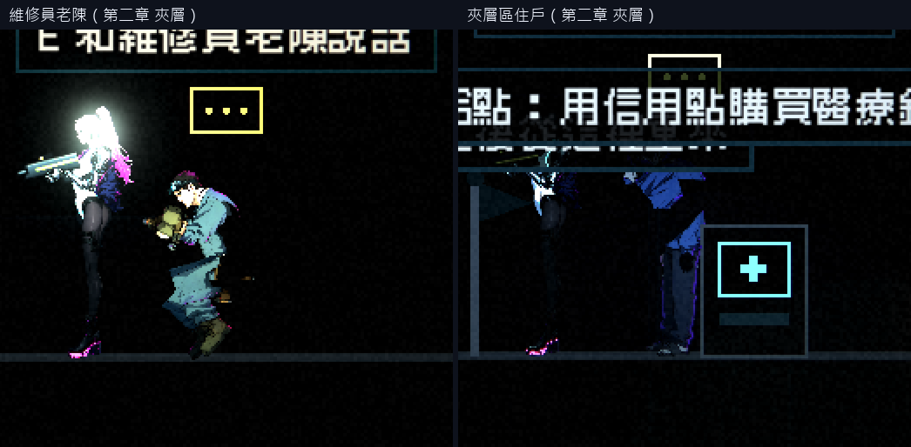
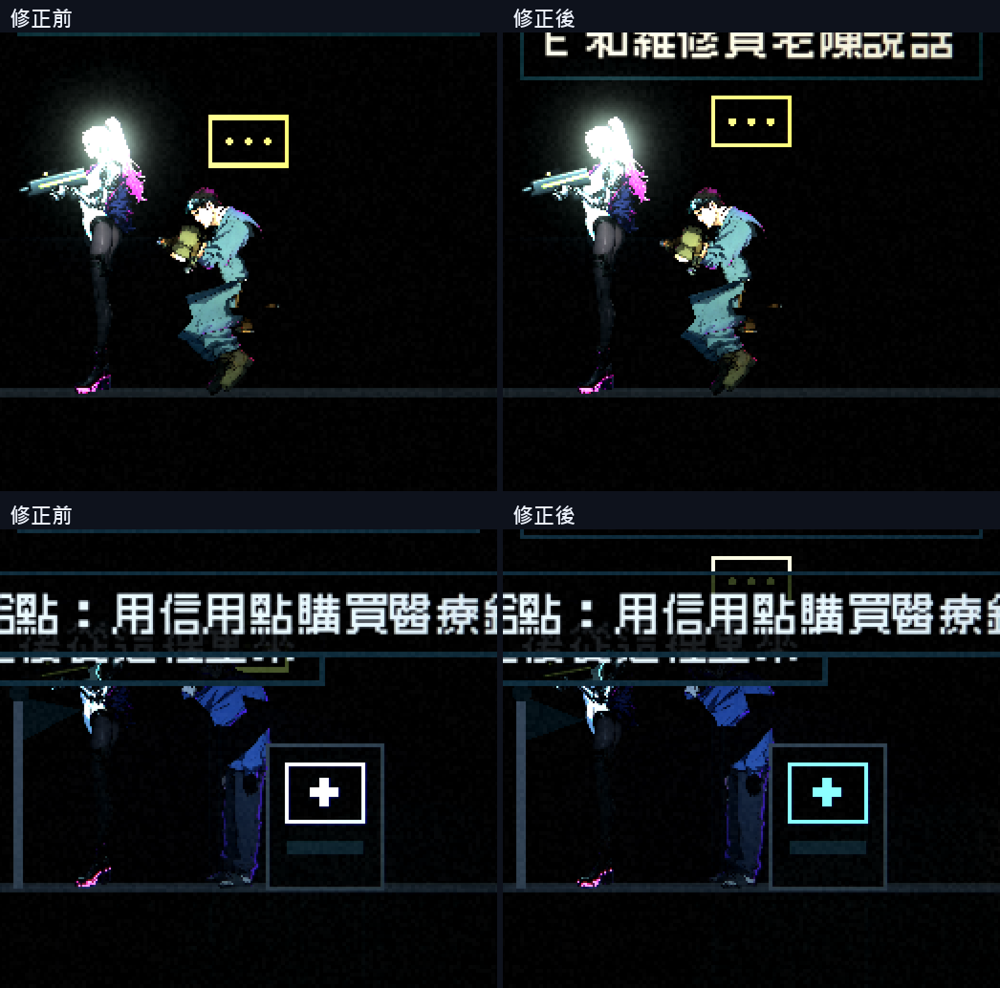
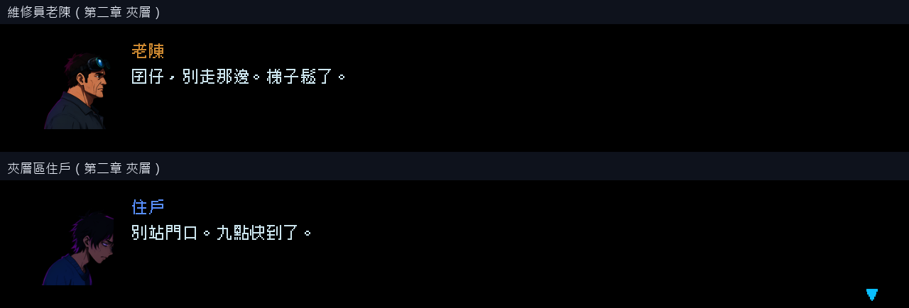

# [NE-87] 重畫維修員老陳與夾層區住戶

> 狀態：進行中

## 內文

### 需求
維修員老陳與夾層區住戶目前是用頭像做的剪影（或程式畫的 Q 版外觀），而且對話頭像借用「天穹廣播」的暫代圖或是程式畫的舊圖。要用凜的流程重畫成同等精細度：Qwen 畫側面全身圖、分件、清理、法線與發光，並依角色專屬設定套用 NPC 動畫（NE-83）；對話頭像由新造型切出。NPC 不戰鬥，不需要裝甲與破衣。

老陳：維修員，工作服、護目鏡、工具腰帶，蹲著修東西。住戶：夾層區，家居服，疲憊不安，抱著或牽著孩子。比例：老陳約 6.5 頭身、結實；住戶約 7 頭身、瘦。

### 來源
2026-10-03，使用者在凜（NE-17、NE-68～72）完成後要求重畫敵人與其他 NPC、精細度與凜一致、敵人依各自骨骼分件、可以的話替 NPC 加動畫；並確認先做人形、每個敵人有自己的比例、所有 NPC 都做、芽當成可操控角色設計。設計見 `design/12-cast-redraw/DESIGN.md`。

### 驗收條件
- [x] 外觀符合設定，每個角色的比例與造型各自獨特
- [x] 零件圖放大 2 倍看沒有多餘線條、碎片或拼貼感，邊緣沒有點狀亮邊
- [x] 角色在場景與過場裡的位置、大小與腳底接地正常（腳不懸空、不陷入地面）
- [x] 老陳的專屬動作：蹲著修理、偶爾敲打、焊接火花（發光與粒子在正確位置）
- [x] 住戶的專屬動作：不安地張望、抱著孩子
- [x] 兩人的可互動提示位置與新外觀對得上
- [x] 有自己的對話頭像（由新造型切出，取景完整），對話框與過場字幕顯示正常
- [x] 法線與發光（有發光部位的話）正確，在該角色所在場景的光影下清楚可辨
- [x] 附預覽、場景內、頭像與動作的截圖

### 測試流程
1. 以配方與規格產生，檢查零件與角色定義
2. 在預覽工具看站姿特寫與各動畫
3. 進入該角色所在的場景，靠近並對話，確認動畫與頭像
4. 在相關過場中檢查位置與大小

---

# 跟其他票的關係

- Blocks：NE-88
- Blocked by：NE-73、NE-83
- Related：NE-83

---

# Commit-1

## 內文

維修員老陳與夾層區住戶用新流程重畫（Qwen 側面圖 → 分件 → 法線），並套用 NPC 動畫（NE-83）：專屬工作循環與姿勢、說話與聆聽；對話頭像由新造型切出；場景人物與過場都改用骨架外觀。已打勾的是已經驗證的項目。
還沒做所以狀態維持「進行中」：使用者在預覽裡觀察到有些角色的零件分割或骨架對應有問題（已另開 NE-90 處理），修正前不算完成；場景位置、腳底接地與光影下的辨識度也還沒逐一在遊戲內檢查。依使用者指示，沒有跑完整測試套件。

---

# Commit-2

## 內文

在第二章夾層走近維修員老陳與夾層區住戶時發現：頭上的對話泡泡與提示文字固定在舊外觀的高度，住戶比舊外觀高，泡泡蓋住頭；老陳蹲著，提示文字卻飄在他頭上很遠的地方；提示文字在 72 像素外就出現，但按互動鍵只有約 38 像素內有效。
現在泡泡與提示文字依角色實際的頭頂高度排列（蹲著的老陳排得比站著的住戶低，各自貼在頭頂上方），提示出現的距離與互動有效的距離統一為 48 像素。
驗收：兩人在第二章實際走近檢查：腳底貼地（誤差 1 像素內）；住戶身高約 56、蹲著的老陳約 48，和凜並排合理；泡泡與提示不蓋臉；46 像素內提示出現且能對話，52 像素外提示消失、也不能互動；與背景的亮度對比，老陳約 4.8 倍、住戶約 3.2 倍，發光層與邊光在暗處看得清楚；老陳蹲姿的敲打、住戶抱孩子的動作、對話框頭像與領補給都正常。

### 測試結果

| 項目 | 結果 |
|---|---|
| 完整測試套件 | 依使用者指示未跑；只跑相關七組（NPC、NPC 動畫、角色、過場、章節過場、劇情內容、劇情檢查）：通過 1778 / 1778 |
| 資料驗證 | 0 錯誤 |
| 執行 log | 只有故意餵壞資料的測試產生的錯誤訊息，沒有其他 ERROR |

### 截圖

---
