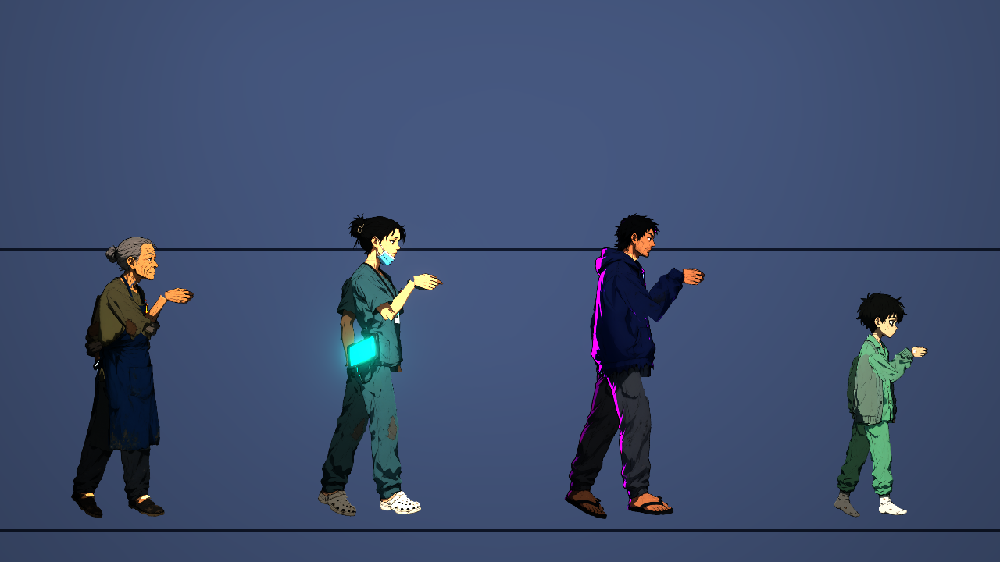
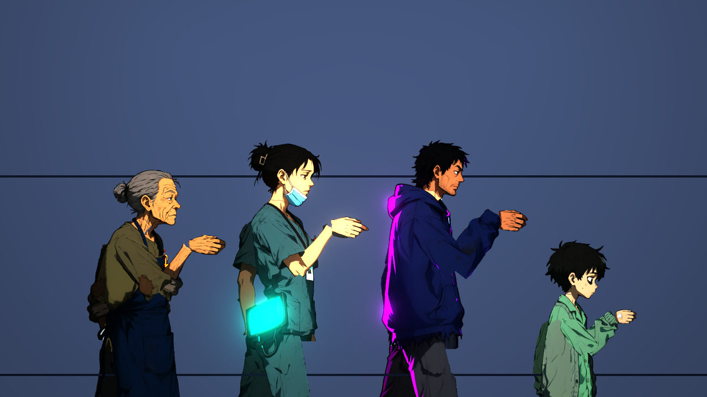
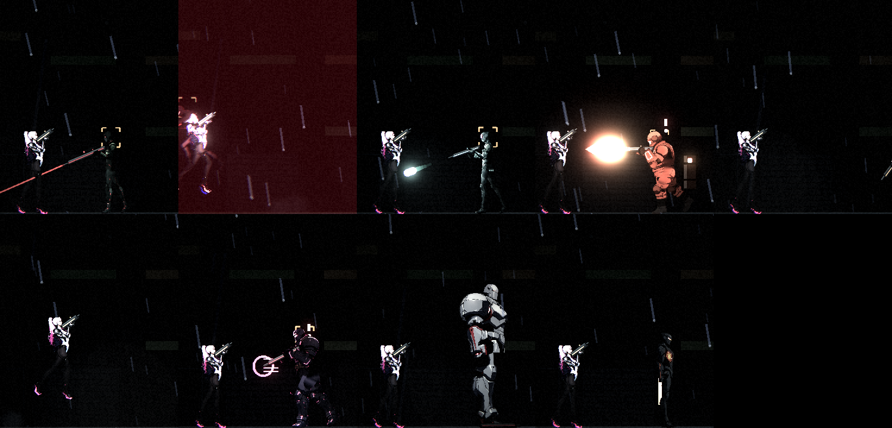
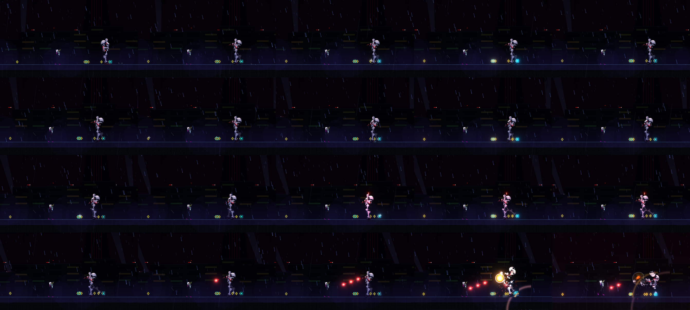
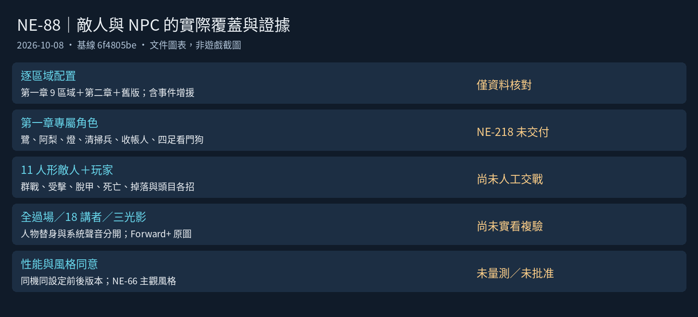

# [NE-88] 整合驗證敵人與 NPC 的新外觀

> 狀態：待辦

## 內文

### 需求
所有人形敵人與 NPC 重畫完成後，在遊戲中整體檢查：光影、效能、群戰、過場與對話，修掉發現的問題。

### 來源
2026-10-03，使用者在凜（NE-17、NE-68～72）完成後要求重畫敵人與其他 NPC、精細度與凜一致、敵人依各自骨骼分件、可以的話替 NPC 加動畫；並確認先做人形、每個敵人有自己的比例、所有 NPC 都做、芽當成可操控角色設計。設計見 `design/12-cast-redraw/DESIGN.md`。

### 驗收條件
- [ ] 第一、二章所有關卡的敵人配置畫面逐一檢查，敵人與場景的比例、光影和辨識度正常
- [ ] 同屏 10 個以上人形敵人與玩家時幀率與重畫前相比沒有明顯下降
- [ ] 所有出現 NPC 與重畫角色的過場位置、大小、動畫正常
- [ ] 所有對話與通訊的頭像顯示正常，沒有借用「天穹廣播」暫代圖的角色
- [ ] 敵人預兆、受擊閃白、裝甲脫落、死亡與掉落在新外觀上都正常
- [ ] 三種代表性光影下（轉運站、停電、霓虹市集）所有重畫角色清楚可辨
- [ ] 附各項的遊戲內截圖

### 本次整合基準與依賴（2026-10-08）

本次從 main 核對需求、驗收條件、全部 Commit 段落及實際敵人／NPC／故事資料。NE-74～78、82、84～87、89 已有交付；NE-79／80／81／90 仍為進行中，三個重甲的零件修正票 NE-181（「修正鎮暴員、重裝機槍手與監管者的大腿與腰部零件」）仍待辦。NE-218、NE-222 尚未交付。最終檢查須等角色素材／骨架、第一章關卡／過場、光影三組穩定合入並記錄各自 commit。

NE-66 的使用者風格確認仍未勾選；本票可以核對工程表現，不能宣稱主觀風格已批准。原 Commit-1 的 NPC 圖與十隻敵人量測保留為歷史材料，不作本次實玩、效能對照或最終外觀證據。

### 逐區域敵人／NPC 覆蓋矩陣

依地圖實際字元與對應資源核對；「增援」由地圖上的事件資源引用，非只看未使用的資源宣告。每列的比例、辨識、動作、交戰與截圖均未執行本次遊戲驗證。欄／列座標是資料定位，不能充當碰撞通過證據。

| 區域／關卡 | 實際敵人（含事件增援） | NPC | 本次畫面／人工交戰 |
|---|---|---|---|
| 電話亭巷（`ch1_booth_alley`） | 無敵人配置 | 無 NPC 配置 | 未執行 |
| 復原館（`ch1_lounge`） | 無敵人配置 | 阿梨（`ch1_ali_lounge`） | 未執行 |
| 當舖（`ch1_pawnshop`） | 無敵人配置 | 老 K（`ch1_old_k`） | 未執行 |
| 當舖（天亮）（`ch1_pawnshop_dawn`） | 無敵人配置 | 老 K（`ch1_old_k`） | 未執行 |
| 屋頂（`ch1_rooftop`） | 無敵人配置 | 鷺（`ch1_egret`） | 未執行 |
| 宵夜麵攤（`ch1_stall`） | 無敵人配置 | 阿梨（`ch1_ali_stall`） | 未執行 |
| 港區街道（`ch1_street`） | 收帳人·督察（`ch1_inspector`）、收帳人·打手（`collector_brute`）、收帳人·槍手（`collector_gunner`）、監視蜂（`drone`）、清掃兵（`sweeper`） | 無 NPC 配置 | 未執行 |
| 倉庫深處（`ch1_vault`） | 收帳人·督察（`ch1_inspector`）、收帳人·打手（`collector_brute`，增援）、收帳人·槍手（`collector_gunner`）、監視蜂（`drone`）、清掃兵（`sweeper`） | 無 NPC 配置 | 未執行 |
| 碼頭倉庫（`ch1_warehouse`） | 收帳人·打手（`collector_brute`）、收帳人·槍手（`collector_gunner`）、監視蜂（`drone`）、清掃兵（`sweeper`）、看門狗（`watchdog`） | 無 NPC 配置 | 未執行 |
| 第一章　雨夜（`level_01`） | 自爆蟲（`bomber`）、監視蜂（`drone`）、天穹保全（`grunt`）、偽裝箱（`mimic`）、天穹擲彈兵（`mortar`）、探照無人機（`searchlight_drone`）、天穹鎮暴員（`shield_rusher`）、電擊犬（`shock_hound`）、狙擊手（`sniper`）、哨戒砲台（`turret`）、監管者 WARDEN（`warden`） | 麵攤阿婆（`ah_po`）、夜班工人（`night_worker`） | 未執行 |
| 第二章　天空的代價（`level_02`） | 看守長（`custodian`）、監視蜂（`drone`）、精銳保全（`elite_grunt`）、火焰兵（`flamer`）、天穹保全（`grunt`）、重裝機槍手（`heavy_gunner`）、偽裝箱（`mimic`）、吊軌砲（`rail_cannon`）、回收員 RECLAIMER（`reclaimer`）、維修機（`repair_drone`）、探照無人機（`searchlight_drone`）、井道蝙蝠機（`shaft_bat`）、天穹鎮暴員（`shield_rusher`）、電擊犬（`shock_hound`）、切割者（`slasher`）、狙擊手（`sniper`）、迷彩獵手（`stalker`）、纏絲（`tangle_wire`）、哨戒砲台（`turret`）、攀牆者（`wall_gecko`） | 牆上的刻痕（`height_marks`）、轉運站護理師（`nurse`）、維修員老陳（`repairman_chen`）、夾層區住戶（`resident`） | 未執行 |

### 第一章新角色：替身核對與驗收接點

| 角色／實體 | 現在場景外觀／頭像 | 必須驗收的真正交付 | 對應 |
|---|---|---|---|
| 鷺（egret） | 屋頂 NPC 使用 night_worker；過場使用 resident；頭像 resident | 場景／過場／通訊都使用鷺專屬外觀，靠牆與談話正常 | NE-218 |
| 阿梨（ali） | 復原館與宵夜麵攤使用 nurse；頭像 nurse | 兩處 NPC、復原過場與頭像使用專屬阿梨 | NE-218 |
| 燈（lamp） | 通訊頭像 wataru，沒有 lamp 角色骨架 | 專屬燈的通訊頭像與立繪；不當作航通過 | NE-218 |
| 清掃兵（sweeper） | trooper | 新專屬外觀的預兆、射擊、受擊與倒下 | NE-218 |
| 收帳人槍手／打手 | collector_gunner／collector_brute 均使用 enforcer | 兩種專屬角色，各自動作、武器、脫甲、死亡 | NE-218 |
| 看門狗（watchdog） | warden 人形替身 | 專屬四足模型、預兆、攻擊、受擊、死亡、戰前後 | NE-218 |
| 收帳人·督察（ch1_inspector） | enforcer，空手與專屬斬擊動作 | 同時覆蓋實際第一章變體，不能只驗鎮暴員盾牌情境 | NE-88 整合覆蓋；素材若需替換回交上游 |

### 交戰、群戰、光影與頭像矩陣

| 項目 | 最少觀察情境 | 紀錄／本次結果 |
|---|---|---|
| 每種敵人完整流程 | 巡邏→發現→蓄力／預兆→出招→恢復→受擊→裝甲脫落→死亡／掉落；各頭目招式 | 第一、二章逐區域原始畫面；未執行 |
| 10 個以上人形＋玩家 | 同屏至少 11 個人形敵人＋玩家，混合鎮暴／機槍／狙擊／斬擊等，含第一章新角色 | 確認同屏計數、交戰錄影、場景與輸入；未執行 |
| 三種代表光影 | 轉運站、停電、霓虹市集；每個重畫模型與第一章新角色 | Forward+ 原圖；預兆與裝甲受擊不能淹沒角色；未執行 |
| NPC 與過場 | 全部帶演員的載入中過場、場景 NPC 實際工作循環與談話 | 站／坐／靠／蹲／說話／聆聽／揮手／工作，3.4 倍接縫；未執行 |
| 對話／通訊／背包 | 每個有效講者的頭像、正式系統聲音與人物替身分開 | 正式系統圖不誤判為人物已補齊；未執行 |
| 實機效能前後比較 | 同一機器、相同 Godot／Forward+／解析度／品質／VSync／負載／輸入；生成停止且資源可用 | 前後 commit、GPU、暖機、平均／p99、FPS、繪製／記憶體；未量測 |
| 自動回歸 | 角色、敵人、NPC、動作、過場、曝光與相關整合套件 | 本次只有文件與圖表，未執行遊戲測試 |

效能對照不能用「凜 versus 目前保全」代替重畫前後；無頭動畫量測只提供腳本成本，軟體 Vulkan 只提供畫面，兩者都不代表使用者 GPU 幀率。本機 Windows GPU 工作使用既有共享鎖；雲端沒有與該機共用的 GPU，現有鎖依賴 msvcrt，不修改鎖或自行啟停 ComfyUI。

### 通訊與對話講者索引

依 Story 實際載入順序合併後的講者資料（人物頭像仍須進畫面檢查）：

| 講者 id／名稱 | 現在頭像 | 素材用途／複驗 |
|---|---|---|
| `rin`／凜 | `rin.png` | 人物頭像，待畫面複驗 |
| `mei`／芽 | `mei.png` | 人物頭像，待畫面複驗 |
| `old_k`／老K | `old_k.png` | 人物頭像，待畫面複驗 |
| `warden`／監管者 | `warden.png` | 人物頭像，待畫面複驗 |
| `system`／天穹廣播 | `system.png` | 正式廣播／看板／錄音或童聲；人工確認用途 |
| `billboard`／看板 | `system.png` | 正式廣播／看板／錄音或童聲；人工確認用途 |
| `wataru`／航 | `wataru.png` | 人物頭像，待畫面複驗 |
| `ah_po`／阿婆 | `ah_po.png` | 人物頭像，待畫面複驗 |
| `worker`／工人 | `night_worker.png` | 人物頭像，待畫面複驗 |
| `reclaimer`／回收員 | `reclaimer.png` | 人物頭像，待畫面複驗 |
| `chen`／老陳 | `repairman_chen.png` | 人物頭像，待畫面複驗 |
| `resident`／住戶 | `resident.png` | 人物頭像，待畫面複驗 |
| `nurse`／護理師 | `nurse.png` | 人物頭像，待畫面複驗 |
| `child`／童聲 | `system.png` | 正式廣播／看板／錄音或童聲；人工確認用途 |
| `egret`／鷺 | `resident.png` | NE-218 人物替身，等待專屬交付 |
| `lamp`／燈 | `wataru.png` | NE-218 人物替身，等待專屬交付 |
| `ali`／阿梨 | `nurse.png` | NE-218 人物替身，等待專屬交付 |
| `voice`／錄音 | `system.png` | 正式廣播／看板／錄音或童聲；人工確認用途 |

### 動畫過場演員索引

| 資料／場景 | 演員外觀 | 本次檢查 |
|---|---|---|
| `ch1_kasa`／`ch1_c01_open` | rin→`rin`、k→`old_k` | 未執行 |
| `ch1_kasa`／`ch1_c09_wake` | rin→`rin` | 未執行 |
| `ch1_kasa`／`ch1_c14_home` | rin→`rin`、k→`old_k` | 未執行 |
| `cutscenes_ch1`／`cut_c1_shop` | rin→`rin`、k→`old_k`、boy→`wataru` | 未執行 |
| `cutscenes_ch1`／`cut_c2_hangar` | rin→`rin`、w→`warden` | 未執行 |
| `cutscenes_ch1`／`cut_c3_terminal` | rin→`rin` | 未執行 |
| `cutscenes_ch2`／`cut_c4_dawn` | k→`old_k`、rin→`rin` | 未執行 |
| `cutscenes_ch2`／`cut_c6_corridor` | rin→`rin`、r→`reclaimer` | 未執行 |
| `cutscenes_ch2`／`cut_c7_elevator` | rin→`rin`、rin→`rin` | 未執行 |

### 已有問題的複現與證據索引

| 角色／情境 | 最小複現、歷史原因與畫面 | 回交／複驗票 |
|---|---|---|
| enforcer／heavy_gunner 跑／跳 | 預覽站、跑、蹲、跳、倒下；大腿上方塊狀漸層隨腿擺；[歷史圖](images/NE-90-thigh-defects.png) | NE-79／80／90、NE-181「修正…大腿與腰部零件」 |
| warden 站／過場 | 站姿與戰前過場，平直腰緣／細腿造成縫；同一歷史圖 | NE-81／90、上述 NE-181 |
| old_k 坐姿 | NPC 坐姿，衣襬像硬長方形；保留 NE-90 的歷史紀錄 | NE-90，素材／骨架回交 Session 1 |
| 狙擊手停電 | 完整暗場看角色與背景分離、再射擊受擊；[歷史模型圖](images/models/sniper.png) 僅作模型索引，並非本次停電驗證 | BG-13 已有修正，待最新光影複驗，不擅改全局 |
| 第一章人物與敵人替身 | 上表逐項到實際使用區域檢查，不將借圖視為專屬交付 | NE-218 |

main 同時存在兩張不同標題的 NE-181；上表以完整標題指明素材修正票，不更改已發布票號或任意新開票。修前材料引用現有歷史圖，本次沒有修後畫面，不宣稱問題已修正。

### 測試流程
1. 執行截圖工具的各情境（關卡、過場、光影、敵人、NPC），逐張檢查
2. 手動玩第一章與第二章，特別注意頭目戰、群戰
3. 單獨執行角色相關測試
4. 用效能情境量測同屏多角色的處理時間

---

# 跟其他票的關係

- Blocks：無
- Blocked by：NE-74～NE-82、NE-84～NE-87、NE-89、NE-90
- Related：NE-71

---

# Commit-1

## 內文

使用者覺得麵攤阿婆「太 AI 感」（平滑、發亮、笑嘻嘻的標準慈祥臉），並要我看看還有哪些 NPC 太 AI。檢視後，阿婆、護理師、住戶、航四個重畫：新造型用粗細不一的手繪線條、髒污與補丁、消瘦疲憊的臉（阿婆瘦削瞇眼、護理師黑眼圈與皺掉的刷手服、住戶鬍渣與破下擺、航病容），不再是乾淨發亮的賽璐璐。老 K、老陳、夜班工人、梅質感夠，沒動。舊造型整份存在 `art_src/_variants/<id>_v1/`（立繪、零件貼圖、骨架、頭像、舊規格與配方），使用者之後再挑。
四人重新分件：圍裙獨立成零件（阿婆新增 `apron`、`apron_bib`），護理師平板的發光層改掛骨盆並壓低，住戶與航修正大腿缺口與骨盆切線。八種動作與 NPC 的站、坐、靠牆、蹲、說話、聆聽、揮手、工作循環預覽沒有縫與碎塊；零件檢查全過。
遊戲內量測：十隻敵人對打 14 秒，轉運站、停電、霓虹市集三種光影下每影格平均 4.8～5.2 毫秒（p99 約 6 毫秒），沒有異常；沒有量重畫前的同機基準，所以「與重畫前相比沒有明顯下降」那一條不勾。
**還沒做**：第一、二章逐關檢視、人工手玩頭目戰與群戰、敵人與場景比例的逐一檢查、過場全部走一遍。敵人在暗場的辨識度也有疑慮：狙擊手（深綠灰）在停電光影下幾乎融進背景，這屬於暗場對比（BG-13），這裡只記錄。航只在第一章過場出現，遊戲內光影截圖拍不到。因此狀態維持進行中，驗收條件不勾。依使用者指示沒有跑完整測試套件，只跑角色、NPC、動畫、動作、零件相關套件（3177 項、0 失敗）。

### 測試結果

| 項目 | 結果 |
|---|---|
| 角色、NPC、NPC 動畫、動作、場景覆蓋、動畫稽核套件 | 3177 項、0 失敗 |
| 零件檢查（四個重生角色） | 通過 |
| 十隻敵人對打，三種光影的每影格時間 | 平均 4.8～5.2 毫秒 |

### 截圖

---

# Commit-2

## 內文

交付以最新地圖實際配置為基準的逐區域敵人、NPC、事件增援、講者頭像與第一章替身核對表，補上至少 11 個人形敵人加玩家的群戰證據要求，以及實機性能與使用者風格同意的獨立紀錄。已有問題對應現有票，保留歷史圖，不跨組修改素材、骨架或光影。

這是最終整合前的準備交付；本票原狀態待辦、驗收條件仍未勾選。

### 測試結果

| 項目 | 結果 |
|---|---|
| 程式／資料基線 | 6f4805be；之後 main 的 ST-1／ST-4 文件提交已保留 |
| 配置與頭像核對 | 11 個區域／關卡資源、18 個合併後講者；直接配置與事件增援分開 |
| 文件、圖表、引用 | 已核對與預覽；不存在人物專屬圖的項目明確標示替身 |
| tools/run_tests_changed.sh | 本次僅文件／pm 圖表，沒有受影響遊戲套件；不稱遊戲測試通過 |
| 人工頭目／群戰／逐關檢視 | 未執行 |
| 實機性能對照 | 未量測；不沿用歷史平均 4.8～5.2 ms 作為本次結果 |
| 使用者風格批准 | 未取得；NE-66 對應條件維持未勾選 |

### 截圖

