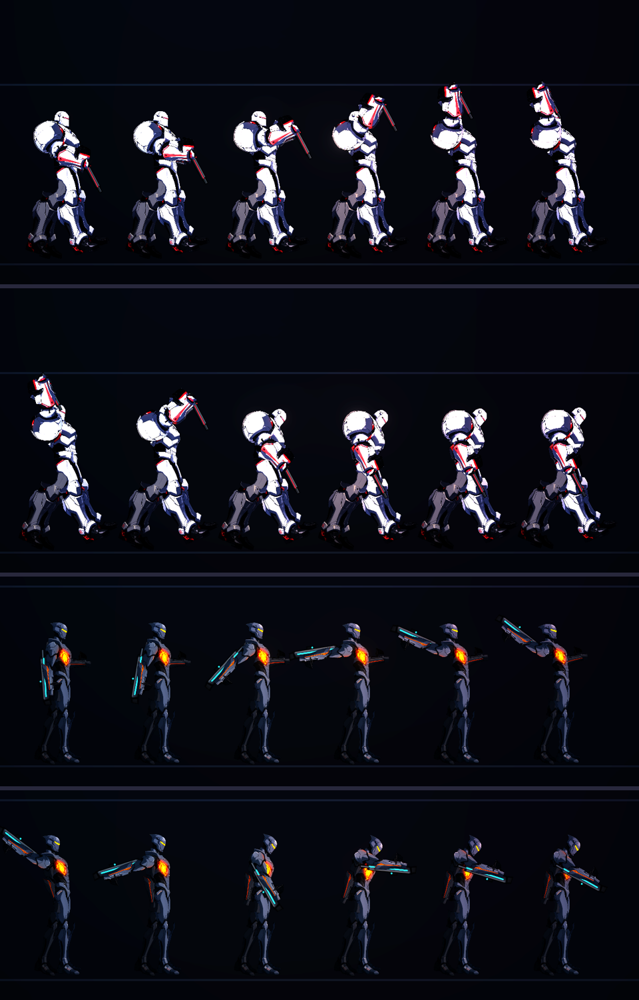

# [NE-89] 特殊角色的專屬骨架、動畫器與攻擊動作

> 狀態：進行中

## 內文

### 需求
目前所有人形角色（凜、敵人、NPC）共用同一個骨頭名稱家族與動畫程式，只有骨頭長度與比例不同；NE-83 之後可以用 `animator` 指定 NPC 動畫器。特殊角色（例如手臂特別多或有特殊武器的頭目、監管者的專屬招式）需要自己的骨架與動畫：在骨架裡加上專屬骨頭（例如額外的手臂、砲管、披風），並有專屬的攻擊動作（蓄力、揮擊、砲擊、展開）由敵人腳本驅動，而不是靠人形動畫器的瞄準。要建立一個清楚的機制，讓之後的特殊頭目與非人形敵人（無人機、電擊犬、自爆蟲、砲台、偽裝箱）都能照同一個方式加進來，並用監管者的一個專屬招式當範例。

### 來源
2026-10-03，使用者問「監管者之後套用的骨架也是這個嗎？如果有特殊的角色，可以用不同的骨架，然後有自己特殊的攻擊方式與動畫」。設計見 `design/12-cast-redraw/DESIGN.md` 5b。

### 驗收條件
- [ ] 骨架檔可以宣告專屬骨頭（不在人形家族裡的），角色流程（規格 `bones`）能產生含專屬骨頭的骨架與零件掛載
- [x] 動畫器登記表可以登記新的動畫器（名稱 → 類別），外觀定義或建立時指定；沒登記時退回人形動畫器並記錄具體錯誤
- [x] 敵人腳本可以提供專屬動作（命名動作加上時間進度，或直接給骨頭目標角度），預兆與判定位置能對到專屬骨頭（例如砲口、刀尖）的位置
- [ ] 以監管者做一個範例：一個專屬招式的蓄力與出招動作（含預兆、發光部位與判定位置一致），原有招式不受影響
- [x] 動作資料化：專屬動作的角度、時間與緩動放在資料裡，不需要改程式就能調整
- [x] 其他角色（凜、一般敵人、NPC）的行為與外觀不受影響
- [x] 說明文件寫清楚怎麼加一個特殊角色（骨架、規格、動畫器、敵人腳本各要做什麼）
- [ ] 附專屬動作的預覽截圖與說明

### 測試流程
1. 規格宣告一根專屬骨頭，執行一鍵腳本，檢查骨架與零件掛載
2. 預覽專屬動作的各階段，檢查發光與判定位置
3. 玩一次頭目戰，確認範例招式的預兆、出招與判定
4. 調整資料中的角度與時間，確認有效果

---

# 跟其他票的關係

- Blocks：無
- Blocked by：NE-83
- Related：NE-81、NE-73

---

# Commit-1

## 內文

先做機制的第一半：專屬動作系統與動畫器登記表。敵人招式可以在某個狀態下播放一段骨頭動作（高舉、砸下、舉刀、揮斬、蓄力沉腰、受創後仰、散熱仰頭、發射後仰），動作資料在 `art/rigs/action_poses.json`（關鍵格、緩動內插、淡入淡出、手臂是否交給動作、武器角度），敵人資料用 `rig_actions` 把狀態名稱接到動作，進度依停留時間算，敵人腳本不用改。已接上：監管者（砸地跳躍的蓄力與落地、扇形與召喚的蓄力、階段轉換散熱）、鎮暴員、重裝機槍手、火焰兵、切割者與回收員（舉刀與揮斬）。開槍有後座力（發射子彈的招式都會設定）。動畫器登記表（`CharacterRig.ANIMATORS`）讓特殊角色可以用自己的動畫器，沒登記時記錄錯誤並退回人形動畫器。說明文件：`design/12-cast-redraw/ANIMATION.md`。
還沒做、所以狀態維持「進行中」：專屬骨頭（骨架宣告人形家族以外的骨頭，並讓流程產生含專屬骨頭的零件掛載）、監管者專屬招式的完整範例（含發光部位與判定位置對到專屬骨頭）、遊戲內實際交戰檢查。依使用者指示，沒有跑完整測試套件。

### 測試結果

| 項目 | 結果 |
|---|---|
| 動作資料引用的骨頭在三種骨架上都存在、key 依序 | 通過 |
| 高舉抬手、進度 0 比進度 1 低、砸下前傾、動作結束回到原姿勢 | 通過 |
| 不存在的動作不崩潰；敵人資料引用的動作與狀態都存在 | 通過 |

### 截圖

---
