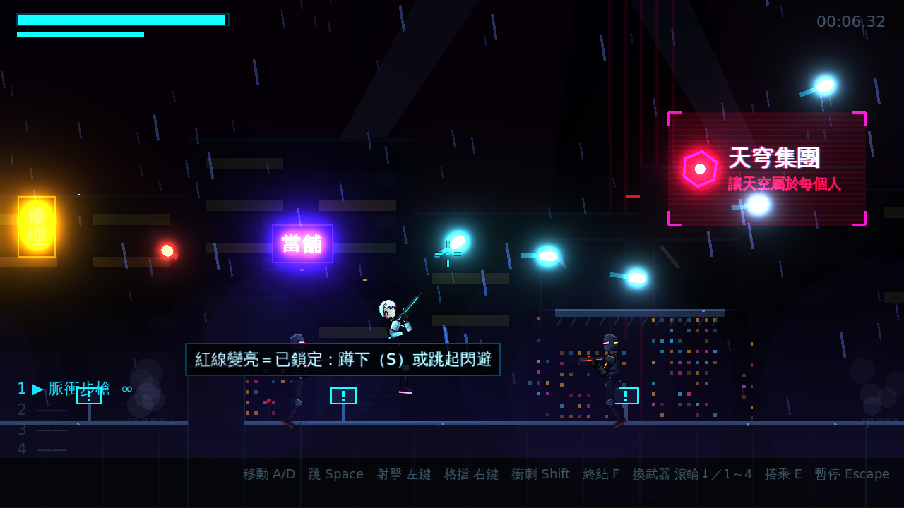
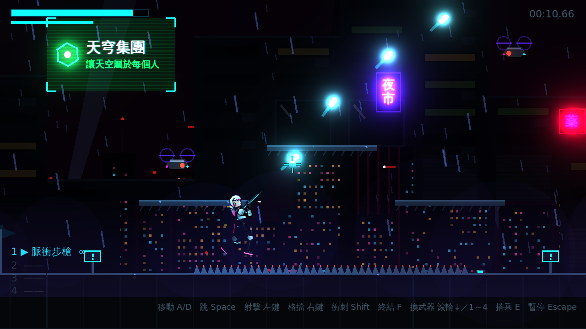
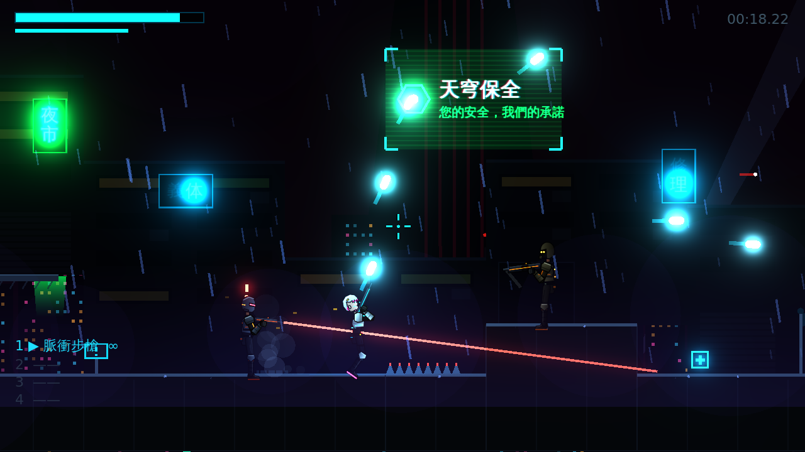

# [NE-8] 打造賽博龐克場景美術

> 狀態：完成

## 內文

### 需求
把遊戲美術風格改為賽博龐克：雨夜的沉港市，霓虹招牌、全像廣告、多層城市天際線、雨與水花、霧氣與濕地反光，敵方機械改為霓虹機械風格。

### 來源
2026-10-02，使用者於開發對話中提出：「我希望遊戲的風格是賽博龐克」「整個遊戲應該要以美術風格、人物、劇情為主」。

### 驗收條件
- [x] 場景持續降雨，地面有水花
- [x] 有會閃爍的霓虹招牌與全像廣告，招牌光會映在濕地上
- [x] 背景有多層視差的城市天際線與霧氣
- [x] 整體配色以洋紅、青、黃霓虹為主光
- [x] 無人機、砲台、自爆機改為霓虹機械風格
- [x] 開啟所有效果時畫面仍維持流暢，不隨遊戲時間增加記憶體

### 測試流程
1. 從關卡開頭走到結尾，確認每個區段都有雨、霓虹與天際線
2. 靠近霓虹招牌，確認地面倒影與閃爍
3. 長時間停留同一區域，確認效能穩定
4. 執行完整測試套件，全部通過

---

# 跟其他票的關係

- Blocks：NE-10
- Blocked by：無
- Related：無

---

# Commit-1

## 內文

原本是封閉的廢棄設施，畫面只有深藍牆面與少數燈光，沒有賽博龐克的城市感。
現在第一關改為雨夜的沉港市：室外街區開放天空，背景是多層視差的城市天際線（遠方的天穹集團巨塔與紅色信標、掃動的探照燈、飛行車流、滿是窗光與霓虹的樓群），近處是街邊店面、鐵捲門與冷氣機；持續降雨分三層景深，雨滴落到地面會濺起水花，有屋頂的室內區域不會下雨。街上有中日文霓虹招牌（會閃爍、偶爾單字故障、投射彩色光並在濕地面留下倒影）、帶色差與故障切換的全像廣告看板、地面霧氣與排氣孔蒸汽；場景燈改為洋紅、青、黃三色。無人機、砲台、自爆機改為鉻金屬加霓虹燈號的機械風格。所有裝飾都由地圖字元配置，招牌文字與廣告內容寫在關卡資料裡。
雨與水花不保存狀態也不增加節點，霓虹與看板數量固定，長時間停留記憶體不會成長；完整測試全數通過，並以實際渲染確認各區段的畫面。

### 測試結果

| 項目 | 結果 |
|---|---|
| 完整測試套件 | 通過 374 / 374 |
| 資料驗證 | 0 錯誤 |
| 執行 log | 無非預期 ERROR |

### 截圖

