# [NE-90] 檢查並修正重畫角色的零件分割與骨架對應

> 狀態：進行中

## 內文

### 需求
敵人與 NPC 用新流程重畫後，有些角色在遊戲裡看起來是零件分割（SAM 分群、補全、切線）出錯，或骨架關節對錯位置（關節點、骨頭長度、零件掛的骨頭），造成多餘的碎塊、手臂或衣服黏在錯的地方、動作時露縫或變形。動畫與零件本來就是分開的（動畫由骨頭角度驅動，與零件圖無關），所以這件事單獨處理：逐一檢查、找出原因、修到動作時看起來正確。

已經看到、需要確認的現象（來自 NE-73～84 的預覽，使用者另有觀察到的問題以票上補充為準）：
- 老 K：手臂前方有一大塊深色大衣碎塊跟著手臂走（袖口與大衣下擺被分到手臂群組）。
- 麵攤阿婆、維修員老陳：圍裙與工具包被分到手臂群組，手臂動作時整片布料一起甩。
- 火焰兵：膝蓋護甲的 SAM 遮罩吞掉整條小腿，需要手動限制範圍與調整膝蓋關節才能切出小腿。
- 切割者：原圖的刀臂被畫成背後的紅色長條，不是手臂的一部分；刀刃目前靠程式畫在手上。
- 迷彩獵手：貼身服的手臂在 SAM 裡被當成身體，要用別的提示詞才抓到。
- 使用者另外觀察到的「不知道是骨架套錯還是分割有問題」的角色與動作，補在票的留言或這裡。

- 2026-10-10 使用者提供[透明背景異常原圖](images/NE-90-user-alpha-failure.png)及[單腳混入雙靴的畫面](images/NE-90-user-double-boot.png)：所有角色的原圖、分件及實際掛載須檢查透明背景、殘留色邊及錯誤部件歸屬；一隻腳不能帶入另一隻腳的輪廓。透明提示詞或 RGBA 格式不能代替實際檢查。需要新姿勢素材時可局部生成，仍須符合賽博龐克風格、合理解剖與完整動態驗收。

- 2026-10-04 NPC 場景內驗證另外發現：護理師坐姿時前臂缺一段，手漂在膝蓋前；麵攤阿婆的圍裙與托盤變成米色多邊形碎片；老 K 的頭與軀幹發光層是全透明的空檔（其實沒有發光層）；夜班工人與老 K 的深色衣物在暗處糊進背景，目前是直接把兩個角色定義的身體零件提亮（老 K 乘 1.8、工人乘 1.7，臉與手不動），重建這兩個角色時要把這個提亮寫進規格（`tools/comfyui/specs/<id>_side.json` 的 `parts` 支援 `tint`），否則會被覆蓋。

### 來源
2026-10-03，使用者：「我發現有一些不知道是骨架套錯還是 segment 有問題，沒關係，開票放著我們之後再處理」。

### 驗收條件
- [x] 使用者指出的每一個有問題的角色與動作都有紀錄，並分清楚原因是分割、骨架關節，還是掛載
- [ ] 逐一修好，修前修後各附預覽截圖（站姿特寫與有問題的動作）
- [ ] 預覽的八種動作與 NPC 動作（站、坐、靠牆、蹲、說話、揮手、工作循環）關節沒有露縫、碎塊或變形
- [x] 每一種原因的處理方式寫進 `design/03-art-pipeline/CHARACTER_PIPELINE.md`（哪種現象 → 怎麼查 → 怎麼修），讓之後新角色不用再踩
- [x] 規格檢查（`check_spec.py`）或預覽流程能提早抓出常見的錯（例如零件面積異常小或大、零件離它掛的骨頭太遠）
- [x] 修改後的零件尺寸與支點變動有紀錄，角色定義、骨架與遊戲內檢查都正常
- [ ] 全角色透明背景与可見色邊驗收通過，單件沒有混入另一隻手、腳或不屬於該部件的輪廓

### 測試流程
1. 逐一開啟有問題的角色預覽（站姿特寫、八種動作、NPC 動作），找出問題
2. 查看該角色的 `06_parts/ownership.png` 與 `07_refined`，判斷是分割還是骨架
3. 修規格或手動覆蓋，重跑流程，再看預覽
4. 進遊戲看該角色出現的場景

---

# 跟其他票的關係

- Blocks：NE-88
- Blocked by：NE-181
- Related：NE-73、NE-74～NE-87

---

# Commit-1

## 內文

重畫後的 NPC 與敵人在遊戲裡有一批看起來不對的地方：護理師坐下時前臂缺一段，阿婆的圍裙與托盤變成米色多邊形，老 K 的大衣有一大塊跟著手臂甩、頭與軀幹的發光層是全黑的空檔，老陳的工具包黏在手上，夜班工人與老 K 的深色衣服在暗處糊進背景（先前靠直接把角色定義調亮頂著，重建就會被蓋掉）。
逐一查過原因，分成四類：
- **分割**（零件被切到錯的群組）：護理師的前臂與手根本沒被抓到，前臂零件是空的，連貼圖都沒有；阿婆的圍裙、老 K 的大衣下襬與袖口、老陳的工具包、夜班工人的工具包被歸到手臂群組，手臂一動整片布料跟著動；住戶的軀幹被切成 58×52 的一小塊。
- **補全**（手臂擋在身體前面，後面沒東西可補）：手臂移開後身體留下破洞或殘影；敵人（保全、精銳保全、狙擊手、切割者、迷彩獵手、火焰兵、擲彈兵）的大腿旁多了一片沒連到腿的碎布，跑起來像拖著尖刺；手臂的黑輪廓線留在軀幹上變成虛線。
- **發光層**：老 K 的發光層全黑（金色滾邊不夠亮），另有 13 個角色留著全空或幾乎全空的發光層檔案。
- **亮度**：夜班工人與老 K 的暗色衣物。
關節與骨架都沒有問題，骨頭長度與位置完全沒動（零件掛的骨頭也沒變），錯的全在零件怎麼切。
現在的做法：七個 NPC（護理師、阿婆、老 K、老陳、夜班工人、住戶、航）的近側手臂用「請 Qwen 把這條手臂整個拿掉」補出完整身體，手臂、手、圍裙、工具包、大衣各歸各的群組；七個敵人的缺口用兩側身體顏色連成漸層補起來；亮度寫進角色規格，夜班工人只提亮衣褲與袖子（霓虹反光衣不提亮，不然在暗處被泛光燒成一片白）；老 K 的發光層改用較低門檻抓出金色滾邊；全空的發光層不再輸出（共清掉 13 個角色的空檔）。修完後 NPC 的站、坐、靠牆、蹲、說話、聆聽、揮手與各自的工作循環、以及八種戰鬥動作的預覽都沒有缺塊或碎片，遊戲內的 NPC 排列也正常。零件尺寸與支點隨重新切割改變：護理師多了前臂貼圖，住戶軀幹從 58×52 變成 215×291，七個 NPC 的手臂與手重切（骨架不變）。
新增「零件檢查」：流程跑完貼圖步驟會自動檢查內部孔洞、游離碎片、空的發光層、缺法線與支點離零件太遠，並指出是哪個零件；做法與每一類現象怎麼查、怎麼修寫進角色製作流程文件的新章節。
**還沒解決**：老 K 坐下時，大衣下襬是一整塊硬的長方形（大衣下襬與大腿是同一個零件，大腿轉成水平時整塊跟著轉）；要改好需要把大衣下襬做成獨立的軟骨零件。目前老 K 在遊戲裡都是站著，沒有人坐，所以先不處理；因此「所有姿勢沒有變形」那一條維持未勾。切割者的刀臂（票上原本記的：原圖的刀被畫成背後的紅色長條、刀刃靠程式畫在手上）這次沒有處理；火焰兵的膝蓋護甲與迷彩獵手的手臂早先已用規格限制範圍與換提示詞處理，這次預覽確認沒有缺塊。依使用者指示，沒有跑完整測試套件，只跑角色、NPC、NPC 動畫、動作與零件生物相關的測試。

### 測試結果

| 項目 | 結果 |
|---|---|
| 護理師、阿婆、老 K、老陳、夜班工人、住戶、航：八種動作與 NPC 動作預覽 | 沒有缺塊與碎片（老 K 坐姿的大衣下襬例外，見上） |
| 七個敵人的大腿碎布與跑步拖尖刺 | 已消失 |
| 零件檢查（全部 20 個角色） | 剩 3 項，皆為設計：芽的外套袖孔、凜的馬尾空隙、重裝機槍手護膝的支點偏位（骨架對得上） |
| 角色、NPC、NPC 動畫、動作、零件生物、動畫稽核測試 | 2365 項、0 失敗 |
| 完整測試套件 | 依使用者指示未執行 |

### 截圖

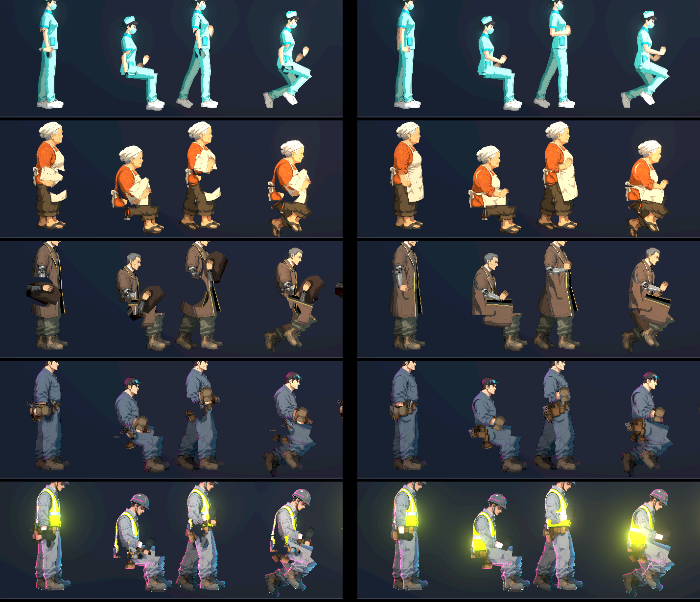

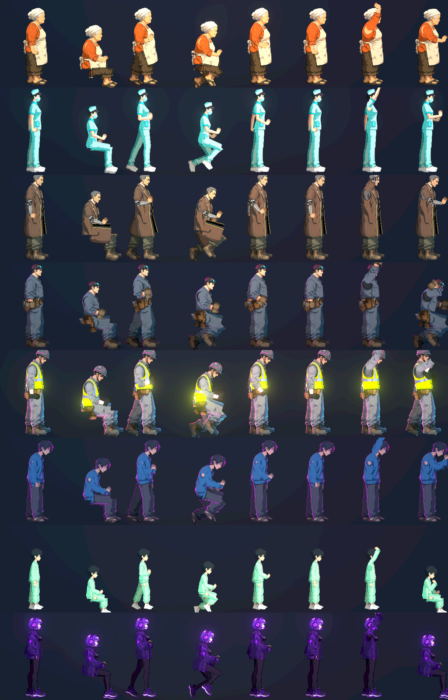

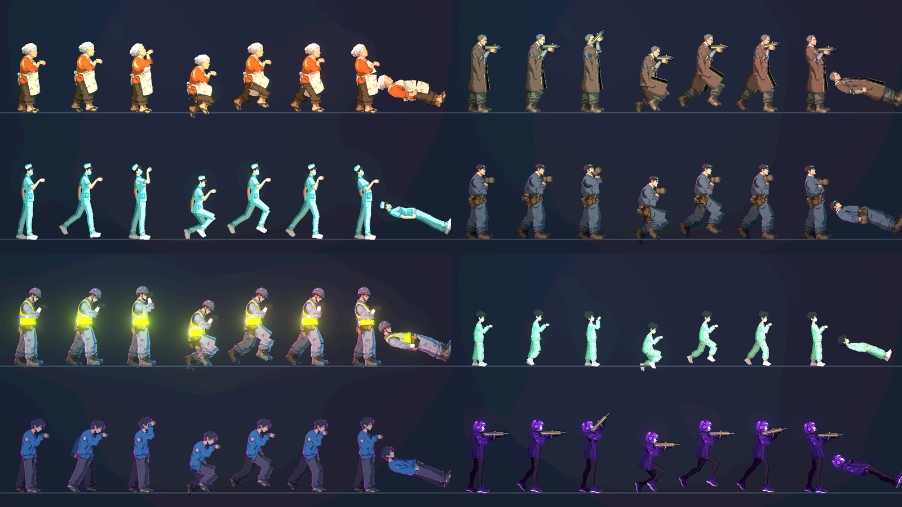

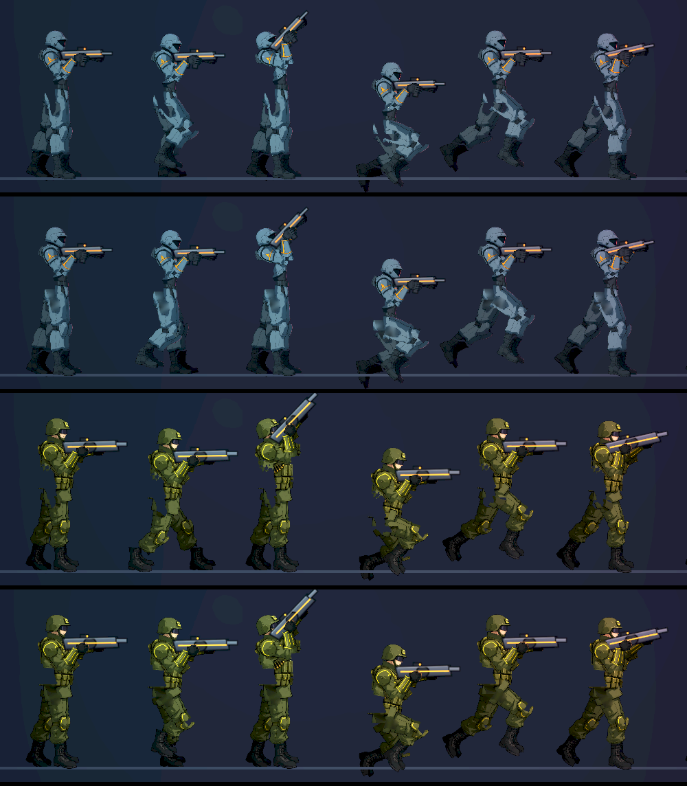

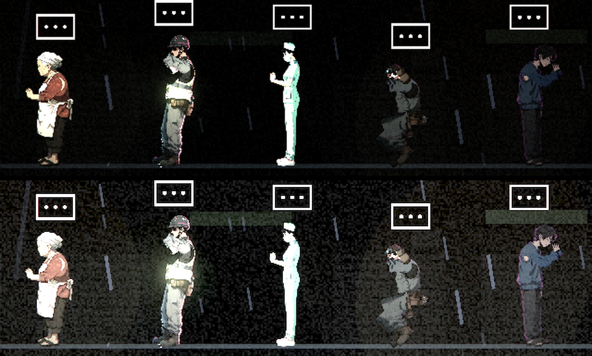

---

# Commit-2

## 內文

麵攤阿婆、護理師、住戶、航在 NE-88 重畫成新造型後，沿用本票的做法重新分件（見 NE-88 Commit-1）：圍裙獨立為零件、近側腿用正負點限制、手臂用 Qwen 補全身體、護理師平板發光層壓低。零件檢查全過，NPC 動作預覽沒有缺塊。八種動作與 NPC 動作那一條仍維持未勾（老 K 坐姿大衣下襬的問題沒動）。

---

# Commit-3

## 內文

重新檢查八種敵人動作預覽與遊戲內畫面（狙擊手、切割者、迷彩獵手、火焰兵、擲彈兵、保全、精銳保全、鎮暴員、重裝機槍手、監管者）：前八個角色的站、跑、瞄準、蹲、跳、格擋、硬直、倒下都沒有露縫、碎塊或變形，其中保全與火焰兵、擲彈兵的軀幹下緣是平的、與骨盆之間的接縫看得出，但沒有缺塊（NE-153 已列為小問題）。
有三個角色的下半身仍有明顯問題，原因都在零件怎麼切（骨架關節與掛載沒有問題）：
- 鎮暴員、重裝機槍手：大腿上半是整塊由兩側顏色連成的漸層，跑與跳時像方塊在髖部擺動。
- 監管者：軀幹下緣是平直的切邊，下面只接著很細的大腿，站姿與戰前過場都看得出。
這需要重新切割與補全底層身體，另開 NE-181 處理，所以「預覽的八種動作與 NPC 動作沒有露縫、碎塊或變形」維持未勾；老 K 坐姿的大衣下襬問題（Commit-1）也仍未處理。依使用者指示沒有跑完整測試套件。

### 測試結果

| 項目 | 結果 |
|---|---|
| 受影響範圍測試 | 本次沒有改動角色資料，與 NE-75～82 同批驗證（25253 項、0 新失敗） |
| 資料驗證 | 0 錯誤 |
| 執行 log | 無 ERROR |

### 截圖

---

# Commit-4

## 內文

補記已發布於 `3feaa6d32b4881052fe10f9ae0ba8419d1bedf64` 的 NE-90 雲端「四足與其他非人形角色」實際稽核證據與 NE218 接口。此次追加只有本票文件，不修改既有需求、Commit-1～3、驗收勾選、其他票或共用核心；票保持**進行中**。已知 FAIL 尚未修復，不宣稱視覺／全部角色已驗收。

cloudscope 的實際盤點為 **18 個掛載項目：16 個獨立非人形模型＋buoy_worm_small（共用模型、倍率0.62）＋watchdog（現借人形warden）**；test_creature 是 fixture，不計交付角色。「13/18」不作已驗收比例：31張CPU重建涵蓋16個模型，嚴格接點取樣涵蓋15個模型，18項的完整視覺門檻沒有任一項在本次被宣告全部通過。飛行單位／無腿模型不要求步行。完整模型、掛載、狀態、part父鏈/pivot/z、source SHA/native RGBA尺寸及每物種FAIL／未驗表見[稽核報告](attachments/NE-90-cloud-creatures/REPORT.md)及[原始資料帳本](attachments/NE-90-cloud-creatures/inventory.json)。

來源／原生畫面固定基準為 `c0250bff9dd6a44a8b1c9df557eaab18b0a12996`；成功fetch並rebase至 `4d71d7a8a0a43ca9b82ac47624357a8ddef4124a` 後局部複驗，相關來源/runtime依賴未變，核對見[基線相等記錄](attachments/NE-90-cloud-creatures/rebase-source-equivalence.json)。本次文件追加從最新fetch的 `3feaa6d32b4881052fe10f9ae0ba8419d1bedf64` 開始；不是以fetch冒稱worktree已更新。

### 已保存的實測結果與適用範圍

| 項目 | 真實結果／限制 |
|---|---|
| 引擎／headless | Godot `4.7.stable.official.5b4e0cb0f`，headless `--audio-driver Dummy`實跑；4.6.3拒收 |
| 原生畫面 | Compatibility `gl_compatibility`／driver `opengl3`，Mesa25.0.7 llvmpipe LLVM19.1.7＋Xvfb；一般PNG原生1280×720（canvas640×360/stretch canvas_items），接點atlas原生2048寬、每cell128×128、兩face、actor zoom1/3.4，未resize |
| CPU來源重建 | 31/31 selected source轉製RGBA byte一致；57原始PNG／62 runtime PNG的來源SHA及尺寸保留；不是完整身體／動畫通過 |
| 既有affected複驗 | PartCreatureSuite、ChainCreatureSuite、ExoticEnemiesSuite、Chapter1EnemiesSuite、AssaultEnemiesSuite：**686 checks／0 failures，107.681秒**；[真log](attachments/NE-90-cloud-creatures/rerun-affected.log)、[命令／base／elapsed](attachments/NE-90-cloud-creatures/command-affected.json)。bad-data與exit資源/RID原ERROR保留，按既有filter分列，不新增known_failures；不是完整CI通過 |
| 數值與非空覆蓋 | 16模型全JSON states×120frames×兩face×兩zoom，43,200樣本0非有限值／空part失敗；只證數值，不證解剖或全彩輪廓 |
| 嚴格接點 | 15模型、628,800樣本、2,160張原生atlas；**138,875 flagged samples，checker exit1**。既有alpha≥128／8世界像素radius／一像素洞與連通件門檻不變；不把旗標全稱已確認素材缺陷或通過。[嚴格結果](attachments/NE-90-cloud-creatures/contacts-report.json)／[完整旗標](attachments/NE-90-cloud-creatures/contact-failures.jsonl.gz) |
| 有效負控制 | 真渲染移開child32世界像素，相對原乾淨樣本新增6個失敗；[逐例差異](attachments/NE-90-cloud-creatures/negative-control-delta.json)，沒有用原先失敗充作負控制有效 |
| FootGait | 2 assertions與48組idle/half/full/turn數值取樣，含small倍率；world foot target鎖定不等於actual腳掌材質輪廓接地。幾何tip-target偏差及原生故障圖保留，不能代勾接地通過 |
| 本次文件追加檢查 | 僅核對append-only、Commit編號連續、進行中狀態／原checkbox不變、相對連結與PNG／JSON引用、git diff whitespace；沒有重跑遊戲測試，686是上述已保存實跑結果 |

### 已知 FAIL、來源與交接

watchdog實際Enemy載入 `rig_skin=warden`、rig=true／PartCreature=false，四足需求FAIL；shock_hound／wall_gecko的四肢融合body、gait.legs=[]，不能以sx/sy拉體長交付獨立四腳；drone在idle/frame119/face1/zoom3.4可見wing懸離機身。source-mask/rig-gait歸因、來源座標與最小重現見[已確認故障](attachments/NE-90-cloud-creatures/confirmed-failures.json)、[drone來源座標](attachments/NE-90-cloud-creatures/drone-source-coordinate.json)。

| 原始source／掛載檔（相對repo） | SHA256 |
|---|---|
| art_src/creatures/drone/wing_s1.png | `febd657312d762a4e33ffd4699e183e884277822c968ada07eab904930dffa84` |
| art_src/creatures/shock_hound/body_s2.png | `fefad0ad5bb8607444646e03fca30880420c0f436e411b982941cf737d78e06b` |
| art_src/creatures/wall_gecko/design_s1.png | `286df5db609488397d4dd402e9a1d8de44ce2c6cbe8147599620ad6e6060599b` |
| data/enemies/watchdog.tres（掛載SHA，不是假造的新四足source） | `8de31a4285c301db26c5e781ef204ada7f8a0738a1fcd88bb01f46f10fbbf2f7` |

其餘source SHA完整保存在[CPU重建結果](attachments/NE-90-cloud-creatures/source-check.json)與原始帳本；alpha0 RGB不當多餘parts。NE218沿用原票，僅交[四足接口與caller／素材要求](attachments/NE-90-cloud-creatures/NE218-interface.md)及未套用的最小掛載建議，不新增duplicate、不修改NE218正文。

### 原生render代表作與證據索引

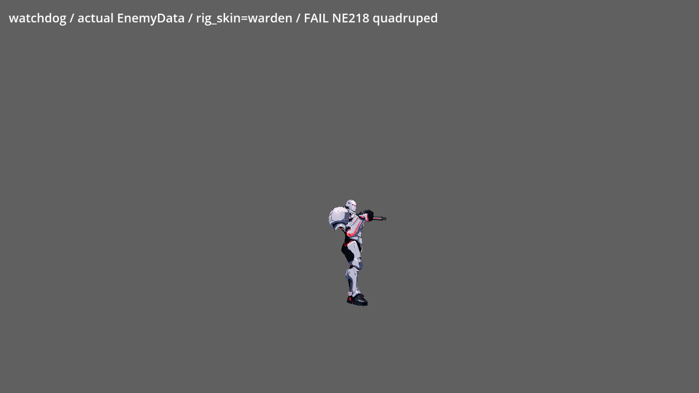

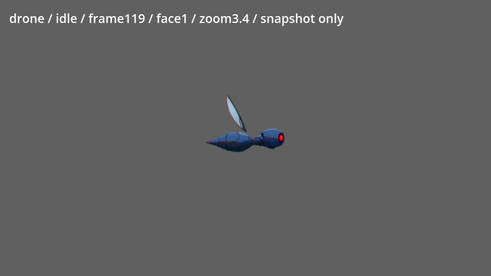

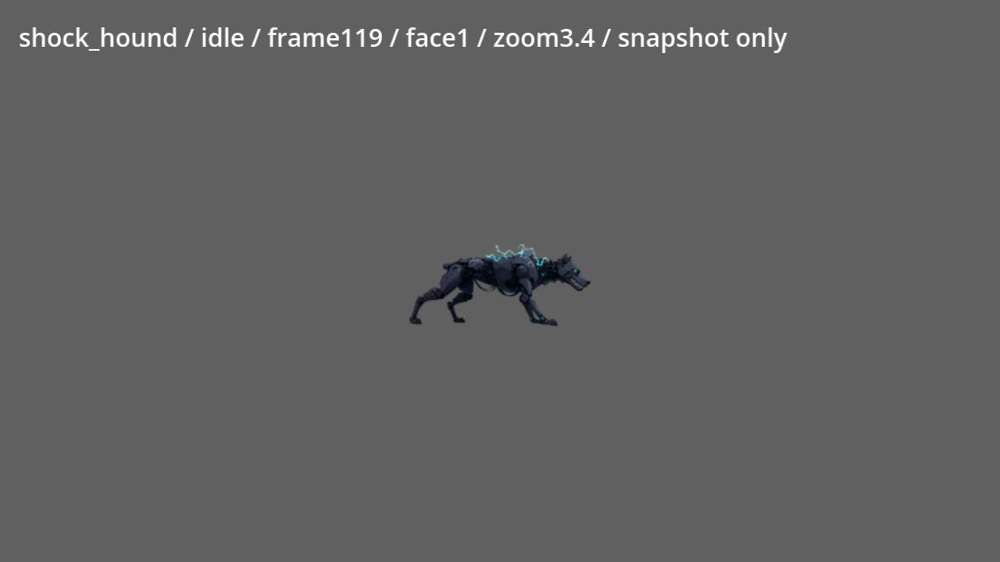

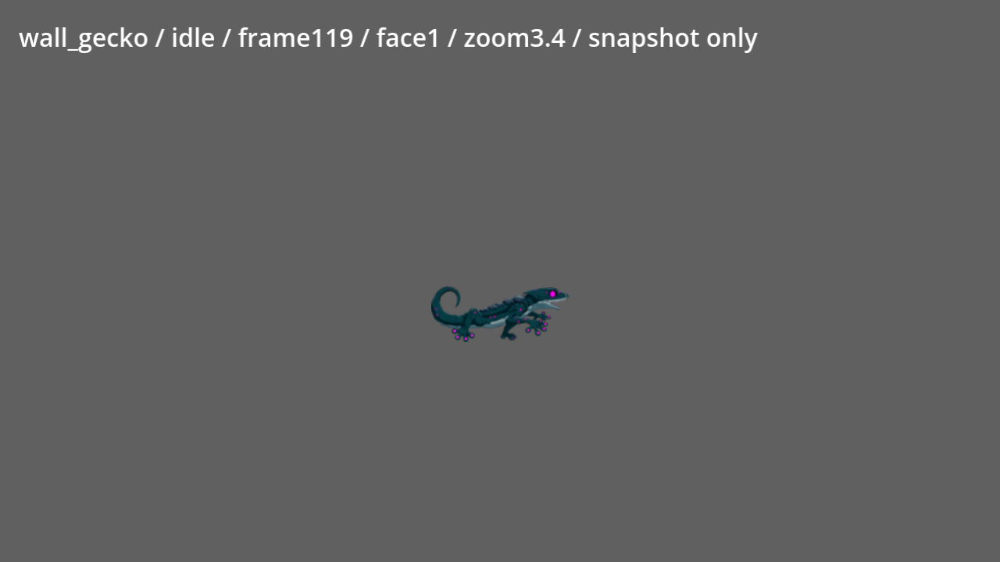

2,230張保存PNG的native尺寸／SHA／driver／capture base見[證據索引](attachments/NE-90-cloud-creatures/EVIDENCE-INDEX.md)、[完整原生PNG索引](attachments/NE-90-cloud-creatures/evidence-index.json)；各joint/state/frame/face/zoom的精確atlas位置見[逐格manifest](attachments/NE-90-cloud-creatures/frames.json)。全量全彩人工逐格、Worm專屬可信接點、actual腳掌輪廓接地、normal/glow實照、真輸入與完整CI仍未驗；Compatibility不推成Forward+HDR或實機perf通過，最後由root於NE224本地驗收。沒有勾視覺／全部角色驗收。

# Commit-5

## 內文

八種其餘人形敵人的完整外觀、左右走跑與持武器模式已在本機重新審查，保留十一組原生 Forward+ 畫面及來源比對。步態數字合格仍可看到精銳保全大腿缺圖、迷彩獵手前臂混入手與衣片、切割者漂手、保全膝旁碎片；五種持槍模式的握點偏離也已保留證據，分別由本票與 NE-222 繼續修復。完整報告：[人形敵人審查](attachments/NE-90-humanoid-subagent/REPORT.md)。

### 測試結果

| 項目 | 結果 |
|---|---|
| 覆蓋 | 8 種外觀、11 組敵人／武器模式，左右走跑 |
| 步態取樣 | 44 組、15,840 格；骨長、骨盆起伏與腳支點滑步通過 |
| 原生畫面 | 11 張 2240×1080；Godot 4.7.2、Intel Arc B580、Forward+ |
| 來源與零件資料檢查 | 8 組 0 errors／0 warnings；畫面仍有上述失敗 |
| 本次局部測試選集 | 文件與審查工具，無受影響套件；退出碼 0 |
| 審查工具實跑 | 來源盤點與兩個 Godot 審查流程退出碼 0，無腳本錯誤 |

### 截圖

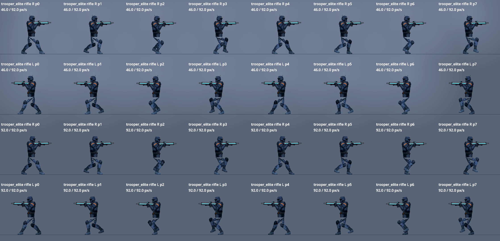

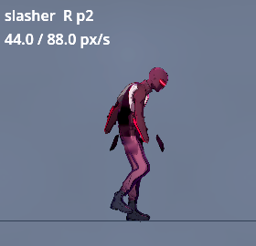

# Commit-6

## 內文

已在本機複驗十六種非人形模型與十八個掛載項目，補齊兩面向的原生 Forward+ 證據及正確倍率／速度的步態數值。監視蜂分離翼片、犬與壁虎缺少獨立四足、看門狗仍用人形替身都可重現；雲蛇左向另確認頭與身體的白腹方向不一致及頭身硬切口。來源資料沒有更新，原有失敗維持待修，資料與腳支點數字不代替完整外觀驗收。[完整複驗報告](attachments/NE-90-creature-subagent/REPORT.md)。

### 測試結果

| 項目 | 結果 |
|---|---|
| 來源對照 | 174 項來源／資源相同，0 變更 |
| 真實載入 | 38 個敵人資源、11 種分件模型共 30 部件；Godot 4.7.2 退出碼 0 |
| 原生畫面 | 34 張 1280×720，Intel Arc B580、Forward+；0 引用／尺寸／SHA 錯誤 |
| 腳支點取樣 | 48 組、5,760 格與 2 條 assertion 通過；材質接地維持未驗 |
| 本次受影響測試 | 僅文件／私有審查工具，選集為空，退出碼 0；既有雲端 686 checks 不算本次重跑 |

### 截圖

# Commit-7

## 內文

雲蛇兩面向的白腹已保持朝下，頭與身體之間的硬切口已接回原立繪的不透明頸段。轉彎時各段身體依自己的方向平順換面，頭跨過垂直方向也不會讓整條遠尾瞬間翻色；鱗片沿用完整原圖取樣，不會拉成橫條。保留二十節全長、原來源圖片與判定点。完整交付與反例見[雲蛇修復報告](attachments/NE-90-worm-repair/REPORT.md)。其他角色的四足、翼片和素材問題仍待修，本票維持進行中，整體驗收條件不代勾完成。

### 測試結果

| 項目 | 結果 |
|---|---|
| 受影響測試 | bca11c2f3 基準、SHARDS=2，23 群、34,802 checks，0 新失敗／0 已知失敗，319 秒 |
| 最新 main 局部複驗 | 4d3de9d8f 基準，ChainCreatureSuite、FloodPitSuite、EnvironmentSuite，SHARDS=2，6,282 checks，0 新失敗／0 已知失敗，29 秒 |
| 真缺陷／負控制 | 修前 219 checks／12 FAIL；全身跟頭翻面的真 Worm 反例 32 checks／2 FAIL，單幀 UV 跳動 37 像素 |
| 修後轉向 | 兩圈 480 格、32 checks 通過；最大可見 UV 變化 3.700001 像素／幀，包含 3 個頭尾相反方向樣本 |
| 定稿圖片 | 6 張來源／運行 PNG 與 2 張修前證據 PNG Git blob 未變 |
| 原生證據 | 97 張完整 1280×720：兩面向六 state、四張轉向截點與 81 張邊界逐幀；另有 7 張不縮放裁切表，Godot 4.7.2／Forward+／Intel Arc B580，exit 0 |

### 截圖

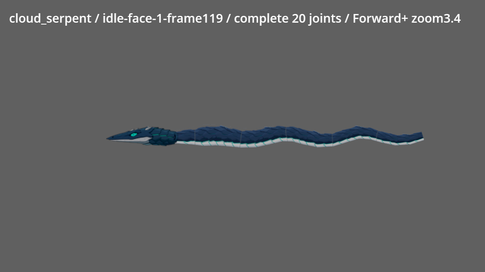

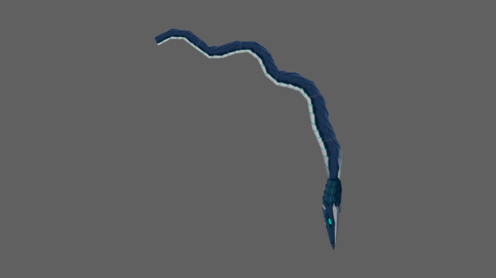

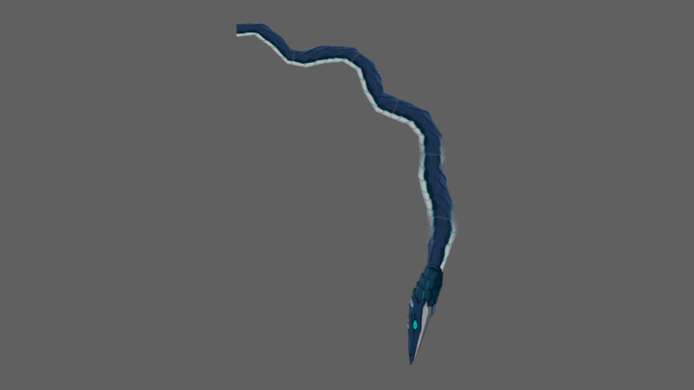

# Commit-8

## 內文

切割者的單脚貼圖原先混入另一隻靴子的輪廓，近側手也切成遠側手、掛在不相符的腕點。現在從既有原圖重新分割完整單靴與近側手，重新對齊手腕；修後跑姿的重複鞋尖已消失，手接回袖口。原始立繪保持不變，取用範圍內的顏色與透明度保持原像素，沒有重新生成角色。重建依據、部件支點／尺寸與核對結果見[可重跑修復證據](attachments/NE-90-slasher-repair/README.md)。

另盤點 1,295 張角色、非人形、頭像及製作來源 PNG，區分正式掛載與未驗收候選，保存每檔 alpha 分布、雜點及來源雜湊；見[透明背景盤點](attachments/NE-90-alpha-audit/alpha-audit-summary.md)。洋紅背景中有大量極低 alpha 像素，正確透明合成會消除背景，但半透明色邊仍需獨立驗收。生成流程已使用透明背景提示與原生 RGBA；提示詞不能保證每張輸出合格。使用者附件與現存來源尺寸不同，沒有據此捏造來源相同或過去批准。

本次只交付上述分件修復與盤點；切割者腰腿殘留輪廓及其他角色的完整姿勢仍在整體未勾選條件中，狀態維持進行中。

### 測試結果

| 項目 | 結果 |
|---|---|
| 受影響測試 | 固定基準 9f6438869、SHARDS=2，3,363 checks，0 新／已知失敗；選單含未註冊的 EnemyArtDeliverySuite，不宣稱該套件執行 |
| 追加動畫／敵人／姿勢／命中回歸 | 684 checks，0 新／已知失敗 |
| 分件及規格 | 規格 0 錯誤／警告、部件與法線檢查通過；法線重建、匯入 exit 0 |
| 隔離來源重建 | 兩次重跑 16 個輸出雜湊一致；正式兩張來源覆蓋及 12 張運行 diffuse 逐像素一致，來源雜湊／假透明／改色負控制通過 |
| 原生修前／修後 | Godot 4.7.2、Forward+、RTX 4070 SUPER，各 72 張 1536×1400 PNG；兩面向九狀態四個截點，各 2,160 格手腕有限值記錄，exit 0 無 SCRIPT ERROR |
| 透明背景盤點 | 1,295 張只讀 PNG，輸入雜湊前後一致；數據盤點不等同全部角色視覺通過 |
| 完整測試 | 依本次使用者指示由 CI 執行 |

### 截圖

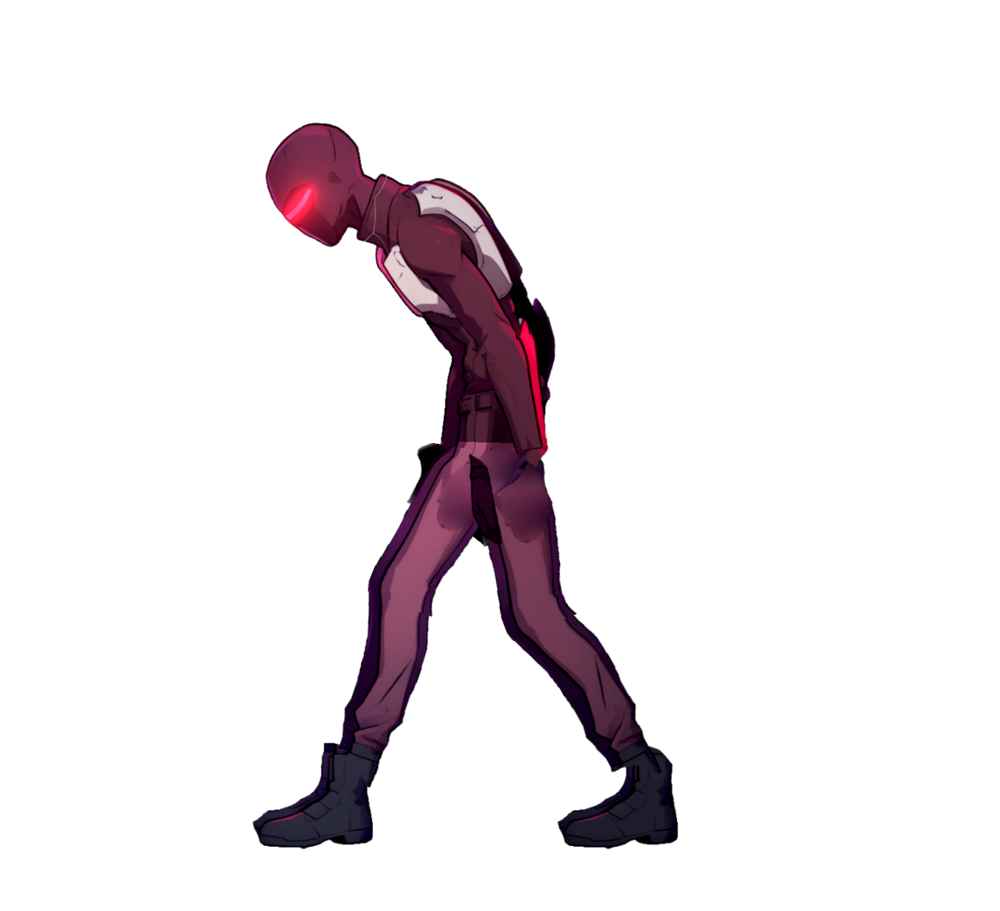

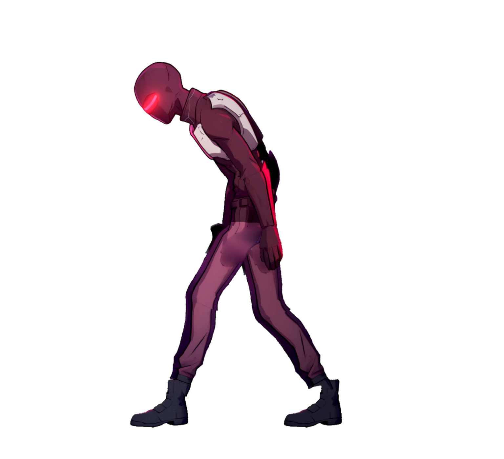

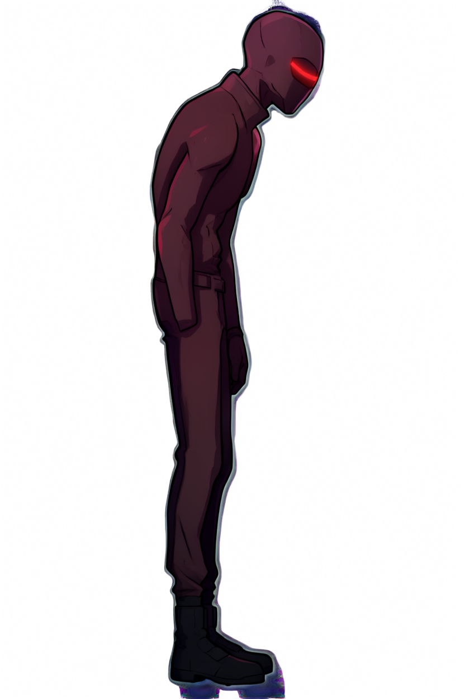
